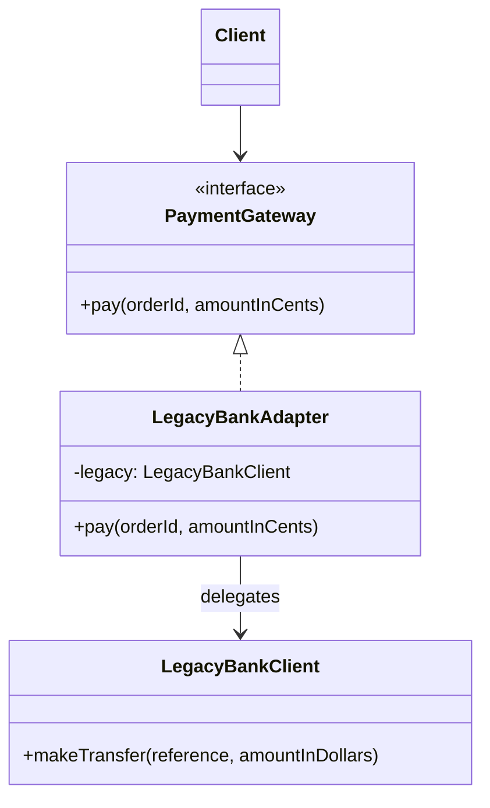

# What is Adapter pattern

---

## 🟢 Junior Level

The **Adapter** pattern is a **Structural** design pattern that converts the interface of an existing class into another interface that the client expects. It lets classes work together that could not otherwise because of incompatible interfaces. It is also known as the **Wrapper**.

### Real-World Analogy
A travel power plug adapter: your laptop charger has a European plug, but the hotel socket is British. You do not rewire the laptop or the wall. You put a small adapter between them that translates one shape into the other.

### Minimal Working Example

```java
// Target: what our application expects
public interface PaymentGateway {
    void pay(String orderId, long amountInCents);
}

// Adaptee: a legacy / third-party class we cannot (or should not) change
public class LegacyBankClient {
    public void makeTransfer(String reference, double amountInDollars) {
        System.out.println("Legacy transfer " + reference + " = $" + amountInDollars);
    }
}

// Adapter: translates Target calls into Adaptee calls
public class LegacyBankAdapter implements PaymentGateway {
    private final LegacyBankClient legacy;

    public LegacyBankAdapter(LegacyBankClient legacy) {
        this.legacy = legacy;
    }

    @Override
    public void pay(String orderId, long amountInCents) {
        legacy.makeTransfer(orderId, amountInCents / 100.0);
    }
}

public class Demo {
    public static void main(String[] args) {
        PaymentGateway gateway = new LegacyBankAdapter(new LegacyBankClient());
        gateway.pay("ORD-42", 1999);
    }
}
```

### Class Diagram



### When to Use
1. You want to reuse an existing class whose interface does not match what you need.
2. You integrate third-party SDKs and want to isolate them from your domain code.
3. You migrate from an old API to a new one gradually.

---

## 🟡 Middle Level

### Object Adapter vs Class Adapter

| Aspect | Object Adapter (composition) | Class Adapter (inheritance) |
|---|---|---|
| Mechanism | Holds the adaptee as a field | Extends the adaptee and implements target |
| Java support | Always possible | Only if target is an interface and adaptee is non-final |
| Flexibility | Can adapt adaptee subclasses, swap at runtime | Bound to one concrete adaptee |
| Recommended | ✅ Yes (composition over inheritance) | Rarely |

```java
// Class adapter: possible in Java only because PaymentGateway is an interface
public class LegacyBankClassAdapter extends LegacyBankClient implements PaymentGateway {
    @Override
    public void pay(String orderId, long amountInCents) {
        makeTransfer(orderId, amountInCents / 100.0);
    }
}
```

### Common Mistakes
- **Leaking the adaptee:** returning adaptee types from the adapter's methods defeats the purpose. Convert inputs and outputs to your own types.
- **Business logic in the adapter:** an adapter translates; it should not decide. Put rules in the domain.
- **Swallowing exceptions:** translate vendor exceptions into your own (anti-corruption), but keep the cause.
- **Two-way confusion:** an adapter usually adapts in one direction. Two-way adapters are a design smell.

### JDK Examples
- `java.util.Arrays.asList(T...)` adapts an array to a `List`.
- `java.io.InputStreamReader` adapts a byte `InputStream` to a character `Reader`.
- `java.util.Collections.enumeration(Collection)` adapts a `Collection` to an `Enumeration`.
- `java.util.concurrent.Executors.callable(Runnable)` adapts `Runnable` to `Callable`.

```java
import java.io.*;
import java.nio.charset.StandardCharsets;

public class JdkAdapterDemo {
    public static void main(String[] args) throws IOException {
        InputStream bytes = new ByteArrayInputStream("hello".getBytes(StandardCharsets.UTF_8));
        // InputStreamReader adapts InputStream (bytes) to Reader (chars)
        try (Reader chars = new InputStreamReader(bytes, StandardCharsets.UTF_8)) {
            System.out.println((char) chars.read());
        }
    }
}
```

### Spring Examples
- `HandlerAdapter` (`RequestMappingHandlerAdapter`, `HttpRequestHandlerAdapter`) lets `DispatcherServlet` invoke very different handler types uniformly.
- `MessageListenerAdapter` adapts any POJO to a JMS `MessageListener`.
- `HttpMessageConverter` adapts HTTP bodies to Java objects.
- `JpaVendorAdapter` hides Hibernate/EclipseLink specifics from `LocalContainerEntityManagerFactoryBean`.

### Refactoring Example: Anti-Corruption Layer for a Vendor SDK

```java
// Before: SDK types spread through the codebase
// vendorClient.send(new VendorSmsRequest(phone, text, VendorPriority.HIGH));

// After: our own port + adapter
public interface SmsSender {
    void send(String phone, String text);
}

public class VendorSmsAdapter implements SmsSender {
    private final VendorSmsClient client;

    public VendorSmsAdapter(VendorSmsClient client) { this.client = client; }

    @Override
    public void send(String phone, String text) {
        try {
            client.send(new VendorSmsRequest(phone, text, VendorPriority.HIGH));
        } catch (VendorException e) {
            throw new SmsDeliveryException("SMS delivery failed for " + phone, e);
        }
    }
}
```

In Spring register the adapter as a `@Component` implementing the port. Swapping vendors becomes a one-class change, and tests use a trivial fake `SmsSender`.

---

## 🔴 Senior Level

### Adapter in Hexagonal Architecture
In **Ports and Adapters** (hexagonal) architecture, the domain defines *ports* (interfaces) and the infrastructure supplies *adapters*: a `JpaOrderRepositoryAdapter`, a `KafkaEventPublisherAdapter`, a `RestPaymentAdapter`. Inbound adapters (REST controllers, schedulers) translate external stimuli into use-case calls. The dependency rule says adapters depend on the domain, never the reverse. This is the Adapter pattern applied at the architecture level.

### Performance and JVM Implications
- An adapter adds one extra indirection. With one or two implementations the JIT inlines it fully; the cost is effectively zero.
- Adapters that **copy** data (e.g., `double` to `BigDecimal`, array to list) allocate. In hot paths prefer **views** over copies: `Arrays.asList` is a fixed-size view backed by the array, not a copy, whereas `List.copyOf` allocates.
- Boxing in adapters (`int` to `Integer`) can silently dominate allocation profiles in tight loops.

### Concurrency
- An adapter is only as thread-safe as its adaptee. Wrapping a non-thread-safe legacy class (e.g., `SimpleDateFormat`) behind a clean interface does not make it safe. Either synchronize inside the adapter, confine to a thread (`ThreadLocal`), or create instances per call.
- A view adapter shares mutable state with the original: modifying the array after `Arrays.asList(arr)` changes the list.

```java
import java.text.SimpleDateFormat;
import java.util.Date;

// Adapter making a legacy non-thread-safe formatter safe for concurrent use
public class SafeDateFormatter {
    private static final ThreadLocal<SimpleDateFormat> FORMAT =
        ThreadLocal.withInitial(() -> new SimpleDateFormat("yyyy-MM-dd"));

    public String format(Date date) {
        return FORMAT.get().format(date);
    }
}
```
(With virtual threads prefer `java.time.format.DateTimeFormatter`, which is immutable and needs no adapter.)

### Production Scenarios
- **Strangler-fig migration:** adapters let new code talk to the legacy system through the new interface while the legacy is gradually replaced.
- **Multi-vendor support:** one `PaymentGateway` port with `StripeAdapter`, `AdyenAdapter` selected by a strategy registry (see [When to use Strategy](10.%20When%20to%20use%20Strategy.md)).
- **Version adapters for APIs:** an adapter converts `v1` DTOs to the current internal model so only one domain model is maintained.

### Edge Cases
- **Lossy conversion:** `double` dollars to cents loses precision. Use `BigDecimal` or integer cents in the adapter contract.
- **Semantic mismatch:** adapting a synchronous API to an asynchronous one (or blocking to reactive) is not just a signature change. Hiding latency or failure modes behind a method call can mislead callers. Document timeouts and pair with resilience (see [Circuit Breaker Retry and Bulkhead resilience patterns](38.%20Circuit%20Breaker%20Retry%20and%20Bulkhead%20resilience%20patterns.md)).
- **Default methods and records:** a functional interface with a lambda is often the lightest adapter: `Callable<Void> c = () -> { runnable.run(); return null; };`.

### When NOT to Use
- When you own both sides: just change the interface.
- When the adapter only renames one method: a method reference or lambda is enough.
- When the mismatch is semantic and large: you need a **Facade** or an anti-corruption layer with real translation logic.

### Comparison

| Pattern | Intent | Changes interface? |
|---|---|---|
| Adapter | Make an existing interface fit another | Yes |
| Decorator | Add behavior, same interface | No |
| Proxy | Control access, same interface | No |
| Facade | Simplify a subsystem | Provides a new simpler one |

---

## 🎯 Interview Cheat Sheet

### 30-Second Elevator Pitch
> "The **Adapter** wraps an incompatible class and exposes the interface the client expects, translating calls and data between them. I prefer the object adapter using composition. I use it to isolate third-party SDKs and legacy systems behind my own port, as in hexagonal architecture. The JDK has `InputStreamReader` and `Arrays.asList`; Spring has `HandlerAdapter` and `MessageListenerAdapter`."

### Must-Know Bullets
- Structural pattern; also called Wrapper.
- Object adapter (composition) over class adapter (inheritance).
- Translate types and exceptions; do not leak the adaptee.
- Adapter changes interface; Decorator and Proxy keep it.
- Thread-safety is inherited from the adaptee.

### Common Follow-Up Questions
1. **Adapter vs Facade?** Adapter makes one interface fit another; Facade offers a simplified entry to a whole subsystem.
2. **Adapter vs Decorator?** Decorator keeps the interface and adds behavior; Adapter changes it.
3. **Is `Arrays.asList` a copy?** No, it is a fixed-size view over the array.
4. **Where does Spring MVC use Adapter?** `HandlerAdapter` in `DispatcherServlet`.

### Red Flags
- 🚩 Business rules inside the adapter.
- 🚩 Adaptee types in the adapter's public signature.
- 🚩 Pretending an async/remote call is a cheap local one.
- 🚩 Creating an adapter when you can change the code you own.

### Related Topics
- [What is Facade pattern](18.%20What%20is%20Facade%20pattern.md) — simplifying subsystems rather than converting interfaces
- [Advantage of Decorator over inheritance](12.%20Advantage%20of%20Decorator%20over%20inheritance.md) — wrapping without changing the interface
- [What Proxy types exist](14.%20What%20Proxy%20types%20exist.md) — wrapping to control access
- [Patterns used inside the JDK and Spring](40.%20Patterns%20used%20inside%20the%20JDK%20and%20Spring.md) — adapters across frameworks
- [What pattern categories exist](02.%20What%20pattern%20categories%20exist.md) — Structural patterns overview
