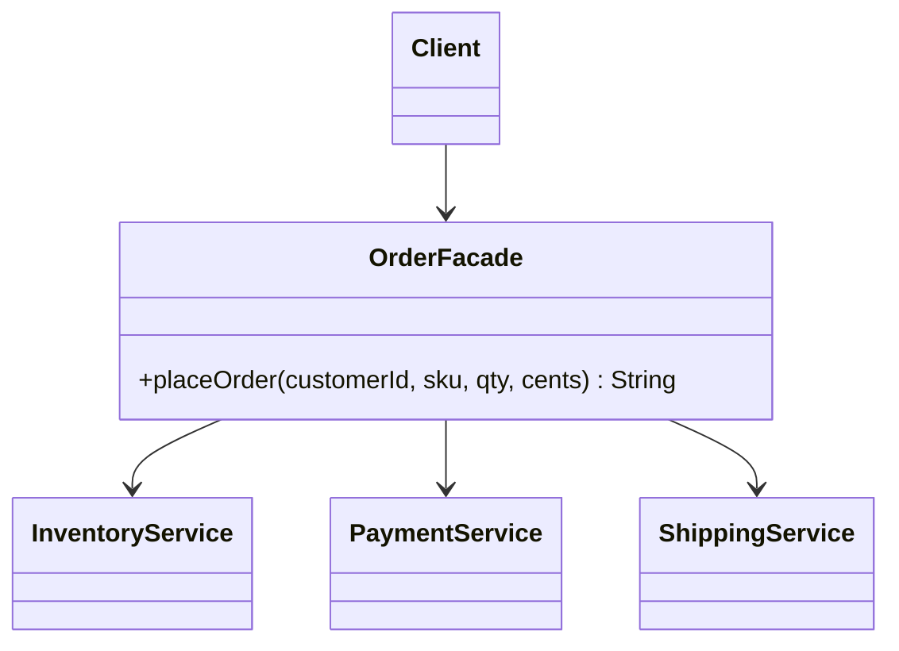

# What is Facade pattern

---

## 🟢 Junior Level

The **Facade** pattern is a **Structural** design pattern that provides a single, simplified interface to a complex subsystem of classes. Clients talk to the facade and do not need to know the many collaborating classes behind it.

### Real-World Analogy
A hotel concierge. You say "I need a table for two tonight and a taxi at 8". The concierge calls the restaurant, the taxi company and the theatre. You never learn their phone numbers or booking rules.

### Minimal Working Example

```java
// Complex subsystem classes
class InventoryService {
    boolean reserve(String sku, int qty) {
        System.out.println("Reserved " + qty + " x " + sku);
        return true;
    }
}

class PaymentService {
    boolean charge(String customerId, long cents) {
        System.out.println("Charged " + cents + " cents to " + customerId);
        return true;
    }
}

class ShippingService {
    String schedule(String customerId, String sku) {
        System.out.println("Shipping scheduled for " + customerId);
        return "TRACK-123";
    }
}

// Facade
public class OrderFacade {
    private final InventoryService inventory = new InventoryService();
    private final PaymentService payment = new PaymentService();
    private final ShippingService shipping = new ShippingService();

    public String placeOrder(String customerId, String sku, int qty, long cents) {
        if (!inventory.reserve(sku, qty)) {
            throw new IllegalStateException("Out of stock");
        }
        if (!payment.charge(customerId, cents)) {
            throw new IllegalStateException("Payment failed");
        }
        return shipping.schedule(customerId, sku);
    }
}
```

The client now calls a single method: `new OrderFacade().placeOrder("c1", "SKU-1", 2, 4999)`.

### Class Diagram



### When to Use
1. A subsystem is complicated and most clients need only a simple common use case.
2. You want to layer a system: each layer exposes a facade.
3. You want to decouple clients from subsystem internals so they can evolve.

---

## 🟡 Middle Level

### Facade Does Not Hide the Subsystem
A facade is a **convenience**, not a wall. Advanced clients may still use subsystem classes directly. If you forbid direct access you are creating an encapsulation boundary (a module API), which is a stronger concept.

### Common Mistakes
- **God facade:** one `SystemFacade` with 80 methods. Split per use-case or bounded context.
- **Business logic in the facade:** it should orchestrate, not own domain rules. Otherwise it becomes an anemic-model service (see [What anti-patterns do you know](16.%20What%20anti-patterns%20do%20you%20know.md)).
- **Hard-coded dependencies:** `new` inside the facade makes it untestable. Inject collaborators.
- **Hidden transaction boundaries:** a facade that calls several services should define the transaction clearly.

### Spring Version

```java
import org.springframework.stereotype.Service;
import org.springframework.transaction.annotation.Transactional;

@Service
public class CheckoutFacade {
    private final InventoryClient inventory;
    private final PaymentClient payment;
    private final ShippingClient shipping;

    public CheckoutFacade(InventoryClient inventory,
                          PaymentClient payment,
                          ShippingClient shipping) {
        this.inventory = inventory;
        this.payment = payment;
        this.shipping = shipping;
    }

    @Transactional
    public CheckoutResult checkout(CheckoutCommand cmd) {
        inventory.reserve(cmd.sku(), cmd.quantity());
        payment.charge(cmd.customerId(), cmd.totalCents());
        String tracking = shipping.schedule(cmd.customerId(), cmd.sku());
        return new CheckoutResult(tracking);
    }
}

public record CheckoutCommand(String customerId, String sku, int quantity, long totalCents) {}
public record CheckoutResult(String trackingNumber) {}
```

Interfaces `InventoryClient`, `PaymentClient` and `ShippingClient` are assumed to be simple application interfaces. The controller then depends on one bean instead of three.

### Facade in the JDK and Libraries
- `javax.faces.context.FacesContext` aggregates many JSF subsystems.
- `java.net.URL#openStream()` hides `URLConnection`, protocol handlers and streams.
- `java.sql.DriverManager.getConnection(...)` hides driver lookup and handshake.
- SLF4J is a facade over Logback, Log4j2 and JUL.
- Spring `JdbcTemplate` and `RestClient` are facades over low-level JDBC and HTTP.
- `Files.readString(Path)` hides channels, charsets and buffers.

### Refactoring Example
Before: a controller that orchestrates five services, duplicating the flow in three controllers.

```java
// ❌ Duplicated orchestration in each controller
@PostMapping("/orders")
public ResponseEntity<?> create(@RequestBody OrderDto dto) {
    inventory.reserve(dto.sku(), dto.qty());
    payment.charge(dto.customer(), dto.total());
    String t = shipping.schedule(dto.customer(), dto.sku());
    notifier.send(dto.customer(), "Order placed " + t);
    return ResponseEntity.ok(t);
}
```

After: extract the flow into a facade (`OrderApplicationService`), keep the controller as a thin HTTP adapter. The flow is now reused by REST, messaging and batch entry points.

---

## 🔴 Senior Level

### Facade vs Application Service vs API Gateway
- **Facade (GoF):** code-level simplification of a subsystem.
- **Application/Service layer:** use-case orchestration at architecture level; often a facade in disguise (see [Service Layer and Transaction Script vs Domain Model](34.%20Service%20Layer%20and%20Transaction%20Script%20vs%20Domain%20Model.md)).
- **API Gateway / BFF:** a facade over many microservices at the network level, which introduces latency, partial failure and versioning concerns that an in-process facade does not have.

### Remote Facades and Granularity
Martin Fowler's **Remote Facade** is a coarse-grained interface over fine-grained objects to cut network round trips. In microservices, an aggregating facade must handle:
- **Parallel calls:** use `CompletableFuture` or structured concurrency rather than serial calls.
- **Partial failure:** decide between fail-all, degrade or fallback.
- **Timeouts and bulkheads:** see [Circuit Breaker Retry and Bulkhead resilience patterns](38.%20Circuit%20Breaker%20Retry%20and%20Bulkhead%20resilience%20patterns.md).

```java
import java.util.concurrent.CompletableFuture;

public class ProductPageFacade {
    private final CatalogClient catalog;
    private final PriceClient prices;
    private final ReviewClient reviews;

    public ProductPageFacade(CatalogClient c, PriceClient p, ReviewClient r) {
        this.catalog = c; this.prices = p; this.reviews = r;
    }

    public ProductPage load(String id) {
        var info = CompletableFuture.supplyAsync(() -> catalog.find(id));
        var price = CompletableFuture.supplyAsync(() -> prices.priceOf(id));
        var revs = CompletableFuture.supplyAsync(() -> reviews.top(id))
                .exceptionally(ex -> java.util.List.of()); // degrade gracefully
        return new ProductPage(info.join(), price.join(), revs.join());
    }
}

record ProductPage(String info, long price, java.util.List<String> reviews) {}
interface CatalogClient { String find(String id); }
interface PriceClient { long priceOf(String id); }
interface ReviewClient { java.util.List<String> top(String id); }
```

### Performance and Concurrency
- A facade adds negligible call overhead in-process; the real cost is what it orchestrates.
- Serial orchestration makes latency the **sum** of calls; parallel makes it the **max**. Using the common ForkJoin pool for blocking I/O starves it; use a dedicated executor or virtual threads (Java 21).
- Stateless facades are singleton-safe. Keep per-request data in method parameters, never fields.
- A facade spanning several resources needs a clear consistency story: a local `@Transactional` does not cover remote calls; use a saga or outbox.

### Production Scenarios
- **Legacy wrapping:** a facade over a 20-class legacy billing module so new services call `BillingFacade.invoice(...)`.
- **Library boundary:** a module exposes a facade as its only public package; the rest is package-private (or not exported in `module-info.java`).
- **Testing:** mock the facade in controller tests; test the facade with fakes of its collaborators.

### Edge Cases
- **Leaky abstraction:** exceptions from the subsystem propagate; translate them to the facade's own exception types.
- **Evolution:** adding parameters to a facade breaks all callers. Use command/record objects so new optional fields do not break signatures.
- **Hidden cost:** a convenient method may call 12 services. Document cost and timeouts.

### When NOT to Use
- When the subsystem is already simple (a facade over one class is noise).
- When clients need fine-grained control: a facade then forces them around it.
- When it becomes a dumping ground: a facade that grows logic is a **God Object**.

---

## 🎯 Interview Cheat Sheet

### 30-Second Elevator Pitch
> "A **Facade** gives clients one simple interface to a complex subsystem. It orchestrates collaborators but does not own business rules and does not forbid direct use of the subsystem. In Spring, a `@Service` that coordinates several components is a facade; SLF4J and `JdbcTemplate` are classic library facades. At microservice level the same idea appears as an API gateway or BFF, where timeouts, parallelism and partial failure matter."

### Must-Know Bullets
- Structural; simplifies, does not change behavior.
- Orchestrates; business rules belong in the domain.
- Inject collaborators; keep stateless.
- Split per use-case to avoid a god facade.
- Remote facades need timeouts, parallelism and fallbacks.

### Common Follow-Up Questions
1. **Facade vs Adapter?** Facade simplifies many classes; Adapter converts one interface to another.
2. **Facade vs Mediator?** Facade is one-directional (client to subsystem); Mediator coordinates peers who talk to each other.
3. **Is a Spring `@Service` a facade?** Often, when it orchestrates multiple components.
4. **Is SLF4J a facade?** Yes, over logging frameworks.

### Red Flags
- 🚩 God facade with dozens of unrelated methods.
- 🚩 Domain logic inside the facade.
- 🚩 Subsystem exceptions leaking out.
- 🚩 Serial remote calls where parallel would work.

### Related Topics
- [What is Adapter pattern](17.%20What%20is%20Adapter%20pattern.md) — interface conversion rather than simplification
- [What is Mediator pattern](25.%20What%20is%20Mediator%20pattern.md) — peer coordination
- [Service Layer and Transaction Script vs Domain Model](34.%20Service%20Layer%20and%20Transaction%20Script%20vs%20Domain%20Model.md) — facades at architecture level
- [What anti-patterns do you know](16.%20What%20anti-patterns%20do%20you%20know.md) — God Object risk
- [What pattern categories exist](02.%20What%20pattern%20categories%20exist.md) — Structural overview
