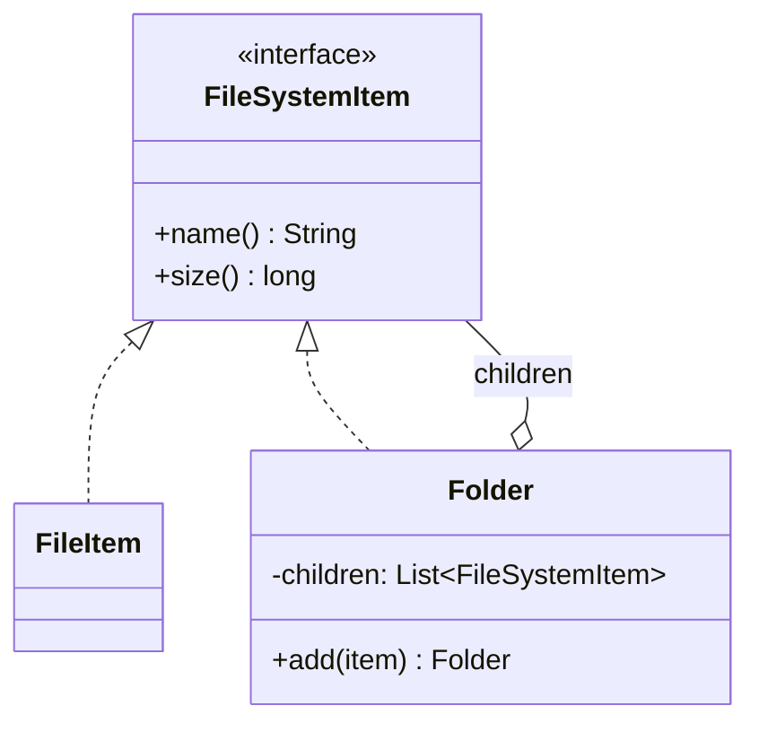

# What is Composite pattern

---

## 🟢 Junior Level

The **Composite** pattern is a **Structural** design pattern that lets you compose objects into tree structures and treat individual objects (leaves) and compositions (nodes) **uniformly** through a common interface.

### Real-World Analogy
A company's org chart or a file system. A folder contains files and other folders. Asking "how big are you?" works the same for a file and for a folder: the folder adds up its children.

### Minimal Working Example

```java
import java.util.ArrayList;
import java.util.List;

// Component
public interface FileSystemItem {
    String name();
    long size();
}

// Leaf
public class FileItem implements FileSystemItem {
    private final String name;
    private final long size;

    public FileItem(String name, long size) {
        this.name = name;
        this.size = size;
    }

    @Override public String name() { return name; }
    @Override public long size() { return size; }
}

// Composite
public class Folder implements FileSystemItem {
    private final String name;
    private final List<FileSystemItem> children = new ArrayList<>();

    public Folder(String name) { this.name = name; }

    public Folder add(FileSystemItem item) {
        children.add(item);
        return this;
    }

    @Override public String name() { return name; }

    @Override
    public long size() {
        return children.stream().mapToLong(FileSystemItem::size).sum();
    }
}

public class Demo {
    public static void main(String[] args) {
        Folder root = new Folder("root")
            .add(new FileItem("a.txt", 100))
            .add(new Folder("docs").add(new FileItem("b.pdf", 900)));
        System.out.println(root.size()); // 1000
    }
}
```

### Class Diagram



### When to Use
1. Data is naturally a tree: menus, org charts, UI widgets, expression trees, categories.
2. Clients should ignore the difference between a single object and a group.

---

## 🟡 Middle Level

### Transparency vs Safety
There are two design choices for child-management methods (`add`, `remove`):

| Variant | Where `add()` lives | Pros | Cons |
|---|---|---|---|
| **Transparent** | In the `Component` interface | Uniform treatment | Leaves must throw `UnsupportedOperationException` |
| **Safe** | Only in `Composite` | Type-safe | Client must know the concrete type to add |

Modern Java prefers the **safe** variant, or an immutable composite built once via constructor or builder.

### Sealed Types and Records (Java 17+)

```java
public sealed interface Node permits Leaf, Branch {}
public record Leaf(String name, long size) implements Node {}
public record Branch(String name, java.util.List<Node> children) implements Node {
    public Branch { children = java.util.List.copyOf(children); }
}

public final class Sizes {
    public static long total(Node node) {
        return switch (node) {
            case Leaf l -> l.size();
            case Branch b -> b.children().stream().mapToLong(Sizes::total).sum();
        };
    }
}
```
The compiler checks exhaustiveness. The trade-off: adding an operation is easy (new function), adding a node type forces edits to all `switch` statements, which mirrors the Visitor trade-off (see [What is Visitor pattern](27.%20What%20is%20Visitor%20pattern.md)).

### Common Mistakes
- **Cycles:** adding a folder to itself creates infinite recursion in `size()`. Validate or build immutably.
- **Parent pointers out of sync:** if children know their parent, `add` and `remove` must update both sides.
- **Recursion depth:** very deep trees can cause `StackOverflowError`; use an explicit stack for traversal.
- **Exposing the internal list:** return `List.copyOf` or unmodifiable views.
- **Overly general component interface:** if leaves and composites have little in common, composite is the wrong tool.

### JDK and Spring Examples
- `java.awt.Container` extends `Component`; Swing/AWT is the textbook example.
- `javax.swing.JComponent` trees, JavaFX `Node` and `Parent`.
- `org.w3c.dom.Node` (DOM trees).
- Spring Security's `CompositeFilter`, `DelegatingPasswordEncoder`; Spring's `CompositeCacheManager`, `CompositePropertySources`; `HandlerExceptionResolverComposite`.
- `java.nio.file.Path` forms hierarchical structures, though not literally Composite.

### Refactoring Example: Replace Type Checks with Composite
Before:

```java
// ❌ Caller must know what it has
long total(Object o) {
    if (o instanceof FileItem f) return f.size();
    long sum = 0;
    for (Object c : ((Folder) o).children()) sum += total(c);
    return sum;
}
```
After: `item.size()` on the common interface; each class knows how to compute its own size.

### Composite in Spring: Collecting Strategies

```java
import org.springframework.context.annotation.Primary;
import org.springframework.stereotype.Component;
import java.util.List;

public interface Validator2 { List<String> validate(String input); }

@Component
@Primary
class CompositeValidator implements Validator2 {
    private final List<Validator2> delegates;

    // Spring injects every other Validator2 bean; @Primary one is excluded from its own list
    CompositeValidator(List<Validator2> delegates) {
        this.delegates = delegates;
    }

    @Override
    public List<String> validate(String input) {
        return delegates.stream().flatMap(v -> v.validate(input).stream()).toList();
    }
}
```
Note: when a bean injects `List<Validator2>` into itself, Spring excludes the bean itself from the collection, so this is safe.

---

## 🔴 Senior Level

### Performance Considerations
- Recursive aggregation is O(n) per call. If `size()` is queried often and the tree changes rarely, **cache** the result and invalidate upward through parent links, or compute lazily with a version counter.
- Tree nodes are many small objects: poor locality, GC pressure. For millions of nodes consider arrays-of-structures (`int[] parent`, `long[] size`) or a nested-set / materialized-path model in the database.
- Use `Stream` carefully: deep recursion with streams consumes more stack frames per level than plain loops.

### Concurrency
- A mutable composite is not thread-safe: concurrent `add` during traversal throws `ConcurrentModificationException` or yields inconsistent aggregates.
- Options: immutable (persistent) trees with copy-on-write of the path to the root; `CopyOnWriteArrayList` for read-mostly children; or a `ReadWriteLock` at the root. Immutable composites are the safest for sharing across threads.

```java
import java.util.concurrent.CopyOnWriteArrayList;
import java.util.List;

public class ConcurrentMenu {
    private final String label;
    private final List<ConcurrentMenu> items = new CopyOnWriteArrayList<>();

    public ConcurrentMenu(String label) { this.label = label; }

    public void add(ConcurrentMenu m) { items.add(m); }

    public int count() {
        int total = 1;
        for (ConcurrentMenu m : items) total += m.count(); // snapshot iteration, no CME
        return total;
    }
}
```

### Persistence of Trees
JPA self-referencing entities (`@ManyToOne parent`, `@OneToMany children`) lead to **N+1** problems when traversed lazily. Mitigations: recursive CTE queries (`WITH RECURSIVE`), materialized path (`/1/4/9/`), closure table, or loading the whole subtree in one query and assembling it in memory.

### Production Scenarios
- **Permission trees / role hierarchies:** a composite `Permission` where a group grants all children.
- **Rule engines / validators:** `AllOf`, `AnyOf`, `Not` composites of `Predicate`s (see [Specification pattern](36.%20Specification%20pattern.md)). `Predicate.and/or/negate` compose predicates this way.
- **Pricing bundles:** a `Bundle` containing products and other bundles computes price recursively with discount rules.
- **UI rendering:** component trees such as React-like trees or Vaadin/JavaFX.

### Edge Cases
- **Equality and hashing:** define whether two folders are equal by identity or by contents; mutable keys in hash collections are a classic bug.
- **Serialization:** Jackson needs polymorphic type info (`@JsonTypeInfo`/`@JsonSubTypes`) to deserialize `Node` trees; sealed hierarchies still require this annotation.
- **Operations that don't make sense for leaves:** `add` on a leaf; prefer the safe variant.

### When NOT to Use
- Flat collections: a `List` is enough.
- When leaves and composites behave very differently: forced uniformity produces `UnsupportedOperationException` noise.
- When the tree is huge and hot: a data-oriented layout may be preferable.

---

## 🎯 Interview Cheat Sheet

### 30-Second Elevator Pitch
> "**Composite** models part-whole hierarchies as a tree where leaves and containers share one interface, so client code treats a single object and a whole group uniformly. Typical examples are file systems, UI widget trees and expression trees; in Java, `Predicate.and/or` and Spring's `Composite*` classes follow it. In modern Java I model it with sealed interfaces and records, and watch for cycles, thread-safety and N+1 loads when persisting trees."

### Must-Know Bullets
- Leaf + Composite implement the same Component interface.
- Safe vs transparent variants of child management.
- Recursion; beware cycles and stack depth.
- Mutable trees are not thread-safe; prefer immutable.
- Often combined with Visitor, Iterator and Decorator.

### Common Follow-Up Questions
1. **Composite vs Decorator?** Both are recursive compositions; Decorator wraps one component to add behavior, Composite aggregates many to represent a group.
2. **How do you traverse a Composite?** Recursion, Iterator or Visitor.
3. **How to store a tree in SQL?** Adjacency list with recursive CTE, materialized path, nested sets, closure table.
4. **Where in the JDK?** AWT `Container`, DOM `Node`.

### Red Flags
- 🚩 `instanceof` chains instead of polymorphism.
- 🚩 Leaves throwing `UnsupportedOperationException` for most methods.
- 🚩 Unprotected cycles.
- 🚩 Lazy-loaded JPA trees traversed in loops.

### Related Topics
- [What is Visitor pattern](27.%20What%20is%20Visitor%20pattern.md) — operations over composite structures
- [What is Iterator pattern](15.%20What%20is%20Iterator%20pattern.md) — traversing composites
- [Advantage of Decorator over inheritance](12.%20Advantage%20of%20Decorator%20over%20inheritance.md) — similar recursive structure, different intent
- [What is Interpreter pattern](28.%20What%20is%20Interpreter%20pattern.md) — expression trees are composites
- [Specification pattern](36.%20Specification%20pattern.md) — composite predicates
