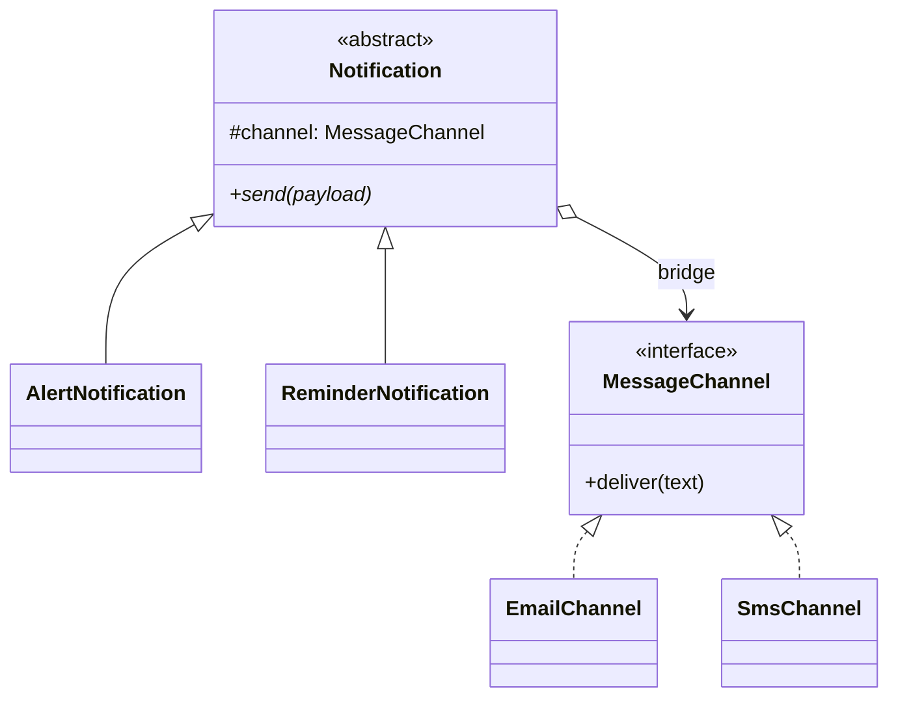

# What is Bridge pattern

---

## 🟢 Junior Level

The **Bridge** pattern is a **Structural** design pattern that **decouples an abstraction from its implementation** so the two can vary independently. Instead of one inheritance hierarchy that multiplies (shape x color, notification x channel), you have two hierarchies connected by composition.

### Real-World Analogy
A TV remote and a TV. Remotes (basic, advanced) are the abstraction; TVs (Sony, Samsung) are implementations. Any remote works with any TV through a standard infrared protocol. You do not need `AdvancedSonyRemote`, `BasicSamsungRemote` and so on.

### Minimal Working Example

```java
// Implementor
public interface MessageChannel {
    void deliver(String text);
}

public class EmailChannel implements MessageChannel {
    @Override public void deliver(String text) { System.out.println("EMAIL: " + text); }
}

public class SmsChannel implements MessageChannel {
    @Override public void deliver(String text) { System.out.println("SMS: " + text); }
}

// Abstraction
public abstract class Notification {
    protected final MessageChannel channel;

    protected Notification(MessageChannel channel) {
        this.channel = channel;
    }

    public abstract void send(String payload);
}

// Refined abstractions
public class AlertNotification extends Notification {
    public AlertNotification(MessageChannel channel) { super(channel); }

    @Override
    public void send(String payload) {
        channel.deliver("[ALERT] " + payload.toUpperCase());
    }
}

public class ReminderNotification extends Notification {
    public ReminderNotification(MessageChannel channel) { super(channel); }

    @Override
    public void send(String payload) {
        channel.deliver("Reminder: " + payload);
    }
}

public class Demo {
    public static void main(String[] args) {
        new AlertNotification(new SmsChannel()).send("server down");
        new ReminderNotification(new EmailChannel()).send("meeting at 10");
    }
}
```
With 2 abstractions and 2 channels you have 4 combinations but only 4 classes (2 + 2), and adding a Push channel adds 1 class instead of 2.

### Class Diagram



### When to Use
1. Two independent dimensions of variation (what it is x how it is done).
2. You want to switch implementations at runtime.
3. You want to avoid a Cartesian explosion of subclasses.

---

## 🟡 Middle Level

### Bridge vs Strategy vs Adapter
They look similar in code (an object holds a reference to an interface), but intent differs:

| Pattern | Intent | Designed when |
|---|---|---|
| **Bridge** | Separate abstraction and implementation hierarchies up front | At design time, to keep two hierarchies independent |
| **Strategy** | Swap one algorithm | Behavior selection at runtime, usually one hierarchy |
| **Adapter** | Make incompatible interfaces work | After the fact, when classes already exist |

Bridge is "designed in"; Adapter is "retrofitted".

### The Classic Java Example: JDBC
`java.sql.Connection`, `Statement` and `ResultSet` are the abstraction side (stable API); each vendor's driver is the implementation. `DriverManager` links them. Application code does not change when you swap PostgreSQL for MySQL (except SQL dialect differences).

Other examples: SLF4J API + bindings, `java.awt` with peer classes, JPA API with Hibernate provider, `javax.crypto.Cipher` with providers (JCA).

### Common Mistakes
- **Using Bridge for a single dimension:** if only one thing varies, use Strategy or plain polymorphism.
- **Anemic implementor interface:** an implementor with `doStep1(); doStep2(); doStep3()` leaks the abstraction's algorithm. Make the implementor interface expose primitive operations, and let the abstraction compose them.
- **Inheritance of the implementor from the abstraction:** defeats the point.
- **Hard-coding the implementor in the abstraction's constructor** (`new SmsChannel()`).

### Spring Style with Constructor Injection

```java
import org.springframework.stereotype.Component;

public interface Renderer {
    String renderTitle(String title);
    String renderBody(String body);
}

@Component("htmlRenderer")
class HtmlRenderer implements Renderer {
    public String renderTitle(String t) { return "<h1>" + t + "</h1>"; }
    public String renderBody(String b) { return "<p>" + b + "</p>"; }
}

@Component("markdownRenderer")
class MarkdownRenderer implements Renderer {
    public String renderTitle(String t) { return "# " + t; }
    public String renderBody(String b) { return b; }
}

abstract class Document {
    protected final Renderer renderer;
    protected Document(Renderer renderer) { this.renderer = renderer; }
    abstract String render();
}

class Article extends Document {
    private final String title, body;
    Article(Renderer r, String title, String body) { super(r); this.title = title; this.body = body; }
    String render() { return renderer.renderTitle(title) + "\n" + renderer.renderBody(body); }
}

class Invoice extends Document {
    private final String number;
    Invoice(Renderer r, String number) { super(r); this.number = number; }
    String render() { return renderer.renderTitle("Invoice " + number); }
}
```
Here `Document` types (Article, Invoice) vary independently from `Renderer` types (Html, Markdown, later PDF).

### Refactoring Example: From Class Explosion to Bridge
Before:

```
Shape
├── Circle ── RedCircle, BlueCircle
└── Square ── RedSquare, BlueSquare
```
Adding Triangle and Green needs 3 new classes. After: `Shape` holds a `Color` (or `Renderer`); classes are `Circle`, `Square`, `Triangle` and `Red`, `Blue`, `Green`: 6 classes, any combination.

---

## 🔴 Senior Level

### Where Bridge Shines in Real Architectures
- **Cross-platform / multi-backend features:** domain "ReportGenerator" abstraction x `PdfEngine`, `XlsxEngine`, `CsvEngine` implementation.
- **Multi-tenant or multi-vendor integration:** `PaymentFlow` (one-time, subscription, refund) x `ProviderClient` (Stripe, Adyen).
- **Ports and adapters:** the port is the bridge's implementor interface; infrastructure adapters implement it.
- **Library APIs with SPI:** the public API is the abstraction and `ServiceLoader`-discovered providers are implementations. Because the SPI is separate, you can version the API and providers independently.

```java
import java.util.ServiceLoader;

public interface StorageProvider {
    String name();
    void put(String key, byte[] data);
}

public final class Storage {
    private final StorageProvider provider;

    private Storage(StorageProvider provider) { this.provider = provider; }

    public static Storage using(String name) {
        for (StorageProvider p : ServiceLoader.load(StorageProvider.class)) {
            if (p.name().equals(name)) return new Storage(p);
        }
        throw new IllegalArgumentException("No provider: " + name);
    }

    public void save(String key, String text) {
        provider.put(key, text.getBytes(java.nio.charset.StandardCharsets.UTF_8));
    }
}
```
Providers are registered in `META-INF/services/<fqcn>` (or `provides ... with ...` in `module-info.java`).

### Performance and JVM
- The bridge costs one interface call. With a few implementations, JIT inlines it; with many implementations at the same call site it becomes megamorphic (itable dispatch), as discussed in [When to use Strategy](10.%20When%20to%20use%20Strategy.md). It is rarely significant unless it sits in a tight inner loop.
- Keep the implementor interface **coarse enough**: a chatty bridge (`setX`, `setY`, `draw` per pixel) amplifies call overhead and, if remote, latency.

### Concurrency
- The abstraction should be immutable (final implementor reference) so it can be shared safely. If the implementor can be swapped at runtime, make the field `volatile` or use `AtomicReference` and read it once into a local variable per operation to avoid mixing two implementors mid-operation.
- Implementors usually carry the thread-safety burden (e.g., JDBC connections are not thread-safe).

### Testing
The bridge makes testing simple: test abstraction logic with a fake implementor, and test each implementor against a shared contract test suite (abstract JUnit test class run for every implementation).

### Edge Cases
- **Leaky abstraction:** an implementor that only works with a specific abstraction subtype means the dimensions are not truly independent.
- **Feature parity:** if one provider lacks a capability (e.g., no transactions), the interface must expose capability queries or throw a documented exception; otherwise the "bridge" lies.
- **Versioning:** adding a method to the implementor interface breaks all providers; use `default` methods or separate interface versions.

### When NOT to Use
- Only one dimension varies, or there will only ever be one implementation (YAGNI).
- The two dimensions are strongly coupled by performance needs, e.g., a vendor-specific bulk API that cannot be generalized.
- A plain lambda/function suffices.

---

## 🎯 Interview Cheat Sheet

### 30-Second Elevator Pitch
> "**Bridge** splits a class into two hierarchies, an abstraction and an implementation, connected by composition so each can evolve independently. It prevents subclass explosion across two dimensions of variation. JDBC is the textbook case: the `Connection` API is stable while each vendor supplies its driver. Unlike Adapter, which is retrofitted, Bridge is designed up front."

### Must-Know Bullets
- Composition link between abstraction and implementor.
- N + M classes instead of N x M.
- Different intent from Strategy (one algorithm) and Adapter (retrofit).
- Great for SPI/provider style APIs (`ServiceLoader`).
- Contract tests for every implementor.

### Common Follow-Up Questions
1. **Bridge vs Adapter?** Bridge designed in advance to decouple; Adapter fixes incompatibility afterwards.
2. **Bridge vs Strategy?** Strategy replaces behavior of one class; Bridge has two evolving hierarchies.
3. **Example in the JDK?** JDBC, JCA providers, AWT peers.
4. **Can the implementor change at runtime?** Yes, but handle thread-safety.

### Red Flags
- 🚩 Bridge introduced with only one implementation and no expected second.
- 🚩 Implementor interface mirrors the abstraction one-to-one.
- 🚩 Abstraction instantiating concrete implementors itself.
- 🚩 Provider-specific capabilities hidden behind a uniform interface.

### Related Topics
- [When to use Strategy](10.%20When%20to%20use%20Strategy.md) — similar structure, different intent
- [What is Adapter pattern](17.%20What%20is%20Adapter%20pattern.md) — retrofit counterpart
- [Difference between Factory Method and Abstract Factory](07.%20Difference%20between%20Factory%20Method%20and%20Abstract%20Factory.md) — creating the right implementor
- [Dependency Injection and Inversion of Control as patterns](30.%20Dependency%20Injection%20and%20Inversion%20of%20Control%20as%20patterns.md) — wiring the bridge
- [Patterns used inside the JDK and Spring](37.%20Patterns%20used%20inside%20the%20JDK%20and%20Spring.md) — JDBC and others
