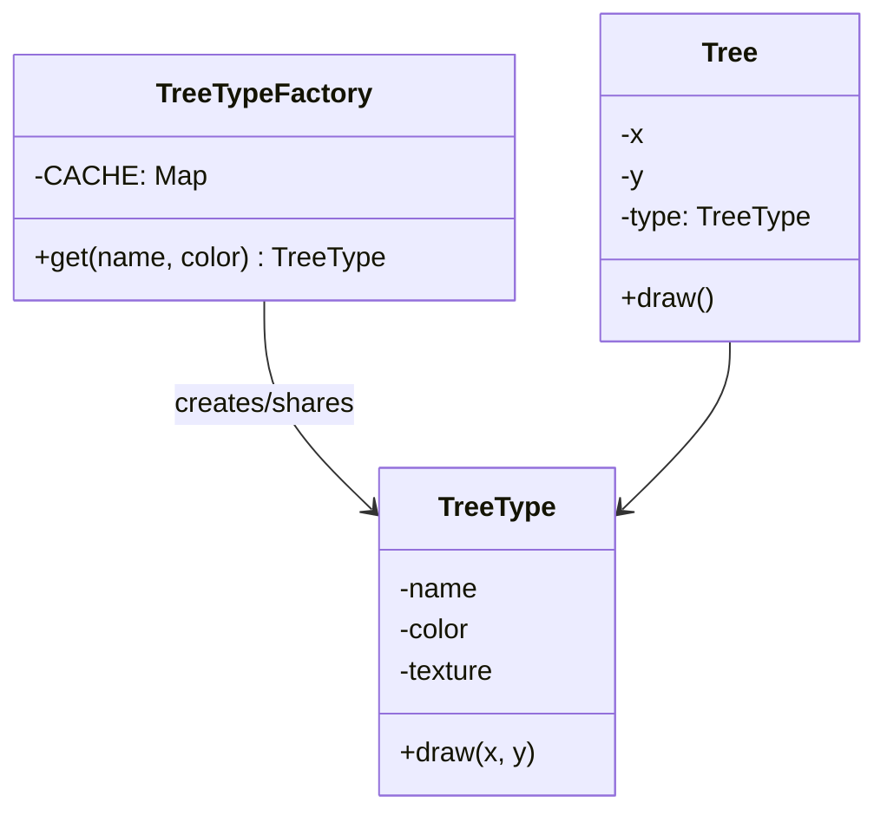

# What is Flyweight pattern

---

## 🟢 Junior Level

The **Flyweight** pattern is a **Structural** design pattern that reduces memory usage by **sharing** the common, immutable part of many similar objects instead of storing it in each one. The shared part is called **intrinsic state**; the part that differs per use is **extrinsic state** and is passed in by the client.

### Real-World Analogy
A text editor with a million characters. Instead of one object per character with its own font outline, the editor keeps one glyph object for 'a' and reuses it everywhere. The position on the page (extrinsic) is stored separately.

### Minimal Working Example

```java
import java.util.HashMap;
import java.util.Map;

// Flyweight: immutable, holds intrinsic state only
public final class TreeType {
    private final String name;
    private final String color;
    private final byte[] texture; // heavy data shared by thousands of trees

    public TreeType(String name, String color, byte[] texture) {
        this.name = name;
        this.color = color;
        this.texture = texture;
    }

    public void draw(int x, int y) { // x, y are extrinsic
        System.out.println("Draw " + name + " (" + color + ") at " + x + "," + y);
    }
}

// Flyweight factory
public final class TreeTypeFactory {
    private static final Map<String, TreeType> CACHE = new HashMap<>();

    public static TreeType get(String name, String color) {
        return CACHE.computeIfAbsent(name + "/" + color,
            k -> new TreeType(name, color, new byte[1_000_000]));
    }
}

// Context: lightweight object with extrinsic state
public record Tree(int x, int y, TreeType type) {
    public void draw() { type.draw(x, y); }
}

public class Forest {
    public static void main(String[] args) {
        TreeType oak = TreeTypeFactory.get("Oak", "green");
        for (int i = 0; i < 100_000; i++) {
            new Tree(i, i * 2, oak).draw();
        }
        // only ONE 1 MB texture exists, not 100,000
    }
}
```

### Class Diagram



### When to Use
1. The application creates a huge number of similar objects.
2. Memory cost is a measured problem.
3. Most object state can be made extrinsic (or is identical across objects).

---

## 🟡 Middle Level

### Intrinsic vs Extrinsic State

| State | Where it lives | Shared? | Example |
|---|---|---|---|
| Intrinsic | Inside the flyweight | Yes, immutable | Glyph shape, tree texture, currency metadata |
| Extrinsic | Passed in by the client/context | No | Coordinates, owner, quantity |

If you cannot cleanly separate them, Flyweight will not help.

### Flyweights Already in the JDK
- `Integer.valueOf(int)` caches -128..127 (extend the upper bound with `-XX:AutoBoxCacheMax`). Also `Long`, `Short`, `Byte`, `Character` (0..127), `Boolean.TRUE/FALSE`.
- **String pool:** string literals and `String.intern()`.
- `Enum` constants are flyweights by nature.
- `java.util.Currency.getInstance(...)`, `java.time.ZoneId.of(...)` caches regions.

```java
public class IntegerCacheDemo {
    public static void main(String[] args) {
        Integer a = 127, b = 127;
        Integer c = 128, d = 128;
        System.out.println(a == b);      // true  (cached flyweight)
        System.out.println(c == d);      // false (distinct objects)
        System.out.println(c.equals(d)); // true  (always use equals)
    }
}
```

### Common Mistakes
- **Mutable flyweights:** if one client mutates the shared object, everyone sees it. Make flyweights immutable (`final` fields, records).
- **Non thread-safe factory:** a plain `HashMap` cache races under concurrency. Use `ConcurrentHashMap.computeIfAbsent`.
- **Unbounded cache:** a factory that never evicts leaks memory. Use `WeakHashMap`/weak values, Caffeine with size limits, or a bounded key space.
- **Premature use:** adding the pattern without profiling.
- **Comparing with `==`:** valid only when you guarantee canonical instances.

### Thread-safe Factory

```java
import java.util.concurrent.ConcurrentHashMap;
import java.util.concurrent.ConcurrentMap;

public final class IconFactory {
    private static final ConcurrentMap<String, Icon> ICONS = new ConcurrentHashMap<>();

    private IconFactory() {}

    public static Icon get(String name) {
        return ICONS.computeIfAbsent(name, Icon::load); // atomic per key
    }

    public record Icon(String name, byte[] pixels) {
        static Icon load(String name) {
            return new Icon(name, new byte[64 * 1024]); // simulate loading
        }
    }
}
```
`computeIfAbsent` runs the mapping function at most once per key, and the function must not modify the map.

### Refactoring Example
Before: each `Particle` holds its own `BufferedImage sprite` (2 MB). 50,000 particles x 2 MB is 100 GB. After: `Particle` holds `SpriteRef` (shared flyweight) plus position and velocity (extrinsic), and total memory is dominated by the number of distinct sprites.

### Spring Notes
Spring singleton beans are a related but different idea: one shared stateless instance per context. Flyweight is specifically about **many fine-grained value-like objects** shared by key. `StringUtils`-style caches and `MessageSource` caches resemble it.

---

## 🔴 Senior Level

### Measuring the Real Benefit
A Java object has a 12-byte header (with compressed oops) plus fields, aligned to 8 bytes. Sharing helps when the shared portion is large relative to the per-instance reference. Verify with tools instead of guessing:
- **JOL** (Java Object Layout) to see the real size of objects.
- **JFR** allocation profiling and **heap dumps** (Eclipse MAT) to find duplicate objects.
- `-XX:+UseStringDeduplication` (G1/Shenandoah/ZGC) is an automatic flyweight for `char`/`byte` arrays of duplicate `String`s.

### Trade-off: CPU vs Memory
Flyweight trades memory for lookup cost and code complexity. Each lookup is a hash + equals; extrinsic state must be passed on every call, which may lengthen method signatures. When memory is cheap and the objects are few, the pattern is a net loss.

### Value Objects and Valhalla
Project Valhalla (value classes) aims to flatten small immutable objects and drop identity, making many "I only share to save headers" flyweights unnecessary. Until it ships, use primitive arrays or struct-of-arrays layouts for millions of tiny objects:

```java
// Data-oriented alternative: instead of 1M Particle objects
public final class Particles {
    private final float[] x, y, vx, vy;
    private final byte[] spriteId; // index into a small SpriteTable (flyweights)

    public Particles(int n) {
        x = new float[n]; y = new float[n];
        vx = new float[n]; vy = new float[n];
        spriteId = new byte[n];
    }

    public void step(float dt) {
        for (int i = 0; i < x.length; i++) {
            x[i] += vx[i] * dt;
            y[i] += vy[i] * dt;
        }
    }
}
```
This is cache-friendly and removes per-object headers; sprites remain flyweights referenced by small ids.

### Concurrency and Memory Visibility
- Flyweights should be immutable with `final` fields: the JMM guarantees safe publication of final fields even through a data race, but do not rely on it for correctness of the cache itself; use `ConcurrentHashMap`.
- `String.intern()` historically lived in PermGen; since Java 7 it is on the heap but still has a native hash table whose size (`-XX:StringTableSize`) affects performance when interning millions of strings. Prefer your own `ConcurrentHashMap` interner or Guava's `Interners.newWeakInterner()`.

### Eviction and Leaks
Strong-ref caches keep flyweights alive forever. Options:
- **Weak interner:** entries disappear when no one else references the value.
- **Bounded cache (Caffeine)** with `maximumSize` when recreating is cheap.
- **Classloader leaks:** static caches holding classes from a redeployed web app prevent classloader GC.

### Production Scenarios
- **Game/GIS/Rendering engines:** sprites, meshes, map tiles.
- **Document editors and PDF generators:** fonts, glyphs, styles.
- **Financial systems:** instrument metadata (`Instrument` with ISIN, currency) shared among millions of `Trade` records.
- **JSON/XML parsing:** interning repeated keys (Jackson's `CANONICALIZE_FIELD_NAMES` / `ByteQuadsCanonicalizer`).

### Edge Cases
- **Identity semantics:** synchronizing on a flyweight (e.g., `synchronized (Integer.valueOf(1))`) shares a lock with unrelated code. Never lock on boxed values or interned strings.
- **Hidden shared mutability:** a flyweight holding a `byte[]` exposed via a getter can be mutated. Return copies or expose read-only views (`ByteBuffer.asReadOnlyBuffer`).
- **Serialization:** deserializing flyweights creates new instances; implement `readResolve()` to restore canonical instances (also needed for enum-like classes).

### When NOT to Use
- Few objects, small objects, or objects whose state is mostly unique.
- Mutable per-instance state that can't be extrinsic.
- When a profile shows memory is not the constraint.

---

## 🎯 Interview Cheat Sheet

### 30-Second Elevator Pitch
> "**Flyweight** saves memory by sharing immutable, intrinsic state among many objects through a factory/cache, while extrinsic state is supplied by the caller. `Integer.valueOf` and the String pool are built-in examples. It must be immutable and thread-safe, caches need eviction, and I only apply it after measuring a memory problem."

### Must-Know Bullets
- Intrinsic (shared, immutable) vs extrinsic (passed in).
- Factory returns canonical instances (`computeIfAbsent`).
- JDK: `Integer` cache, String pool, enums.
- Never use `==` on boxed values; never lock on them.
- Unbounded caches leak; use weak or bounded caches.

### Common Follow-Up Questions
1. **Why does `Integer a=128,b=128; a==b` print false?** The cache covers -128..127 only.
2. **Flyweight vs Singleton?** Singleton: exactly one instance; Flyweight: one instance per distinct intrinsic state.
3. **Flyweight vs Object Pool?** Flyweight shares immutable objects concurrently; a pool lends exclusive mutable objects (see [Object Pool and connection pools](34.%20Object%20Pool%20and%20connection%20pools.md)).
4. **Flyweight vs Prototype?** Prototype clones for independence; Flyweight shares to avoid copies.

### Red Flags
- 🚩 Mutable shared objects.
- 🚩 Plain `HashMap` as concurrent cache.
- 🚩 Pattern applied without profiling.
- 🚩 Synchronizing on interned/boxed objects.

### Related Topics
- [What is Singleton](03.%20What%20is%20Singleton.md) — single instance vs shared instances per key
- [What is Prototype pattern](09.%20What%20is%20Prototype%20pattern.md) — cloning instead of sharing
- [Object Pool and connection pools](34.%20Object%20Pool%20and%20connection%20pools.md) — reuse with exclusive access
- [What is Composite pattern](19.%20What%20is%20Composite%20pattern.md) — leaves are often flyweights
- [Patterns used inside the JDK and Spring](37.%20Patterns%20used%20inside%20the%20JDK%20and%20Spring.md) — caches in the JDK
