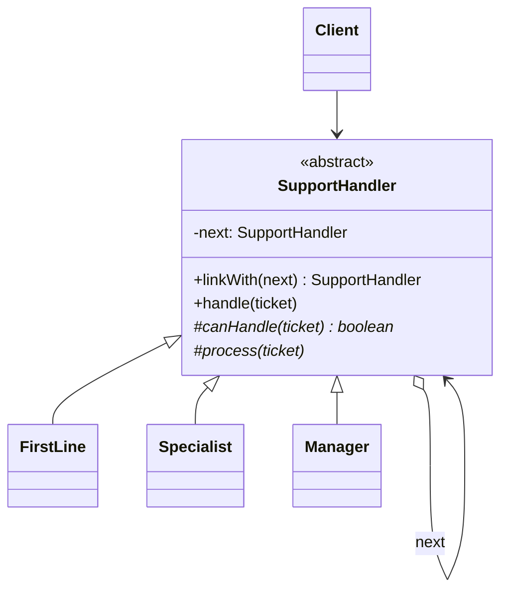

# What is Chain of Responsibility pattern

---

## 🟢 Junior Level

The **Chain of Responsibility** pattern is a **Behavioral** design pattern that passes a request along a chain of handlers. Each handler decides either to process the request or to pass it to the next handler. The sender does not know which handler will eventually deal with it.

### Real-World Analogy
Customer support escalation. A call goes to a first-line agent; if they cannot solve it, it moves to a specialist, then to a manager. The customer just dials one number.

### Minimal Working Example

```java
public abstract class SupportHandler {
    private SupportHandler next;

    public SupportHandler linkWith(SupportHandler next) {
        this.next = next;
        return next; // enables fluent chaining
    }

    public void handle(Ticket ticket) {
        if (canHandle(ticket)) {
            process(ticket);
        } else if (next != null) {
            next.handle(ticket);
        } else {
            System.out.println("Nobody could handle: " + ticket);
        }
    }

    protected abstract boolean canHandle(Ticket ticket);
    protected abstract void process(Ticket ticket);
}

public record Ticket(String description, int severity) {}

public class FirstLine extends SupportHandler {
    protected boolean canHandle(Ticket t) { return t.severity() <= 1; }
    protected void process(Ticket t) { System.out.println("First line solved: " + t.description()); }
}

public class Specialist extends SupportHandler {
    protected boolean canHandle(Ticket t) { return t.severity() <= 3; }
    protected void process(Ticket t) { System.out.println("Specialist solved: " + t.description()); }
}

public class Manager extends SupportHandler {
    protected boolean canHandle(Ticket t) { return true; }
    protected void process(Ticket t) { System.out.println("Manager solved: " + t.description()); }
}

public class Demo {
    public static void main(String[] args) {
        SupportHandler chain = new FirstLine();
        chain.linkWith(new Specialist()).linkWith(new Manager());
        chain.handle(new Ticket("Password reset", 1));
        chain.handle(new Ticket("Data corruption", 5));
    }
}
```

### Class Diagram



### When to Use
1. More than one object may handle a request and the handler is unknown in advance.
2. You want to decouple sender from receivers.
3. The set or order of handlers should be configurable at runtime.

---

## 🟡 Middle Level

### Two Variants
- **Stop-at-first-handler** (support escalation, exception handling): the first capable handler consumes the request.
- **Pipeline / all-handle** (servlet filters, middleware): every link does some work and calls the next; any may short-circuit.

### Servlet Filters: the Canonical Java Example

```java
import jakarta.servlet.*;
import java.io.IOException;

public class TimingFilter implements Filter {
    @Override
    public void doFilter(ServletRequest req, ServletResponse res, FilterChain chain)
            throws IOException, ServletException {
        long start = System.nanoTime();
        try {
            chain.doFilter(req, res); // pass to the next link
        } finally {
            System.out.println("Took " + (System.nanoTime() - start) / 1_000_000 + " ms");
        }
    }
}
```
Other examples: Spring Security's `SecurityFilterChain`, Spring MVC `HandlerInterceptor`, `java.util.logging` handler chain, Netty `ChannelPipeline`, Java exception propagation through `catch` blocks, Log4j appenders.

### Functional Style (Lambdas)

```java
import java.util.List;
import java.util.function.UnaryOperator;

public class Pipeline {
    public static void main(String[] args) {
        List<UnaryOperator<String>> steps = List.of(
            String::strip,
            s -> s.replaceAll("\\s+", " "),
            String::toLowerCase
        );
        String result = "  Hello    WORLD ";
        for (UnaryOperator<String> step : steps) {
            result = step.apply(result);
        }
        System.out.println(result); // "hello world"
    }
}
```
`Function.andThen` and `Stream.reduce(Function.identity(), Function::andThen)` build the same chain functionally.

### Common Mistakes
- **No terminal handler:** a request silently falls off the end. Provide a default handler or fail loudly.
- **Forgetting to call next:** a filter that forgets `chain.doFilter` blocks all requests.
- **Order dependence undocumented:** chain order changes behavior (authentication before authorization). In Spring use `@Order` and test the ordering.
- **Cycles in the chain** cause infinite loops.
- **Shared mutable state in handlers** accessed concurrently.

### Spring Example: Ordered Handler Beans

```java
import org.springframework.core.annotation.Order;
import org.springframework.stereotype.Component;
import org.springframework.stereotype.Service;
import java.util.List;

public interface OrderRule {
    // returns an error message, or null if OK
    String check(OrderRequest request);
}

public record OrderRequest(String customer, long totalCents) {}

@Component @Order(1)
class CustomerRule implements OrderRule {
    public String check(OrderRequest r) { return r.customer().isBlank() ? "customer required" : null; }
}

@Component @Order(2)
class LimitRule implements OrderRule {
    public String check(OrderRequest r) { return r.totalCents() > 1_000_000 ? "limit exceeded" : null; }
}

@Service
class OrderValidator {
    private final List<OrderRule> rules; // injected sorted by @Order

    OrderValidator(List<OrderRule> rules) { this.rules = rules; }

    String validate(OrderRequest r) {
        for (OrderRule rule : rules) {
            String error = rule.check(r);
            if (error != null) return error; // stop at first failure
        }
        return null;
    }
}
```

### Refactoring Example
Before: a 150-line `process(Request)` with nested `if` blocks for authentication, rate limiting, validation, and caching. After: each concern becomes a handler class (or lambda) in a chain, so concerns can be added, reordered, or tested in isolation.

---

## 🔴 Senior Level

### Internals of Servlet/Spring Filter Chains
`FilterChain` is typically implemented with an index into an array: `doFilter` calls the next filter at `pos++` and finally the servlet. Because each filter wraps the downstream call, code before `chain.doFilter` runs on the way in and code after runs on the way out (like an onion). This makes try/finally timing, transaction, and MDC cleanup natural, and also explains why exceptions propagate back through the chain.

### Performance
- Each link is a virtual call; chains of 10-20 handlers cost nanoseconds and are usually irrelevant compared with I/O.
- Call sites inside the loop are megamorphic (different handler classes), so no inlining. In ultra-hot paths (Netty pipelines, HFT) handlers are combined or compiled into one method.
- Deep recursive chains (each link calls the next in its own stack frame) create deep stacks: 1,000 handlers can lead to `StackOverflowError`. Iterating over a list avoids that.
- Avoid allocating a new chain per request; chains should be built once and be stateless.

### Concurrency
- Handlers shared among threads must be stateless or thread-safe. Per-request data travels in the request object or a context.
- In async/reactive chains (WebFlux `WebFilter`, Netty), `next` returns a `Mono`/future; never block inside handlers on event-loop threads.
- With Java 21 virtual threads, blocking handlers are less harmful, but thread locals (MDC, `SecurityContextHolder`) still need care.

```java
import java.util.List;

public final class ImmutableChain<T> {
    public interface Link<T> {
        void handle(T ctx, Runnable next);
    }

    private final List<Link<T>> links;

    public ImmutableChain(List<Link<T>> links) {
        this.links = List.copyOf(links);
    }

    public void execute(T ctx, Runnable terminal) {
        run(0, ctx, terminal);
    }

    private void run(int index, T ctx, Runnable terminal) {
        if (index == links.size()) {
            terminal.run();
            return;
        }
        links.get(index).handle(ctx, () -> run(index + 1, ctx, terminal));
    }
}
```
Each `Link` decides whether to call `next`, which is the same contract as `FilterChain`. The chain itself is immutable and safely shared.

### Production Scenarios
- **API gateway:** authentication, rate limiting, tracing, routing as filter chain.
- **Payment risk checks:** a chain of fraud rules with early rejection and audit logging of which link decided.
- **Exception translation:** Spring's `HandlerExceptionResolver` chain tries resolvers in order.
- **Observability:** a link measures latency and records metrics for each downstream handler.

### Edge Cases
- **Partial processing and rollbacks:** if link 3 fails after link 1 had side effects, you may need compensation or put side-effecting links last.
- **Ordering bugs in security:** putting CORS or exception-handling filters in the wrong place breaks error responses. Test with `FilterChainProxy` debug logs.
- **Auditability:** log which handler processed the request; a chain's flexibility makes behavior hard to trace.
- **Request mutation:** handlers that modify the request affect later handlers; prefer immutable request + derived context.

### When NOT to Use
- Exactly one handler is known statically: call it directly.
- Handlers must all run regardless of earlier ones failing: use Observer or composition.
- Complex branching or loops between handlers: consider a state machine or workflow engine.

---

## 🎯 Interview Cheat Sheet

### 30-Second Elevator Pitch
> "**Chain of Responsibility** links handlers so a request travels along until one handles it, or every link processes it in pipeline style, as with servlet filters and Spring Security. It decouples the sender from receivers and makes order and membership configurable. I keep handlers stateless, give the chain a clear terminal, document ordering with `@Order`, and watch for stack depth and async/blocking issues."

### Must-Know Bullets
- Two flavors: first-match and pipeline.
- Java examples: `Filter`/`FilterChain`, `HandlerInterceptor`, Netty pipeline, exceptions.
- Always have a terminal/default behavior.
- Stateless handlers; thread-safety by design.
- Order matters and must be tested.

### Common Follow-Up Questions
1. **Chain vs Decorator?** Decorator always forwards and adds behavior; a chain link may stop the flow.
2. **Chain vs Observer?** Observer notifies all subscribers; chain stops when handled.
3. **Chain vs Strategy?** Strategy picks one algorithm up front; a chain finds the handler dynamically.
4. **How does Spring order handlers?** `@Order`, `Ordered`, `@Priority` with `List<T>` injection.

### Red Flags
- 🚩 Unhandled requests silently dropped.
- 🚩 Handler forgetting to call next.
- 🚩 Mutable state in shared handlers.
- 🚩 Ordering encoded only in tribal knowledge.

### Related Topics
- [What is Command pattern](23.%20What%20is%20Command%20pattern.md) — requests as objects, often passed through chains
- [How is Observer implemented in Java](11.%20How%20is%20Observer%20implemented%20in%20Java.md) — broadcast instead of stop-at-first
- [Advantage of Decorator over inheritance](12.%20Advantage%20of%20Decorator%20over%20inheritance.md) — similar wrapping structure
- [When to use Strategy](10.%20When%20to%20use%20Strategy.md) — static selection alternative
- [Front Controller and MVC MVP MVVM](35.%20Front%20Controller%20and%20MVC%20MVP%20MVVM.md) — filters around the front controller
