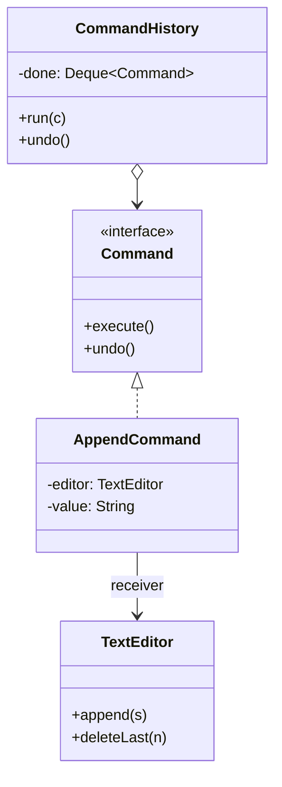

# What is Command pattern

---

## 🟢 Junior Level

The **Command** pattern is a **Behavioral** design pattern that turns a request into a stand-alone object containing all information about the action: what to do, on which receiver, and with which parameters. This lets you queue, log, schedule, undo, or pass requests around like any other object.

### Real-World Analogy
A restaurant order slip. The waiter (invoker) writes the order (command) and hands it to the kitchen (receiver). The slip can be queued, cancelled, or re-read later. The waiter does not cook.

### Minimal Working Example

```java
// Command
public interface Command {
    void execute();
    void undo();
}

// Receiver
public class TextEditor {
    private final StringBuilder text = new StringBuilder();

    public void append(String s) { text.append(s); }

    public void deleteLast(int n) { text.setLength(text.length() - n); }

    @Override public String toString() { return text.toString(); }
}

// Concrete command
public class AppendCommand implements Command {
    private final TextEditor editor;
    private final String value;

    public AppendCommand(TextEditor editor, String value) {
        this.editor = editor;
        this.value = value;
    }

    @Override public void execute() { editor.append(value); }
    @Override public void undo() { editor.deleteLast(value.length()); }
}

// Invoker with history
public class CommandHistory {
    private final java.util.Deque<Command> done = new java.util.ArrayDeque<>();

    public void run(Command c) {
        c.execute();
        done.push(c);
    }

    public void undo() {
        if (!done.isEmpty()) done.pop().undo();
    }
}

public class Demo {
    public static void main(String[] args) {
        TextEditor editor = new TextEditor();
        CommandHistory history = new CommandHistory();
        history.run(new AppendCommand(editor, "Hello"));
        history.run(new AppendCommand(editor, " World"));
        System.out.println(editor); // Hello World
        history.undo();
        System.out.println(editor); // Hello
    }
}
```

### Class Diagram



### When to Use
1. Undo/redo.
2. Queueing, scheduling, or delayed execution of operations.
3. Logging operations for replay or auditing.
4. Decoupling the object that triggers an action (button, API) from the one that performs it.

---

## 🟡 Middle Level

### Roles
- **Command:** interface with `execute()`.
- **ConcreteCommand:** binds a receiver and parameters.
- **Receiver:** knows how to do the work.
- **Invoker:** triggers commands (button, scheduler, thread pool).
- **Client:** creates commands and wires receiver.

### Commands in the JDK
- `Runnable` and `Callable<V>` are commands; `ExecutorService.submit(...)` is the invoker.
- `javax.swing.Action`, `ActionListener`.
- `java.util.concurrent.ScheduledExecutorService` stores commands for later.
- `Runtime.addShutdownHook(Thread)`.
- JDBC `PreparedStatement` batch (`addBatch`/`executeBatch`) stores a series of operations.

### Lambdas Collapse Simple Commands

```java
import java.util.ArrayList;
import java.util.List;

public class MacroRecorder {
    private final List<Runnable> macro = new ArrayList<>();

    public void record(Runnable action) { macro.add(action); }

    public void replay() { macro.forEach(Runnable::run); }

    public static void main(String[] args) {
        MacroRecorder r = new MacroRecorder();
        r.record(() -> System.out.println("open"));
        r.record(() -> System.out.println("save"));
        r.replay();
    }
}
```
Use full classes when you need **undo, serialization, identity, or rich metadata** (name, id, timestamp, user).

### Common Mistakes
- **Command with business logic:** the command should delegate to the receiver; otherwise it becomes a mini service.
- **Undo capturing too little state:** `undo()` of "delete" needs the deleted content; capture it in `execute()` (this is where Memento helps, see [What is Memento pattern](26.%20What%20is%20Memento%20pattern.md)).
- **Mutable parameters:** if parameters change after the command is created, queued execution surprises you. Use immutable records.
- **Unbounded history** causing memory growth.

### Spring Examples
- `ApplicationRunner`/`CommandLineRunner` beans are commands executed by the Boot invoker at startup.
- `@Async` and `@Scheduled` methods are queued commands.
- Spring Batch `Tasklet` and Spring Shell commands.
- Message-driven handlers where a message is a serialized command.

```java
import org.springframework.stereotype.Component;
import org.springframework.stereotype.Service;
import java.util.Map;
import java.util.function.Function;
import java.util.stream.Collectors;
import java.util.List;

public sealed interface AccountCommand permits Deposit, Withdraw {}
public record Deposit(String accountId, long cents) implements AccountCommand {}
public record Withdraw(String accountId, long cents) implements AccountCommand {}

public interface CommandHandler<C extends AccountCommand> {
    Class<C> supports();
    void handle(C command);
}

@Component
class DepositHandler implements CommandHandler<Deposit> {
    public Class<Deposit> supports() { return Deposit.class; }
    public void handle(Deposit c) { System.out.println("Deposit " + c.cents()); }
}

@Service
class CommandBus {
    private final Map<Class<?>, CommandHandler<?>> handlers;

    CommandBus(List<CommandHandler<?>> list) {
        this.handlers = list.stream().collect(Collectors.toMap(CommandHandler::supports, Function.identity()));
    }

    @SuppressWarnings("unchecked")
    <C extends AccountCommand> void dispatch(C command) {
        CommandHandler<C> h = (CommandHandler<C>) handlers.get(command.getClass());
        if (h == null) throw new IllegalArgumentException("No handler for " + command);
        h.handle(command);
    }
}
```
This is a **command bus**, the foundation of CQRS write models (see [CQRS and Event Sourcing patterns](36.%20CQRS%20and%20Event%20Sourcing%20patterns.md)).

---

## 🔴 Senior Level

### Undo/Redo Design
Two approaches:
1. **Inverse operations** (each command implements `undo()`): compact, but must be exactly reversible (floating-point or external side effects may not be).
2. **Snapshots** (Memento): store state before the command; undo restores it. Costly for large state; use structural sharing/persistent data structures.

Redo requires a second stack that is cleared whenever a new command executes after an undo. **Compound (macro) commands** group a list of commands with all-or-nothing semantics; a failure mid-way must roll back the executed prefix.

```java
import java.util.ArrayDeque;
import java.util.ArrayList;
import java.util.Deque;
import java.util.List;

public class MacroCommand implements Command {
    private final List<Command> parts;
    private final Deque<Command> executed = new ArrayDeque<>();

    public MacroCommand(List<Command> parts) { this.parts = List.copyOf(parts); }

    @Override
    public void execute() {
        try {
            for (Command c : parts) {
                c.execute();
                executed.push(c);
            }
        } catch (RuntimeException e) {
            undo(); // rollback the executed prefix
            throw e;
        }
    }

    @Override
    public void undo() {
        while (!executed.isEmpty()) executed.pop().undo();
    }
}
```
(`Command` here is the interface from the Junior section.)

### Distributed and Asynchronous Commands
- Commands become **messages** (Kafka, RabbitMQ). They must be serializable, versioned, and **idempotent** because delivery is at-least-once. Include a command id and deduplicate in the handler (idempotency key table).
- Naming: a command is an *intention* ("PlaceOrder", imperative) that may be rejected; an event is a *fact* ("OrderPlaced", past tense).
- Retry and dead-letter policies belong to the invoker infrastructure, not to commands.

### Concurrency
- A shared invoker queue needs a thread-safe structure (`LinkedBlockingQueue`, `ConcurrentLinkedDeque`) and a defined ordering policy: per-aggregate ordering (partition by key) beats global ordering for scalability.
- Commands that capture mutable receivers across threads need receiver-level synchronization. Prefer immutable command data and let the handler load the current state.
- With `ExecutorService`, an uncaught exception inside `Runnable.run()` of a `submit()` call is stored in the `Future` and silently lost unless you call `get()`; log failures explicitly.

### Performance
- Allocation: one object per command. For high-frequency commands (game loops, trading), use object pooling or primitives in a ring buffer (LMAX Disruptor pre-allocates events).
- Lambdas as commands compile to `invokedynamic` and are cheap; capturing lambdas allocate per capture.
- History storage must be bounded (ring buffer or max depth) to avoid OOM.

### Production Scenarios
- **Task queues and job schedulers** (Quartz `Job`, Spring Batch).
- **Audit trails:** persist every command with user, timestamp and outcome.
- **Transactional outbox:** write the command/event row in the same DB transaction, then publish asynchronously.
- **GUI/editor undo stacks**, **workflow engines**, **infrastructure as code** plans.

### Edge Cases
- **Non-undoable commands** (send email): mark them explicitly (`isUndoable()`), or use compensating commands (send correction).
- **Serialization compatibility:** adding fields to a command changes the wire format; use Jackson-ignorable-unknown and versioned type names.
- **Security:** deserializing commands from untrusted sources is a classic remote-code-execution vector with Java native serialization. Use JSON with explicit type allow-lists.

### When NOT to Use
- A direct method call is enough (no queueing, undo, logging).
- A lambda suffices and no metadata is needed.
- The "command" just wraps a getter: that is a query, not a command.

---

## 🎯 Interview Cheat Sheet

### 30-Second Elevator Pitch
> "**Command** encapsulates a request as an object so it can be parameterized, queued, logged, retried or undone, decoupling the invoker from the receiver. `Runnable` submitted to an `ExecutorService` is the everyday form. For undo I either implement inverse operations or use Memento snapshots; in distributed systems commands become idempotent, versioned messages, which is the basis of a CQRS command bus."

### Must-Know Bullets
- Invoker, command, receiver, client.
- Enables undo/redo, queues, macros, audit.
- `Runnable`/`Callable` are commands; lambdas for simple cases.
- Immutable command data; bounded history.
- Distributed commands must be idempotent.

### Common Follow-Up Questions
1. **Command vs Strategy?** Command is a request with receiver and parameters (what to do now); Strategy is an interchangeable algorithm (how to do it).
2. **How to implement undo?** Inverse operation or Memento.
3. **Command vs Event?** Command = intent that may fail; Event = fact that already happened.
4. **Where in Spring?** `CommandLineRunner`, `@Async`, `@Scheduled`, Spring Batch tasklets.

### Red Flags
- 🚩 Business logic duplicated in command instead of receiver.
- 🚩 Unbounded undo history.
- 🚩 Non-idempotent commands over at-least-once messaging.
- 🚩 Native Java deserialization of untrusted commands.

### Related Topics
- [What is Memento pattern](26.%20What%20is%20Memento%20pattern.md) — snapshots for undo
- [What is Chain of Responsibility pattern](22.%20What%20is%20Chain%20of%20Responsibility%20pattern.md) — routing commands through handlers
- [When to use Strategy](10.%20When%20to%20use%20Strategy.md) — algorithm vs request
- [CQRS and Event Sourcing patterns](36.%20CQRS%20and%20Event%20Sourcing%20patterns.md) — command buses
- [How is Observer implemented in Java](11.%20How%20is%20Observer%20implemented%20in%20Java.md) — events after commands
