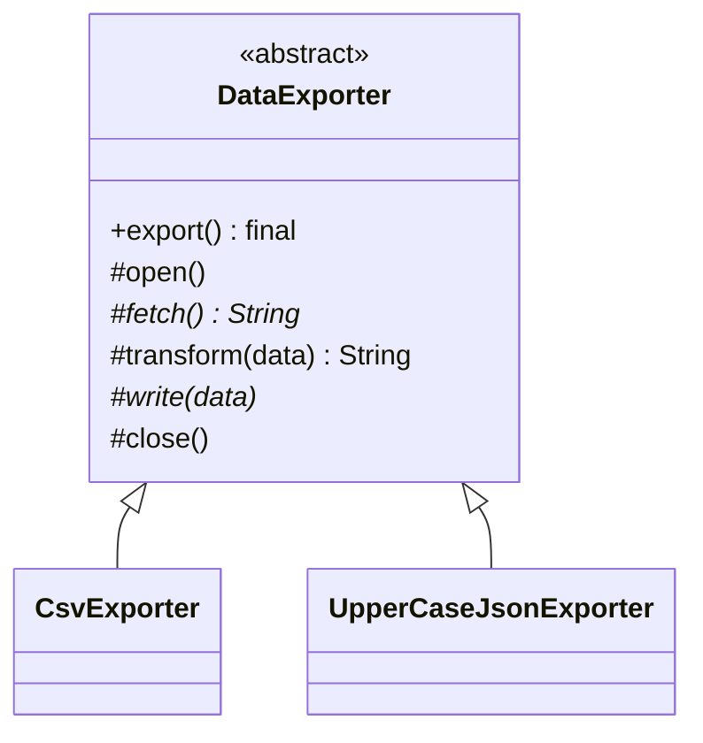

# What is Template Method pattern

---

## 🟢 Junior Level

The **Template Method** pattern is a **Behavioral** design pattern that defines the **skeleton of an algorithm** in a base class method and lets subclasses override specific steps without changing the algorithm's overall structure.

### Real-World Analogy
A recipe for making a hot drink: boil water, brew, pour into a cup, add extras. The sequence is fixed. Tea steeps a bag and adds lemon; coffee brews grounds and adds milk. Only the steps "brew" and "add extras" differ.

### Minimal Working Example

```java
public abstract class DataExporter {

    // The template method: final so subclasses cannot change the order
    public final void export() {
        open();
        String data = fetch();
        write(transform(data));
        close();
    }

    protected void open() { System.out.println("Opening resource"); }

    protected abstract String fetch();          // mandatory step

    protected String transform(String data) {  // optional hook with default
        return data;
    }

    protected abstract void write(String data); // mandatory step

    protected void close() { System.out.println("Closing resource"); }
}

public class CsvExporter extends DataExporter {
    @Override protected String fetch() { return "id,name\n1,Ann"; }
    @Override protected void write(String data) { System.out.println("CSV:\n" + data); }
}

public class UpperCaseJsonExporter extends DataExporter {
    @Override protected String fetch() { return "{\"name\":\"ann\"}"; }
    @Override protected String transform(String d) { return d.toUpperCase(); }
    @Override protected void write(String data) { System.out.println("JSON: " + data); }
}

public class Demo {
    public static void main(String[] args) {
        new CsvExporter().export();
        new UpperCaseJsonExporter().export();
    }
}
```

### Class Diagram



### Key Terms
- **Template method:** the `final` method that fixes the algorithm.
- **Abstract steps:** must be implemented.
- **Hooks:** optional steps with default (often empty) implementations.

### When to Use
1. Several classes share the same algorithm structure and differ in a few steps.
2. You want to prevent code duplication by pulling the common flow into a base class.
3. You want to control where subclasses may extend (the *Hollywood Principle*: "don't call us, we'll call you").

---

## 🟡 Middle Level

### Template Method vs Strategy
| Aspect | Template Method | Strategy |
|---|---|---|
| Mechanism | Inheritance | Composition |
| Granularity | Varies **steps** within a fixed flow | Replaces the **entire** algorithm |
| Binding time | Compile time (class chosen) | Runtime (swappable) |
| Coupling | Subclass tightly coupled to base | Loose |
| Testing | Needs subclass or mock | Inject fake strategy |

Prefer Strategy when you need runtime flexibility or when the hierarchy would be deep. Template Method is great for frameworks where the base class owns the lifecycle.

### JDK Examples
- `java.io.InputStream.read(byte[], int, int)` is implemented in terms of the abstract `read()`.
- `java.util.AbstractList`, `AbstractMap`: implement `get`/`size` and obtain `indexOf`, `iterator`, `equals`.
- `java.util.concurrent.locks.AbstractQueuedSynchronizer` calls `tryAcquire`/`tryRelease` hooks.
- `javax.servlet.http.HttpServlet.service()` dispatches to `doGet`, `doPost`.
- `java.util.Comparator` default methods and `Collection.removeIf`.

### Spring Examples
Spring's `JdbcTemplate`, `RestTemplate`, `TransactionTemplate` use the **callback variant** (a template object + callbacks) to avoid inheritance:

```java
import org.springframework.jdbc.core.JdbcTemplate;
import java.util.List;

public class UserDao {
    private final JdbcTemplate jdbc;

    public UserDao(JdbcTemplate jdbc) { this.jdbc = jdbc; }

    public List<String> names() {
        // template: get connection, create statement, iterate rows, close, translate exceptions
        // callback (RowMapper): map one row
        return jdbc.query("select name from users", (rs, rowNum) -> rs.getString("name"));
    }
}
```
Classic inheritance variants in Spring: `AbstractApplicationContext.refresh()` (a huge template method with hooks like `onRefresh()`), `OncePerRequestFilter.doFilterInternal`, `AbstractRoutingDataSource.determineCurrentLookupKey`, `JdbcDaoSupport`.

### Callback Style Instead of Inheritance

```java
import java.util.function.Consumer;
import java.util.function.Supplier;

public final class ResourceTemplate {
    public static <T> T execute(Supplier<AutoCloseable> opener, java.util.function.Function<AutoCloseable, T> work) {
        try (AutoCloseable r = opener.get()) {
            return work.apply(r);
        } catch (RuntimeException e) {
            throw e;
        } catch (Exception e) {
            throw new IllegalStateException(e);
        }
    }
}
```
Lambdas make the "variable steps" parameters rather than overridden methods, avoiding the fragile base class problem.

### Common Mistakes
- **Template method not `final`:** subclasses can break the algorithm.
- **Too many abstract methods:** subclasses must implement 8 methods; prefer hooks with sensible defaults.
- **Calling overridable methods from constructors:** subclass fields are not initialized yet.
- **Violating Liskov:** a subclass that skips required steps or changes preconditions.
- **Deep hierarchies** make the flow hard to follow.
- **Hooks that need to call `super`:** document when and how.

### Refactoring Example
Before: `PdfReportJob`, `CsvReportJob`, `XlsReportJob` each contain nearly identical code: load config, query data, format, send email, update status. After: an abstract `ReportJob.run()` (final) handles the shared flow and subclasses implement only `format(List<Row>)`. If formats multiply and must be switched at runtime, the next step is turning `format` into a `ReportFormatter` strategy injected into one `ReportJob` class.

---

## 🔴 Senior Level

### Fragile Base Class and Design for Inheritance
Template Method makes base class evolution risky: adding a call to an overridable method inside the template changes behavior of every subclass, including ones you cannot see (Effective Java Item 19: design and document for inheritance or prohibit it). Practices:
- Document **self-use** of each overridable method (`@implSpec` Javadoc).
- Keep the template `final`; keep hooks `protected`.
- Prefer **sealed** hierarchies when the set of variants is known.
- Consider the **Template via composition** (strategy callbacks) for public library APIs, so that you are free to refactor.

### Concurrency
- The template method is as thread-safe as the base class state allows. If it uses fields, concurrent calls on one instance may interfere. Prefer stateless templates or keep per-invocation state in local variables or a context object.
- Hooks invoked while holding a lock (as in `AbstractQueuedSynchronizer`) must be quick and non-blocking; "alien method" calls under locks create deadlock risks.

```java
import java.util.concurrent.locks.AbstractQueuedSynchronizer;

// Simple non-reentrant mutex built by filling in AQS template hooks
public final class SimpleMutex {
    private static final class Sync extends AbstractQueuedSynchronizer {
        @Override protected boolean tryAcquire(int ignored) {
            return compareAndSetState(0, 1);   // hook: try to take the lock
        }
        @Override protected boolean tryRelease(int ignored) {
            setState(0);                       // hook: release
            return true;
        }
        @Override protected boolean isHeldExclusively() { return getState() == 1; }
    }

    private final Sync sync = new Sync();

    public void lock() { sync.acquire(1); }     // template: queuing, parking, fairness
    public void unlock() { sync.release(1); }
}
```
AQS provides the complex queuing and parking; subclasses supply only the state semantics. This is Template Method at its best: a hard, generic algorithm with tiny, well-defined hooks.

### JVM Performance
- Calls to abstract hooks are virtual; if a template is exercised with a single subclass at a call site, the JIT inlines hooks; with many subclasses it is megamorphic. In practice the cost is negligible unless the hook is a tiny method in a hot loop.
- Making the template `final` gives the JIT a statically bindable target.

### Production Scenarios
- **Batch/ETL frameworks:** `read -> process -> write` lifecycle with hooks for error handling.
- **Test base classes:** JUnit `@BeforeEach`/`@AfterEach` lifecycle (template with callbacks).
- **Cross-cutting boilerplate:** `OncePerRequestFilter` guarantees one execution per request and exposes `doFilterInternal`; `AbstractHealthIndicator.health()` wraps `doHealthCheck` with exception handling.
- **Plugin lifecycles:** `init() -> validate() -> execute() -> cleanup()` with guaranteed cleanup in the template's `finally`.

### Edge Cases
- **Exceptions in hooks** must not skip cleanup; put cleanup in a `finally` in the template.
- **Spring proxies:** `@Transactional` on a hook method called by the template (self-invocation) bypasses the proxy. Put the annotation on the public template method or extract a bean.
- **Serialization/equality** in hierarchies: base class assumptions about `equals` can be violated by subclasses.
- **Hook ordering** across multiple levels of inheritance can surprise; log the lifecycle in tests.

### When NOT to Use
- When variation must be chosen at runtime or combined (use Strategy/Decorator).
- When you only have one implementation.
- When the base class would need many hooks: you are building a framework within a class; consider splitting the algorithm.
- Prefer functional composition (`Function.andThen`) for simple pipelines.

---

## 🎯 Interview Cheat Sheet

### 30-Second Elevator Pitch
> "**Template Method** fixes an algorithm's skeleton in a `final` base-class method and lets subclasses fill in abstract steps and optional hooks, applying the Hollywood principle. JDK examples: `AbstractList`, `HttpServlet.service`, `AbstractQueuedSynchronizer`; in Spring `JdbcTemplate` uses the callback variant. It uses inheritance, so I weigh it against Strategy, and guard against fragile base class issues."

### Must-Know Bullets
- `final` template + abstract steps + optional hooks.
- Inheritance-based; Strategy is the composition-based sibling.
- Hollywood Principle: framework calls your code.
- Callbacks/lambdas replace subclassing (`JdbcTemplate`).
- Don't call overridable methods from constructors.

### Common Follow-Up Questions
1. **Template Method vs Strategy?** Inheritance varying steps vs composition replacing the entire algorithm.
2. **Why make the template method `final`?** To protect the invariant sequence.
3. **What is a hook?** An optional overridable method with a default no-op.
4. **Is `JdbcTemplate` Template Method?** Yes, the callback flavor.

### Red Flags
- 🚩 Non-final template method.
- 🚩 Many abstract methods or deep hierarchies.
- 🚩 Overridable method calls in constructors.
- 🚩 Subclass overriding the flow rather than just steps.

### Related Topics
- [When to use Strategy](10.%20When%20to%20use%20Strategy.md) — composition alternative
- [Difference between State and Strategy](13.%20Difference%20between%20State%20and%20Strategy.md) — related behavioral patterns
- [Difference between Factory Method and Abstract Factory](07.%20Difference%20between%20Factory%20Method%20and%20Abstract%20Factory.md) — Factory Method is a specialized template step
- [Patterns used inside the JDK and Spring](40.%20Patterns%20used%20inside%20the%20JDK%20and%20Spring.md) — more real-world templates
- [Choosing the right pattern and avoiding pattern overuse](41.%20Choosing%20the%20right%20pattern%20and%20avoiding%20pattern%20overuse.md) — inheritance vs composition decisions
