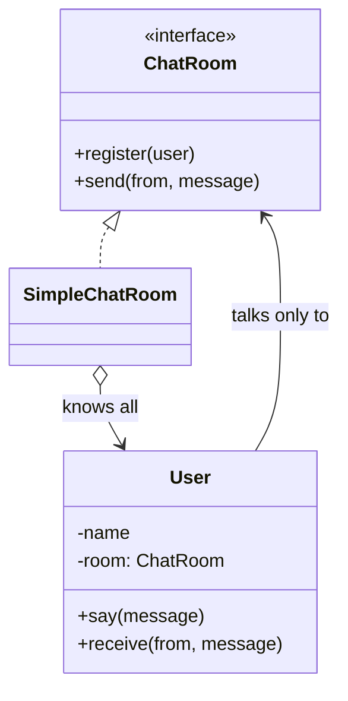

# What is Mediator pattern

---

## 🟢 Junior Level

The **Mediator** pattern is a **Behavioral** design pattern that defines an object which encapsulates how a set of objects interact. Instead of components referring to each other directly (many-to-many), they talk only to the mediator (one-to-many), which reduces coupling.

### Real-World Analogy
An air traffic control tower. Pilots do not talk to each other to avoid collisions; they all talk to the tower, and the tower coordinates takeoffs, landings and routes.

### Minimal Working Example

```java
import java.util.ArrayList;
import java.util.List;

// Mediator
public interface ChatRoom {
    void register(User user);
    void send(String from, String message);
}

public class SimpleChatRoom implements ChatRoom {
    private final List<User> users = new ArrayList<>();

    @Override
    public void register(User user) { users.add(user); }

    @Override
    public void send(String from, String message) {
        for (User u : users) {
            if (!u.name().equals(from)) {
                u.receive(from, message);
            }
        }
    }
}

// Colleague
public class User {
    private final String name;
    private final ChatRoom room;

    public User(String name, ChatRoom room) {
        this.name = name;
        this.room = room;
        room.register(this);
    }

    public String name() { return name; }

    public void say(String message) { room.send(name, message); }

    public void receive(String from, String message) {
        System.out.println(name + " got from " + from + ": " + message);
    }
}

public class Demo {
    public static void main(String[] args) {
        ChatRoom room = new SimpleChatRoom();
        User ann = new User("Ann", room);
        User bob = new User("Bob", room);
        new User("Cid", room);
        ann.say("Hi all");
        bob.say("Hello Ann");
    }
}
```

### Class Diagram



### When to Use
1. A group of objects communicate in complex but well-defined ways, creating a tangle of references.
2. Reusing a component is hard because it refers to many others.
3. Behavior spread among several classes should be customizable without subclassing all of them.

---

## 🟡 Middle Level

### Mediator vs Observer vs Facade
| Pattern | Communication | Who knows whom |
|---|---|---|
| **Mediator** | Colleagues talk to a central coordinator, which contains the interaction logic | Colleagues know the mediator; the mediator knows all colleagues |
| **Observer** | Subject broadcasts to subscribers who register themselves | Subject doesn't know concrete observers; no coordination logic |
| **Facade** | Client calls a simplified API; one-way | Subsystem doesn't know the facade |

Mediator is about **many-to-many coordination logic**; Observer is about **one-to-many notification**. A mediator is often implemented using Observer internally (colleagues emit events; the mediator subscribes).

### Event-Based Mediator in Java

```java
import java.util.ArrayList;
import java.util.List;
import java.util.Map;
import java.util.concurrent.ConcurrentHashMap;
import java.util.concurrent.CopyOnWriteArrayList;
import java.util.function.Consumer;

public class EventMediator {
    private final Map<Class<?>, List<Consumer<Object>>> handlers = new ConcurrentHashMap<>();

    public <E> void subscribe(Class<E> type, Consumer<E> handler) {
        handlers.computeIfAbsent(type, k -> new CopyOnWriteArrayList<>())
                .add(e -> handler.accept(type.cast(e)));
    }

    public void publish(Object event) {
        handlers.getOrDefault(event.getClass(), List.of()).forEach(h -> h.accept(event));
    }
}
```
The components `OrderService`, `InventoryService` communicate only via events and never reference each other.

### Mediators in the JDK and Spring
- `java.util.Timer` (schedules tasks between clients and threads), `ExecutorService`, `java.util.concurrent.ExecutorService.submit` mediating tasks and threads.
- `java.lang.reflect.Method.invoke` is mediated by the runtime.
- Spring `ApplicationEventPublisher`/`ApplicationEventMulticaster` is a mediator between publishers and listeners.
- Spring MVC `DispatcherServlet` mediates between handler mappings, adapters, view resolvers and exception resolvers: none of them knows each other.
- Spring Integration channels and message brokers (Kafka/RabbitMQ) are infrastructure-level mediators.
- The popular "MediatR"-style libraries (command/query mediators), and Spring Modulith events.

```java
import org.springframework.context.ApplicationEventPublisher;
import org.springframework.context.event.EventListener;
import org.springframework.stereotype.Component;
import org.springframework.stereotype.Service;

public record OrderPlaced(String orderId) {}

@Service
class OrderService {
    private final ApplicationEventPublisher publisher;
    OrderService(ApplicationEventPublisher publisher) { this.publisher = publisher; }

    void place(String id) {
        // ... persist order ...
        publisher.publishEvent(new OrderPlaced(id)); // does not know who listens
    }
}

@Component
class StockListener {
    @EventListener
    void on(OrderPlaced e) { System.out.println("Reserve stock for " + e.orderId()); }
}

@Component
class MailListener {
    @EventListener
    void on(OrderPlaced e) { System.out.println("Email for " + e.orderId()); }
}
```

### Common Mistakes
- **God mediator:** the mediator accumulates all logic and becomes an unmaintainable monolith. Split mediators by concern or bounded context.
- **Colleagues still referencing each other,** making the mediator pointless.
- **Hiding data flow:** events through a mediator are hard to trace; add correlation ids and logging.
- **Using a mediator for two objects:** direct collaboration is simpler.
- **Memory leaks:** colleagues registering and never deregistering (lapsed listener problem).

### Refactoring Example
Before: a dialog with 10 widgets where `Checkbox` enables `TextField` which updates `Button` etc., each widget holds references to others. After: a `DialogMediator` receives `widgetChanged(source)` and updates the others in one place. Widgets become reusable.

---

## 🔴 Senior Level

### Architecture-Level Mediation
- **Orchestration vs choreography:** an orchestrator (saga coordinator, workflow engine like Temporal/Camunda) is a mediator with explicit control flow; choreography (services reacting to events) distributes logic and removes the central mediator at the cost of visibility. Orchestration is easier to reason about and monitor; choreography scales organizationally and avoids a single bottleneck.
- **Modular monoliths:** modules should talk via a mediator (published events/application interfaces), preventing cyclic package dependencies; Spring Modulith verifies these boundaries.
- **Message brokers** add durability, ordering and backpressure, but also at-least-once delivery, so listeners must be idempotent.

### Concurrency
- An in-process mediator's `publish` is synchronous by default in Spring: listeners run on the publisher's thread and inside its transaction. A slow or throwing listener affects the publisher. Options: `@Async` listeners, `@TransactionalEventListener(phase = AFTER_COMMIT)` to run only after successful commit, or an outbox.
- Subscriber lists need thread-safe structures (`CopyOnWriteArrayList` for read-mostly) so publishing during registration doesn't throw `ConcurrentModificationException`.
- Re-entrancy: a listener that publishes another event can cause unbounded recursion or ordering surprises; define depth limits or queue events.
- Order of delivery matters: unordered `@EventListener`s need `@Order` if sequence is relevant.

```java
import org.springframework.stereotype.Component;
import org.springframework.transaction.event.TransactionPhase;
import org.springframework.transaction.event.TransactionalEventListener;

@Component
class AfterCommitMail {
    @TransactionalEventListener(phase = TransactionPhase.AFTER_COMMIT)
    void on(OrderPlaced e) {
        // safe: order is durably committed; failure here will not roll back the order
        System.out.println("Sending confirmation for " + e.orderId());
    }
}
```

### Performance
- A central mediator is a single point of contention if guarded by a global lock. Prefer lock-free/immutable subscriber snapshots and partitioned mediators.
- Reflection-based dispatch (`@EventListener` with generics) has overhead; Spring caches listener metadata per event type, making it negligible in practice.
- A mediator chain with `Object` events and `instanceof` dispatch is slow and error-prone; use sealed event hierarchies and exhaustive `switch`.

### Production Scenarios
- **UI frameworks:** form controllers coordinating validation, enabling buttons.
- **Chat/collaboration servers:** room objects as mediators between sessions.
- **Trading engines:** order book mediating between buyers and sellers.
- **Domain events** between aggregates within a service.

### Edge Cases
- **Lost events** if the process crashes between commit and publish: use the transactional outbox.
- **Poison events:** a failing listener repeatedly retried can block others; use dead-letter strategies.
- **Testing:** verify mediator wiring with integration tests; unit test colleagues with a fake mediator.
- **Circular triggering:** component A updates B, B updates A through the mediator; add guard flags or compare values before re-emitting.

### When NOT to Use
- When few objects interact simply; direct calls are more readable.
- When the mediator would hold domain logic that belongs in entities.
- When you need strong traceability but use hidden event flows: prefer explicit orchestration.

---

## 🎯 Interview Cheat Sheet

### 30-Second Elevator Pitch
> "**Mediator** centralizes communication among a group of objects so they depend on the mediator rather than on each other, turning many-to-many coupling into one-to-many. It is behind `DispatcherServlet` coordination, Spring's application events and chat-room style designs. The danger is a god mediator and invisible data flow, so I split mediators by concern, use explicit events with correlation ids, and mind transaction boundaries and async delivery."

### Must-Know Bullets
- Colleagues know only the mediator.
- Mediator holds the interaction logic; Observer just broadcasts.
- Spring: `ApplicationEventPublisher`, `DispatcherServlet`.
- Beware god mediator and lapsed listeners.
- Use `@TransactionalEventListener(AFTER_COMMIT)` or outbox for reliable side effects.

### Common Follow-Up Questions
1. **Mediator vs Observer?** Mediator coordinates interaction; Observer notifies subscribers.
2. **Mediator vs Facade?** Facade is a one-way simplification; Mediator is two-way coordination among peers.
3. **Orchestration vs choreography?** Central controller vs decentralized event reactions.
4. **Are Spring events synchronous?** By default yes, in the caller's thread and transaction.

### Red Flags
- 🚩 Mediator with thousands of lines of mixed logic.
- 🚩 Colleagues calling each other anyway.
- 🚩 Unbounded listener registration.
- 🚩 Assuming listeners run after commit.

### Related Topics
- [How is Observer implemented in Java](11.%20How%20is%20Observer%20implemented%20in%20Java.md) — notification mechanism used inside mediators
- [What is Facade pattern](18.%20What%20is%20Facade%20pattern.md) — one-way simplification
- [What is Command pattern](23.%20What%20is%20Command%20pattern.md) — command buses are mediators
- [CQRS and Event Sourcing patterns](36.%20CQRS%20and%20Event%20Sourcing%20patterns.md) — event-driven architectures
- [Front Controller and MVC MVP MVVM](32.%20Front%20Controller%20and%20MVC%20MVP%20MVVM.md) — presenters and controllers as mediators
