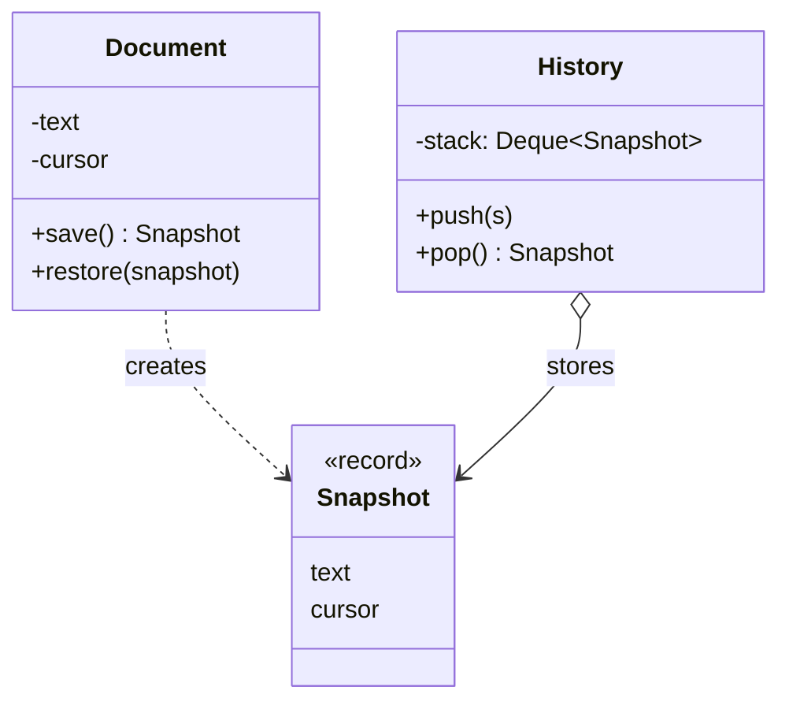

# What is Memento pattern

---

## 🟢 Junior Level

The **Memento** pattern is a **Behavioral** design pattern that lets you capture and externalize an object's internal state as a snapshot, so the object can be restored to that state later, **without violating encapsulation**.

### Real-World Analogy
A save point in a video game. You save the game (memento), keep playing, die, and then reload exactly to the saved moment. The save file is meaningful only to the game; you, the player, do not edit its internals.

### Minimal Working Example

```java
import java.util.ArrayDeque;
import java.util.Deque;

// Originator
public class Document {
    private String text = "";
    private int cursor = 0;

    public void type(String s) {
        text = text + s;
        cursor = text.length();
    }

    public Snapshot save() { return new Snapshot(text, cursor); }

    public void restore(Snapshot s) {
        this.text = s.text();
        this.cursor = s.cursor();
    }

    @Override public String toString() { return text + " |" + cursor; }

    // Memento: immutable, opaque to everybody except Document
    public record Snapshot(String text, int cursor) {}
}

// Caretaker
public class History {
    private final Deque<Document.Snapshot> stack = new ArrayDeque<>();

    public void push(Document.Snapshot s) { stack.push(s); }

    public Document.Snapshot pop() { return stack.pop(); }

    public boolean isEmpty() { return stack.isEmpty(); }
}

public class Demo {
    public static void main(String[] args) {
        Document doc = new Document();
        History history = new History();

        doc.type("Hello");
        history.push(doc.save());
        doc.type(" World");
        System.out.println(doc); // Hello World |11

        doc.restore(history.pop());
        System.out.println(doc); // Hello |5
    }
}
```

### Class Diagram



### Three Roles
- **Originator:** the object whose state is saved/restored.
- **Memento:** the snapshot. Immutable.
- **Caretaker:** stores mementos but never inspects or modifies them.

### When to Use
1. Undo/redo, rollback, checkpoints, drafts.
2. You need a snapshot of state but direct access to fields would break encapsulation.

---

## 🟡 Middle Level

### Keeping the Snapshot Opaque
Strict Memento hides contents from the caretaker. In Java, achieve it using a **nested class** with a private constructor, or an interface that exposes nothing:

```java
public class Editor {
    private String content = "";

    public void set(String c) { this.content = c; }
    public Memento save() { return new EditorMemento(content); }

    public void restore(Memento m) {
        if (!(m instanceof EditorMemento em)) {
            throw new IllegalArgumentException("Foreign memento");
        }
        this.content = em.content;
    }

    // Public marker type: caretakers see only this
    public interface Memento {}

    private static final class EditorMemento implements Memento {
        private final String content;
        private EditorMemento(String content) { this.content = content; }
    }
}
```
Records are simpler but publicly expose their components; that is a pragmatic trade-off in many codebases.

### Immutability and Deep Copies
A memento must not be affected by later changes to the originator. If the state contains mutable objects (lists, dates, arrays), **copy defensively**:

```java
import java.util.List;

class Cart {
    private final java.util.List<String> items = new java.util.ArrayList<>();

    void add(String item) { items.add(item); }

    List<String> snapshot() { return List.copyOf(items); } // immutable copy

    void restore(List<String> saved) {
        items.clear();
        items.addAll(saved);
    }
}
```
Forgetting this is the most common memento bug: the snapshot holds a reference to the live list.

### Memento vs Command for Undo
| Aspect | Memento | Command with inverse |
|---|---|---|
| Stores | Full or partial state | The operation and data to reverse it |
| Memory | Higher | Lower |
| Correctness | Always exact | Inverse must be correct |
| Best for | Complex state, hard-to-invert ops | Simple reversible ops |

They are commonly combined: a command takes a memento before `execute()` and restores it in `undo()` (see [What is Command pattern](23.%20What%20is%20Command%20pattern.md)).

### Where It Appears in Java
- `java.io.Serializable` serialization is a (heavy) memento mechanism: state is written to a byte stream and restored.
- `java.util.Date`/`Calendar` clone patterns, `javax.swing.undo.UndoManager` and `StateEdit`.
- `Object.clone()` as a shallow snapshot.
- Database transactions: rollback restores previous state.
- Spring: `Flash attributes`, `HttpSession` snapshots; Spring Statemachine persists `StateMachineContext` as a memento.
- Hibernate: the persistence context keeps a **loaded state snapshot** of each entity to detect dirty fields, a memento used for dirty checking.

### Common Mistakes
- **Mutable memento** leaks changes.
- **Caretaker peeking into state,** breaking encapsulation.
- **Unbounded history** causing memory leaks.
- **Storing the entire object graph** on each keystroke.
- **Serializing sensitive data** into snapshots that get persisted.

### Refactoring Example
Before: a form wizard exposing getters/setters for every field so an external `UndoManager` can copy and restore them (breaks encapsulation, couples undo code to every field). After: the wizard produces `WizardSnapshot save()` and `restore(WizardSnapshot)`, and the undo manager manipulates opaque snapshots.

---

## 🔴 Senior Level

### Memory Strategies for Large State
Full snapshots per change are O(n) memory each. Alternatives:
- **Incremental / delta snapshots:** store only changes (diffs); restore by replaying. Periodic full checkpoints bound replay cost. Event sourcing is exactly this idea (see [CQRS and Event Sourcing patterns](39.%20CQRS%20and%20Event%20Sourcing%20patterns.md)).
- **Persistent (immutable) data structures with structural sharing:** snapshots are O(1) because versions share most of the structure (e.g., Vavr `List`, `Map`; Clojure-like HAMT). Java's `List.copyOf` is a full copy; use persistent collections for deep histories.
- **Copy-on-write** (`CopyOnWriteArrayList.snapshot` semantic) for read-mostly data.
- **Bounded history:** ring buffer with a max depth, or time-based eviction.

```java
import java.util.ArrayDeque;
import java.util.Deque;

public final class BoundedHistory<M> {
    private final Deque<M> deque = new ArrayDeque<>();
    private final int max;

    public BoundedHistory(int max) {
        if (max <= 0) throw new IllegalArgumentException("max must be positive");
        this.max = max;
    }

    public void push(M m) {
        if (deque.size() == max) deque.removeLast(); // drop the oldest
        deque.addFirst(m);
    }

    public M pop() { return deque.pollFirst(); } // null when empty
}
```

### Concurrency
- Taking a snapshot of a mutable originator while another thread modifies it yields a **torn snapshot** (half-old, half-new). Take snapshots under the same lock that guards mutations, or use immutable state replaced atomically via `AtomicReference<State>` (snapshot = just read the reference).
- Mementos themselves, being immutable, can be safely shared across threads; publish via safe means (final fields, `volatile`, concurrent collections).
- Restoring concurrently with ongoing operations needs coordination; prefer restoring on the owning thread/actor.

```java
import java.util.concurrent.atomic.AtomicReference;

public final class Counter {
    public record State(long value, long version) {}

    private final AtomicReference<State> state = new AtomicReference<>(new State(0, 0));

    public void increment() {
        state.updateAndGet(s -> new State(s.value() + 1, s.version() + 1));
    }

    public State snapshot() { return state.get(); }          // consistent, lock-free

    public void restore(State s) { state.set(s); }
}
```

### Versioning and Compatibility
Persisted mementos (autosave files, saved workflows, session state) outlive code releases. Plan for it:
- Include a **schema version**; write migrations.
- Avoid Java native serialization (security and fragility; `serialVersionUID`); use JSON/Protobuf with explicit schema.
- Encrypt or exclude sensitive fields.

### Production Scenarios
- **Optimistic UI undo**, collaborative editors (CRDT/OT use operation logs instead).
- **Workflow engines:** persist process state at wait points and resume (Camunda, Temporal).
- **Long-running batch checkpoints:** Spring Batch `ExecutionContext` is a memento enabling restart from the last committed chunk.
- **Game saves and simulation rollback** (netcode rollback uses state snapshots).
- **Transactional in-memory structures** and tentative operations ("what-if" analysis).

### Edge Cases
- **Object identity:** restoring state into the same object is easy, but references from other objects to nested mutable objects might become stale if you replaced instead of mutated them.
- **External side effects** (sent emails, DB writes) cannot be restored by an in-memory memento; compensate.
- **Cyclic graphs** and shared substructures need identity-preserving copy.
- **Time-dependent state** (timers, random seeds, connections) must be captured deliberately or recreated.

### When NOT to Use
- State is huge and changes are small: use deltas/events.
- State is derivable: recompute instead of saving.
- Simple reversible operations where a command with an inverse is cheaper.

---

## 🎯 Interview Cheat Sheet

### 30-Second Elevator Pitch
> "**Memento** captures an object's state in an immutable snapshot, held by a caretaker, so the originator can be restored later without exposing its internals. It powers undo, checkpoints and rollback. I make snapshots immutable with defensive copies, bound the history, use deltas or persistent data structures for large state, and use `AtomicReference` on immutable state to snapshot safely under concurrency."

### Must-Know Bullets
- Roles: Originator, Memento, Caretaker.
- Snapshot must be immutable and opaque.
- Defensive copies for mutable fields.
- Bound the history; use deltas for big state.
- Hibernate dirty checking and Spring Batch `ExecutionContext` are memento-like.

### Common Follow-Up Questions
1. **Memento vs Command undo?** Snapshot state vs store the inverse operation; often combined.
2. **How to keep encapsulation in Java?** Nested private class + marker interface, or package-private record.
3. **Is serialization a Memento?** Conceptually yes, but with versioning and security caveats.
4. **How do you snapshot thread-safely?** Immutable state in an `AtomicReference`, or lock around copy.

### Red Flags
- 🚩 Snapshot sharing mutable references with the live object.
- 🚩 Unlimited undo history.
- 🚩 Persisting snapshots with Java native serialization without versioning.
- 🚩 Caretaker reading or editing memento content.

### Related Topics
- [What is Command pattern](23.%20What%20is%20Command%20pattern.md) — undo via commands
- [What is Prototype pattern](09.%20What%20is%20Prototype%20pattern.md) — copying objects (deep vs shallow)
- [Difference between State and Strategy](13.%20Difference%20between%20State%20and%20Strategy.md) — state as objects
- [CQRS and Event Sourcing patterns](39.%20CQRS%20and%20Event%20Sourcing%20patterns.md) — event logs and snapshots
- [What is Iterator pattern](15.%20What%20is%20Iterator%20pattern.md) — iterators with saved positions
