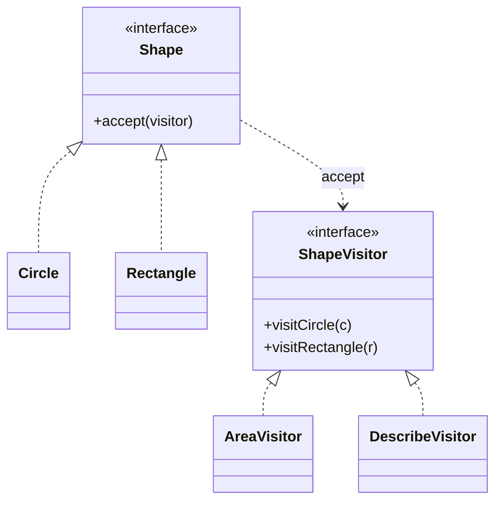

# What is Visitor pattern

---

## 🟢 Junior Level

The **Visitor** pattern is a **Behavioral** design pattern that lets you add new operations to a family of classes **without modifying them**, by moving the operation into a separate visitor object. Each element class has an `accept(visitor)` method that calls back the matching `visit` method (called **double dispatch**).

### Real-World Analogy
A tax inspector visiting different businesses: a restaurant, a bank, a factory. The inspector (visitor) behaves differently for each type, but the businesses only need to say "come in" (`accept`). A new kind of inspector (fire safety) can be added without changing the businesses.

### Minimal Working Example

```java
// Element hierarchy
public interface Shape {
    <R> R accept(ShapeVisitor<R> visitor);
}

public record Circle(double radius) implements Shape {
    @Override public <R> R accept(ShapeVisitor<R> v) { return v.visitCircle(this); }
}

public record Rectangle(double width, double height) implements Shape {
    @Override public <R> R accept(ShapeVisitor<R> v) { return v.visitRectangle(this); }
}

// Visitor
public interface ShapeVisitor<R> {
    R visitCircle(Circle c);
    R visitRectangle(Rectangle r);
}

// Operation 1: area
public class AreaVisitor implements ShapeVisitor<Double> {
    @Override public Double visitCircle(Circle c) { return Math.PI * c.radius() * c.radius(); }
    @Override public Double visitRectangle(Rectangle r) { return r.width() * r.height(); }
}

// Operation 2: description
public class DescribeVisitor implements ShapeVisitor<String> {
    @Override public String visitCircle(Circle c) { return "Circle r=" + c.radius(); }
    @Override public String visitRectangle(Rectangle r) { return "Rect " + r.width() + "x" + r.height(); }
}

public class Demo {
    public static void main(String[] args) {
        java.util.List<Shape> shapes = java.util.List.of(new Circle(1), new Rectangle(2, 3));
        for (Shape s : shapes) {
            System.out.println(s.accept(new DescribeVisitor()) + " area=" + s.accept(new AreaVisitor()));
        }
    }
}
```

### Class Diagram



### Why Double Dispatch?
Java chooses overloads at **compile time** based on static types. With `Shape s = new Circle(1); visitor.visit(s)` the compiler cannot pick `visit(Circle)`. Inside `Circle.accept`, `this` has static type `Circle`, so `v.visitCircle(this)` resolves correctly. The first dispatch is on the element (virtual `accept`), the second on the visitor method.

### When to Use
1. Many distinct operations over a stable set of element types (AST processing, file trees).
2. You want to keep related operation code together in one class instead of spreading it over all elements.

---

## 🟡 Middle Level

### The Expression Problem
| Change | Polymorphic methods (OO) | Visitor (functional style) |
|---|---|---|
| Add a **new operation** | Edit every class | ✅ Add one visitor class |
| Add a **new element type** | ✅ Add one class | Edit every visitor |

Visitor is right when the element hierarchy is stable and operations change often; otherwise use plain polymorphism.

### Visitors in the JDK
- `java.nio.file.FileVisitor<T>` and `Files.walkFileTree` (`SimpleFileVisitor`).
- `javax.lang.model.element.ElementVisitor` (annotation processing), `javax.lang.model.type.TypeVisitor`.
- `com.sun.source.tree.TreeVisitor` (javac AST).
- ASM `ClassVisitor`/`MethodVisitor` for bytecode.
- Jackson `JsonFormatVisitor`; ANTLR parse tree visitors.

```java
import java.io.IOException;
import java.nio.file.*;
import java.nio.file.attribute.BasicFileAttributes;
import java.util.concurrent.atomic.AtomicLong;

public class DirSize {
    public static void main(String[] args) throws IOException {
        AtomicLong total = new AtomicLong();
        Files.walkFileTree(Path.of("."), new SimpleFileVisitor<>() {
            @Override
            public FileVisitResult visitFile(Path file, BasicFileAttributes attrs) {
                total.addAndGet(attrs.size());
                return FileVisitResult.CONTINUE;
            }
        });
        System.out.println(total.get() + " bytes");
    }
}
```

### Modern Java: Sealed Types and Pattern Matching
Java 21 pattern matching for `switch` removes most boilerplate. The compiler enforces exhaustiveness on sealed hierarchies:

```java
public sealed interface Expr permits Num, Add, Mul {}
public record Num(double value) implements Expr {}
public record Add(Expr left, Expr right) implements Expr {}
public record Mul(Expr left, Expr right) implements Expr {}

public final class Evaluator {
    public static double eval(Expr e) {
        return switch (e) {
            case Num n -> n.value();
            case Add a -> eval(a.left()) + eval(a.right());
            case Mul m -> eval(m.left()) * eval(m.right());
        };
    }

    public static String show(Expr e) {
        return switch (e) {
            case Num n -> String.valueOf(n.value());
            case Add a -> "(" + show(a.left()) + " + " + show(a.right()) + ")";
            case Mul m -> show(m.left()) + " * " + show(m.right());
        };
    }
}
```
This provides the same "add operations without touching elements" benefit with no `accept` methods. If you add a new `Expr` subtype, every non-defaulted `switch` fails to compile, which is the same cost as Visitor but flagged by the compiler. Avoid `default` branches in these switches, or you lose that safety.

### Common Mistakes
- **Using Visitor when elements change often.**
- **Breaking encapsulation:** visitors need access to element internals, pushing you to expose getters.
- **Forgetting traversal responsibility:** decide whether the element, the visitor or an iterator traverses children.
- **Stateful visitors reused across runs:** reset state or create a new visitor per traversal.
- **Returning `void` and storing results in fields** instead of using a generic return type.

### Refactoring Example
Before: an `instanceof` ladder `if (n instanceof Add) ... else if (n instanceof Mul)` repeated in the evaluator, printer and optimizer. After: one `Visitor<R>`, or a sealed hierarchy plus switch patterns, so each operation has a single, compiler-checked location.

---

## 🔴 Senior Level

### Performance
- Visitor requires two virtual calls per node (`accept` and `visitX`), and the `accept` call site is megamorphic across element types. For ASTs with millions of nodes consider: arrays-based node storage, switch on an integer node kind, or sealed-switch (which compiles using `invokedynamic` `typeSwitch` bootstraps with decent optimization).
- Deep recursion in visitors of deeply nested trees can overflow the stack; use an explicit stack or run in a thread with a bigger stack size for pathological inputs.
- Generic return types box primitives (`Double` for `double`); in hot paths use specialized visitor interfaces (`DoubleVisitor`) or the switch approach.

### Hierarchical Visitors and Acyclic Visitor
- A visitor interface with N methods is a compile-time dependency from all elements to the visitor interface and vice versa (a cyclic dependency between packages). The **Acyclic Visitor** variant uses a marker `Visitor` interface plus per-element interfaces (`CircleVisitor`) and runtime `instanceof` checks, so adding a type does not break existing visitors, at the cost of runtime dispatch.
- Provide an **adapter base class** (like `SimpleFileVisitor`) with default no-op methods so visitors only override what they need, and new element types don't break existing ones.

```java
public interface ShapeVisitor2<R> {
    default R visitCircle(Circle c) { return fallback(c); }
    default R visitRectangle(Rectangle r) { return fallback(r); }
    R fallback(Shape s);
}
```

### Concurrency
- A stateless visitor can be shared among threads; a stateful visitor (accumulating totals) is not thread-safe. For parallel traversals use a visitor per subtree and a **combine** step (fork/join style), or use thread-safe accumulators (`LongAdder`).
- Never modify the structure during traversal without a plan (`ConcurrentModificationException`, inconsistent results); take an immutable snapshot of the structure first.

### Production Scenarios
- **Compilers/transpilers, linters, static analysis:** AST visitors (javac, Checkstyle, ErrorProne, SpotBugs, JavaParser `VoidVisitorAdapter`).
- **Query/Specification trees:** JPA Criteria, Hibernate HQL AST, Spring Data `PartTree`, translating a domain filter tree to SQL or Elasticsearch queries.
- **Document processing:** rendering a document model into HTML, PDF and Markdown with one visitor per target.
- **Pricing/tax/compliance rules** over a catalog of item types.
- **Bytecode manipulation:** ASM, Byte Buddy for proxies and agents.

### Edge Cases
- **Null elements:** `accept` on null throws; make the structure null-free (see [What is Null Object pattern](29.%20What%20is%20Null%20Object%20pattern.md)).
- **Generic exceptions:** checked exceptions from `visit` methods require a generic `<R, X extends Exception>` signature or wrapping.
- **Serialization boundaries:** a visitor interface that appears in a public API is nearly impossible to evolve; use default methods from day one.
- **Reflection-based visitors** (dynamic dispatch via `MethodHandles`) can emulate multimethods but sacrifice type safety and speed.

### When NOT to Use
- The element hierarchy changes frequently.
- Java 21 sealed types with `switch` give the same effect more simply.
- You only have one or two operations: just add methods to the classes.
- When elements are plain data and visitors need all internals: consider records plus functions.

---

## 🎯 Interview Cheat Sheet

### 30-Second Elevator Pitch
> "**Visitor** puts new operations in separate classes and uses double dispatch (`accept` then `visitX`) so you can add behavior to a stable class hierarchy without editing it. It trades easy new operations for hard new element types, which is the expression problem. In Java 21 I often use sealed interfaces, records and pattern-matching `switch` instead. Real examples are `Files.walkFileTree`, ASM and compiler ASTs."

### Must-Know Bullets
- Double dispatch emulates multimethods in Java.
- Easy to add operations, hard to add element types.
- Sealed + switch patterns is the modern alternative with exhaustiveness checks.
- JDK: `FileVisitor`, annotation-processing visitors.
- Stateful visitors are not thread-safe.

### Common Follow-Up Questions
1. **What is double dispatch?** Selecting a method based on the runtime types of two objects; Java achieves it via `accept` + `visit`.
2. **Visitor vs polymorphism?** Visitor groups operations by operation; polymorphism groups by type.
3. **Visitor vs Iterator?** Iterator traverses; Visitor applies operations; they combine.
4. **Does pattern matching replace Visitor?** In many closed hierarchies, yes.

### Red Flags
- 🚩 Visitor over a volatile hierarchy.
- 🚩 Visitors needing public mutable internals.
- 🚩 `default` branch hiding missing cases in a sealed switch.
- 🚩 Sharing stateful visitors across threads.

### Related Topics
- [What is Composite pattern](19.%20What%20is%20Composite%20pattern.md) — typical structure visited
- [What is Iterator pattern](15.%20What%20is%20Iterator%20pattern.md) — traversal responsibility
- [What is Interpreter pattern](28.%20What%20is%20Interpreter%20pattern.md) — ASTs and evaluation
- [Choosing the right pattern and avoiding pattern overuse](38.%20Choosing%20the%20right%20pattern%20and%20avoiding%20pattern%20overuse.md) — Visitor vs sealed types
- [Difference between State and Strategy](13.%20Difference%20between%20State%20and%20Strategy.md) — sealed dispatch for state machines
