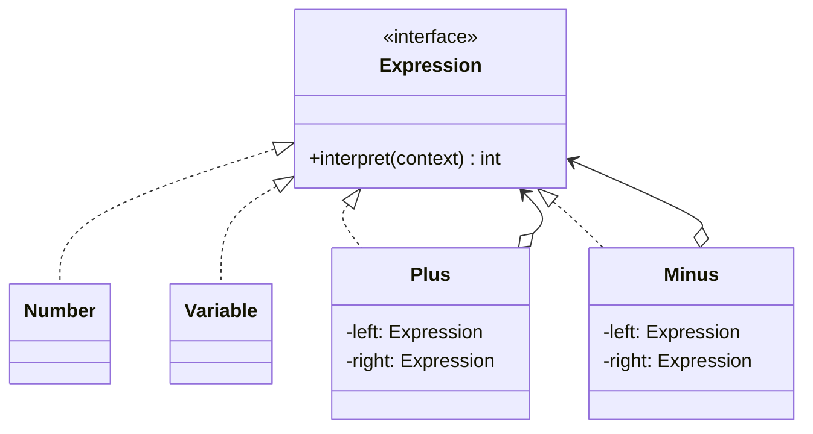

# What is Interpreter pattern

---

## 🟢 Junior Level

The **Interpreter** pattern is a **Behavioral** design pattern that defines a representation for the grammar of a simple language together with an interpreter that uses the representation to evaluate sentences in that language. Each grammar rule becomes a class, and a sentence becomes a tree of objects (an abstract syntax tree, AST).

### Real-World Analogy
A musician reading sheet music. The notation is a small language with rules (notes, rests, tempo). Each symbol has a defined meaning, and the musician interprets the whole piece by combining the symbols.

### Minimal Working Example

A tiny arithmetic language: numbers, variables, `+`, `-`.

```java
import java.util.Map;

public interface Expression {
    int interpret(Map<String, Integer> context);
}

// Terminal expressions
public class Number implements Expression {
    private final int value;
    public Number(int value) { this.value = value; }
    @Override public int interpret(Map<String, Integer> ctx) { return value; }
}

public class Variable implements Expression {
    private final String name;
    public Variable(String name) { this.name = name; }
    @Override public int interpret(Map<String, Integer> ctx) {
        Integer v = ctx.get(name);
        if (v == null) throw new IllegalStateException("Unbound variable " + name);
        return v;
    }
}

// Non-terminal expressions
public class Plus implements Expression {
    private final Expression left, right;
    public Plus(Expression l, Expression r) { left = l; right = r; }
    @Override public int interpret(Map<String, Integer> ctx) {
        return left.interpret(ctx) + right.interpret(ctx);
    }
}

public class Minus implements Expression {
    private final Expression left, right;
    public Minus(Expression l, Expression r) { left = l; right = r; }
    @Override public int interpret(Map<String, Integer> ctx) {
        return left.interpret(ctx) - right.interpret(ctx);
    }
}

public class Demo {
    public static void main(String[] args) {
        // (x + 5) - y
        Expression expr = new Minus(new Plus(new Variable("x"), new Number(5)), new Variable("y"));
        System.out.println(expr.interpret(Map.of("x", 10, "y", 3))); // 12
    }
}
```

### Class Diagram



### When to Use
1. A problem recurs often and can be expressed as sentences in a simple language: rules, filters, formulas, search queries.
2. The grammar is **small and stable**.
3. Efficiency is not the top priority.

---

## 🟡 Middle Level

### Structure
- **AbstractExpression:** `interpret(context)`.
- **TerminalExpression:** leaves (numbers, variables).
- **NonterminalExpression:** composites that hold sub-expressions (Plus, And, Or).
- **Context:** global information (variable bindings).
- **Client:** builds the AST, often with a parser.

The AST is a **Composite** (see [What is Composite pattern](19.%20What%20is%20Composite%20pattern.md)). Operations other than evaluation (printing, optimizing, type-checking) are better handled by a **Visitor** or pattern matching (see [What is Visitor pattern](27.%20What%20is%20Visitor%20pattern.md)), otherwise every operation needs a new method on every node.

### A Parser Is Needed Too
The pattern defines *evaluation*, not parsing. A tiny recursive-descent parser for `+`/`-`:

```java
import java.util.Map;

public class SimpleParser {
    private final String[] tokens;
    private int pos = 0;

    public SimpleParser(String input) {
        this.tokens = input.trim().split("\\s+");
    }

    // expr := term (('+' | '-') term)*
    public Expression parse() {
        Expression left = term();
        while (pos < tokens.length) {
            String op = tokens[pos++];
            Expression right = term();
            left = op.equals("+") ? new Plus(left, right) : new Minus(left, right);
        }
        return left;
    }

    private Expression term() {
        String t = tokens[pos++];
        return Character.isDigit(t.charAt(0)) ? new Number(Integer.parseInt(t)) : new Variable(t);
    }

    public static void main(String[] args) {
        Expression e = new SimpleParser("x + 5 - y").parse();
        System.out.println(e.interpret(Map.of("x", 10, "y", 3))); // 12
    }
}
```
(`Expression`, `Number`, `Variable`, `Plus`, `Minus` are from the Junior example; `Number` here shadows `java.lang.Number`, so name your class `Num` in real code.)

### Interpreters Already in the JDK and Spring
- `java.util.regex.Pattern` compiles a regex into a node graph and `Matcher` interprets it.
- `java.text.Format` (`MessageFormat`, `SimpleDateFormat`) interpret pattern strings.
- `javax.script.ScriptEngine`, `java.time.format.DateTimeFormatter.ofPattern`.
- **Spring Expression Language (SpEL):** `ExpressionParser` builds an AST (`SpelExpression`) that is evaluated against an `EvaluationContext`.
- Spring Data query derivation (`findByNameAndAgeGreaterThan` is parsed into a `PartTree`).
- JPQL/HQL, Spring Security's `hasRole('ADMIN') and #id == principal.id` expressions.

```java
import org.springframework.expression.ExpressionParser;
import org.springframework.expression.spel.standard.SpelExpressionParser;
import org.springframework.expression.spel.support.StandardEvaluationContext;

public class SpelDemo {
    public static void main(String[] args) {
        ExpressionParser parser = new SpelExpressionParser();
        StandardEvaluationContext ctx = new StandardEvaluationContext();
        ctx.setVariable("price", 200);
        Integer result = parser.parseExpression("#price * 0.9").getValue(ctx, Integer.class);
        System.out.println(result); // 180
    }
}
```

### Common Mistakes
- **Using Interpreter for a large grammar:** the class count explodes (one per rule). Use a parser generator (ANTLR, JavaCC) instead.
- **Evaluating untrusted expressions** without sandboxing (SpEL/OGNL/MVEL injection vulnerabilities).
- **Parsing at every evaluation:** parse once, cache the AST, and evaluate many times.
- **Mixing parsing and evaluation** in the same classes.
- **Missing error handling:** report position and token for syntax errors.

### Modern Java Version with Sealed Interfaces and Records

```java
import java.util.Map;

public sealed interface Expr permits Num, Var, Bin {}
public record Num(int value) implements Expr {}
public record Var(String name) implements Expr {}
public record Bin(char op, Expr left, Expr right) implements Expr {}

public final class Eval {
    public static int eval(Expr e, Map<String, Integer> env) {
        return switch (e) {
            case Num n -> n.value();
            case Var v -> {
                Integer value = env.get(v.name());
                if (value == null) throw new IllegalStateException("Unbound " + v.name());
                yield value;
            }
            case Bin b -> switch (b.op()) {
                case '+' -> eval(b.left(), env) + eval(b.right(), env);
                case '-' -> eval(b.left(), env) - eval(b.right(), env);
                case '*' -> eval(b.left(), env) * eval(b.right(), env);
                default -> throw new IllegalArgumentException("Unknown op " + b.op());
            };
        };
    }
}
```
Data (AST) and operations (evaluation) are separate, which fits the functional style and avoids a method per node class.

---

## 🔴 Senior Level

### Performance
- A tree-walking interpreter has high per-node overhead: virtual calls, boxing, poor locality. For hot expressions consider **compiling**: generate bytecode (ASM, Byte Buddy, `javax.tools.JavaCompiler`, `MethodHandle` trees) or convert to a lambda/`MethodHandle` chain once. SpEL does this: `SpelCompilerMode.IMMEDIATE` compiles expressions to bytecode after repeated evaluations.
- Cache compiled expressions in a `ConcurrentHashMap<String, Expression>`; unbounded caches keyed by user input are a memory-DoS vector, so bound them (Caffeine).
- Constant folding and short-circuiting simplify the AST before evaluation (a Visitor/optimizer pass).

### Concurrency and Immutability
- Immutable AST nodes (records) are freely shareable across threads. Keep evaluation state in the **context** (local environment), not in nodes. SpEL's `SpelExpression` is thread-safe but `EvaluationContext` may not be; create a context per evaluation or use a read-only one.
- Cached ASTs with mutable nodes (e.g., storing "last value") break under concurrency.

### Security
- Never evaluate user-supplied SpEL/OGNL/MEL/JEXL with a full-powered context: they can call `T(java.lang.Runtime).getRuntime().exec(...)` (known CVEs, e.g., Spring4Shell-adjacent and many OGNL RCEs). Use `SimpleEvaluationContext` (restricted), allow-lists, and size/depth/time limits.
- Resource exhaustion: regular expressions with catastrophic backtracking (ReDoS), deeply nested expressions causing stack overflow. Impose limits (max depth, token count, timeouts).

### Choosing Alternatives
| Need | Better than hand-written Interpreter |
|---|---|
| Complex grammar | ANTLR, JavaCC, parser combinators |
| Business rules | Rule engines (Drools), decision tables |
| Safe user formulas | Restricted SpEL, CEL (Common Expression Language), JsonLogic |
| Filters | Specification pattern or JPA Criteria (see [Specification pattern](33.%20Specification%20pattern.md)) |
| Scripting | GraalVM polyglot with sandbox settings |
| Internal DSL | Fluent builders, lambdas |

### Production Scenarios
- **Pricing/discount rule DSLs** configured by business users and stored in a DB.
- **Search query languages** (`status:open AND assignee:me`) translated to SQL/Elasticsearch.
- **Feature-flag targeting rules** evaluated per request (cache the AST, bound execution).
- **Workflow conditions** on edges in BPMN engines (JUEL/SpEL).
- **Validation expressions** in annotation attributes (`@PreAuthorize`, `@Cacheable(condition=...)`).

### Edge Cases
- **Operator precedence and associativity** are encoded in the parser, not in the AST; test `a - b - c` yields `(a - b) - c`.
- **Integer overflow and division by zero** need explicit semantics; use `Math.addExact` where wrap-around would be wrong.
- **Type systems:** adding types (strings, booleans, null) demands a type checker pass to avoid runtime `ClassCastException`.
- **Error locations:** keep line/column in nodes for diagnostics.
- **Versioning:** persisted expressions must remain valid across releases; version the grammar.

### When NOT to Use
- Grammar is large or evolving: use a parser generator or a real scripting engine.
- Performance critical: compile.
- Users can supply expressions and you cannot sandbox: do not evaluate them at all.
- A `Predicate`/`Function` composed in code is sufficient.

---

## 🎯 Interview Cheat Sheet

### 30-Second Elevator Pitch
> "**Interpreter** represents each rule of a small grammar as a class and evaluates sentences by walking an AST of expression objects. It is a Composite plus an `interpret` operation. It suits small, stable DSLs: regex, SpEL, Spring Data query derivation. For big grammars I use ANTLR, for hot paths I compile the AST, and for user-provided expressions I sandbox heavily because expression injection is a real RCE risk."

### Must-Know Bullets
- Terminal vs non-terminal expressions form an AST (Composite).
- Pattern covers evaluation, not parsing.
- Parse once, cache AST, evaluate many times.
- Sealed records + `switch` is a concise modern implementation.
- Security: sandbox SpEL/OGNL; limit depth and runtime.

### Common Follow-Up Questions
1. **Where is Interpreter used in Spring?** SpEL, `@PreAuthorize`, `@Cacheable(condition)`, query derivation.
2. **Interpreter vs Visitor?** Interpreter defines the tree and evaluation; Visitor externalizes operations over the tree.
3. **Why not use it for large languages?** Class explosion and slow tree walking; use parser generators.
4. **How do you make it fast?** Compile to bytecode / `MethodHandle`s; cache.

### Red Flags
- 🚩 Evaluating untrusted expressions with a full context.
- 🚩 Re-parsing on every call.
- 🚩 Mutable shared AST nodes.
- 🚩 Hand-rolling a large language grammar.

### Related Topics
- [What is Composite pattern](19.%20What%20is%20Composite%20pattern.md) — AST structure
- [What is Visitor pattern](27.%20What%20is%20Visitor%20pattern.md) — extra operations over the AST
- [Specification pattern](33.%20Specification%20pattern.md) — composable business rules without a grammar
- [What is Command pattern](23.%20What%20is%20Command%20pattern.md) — executable scripts as commands
- [Patterns used inside the JDK and Spring](37.%20Patterns%20used%20inside%20the%20JDK%20and%20Spring.md) — regex and SpEL examples
