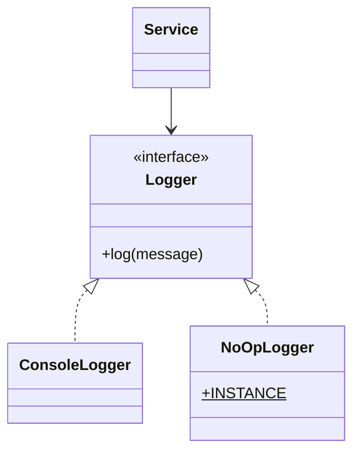

# What is Null Object pattern

---

## 🟢 Junior Level

The **Null Object** pattern is a **Behavioral** design pattern that replaces `null` references with an object that implements the expected interface but does **nothing** (or returns neutral defaults). Clients can call it freely without writing `if (x != null)` checks.

### Real-World Analogy
A "do not disturb" placeholder guest in a seating plan, or an empty list instead of "no list". A sink drain accepting water silently vs. a missing drain that floods the floor: the placeholder absorbs calls harmlessly.

### The Problem

```java
public interface Logger {
    void log(String message);
}

public class Service {
    private final Logger logger; // may be null?

    public Service(Logger logger) { this.logger = logger; }

    public void run() {
        if (logger != null) {       // null checks everywhere
            logger.log("starting");
        }
        // ... work ...
        if (logger != null) {
            logger.log("done");
        }
    }
}
```
Forgetting one check leads to `NullPointerException`.

### The Solution

```java
public interface Logger {
    void log(String message);
}

public class ConsoleLogger implements Logger {
    @Override public void log(String message) { System.out.println(message); }
}

// The Null Object
public final class NoOpLogger implements Logger {
    public static final NoOpLogger INSTANCE = new NoOpLogger();
    private NoOpLogger() {}
    @Override public void log(String message) { /* intentionally nothing */ }
}

public class Service {
    private final Logger logger;

    public Service(Logger logger) {
        this.logger = java.util.Objects.requireNonNull(logger, "use NoOpLogger.INSTANCE");
    }

    public void run() {
        logger.log("starting"); // no null checks
        logger.log("done");
    }
}

public class Demo {
    public static void main(String[] args) {
        new Service(NoOpLogger.INSTANCE).run();     // silent
        new Service(new ConsoleLogger()).run();     // prints
    }
}
```

### Class Diagram



### When to Use
1. Many callers repeat `null` checks before invoking the same collaborator.
2. "Do nothing" is a sensible, safe default behavior.
3. You want to eliminate `NullPointerException` risk in optional collaborators.

---

## 🟡 Middle Level

### Null Objects in the JDK
- `Collections.emptyList()`, `emptyMap()`, `emptySet()`, `Collections.emptyIterator()`: iterate with no special-casing.
- `java.io.OutputStream.nullOutputStream()` (Java 11), `InputStream.nullInputStream()`, `Reader.nullReader()`, `Writer.nullWriter()`.
- `java.util.logging.Handler` with no handlers; `System.Logger`.
- `Optional.empty()` is a *typed absence* rather than a behavioral Null Object.
- `java.util.concurrent.Executors` `DiscardPolicy` (a rejected-execution null object).
- `Comparator.naturalOrder()`/`Function.identity()` are neutral elements.

Spring and others: `NoOpCacheManager`, `NoOpCache`, `NoOpPasswordEncoder` (deprecated; for tests), Micrometer `NoopMeter`/`NoopTimer`, SLF4J `NOPLogger`, Spring's `NullBean`, `NullPortMapper`.

```java
import java.io.IOException;
import java.io.OutputStream;
import java.io.PrintStream;

public class NullStreamDemo {
    public static void main(String[] args) throws IOException {
        try (OutputStream sink = OutputStream.nullOutputStream();
             PrintStream out = new PrintStream(sink)) {
            out.println("discarded");
        }
    }
}
```

### Null Object vs Optional vs Returning Empty Collections
| Approach | Use when |
|---|---|
| **Null Object** | Caller needs polymorphic behavior (call methods on it) |
| **`Optional<T>`** | Absence is meaningful and caller must decide what to do |
| **Empty collection** | Returning "zero results" from a method |
| **Throw exception** | Absence is an error |
| **`@Nullable`** | Interop with legacy APIs, documented absence |

Optional forces the caller to handle absence; Null Object hides absence. Choose based on whether silence is correct.

### Spring Usage: Optional Dependencies

```java
import org.springframework.beans.factory.annotation.Autowired;
import org.springframework.boot.autoconfigure.condition.ConditionalOnMissingBean;
import org.springframework.context.annotation.Bean;
import org.springframework.context.annotation.Configuration;
import org.springframework.stereotype.Service;

public interface AuditSink {
    void record(String event);
}

@Configuration
class AuditConfig {
    // Registered only when the application hasn't defined its own AuditSink
    @Bean
    @ConditionalOnMissingBean(AuditSink.class)
    AuditSink noOpAuditSink() {
        return event -> { };
    }
}

@Service
class PaymentService {
    private final AuditSink audit;

    @Autowired
    PaymentService(AuditSink audit) { this.audit = audit; }

    void pay() { audit.record("payment"); }  // never null
}
```
This is the standard Spring Boot auto-configuration idiom: a no-op default that is replaced when a real bean exists. A lambda works because `AuditSink` is a functional interface.

### Common Mistakes
- **Hiding real errors:** a Null Object that silently swallows failures makes debugging hard (e.g., a no-op payment gateway in production). Log a warning or restrict to harmless operations.
- **Returning null Object for a query result** where "not found" should be explicit.
- **Multiple Null Object instances** when a singleton suffices (they are stateless).
- **Making the Null Object mutable,** so one caller "pollutes" others.
- **Inconsistent semantics:** `isNull()` flags leaking into the interface reintroduce conditionals.
- **Overusing:** where "no object" is a business error, not a neutral case.

### Refactoring Example
Before: `Customer c = repo.find(id); String plan = (c == null) ? "none" : c.getPlan().getName();` repeated across the codebase. After: `repo.findOrGuest(id)` returns `GuestCustomer` (a Null Object with plan `NONE`, no discounts), and callers use `customer.plan().name()` uniformly. If absence is business-significant (e.g., 404), return `Optional<Customer>` instead.

---

## 🔴 Senior Level

### Design Trade-offs
- **Fail-fast vs fail-silent:** Null Object favors robustness in optional, non-critical collaborators (logging, metrics, caching, notifications, audit with best-effort semantics). For critical collaborators (payments, authorization) silently doing nothing is dangerous: an *AllowAll* or *NoOp* security component is a classic vulnerability. For auth, the Null Object should be **deny-by-default**.
- **Liskov Substitution:** the Null Object must respect the interface contract. If `findPrice()` must return a positive number, a Null Object returning `0` violates the postcondition. Define neutral elements deliberately (empty, zero, identity).
- **API design:** prefer making "absent" explicit at boundaries (`Optional`, sealed result types) and using Null Object internally for behavior defaults.

```java
// Deny-by-default Null Object for authorization
public interface AccessPolicy {
    boolean allows(String user, String action);
}

public final class DenyAllPolicy implements AccessPolicy {
    public static final DenyAllPolicy INSTANCE = new DenyAllPolicy();
    private DenyAllPolicy() {}
    @Override public boolean allows(String user, String action) { return false; }
}
```

### Performance and JVM
- Null Object calls are cheap virtual calls. With a stable pair of implementations (real + no-op) the call site is bimorphic and inlined. A no-op body is eliminated entirely after inlining, which can be faster than a null check in the real-vs-nothing hot path; however if logger arguments are built eagerly (string concatenation), the work happens even when output is discarded. Use lazy suppliers or parameterized messages:

```java
import java.util.function.Supplier;

public interface Log {
    void debug(Supplier<String> message);
}

final class NoOpLog implements Log {
    @Override public void debug(Supplier<String> message) { /* never calls message.get() */ }
}
```
- Shared singleton Null Objects avoid allocation; they are safe because they are stateless and immutable.
- `Collections.emptyList()` returns a shared immutable instance, so use it instead of `new ArrayList<>()` for "no results".

### Concurrency
- A stateless, immutable Null Object is trivially thread-safe and can be a static singleton (enum singleton also works: see [What is Singleton](03.%20What%20is%20Singleton.md)).
- Beware a "Null Object" with hidden state (a counter, queue) that accumulates data from all callers: a memory leak.
- Swapping between real and Null Object at runtime (feature toggles, circuit breaker fallbacks) requires safe publication: use `volatile` or `AtomicReference<Logger>` and read once per operation.

### Production Scenarios
- **Optional observability:** metrics/tracing disabled in tests or low environments.
- **Graceful degradation:** a recommendations service down, fallback returns `EmptyRecommendations` (see [Circuit Breaker Retry and Bulkhead resilience patterns](38.%20Circuit%20Breaker%20Retry%20and%20Bulkhead%20resilience%20patterns.md)).
- **Test doubles:** simple no-op collaborators in unit tests.
- **Default strategies** in a library: `NoOpRetryPolicy`, `NoOpCacheManager` (cache disabled by config yet code paths unchanged).
- **Domain modeling:** `NoDiscount`, `EmptyCart`, `GuestUser`, `UnknownCurrency`.

### Edge Cases
- **Equality semantics:** `NoOpLogger.INSTANCE.equals(other)`; use identity or enum when you need `==` checks, but then you reintroduce conditionals; avoid.
- **Serialization:** singleton Null Objects must preserve identity on deserialization (`readResolve` or enum).
- **JPA/Jackson:** Null Objects in entity relations are hard to persist; map to null at the boundary or use `@Embedded` defaults. Jackson `JsonInclude.NON_EMPTY` can hide them but might surprise clients.
- **Pattern matching:** with sealed types, a `NoCustomer` variant makes absence explicit and exhaustive in `switch`.

### When NOT to Use
- Absence is an exceptional or business-significant condition (not found, unauthorized): use exceptions, `Optional` or result types.
- The no-op might hide failures in critical operations.
- The interface is large and no meaningful neutral behavior exists for most methods.
- When `Optional.ifPresent` is a clearer expression for a one-off case.

---

## 🎯 Interview Cheat Sheet

### 30-Second Elevator Pitch
> "**Null Object** replaces `null` with an object implementing the same interface that safely does nothing or returns neutral values, so callers skip null checks and polymorphism does the work. The JDK has `Collections.emptyList()` and `OutputStream.nullOutputStream()`, and Spring Boot uses no-op defaults via `@ConditionalOnMissingBean`. I use it only where silence is the correct behavior; for critical or business-significant absence I use `Optional`, exceptions or sealed result types, and security defaults must be deny-by-default."

### Must-Know Bullets
- Same interface, neutral behavior, usually a stateless singleton.
- JDK: empty collections, null streams; Spring: `NoOpCache`, Micrometer noop meters.
- Null Object vs Optional: hide vs surface absence.
- Must obey the interface contract (LSP).
- Beware of silently ignoring failures; deny-by-default for security.

### Common Follow-Up Questions
1. **Null Object vs Optional?** Null Object provides behavior; Optional forces callers to handle absence.
2. **Why return empty collections instead of null?** Avoids NPEs and null checks; it's an application of Null Object.
3. **Can the Null Object be a singleton?** Yes, if stateless and immutable.
4. **When is Null Object dangerous?** When it masks failures or grants access by default.

### Red Flags
- 🚩 Null Object that swallows critical errors silently.
- 🚩 `isNull()` flags polluting the interface.
- 🚩 Stateful or mutable Null Object shared globally.
- 🚩 Allow-all security Null Object.

### Related Topics
- [What is Singleton](03.%20What%20is%20Singleton.md) — stateless Null Object as singleton
- [When to use Strategy](10.%20When%20to%20use%20Strategy.md) — a no-op strategy
- [Difference between State and Strategy](13.%20Difference%20between%20State%20and%20Strategy.md) — "empty" state objects
- [Circuit Breaker Retry and Bulkhead resilience patterns](38.%20Circuit%20Breaker%20Retry%20and%20Bulkhead%20resilience%20patterns.md) — fallbacks returning neutral objects
- [Dependency Injection and Inversion of Control as patterns](30.%20Dependency%20Injection%20and%20Inversion%20of%20Control%20as%20patterns.md) — default no-op beans
