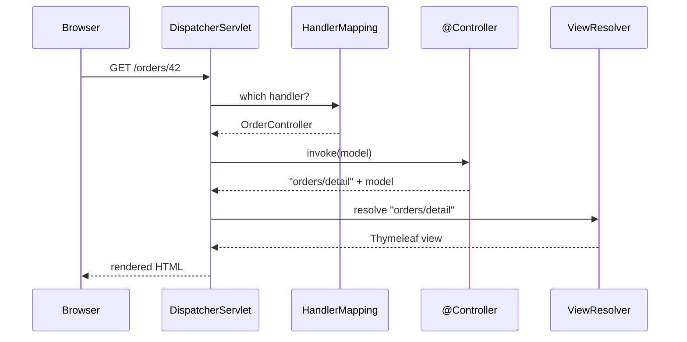

# Front Controller and MVC MVP MVVM

---

## 🟢 Junior Level

* **Front Controller** — one entry point receives *every* request and decides which handler should process it. In Spring MVC this is the `DispatcherServlet`.
* **MVC (Model–View–Controller)** — splits a UI into the **Model** (data and rules), the **View** (rendering), and the **Controller** (handles input and chooses the view).
* **MVP (Model–View–Presenter)** — the view is passive; a **Presenter** holds the UI logic and pushes data into the view through an interface.
* **MVVM (Model–View–ViewModel)** — the view *binds* to a **ViewModel** that exposes observable state; changes propagate automatically.

### Real-world analogy
A hotel reception desk is a front controller: every guest goes there first, and the receptionist routes them to housekeeping, the restaurant, or the concierge. Nobody walks straight into the kitchen.

### Spring MVC in one picture



```java
@Controller
@RequestMapping("/orders")
class OrderController {
    private final OrderQueries queries;
    OrderController(OrderQueries queries) { this.queries = queries; }

    @GetMapping("/{id}")
    String show(@PathVariable long id, Model model) {
        model.addAttribute("order", queries.byId(id)); // Model
        return "orders/detail";                        // logical View name
    }
}
```

---

## 🟡 Middle Level

### What the Front Controller centralizes
Because every request passes through one place, cross-cutting concerns live there instead of in each handler:

* Routing (`HandlerMapping`), argument resolution (`HandlerMethodArgumentResolver`), and return value handling (`HttpMessageConverter` for JSON).
* Interceptors (`HandlerInterceptor.preHandle/postHandle/afterCompletion`) for auth, locale, timing.
* Centralized error handling (`@ControllerAdvice` + `HandlerExceptionResolver`).
* Servlet filters (`OncePerRequestFilter`, Spring Security's `FilterChainProxy`) wrap the front controller one level earlier.

### MVC vs MVP vs MVVM

| | MVC (web) | MVP | MVVM |
| --- | --- | --- | --- |
| Who handles input | Controller | View forwards to Presenter | View binds commands to ViewModel |
| View knows about | Model (for rendering) | Presenter interface | ViewModel (via bindings) |
| Testability of UI logic | Controller testable with MockMvc | Presenter testable with a fake view | ViewModel testable without UI |
| Typical stacks | Spring MVC + Thymeleaf, Rails | Android (classic), GWT, Swing | Angular, Vue, WPF, Jetpack Compose state |
| Update flow | Request → render full page | Presenter calls `view.showX()` | Observable state → automatic re-render |

### REST controllers are still MVC
With `@RestController`, the "view" is the JSON serialization done by `MappingJackson2HttpMessageConverter`. The rules stay the same: controllers translate HTTP into application calls and back, and contain no business logic.

```java
@RestController
@RequestMapping("/api/orders")
class OrderApi {
    @PostMapping
    ResponseEntity<OrderDto> create(@Valid @RequestBody CreateOrderRequest req, UriComponentsBuilder uri) {
        OrderDto created = service.create(req.toCommand());
        return ResponseEntity.created(uri.path("/api/orders/{id}").build(created.id())).body(created);
    }
}
```

### Common mistakes
* "Fat controllers" with repository calls, transactions and rules — move them to the service layer.
* Returning JPA entities as the "model" — leaks persistence details and triggers lazy-loading exceptions during serialization. Return DTOs.
* Putting `@Transactional` on controllers to "fix" `LazyInitializationException`.

---

## 🔴 Senior Level

### DispatcherServlet internals that matter in production

```java
// Simplified doDispatch flow (DispatcherServlet)
HandlerExecutionChain chain = getHandler(request);          // iterate HandlerMappings in order
HandlerAdapter adapter = getHandlerAdapter(chain.getHandler());
if (!chain.applyPreHandle(request, response)) return;       // interceptors can short-circuit
ModelAndView mv = adapter.handle(request, response, handler); // argument resolution + invocation
chain.applyPostHandle(request, response, mv);
processDispatchResult(request, response, chain, mv, exception); // view rendering or exception resolvers
```

* `RequestMappingHandlerMapping` builds its routing table at startup; ambiguous mappings fail fast.
* Path matching uses `PathPatternParser` (Spring 6 default), which pre-parses patterns and is much faster than `AntPathMatcher` for large route tables.
* Async return types (`Callable`, `DeferredResult`, `CompletableFuture`) release the servlet thread and resume dispatch later; interceptors must implement `AsyncHandlerInterceptor` to see completion.
* With virtual threads (`spring.threads.virtual.enabled=true`, Boot 3.2+), blocking controllers scale without async return types.

### Front Controller beyond the servlet
The same pattern appears at other layers:
* **API Gateway** (Spring Cloud Gateway) — a front controller for a whole microservice landscape: routing, auth, rate limiting at one entry point.
* **WebFlux `DispatcherHandler`** — the reactive equivalent, with `HandlerMapping`/`HandlerAdapter`/`HandlerResultHandler`.
* **Message routers** — a single consumer dispatching messages by type to handlers.

The trade-off is always the same: one place for cross-cutting policy versus a potential bottleneck and single point of failure that must be kept thin and highly available.

### MVVM and unidirectional data flow
Modern frontends (React with Redux, Vue/Pinia, Compose) evolved MVVM into *unidirectional data flow*: state → view → events → reducer → new state. Two-way binding is convenient for forms but makes large UIs hard to reason about because any binding can mutate shared state. For a full stack engineer, the key insight is that the backend REST API should expose *resources and commands*, not mirror one screen's ViewModel — otherwise every UI change forces an API change. When screens need aggregated data, add a Backend-for-Frontend instead of bloating core APIs.

---

## 🎯 Interview Cheat Sheet

**30-second pitch:** A Front Controller is a single entry point that routes all requests and centralizes cross-cutting concerns; in Spring that is `DispatcherServlet`. MVC, MVP and MVVM split presentation into model, view and a mediator — controller, presenter or view-model — differing in who handles input and how the view gets updated.

**Must know:**
* DispatcherServlet flow: HandlerMapping → interceptors → HandlerAdapter → view resolution / message converters.
* Controllers translate HTTP; business logic belongs in services.
* MVP: passive view behind an interface; MVVM: data binding to observable state.
* Return DTOs, not entities, from controllers.

**Common follow-ups:**
* Difference between a servlet filter and a `HandlerInterceptor`?
* How does `@ControllerAdvice` fit into the front controller?
* Is an API gateway a front controller?

**Red flags:** controllers calling repositories and opening transactions; confusing MVC with three-tier architecture; returning entities directly as JSON.

**Related:**
* [What is Facade pattern](18.%20What%20is%20Facade%20pattern.md)
* [What is Chain of Responsibility pattern](22.%20What%20is%20Chain%20of%20Responsibility%20pattern.md)
* [What is Mediator pattern](25.%20What%20is%20Mediator%20pattern.md)
* [Patterns used inside the JDK and Spring](37.%20Patterns%20used%20inside%20the%20JDK%20and%20Spring.md)
