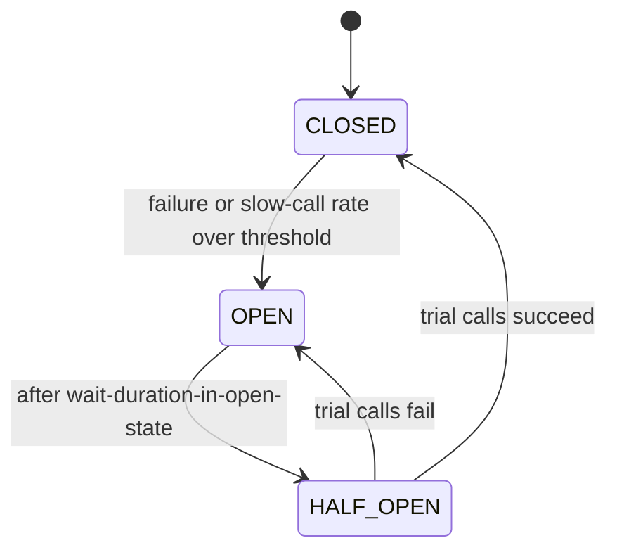

# Circuit Breaker Retry and Bulkhead resilience patterns

---

## 🟢 Junior Level

When one service calls another over the network, the call can be slow or fail. Three patterns keep failures from spreading:

* **Retry** — try again after a short wait, because many failures are temporary (a dropped packet, a restarting pod).
* **Circuit Breaker** — after many failures, stop calling the broken service for a while and fail immediately, giving it time to recover.
* **Bulkhead** — limit how many resources (threads, connections) each dependency can use, so one slow dependency cannot consume all of them.

### Real-world analogy
* *Retry*: redialing a phone number when the line was busy.
* *Circuit breaker*: the electrical breaker in your house trips to stop a fire; you reset it once the fault is fixed.
* *Bulkhead*: a ship's hull is split into watertight compartments, so one leak does not sink the whole ship.

### Resilience4j with Spring Boot

```java
@Service
class PricingClient {
    private final RestClient rest;

    @CircuitBreaker(name = "pricing", fallbackMethod = "cachedPrice")
    @Retry(name = "pricing")
    @Bulkhead(name = "pricing")
    public Price priceFor(String sku) {
        return rest.get().uri("/prices/{sku}", sku).retrieve().body(Price.class);
    }

    private Price cachedPrice(String sku, Throwable cause) {
        return priceCache.lastKnown(sku).orElseThrow(() -> new PricingUnavailableException(sku, cause));
    }
}
```

---

## 🟡 Middle Level

### Configuration that actually works

```yaml
resilience4j:
  retry:
    instances:
      pricing:
        max-attempts: 3                       # 1 call + 2 retries
        wait-duration: 200ms
        enable-exponential-backoff: true
        exponential-backoff-multiplier: 2     # 200ms, 400ms
        retry-exceptions: [java.io.IOException, org.springframework.web.client.ResourceAccessException]
        ignore-exceptions: [com.shop.pricing.PriceNotFoundException]  # 404 is not transient
  circuitbreaker:
    instances:
      pricing:
        sliding-window-type: COUNT_BASED
        sliding-window-size: 50
        minimum-number-of-calls: 20           # don't trip on 3 failures at startup
        failure-rate-threshold: 50            # % failures to open
        slow-call-duration-threshold: 1s
        slow-call-rate-threshold: 80          # slow calls also count
        wait-duration-in-open-state: 10s
        permitted-number-of-calls-in-half-open-state: 5
  bulkhead:
    instances:
      pricing:
        max-concurrent-calls: 20
        max-wait-duration: 0                  # reject immediately when full
```

### Circuit breaker states



In `OPEN`, calls fail with `CallNotPermittedException` in microseconds — that is the point: the caller's threads are not held hostage by a dead dependency.

### Retry rules
* Only retry **idempotent** operations (GET, PUT with full replacement, POST with an idempotency key).
* Only retry **transient** errors: timeouts, connection resets, 502/503/504, 429 (honor `Retry-After`). Never retry 400, 401, 404, 422.
* Add **jitter** so thousands of clients do not retry in lockstep.

### Bulkhead types in Resilience4j
* `SemaphoreBulkhead` — limits concurrent calls on the caller's thread. Cheap; works with virtual threads.
* `ThreadPoolBulkhead` — runs calls on a dedicated bounded pool and queue; isolates blocking calls and returns `CompletionStage`.

---

## 🔴 Senior Level

### Ordering matters
Resilience4j's Spring aspect applies decorators in this order by default (outermost first):

```
Retry ( CircuitBreaker ( RateLimiter ( TimeLimiter ( Bulkhead ( call ) ) ) ) )
```

Consequences:
* Each retry attempt is recorded by the circuit breaker — three failed attempts count as three failures, so the breaker trips sooner.
* When the breaker is open, Retry sees `CallNotPermittedException`. Add it to `ignore-exceptions` for retry, or you will "retry" an open circuit and add pointless latency.
* The aspect order is configurable (`resilience4j.retry.retry-aspect-order`, etc.); state the order explicitly in reviews.

### Retry amplification
Retries multiply load exactly when the system is weakest. With three layers (gateway → service A → service B), each retrying 3 times, one user request can become **3 × 3 × 3 = 27** calls to B. Mitigations:
* Retry at **one** layer only, usually closest to the user, or use a **retry budget** (retries ≤ 10–20% of normal traffic).
* Propagate a **deadline** (e.g. `X-Request-Deadline` or gRPC deadlines) and stop retrying when the remaining time is too short.
* Use exponential backoff with *full jitter*: `sleep = random(0, min(cap, base × 2^attempt))`.

### Timeouts are the foundation
A circuit breaker without a timeout never sees a failure when the dependency hangs. Every remote call needs:
* **connect timeout** (e.g. 500 ms) and **read/response timeout** sized from the dependency's p99.9 plus margin,
* an overall time limit (`TimeLimiter` for async calls),
* and pool timeouts (`connectionTimeout` for JDBC, `pendingAcquireTimeout` for Reactor Netty).

```java
RestClient rest = RestClient.builder()
        .requestFactory(ClientHttpRequestFactoryBuilder.jdk().build(
                ClientHttpRequestFactorySettings.defaults()
                        .withConnectTimeout(Duration.ofMillis(500))
                        .withReadTimeout(Duration.ofSeconds(2))))
        .baseUrl("http://pricing")
        .build();
```

### Sizing a bulkhead with Little's law
Concurrency needed ≈ throughput × latency. If pricing serves 200 req/s at p99 150 ms, steady-state concurrency is 200 × 0.15 = 30. A bulkhead of ~40 tolerates bursts; when pricing degrades to 2 s latency, the bulkhead caps usage at 40 instead of letting it grow to 400 and starve the servlet/virtual-thread carrier pool and the JDBC pool.

### Observability
Export `resilience4j_circuitbreaker_state`, `_failure_rate`, `_slow_call_rate`, `resilience4j_retry_calls{kind="successful_with_retry"}`, and `resilience4j_bulkhead_available_concurrent_calls` via Micrometer. Alert on state transitions to `OPEN` and on a rising "successful with retry" ratio — it is an early warning before the breaker trips.

---

## 🎯 Interview Cheat Sheet

**30-second pitch:** Retry handles transient faults, Circuit Breaker stops calling a failing dependency so it can recover and callers fail fast, and Bulkhead caps the resources each dependency can consume. They all depend on good timeouts, and combining them requires care with ordering and retry amplification.

**Must know:**
* Breaker states: CLOSED → OPEN → HALF_OPEN; slow calls can count as failures.
* Retry only idempotent operations and transient errors, with backoff + jitter.
* Default Resilience4j order: Retry wraps CircuitBreaker wraps Bulkhead.
* Retry storms: layered retries multiply load; use budgets and deadlines.
* Bulkhead size ≈ throughput × latency (Little's law).

**Common follow-ups:**
* What happens if Retry sees `CallNotPermittedException`?
* Semaphore vs thread-pool bulkhead?
* How do you choose `minimumNumberOfCalls`?

**Red flags:** retries without timeouts; retrying POST without idempotency keys; one shared thread pool for all dependencies; fallbacks that silently return wrong data.

**Related:**
* [What Proxy types exist](14.%20What%20Proxy%20types%20exist.md)
* [Advantage of Decorator over inheritance](12.%20Advantage%20of%20Decorator%20over%20inheritance.md)
* [Circuit breaker pattern with Resilience4j](../25.%20Spring%20Cloud%20and%20Resilience/07.%20Circuit%20breaker%20pattern%20with%20Resilience4j.md)
* [Cascading failures and retry storms](../25.%20Spring%20Cloud%20and%20Resilience/13.%20Cascading%20failures%20and%20retry%20storms.md)
