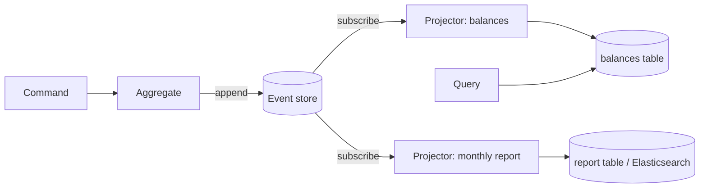

# CQRS and Event Sourcing patterns

---

## 🟢 Junior Level

* **CQRS (Command Query Responsibility Segregation)** — use **different models** for writing data (commands) and reading data (queries). The write side enforces business rules; the read side is shaped for fast display.
* **Event Sourcing** — instead of storing only the *current* state of an entity, store the **sequence of events** that led to it (`AccountOpened`, `MoneyDeposited`, `MoneyWithdrawn`). Current state is computed by replaying events.

They are often used together but are independent patterns.

### Real-world analogy
A bank statement is event sourcing: the balance is not "stored", it is the sum of every transaction. A summary dashboard showing "balance by month" is a separate read model (CQRS) built from the same transactions.

### Minimal event-sourced aggregate

```java
public sealed interface AccountEvent permits Opened, Deposited, Withdrawn {}
public record Opened(UUID id, String owner) implements AccountEvent {}
public record Deposited(UUID id, BigDecimal amount) implements AccountEvent {}
public record Withdrawn(UUID id, BigDecimal amount) implements AccountEvent {}

public final class Account {
    private UUID id;
    private BigDecimal balance = BigDecimal.ZERO;
    private final List<AccountEvent> pending = new ArrayList<>();

    public static Account replay(List<AccountEvent> history) {
        Account a = new Account();
        history.forEach(a::apply);
        return a;
    }

    public void withdraw(BigDecimal amount) {             // command
        if (balance.compareTo(amount) < 0) throw new InsufficientFundsException(id, amount);
        raise(new Withdrawn(id, amount));
    }

    private void raise(AccountEvent e) { apply(e); pending.add(e); }

    private void apply(AccountEvent e) {                   // state transition, no rules
        switch (e) {
            case Opened o    -> id = o.id();
            case Deposited d -> balance = balance.add(d.amount());
            case Withdrawn w -> balance = balance.subtract(w.amount());
        }
    }
}
```

---

## 🟡 Middle Level

### CQRS without event sourcing
Most CQRS in practice is simple: commands go through the domain model and JPA; queries bypass it and read DTO projections, possibly from a denormalized table or a read replica.

```java
// Write side
@Transactional
public void rename(RenameProductCommand cmd) {
    Product p = products.get(cmd.id());
    p.rename(cmd.name());                     // invariants enforced here
}

// Read side: flat projection, no entities, no lazy loading
public record ProductCard(long id, String name, BigDecimal price, double rating) {}

@Query("""
       select new com.shop.ProductCard(p.id, p.name, p.price, coalesce(avg(r.stars), 0))
       from Product p left join p.reviews r
       where p.category = :category
       group by p.id, p.name, p.price
       """)
List<ProductCard> cardsByCategory(String category);
```

### Read models from events



Projectors consume events and update read tables. Because they run asynchronously, reads are **eventually consistent**: a user may not see their own write for a few hundred milliseconds. UIs handle this with optimistic updates or by reading from the write model right after a command.

### When it pays off
* Read and write workloads with very different shapes or scale.
* Audit requirements (finance, healthcare): event sourcing gives a complete, immutable history.
* Temporal queries: "what was the state on 1 March?"
* Many different views of the same data.

When it doesn't: CRUD-style domains, small teams, systems without a clear audit need. Both patterns add infrastructure and eventual consistency.

---

## 🔴 Senior Level

### Event store mechanics
A minimal relational event store:

```sql
create table events (
    stream_id   uuid        not null,
    version     bigint      not null,
    type        text        not null,
    payload     jsonb       not null,
    metadata    jsonb       not null,       -- correlation id, causation id, user, schema version
    recorded_at timestamptz not null default now(),
    global_seq  bigserial,
    primary key (stream_id, version)
);
```

Appending uses **optimistic concurrency**: the command loads events up to version `n`, decides, and inserts versions `n+1..m`. A concurrent writer violates the primary key, so one transaction fails and is retried — no locks held across the decision.

```java
jdbc.batchUpdate("insert into events(stream_id, version, type, payload, metadata) values (?,?,?,?::jsonb,?::jsonb)",
        newEvents, newEvents.size(), (ps, e) -> { /* expectedVersion + i */ });
// DuplicateKeyException => ConcurrencyException => reload and retry the command
```

Dedicated stores (EventStoreDB, Axon Server) add stream subscriptions, catch-up reads and per-stream ordering guarantees.

### Hard problems you must address
* **Snapshots** — replaying 100,000 events per load is slow. Store a snapshot every N events and replay only the tail.
* **Schema evolution** — events are immutable and live forever. Use *upcasters* that transform old payloads (`v1 → v2`) on read, add fields with defaults, never repurpose an event name.
* **Projection rebuilds** — new read models are built by replaying from `global_seq = 0`; design projectors to be idempotent (track the last processed sequence per projector, `insert ... on conflict do update`).
* **GDPR / right to be forgotten** — you cannot delete from an append-only log. Use *crypto-shredding*: encrypt personal data per subject and delete the key.
* **Global ordering** — `bigserial` values can commit out of order under concurrency, so a projector reading "everything after 1000" can skip a slower transaction's 999. Read with a short safety lag or use a dedicated store with gap-free positions.
* **Publishing to other services** — append events and an outbox row in the same transaction, or let consumers read the event store directly; never "save then publish" across two systems without a transaction.

### Choosing the scope
Apply event sourcing to the *core subdomain* where history and auditability are worth the cost (ledger, order lifecycle), not to the whole system. Integration events sent to other services should be a separate, stable public contract — not your internal domain events, which must remain free to change.

---

## 🎯 Interview Cheat Sheet

**30-second pitch:** CQRS separates the write model, which enforces rules, from read models optimized for queries. Event Sourcing stores state as an append-only sequence of events and derives current state by replay. Together they give audit history and flexible read models at the cost of eventual consistency and more infrastructure.

**Must know:**
* CQRS does not require event sourcing or two databases.
* Event store append uses optimistic concurrency on (stream, version).
* Projections are asynchronous, idempotent, rebuildable.
* Snapshots, upcasting and crypto-shredding solve performance, schema evolution and GDPR.

**Common follow-ups:**
* How do you handle reading your own writes?
* How do you fix a bug in a projection?
* How do events reach other services reliably?

**Red flags:** event sourcing an entire CRUD system; exposing internal domain events as public API; projections that are not idempotent; "events are just Kafka messages".

**Related:**
* [What is Command pattern](23.%20What%20is%20Command%20pattern.md)
* [What is Memento pattern](26.%20What%20is%20Memento%20pattern.md)
* [CQRS](../30.%20System%20Design/11.%20CQRS.md)
* [Event sourcing](../30.%20System%20Design/12.%20Event%20sourcing.md)
