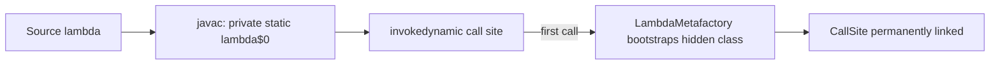

# What are lambda expressions and functional interfaces

---

## 🟢 Junior Level

### What is it?

A **lambda expression** is a short, anonymous function that you can pass around as a value. A **functional interface** is an interface with exactly **one abstract method** (SAM — Single Abstract Method). A lambda is simply a compact way to provide an implementation of that single method.

**Analogy:** Think of a lambda as a sticky note with instructions ("sort by age"). Before Java 8 you had to hire a whole contractor (an anonymous inner class) just to carry one sticky note.

### Before and after

```java
import java.util.*;

public class LambdaIntro {
    public static void main(String[] args) {
        List<String> names = new ArrayList<>(List.of("Charlie", "alice", "Bob"));

        // Java 7 style: anonymous inner class
        Collections.sort(names, new Comparator<String>() {
            @Override
            public int compare(String a, String b) {
                return a.compareToIgnoreCase(b);
            }
        });

        // Java 8+: lambda
        names.sort((a, b) -> a.compareToIgnoreCase(b));
        System.out.println(names); // [alice, Bob, Charlie]
    }
}
```

### Syntax cheat sheet

| Form | Example |
| :--- | :--- |
| No parameters | `() -> 42` |
| One parameter | `x -> x * 2` |
| Two parameters | `(a, b) -> a + b` |
| Explicit types | `(int a, int b) -> a + b` |
| Block body | `x -> { int y = x * 2; return y; }` |

### Built-in functional interfaces (`java.util.function`)

| Interface | Method | Meaning |
| :--- | :--- | :--- |
| `Predicate<T>` | `boolean test(T)` | a test / filter |
| `Function<T,R>` | `R apply(T)` | transform |
| `Consumer<T>` | `void accept(T)` | side effect |
| `Supplier<T>` | `T get()` | factory / lazy value |
| `UnaryOperator<T>` | `T apply(T)` | `Function<T,T>` |
| `BinaryOperator<T>` | `T apply(T,T)` | reduce two into one |

```java
import java.util.function.*;

Predicate<String> isEmpty = String::isEmpty;
Function<String, Integer> length = s -> s.length();
Supplier<Double> random = Math::random;
System.out.println(length.apply("hello")); // 5
```

> [!TIP]
> If you write your own functional interface, annotate it with `@FunctionalInterface`. The compiler will then reject it if a second abstract method sneaks in.

---

## 🟡 Middle Level

### 1. Capturing variables: effectively final

A lambda can read local variables of the enclosing method only if they are **effectively final** (never reassigned after initialization). The lambda copies the value, so allowing mutation would create confusing, thread-unsafe semantics.

```java
int base = 10;
Function<Integer, Integer> add = x -> x + base; // OK
// base++;  // would make the lambda above fail to compile

// Workaround when you really need mutable state: use an explicit holder
java.util.concurrent.atomic.AtomicInteger counter = new java.util.concurrent.atomic.AtomicInteger();
Runnable r = counter::incrementAndGet;
```

### 2. `this` semantics differ from anonymous classes

Inside a lambda, `this` refers to the **enclosing instance**. Inside an anonymous class, `this` is the anonymous object itself. Lambdas also do not introduce a new scope, so you cannot shadow a local variable with a lambda parameter of the same name.

```java
public class ThisDemo {
    private final String name = "outer";

    Runnable lambda() {
        return () -> System.out.println(this.name);   // "outer"
    }

    Runnable anon() {
        return new Runnable() {
            private final String name = "inner";
            public void run() { System.out.println(this.name); } // "inner"
        };
    }
}
```

### 3. Composition

Functional interfaces ship with composition helpers:

```java
Predicate<String> notBlank = s -> !s.isBlank();
Predicate<String> shortWord = s -> s.length() < 6;
Predicate<String> valid = notBlank.and(shortWord).or(s -> s.equals("SPECIAL"));

Function<Integer, Integer> doubleIt = x -> x * 2;
Function<Integer, Integer> plusOne = x -> x + 1;
System.out.println(doubleIt.andThen(plusOne).apply(5)); // 11
System.out.println(doubleIt.compose(plusOne).apply(5)); // 12
```

### 4. Checked exceptions are a pain point

`Function`, `Supplier` etc. do not declare checked exceptions. Use a custom functional interface and a small adapter:

```java
@FunctionalInterface
interface ThrowingFunction<T, R> {
    R apply(T t) throws Exception;

    static <T, R> java.util.function.Function<T, R> unchecked(ThrowingFunction<T, R> f) {
        return t -> {
            try { return f.apply(t); }
            catch (RuntimeException e) { throw e; }
            catch (Exception e) { throw new RuntimeException(e); }
        };
    }
}
// usage: paths.stream().map(ThrowingFunction.unchecked(java.nio.file.Files::readString))
```

### 5. Common mistakes

- **Mutating shared state in stream lambdas** (`forEach(list::add)` on a parallel stream) — a race condition.
- **Huge multi-line lambdas.** If it exceeds 3–4 lines, extract a named method and use a method reference.
- **Overloaded methods with different functional interfaces** (`submit(Runnable)` vs `submit(Callable)`) can cause ambiguity; a block lambda that returns a value picks `Callable`.
- **Primitive boxing:** prefer `IntPredicate`, `ToIntFunction`, `IntBinaryOperator` in hot paths to avoid allocating `Integer`.

---

## 🔴 Senior Level

### 1. How lambdas are compiled: `invokedynamic`

A lambda is **not** an inner class in the bytecode. `javac` desugars the body into a private synthetic method (`lambda$main$0`) and emits an `invokedynamic` instruction. On first execution the JVM calls the bootstrap method `LambdaMetafactory.metafactory`, which spins up a lightweight hidden class implementing the interface and links the call site.



Consequences:
- **No `.class` file per lambda** on disk (smaller jars, faster class loading than anonymous classes).
- **Non-capturing lambdas are singletons**: the JVM caches one instance. A capturing lambda allocates a new object per evaluation (escape analysis often eliminates it).
- **Startup cost:** the first linkage of each lambda costs microseconds up to a millisecond. Frameworks with thousands of lambdas feel it at startup; CDS archives (`-XX:ArchiveClassesAtExit`) and AOT-ish tooling (GraalVM native image) mitigate it.

You can observe the synthetic methods:

```bash
javap -p -c LambdaIntro | grep -E "lambda\$|invokedynamic"
```

### 2. Performance characteristics

- Once JIT-compiled, a monomorphic lambda call site inlines like a normal method; cost ≈ 0.
- **Megamorphic call sites** (e.g. a shared helper `apply(Function f)` called with dozens of different lambdas) defeat inlining. This is why generic utility methods in hot paths can be slower than hand-written loops.
- Capturing lambdas in tight loops allocate; verify with JFR allocation profiling or JMH `-prof gc`.

```java
// JMH-style comparison sketch
@Benchmark public long loop(State s)   { long sum = 0; for (int v : s.data) if (v % 2 == 0) sum += v; return sum; }
@Benchmark public long lambda(State s) { return java.util.Arrays.stream(s.data).filter(v -> v % 2 == 0).asLongStream().sum(); }
```

On warmed-up code these usually differ by a small constant factor; the real wins are readability and parallelism, not raw speed.

### 3. Serialization and identity pitfalls

- Lambdas are only serializable if the target type is `Serializable`; serialized form depends on the synthetic method name, so **recompiling can break stored lambdas**. Never persist lambdas.
- Do not rely on lambda identity (`==`) or `toString()` — both are unspecified.
- Stack traces show `lambda$process$3` frames, which complicates debugging; give important logic named methods.

### 4. Generic inference and target typing

A lambda has no type of its own; its type is inferred from the **target type**. This is why `Object o = () -> {};` does not compile, while `Runnable r = () -> {};` does. Casting with an intersection type can add marker interfaces:

```java
Runnable r = (Runnable & java.io.Serializable) () -> System.out.println("hi");
```

### 5. Production guidance

- Keep lambdas **stateless and side-effect-free** where frameworks (streams, `Map.computeIfAbsent`, Spring `TransactionTemplate`) may invoke them multiple times or concurrently.
- `Map.computeIfAbsent` must not modify the same map inside the lambda (`ConcurrentModificationException` since Java 9 on `HashMap`).
- Avoid capturing large objects in lambdas stored in long-lived caches — a hidden strong reference causes memory leaks.

---

## 🎯 Interview Cheat Sheet

**30-second pitch:** A lambda is an inline implementation of a functional interface (one abstract method). It enables functional-style code (streams, callbacks) with less boilerplate. It is compiled with `invokedynamic`, not inner classes, captures only effectively-final locals, and `this` means the enclosing instance.

**Must-know:**
- `@FunctionalInterface` + exactly one abstract method (default/static/Object methods don't count).
- Core interfaces: `Predicate`, `Function`, `Consumer`, `Supplier`, `UnaryOperator`, `BinaryOperator`, plus primitive specialisations.
- Effectively final capture rule.
- `invokedynamic` + `LambdaMetafactory`; non-capturing lambdas are cached.
- Lambdas differ from anonymous classes: `this`, scope, bytecode, class file.

**Common follow-ups:**
- Why must captured variables be effectively final?
- Is a lambda an object? (Yes, an instance of the functional interface, but created lazily by the JVM.)
- Can a lambda throw checked exceptions? (Only if the interface method declares them.)
- Difference between `Callable` and `Runnable` for `submit`?

**🚩 Red flags:**
- "Lambdas are just syntactic sugar for anonymous classes."
- Mutating outer state from parallel-stream lambdas.
- Writing 20-line lambdas inline.

**Related topics:**
- [What are method references and what kinds exist](02.%20What%20are%20method%20references%20and%20what%20kinds%20exist.md)
- [What are default and static methods in interfaces](03.%20What%20are%20default%20and%20static%20methods%20in%20interfaces.md)
- [Streams and the Date-Time API recap from Java 8](05.%20Streams%20and%20the%20Date-Time%20API%20recap%20from%20Java%208.md)
- Stream API deep dive: section 8; concurrency: section 9.
