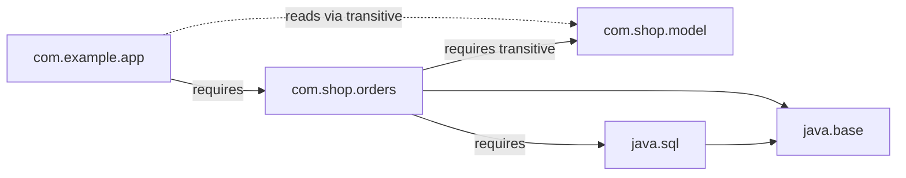

# What is the Java Platform Module System

---

## 🟢 Junior Level

### What is it?

The **Java Platform Module System (JPMS)**, also known as *Project Jigsaw* (Java 9), adds a level above packages: the **module**. A module is a named group of packages that explicitly declares

- what it **requires** from other modules, and
- which of its packages it **exports** (makes visible) to others.

Everything else is hidden — even `public` classes in non-exported packages are inaccessible. This is *strong encapsulation*.

**Analogy:** A company building. Packages are rooms; before Java 9 every `public` room was open to the street. Modules add a lobby with a receptionist: only rooms on the "exported" list can be visited, and visitors must be from companies you listed as partners.

### A minimal module

Project layout:

```
src/
  com.example.greetings/
    module-info.java
    com/example/greetings/api/Greeter.java
    com/example/greetings/internal/Impl.java
  com.example.app/
    module-info.java
    com/example/app/Main.java
```

```java
// com.example.greetings/module-info.java
module com.example.greetings {
    exports com.example.greetings.api;      // visible to everyone
    // com.example.greetings.internal is NOT exported -> hidden
}
```

```java
// com.example.app/module-info.java
module com.example.app {
    requires com.example.greetings;
}
```

```bash
javac -d out --module-source-path src $(find src -name "*.java")
java --module-path out -m com.example.app/com.example.app.Main
```

### Why was it introduced?

1. **Reliable configuration** — missing dependencies fail at startup, not as a random `NoClassDefFoundError` later.
2. **Strong encapsulation** — stop libraries reaching into `sun.misc.Unsafe`, `com.sun.*` internals.
3. **Scalable platform** — the JDK itself was split into ~70 modules (`java.base`, `java.sql`, `java.xml`, …), enabling smaller runtimes with `jlink`.

---

## 🟡 Middle Level

### 1. The module descriptor directives

```java
module com.shop.orders {
    requires java.sql;                         // normal dependency
    requires transitive com.shop.model;        // my API exposes types from model -> consumers get it too
    requires static lombok;                    // compile-time only (optional at runtime)

    exports com.shop.orders.api;               // public API
    exports com.shop.orders.spi to com.shop.plugins;  // qualified export

    opens com.shop.orders.entity to org.hibernate.orm.core;   // runtime reflection access
    // open module com.shop.orders { }  <- opens ALL packages (typical for frameworks)

    uses com.shop.orders.spi.PaymentProvider;                   // ServiceLoader consumer
    provides com.shop.orders.spi.PaymentProvider
        with com.shop.orders.internal.StripeProvider;           // ServiceLoader provider
}
```

`exports` governs **compile and runtime access to public types**; `opens` governs **deep reflection** (`setAccessible(true)` on private members). Frameworks (Hibernate, Jackson, Spring) need `opens`.

### 2. Module path vs classpath, and unnamed/automatic modules

| Concept | Meaning |
| :--- | :--- |
| **Named module** | has `module-info.class` on the module path |
| **Automatic module** | plain JAR on the module path; name derived from the file name or `Automatic-Module-Name` manifest entry; exports and reads everything |
| **Unnamed module** | everything on the classpath; reads all modules, exports all packages |

This is how migration works: most applications still run on the **classpath** (unnamed module). Spring Boot fat-jars run on the classpath; they are not modularised and do not need to be.

### 3. Services with ServiceLoader

```java
// consumer
ServiceLoader<PaymentProvider> loader = ServiceLoader.load(PaymentProvider.class);
loader.stream().map(ServiceLoader.Provider::get).forEach(p -> System.out.println(p.name()));
```

Replaces `META-INF/services` files in modular code (both are supported).

### 4. Tooling

```bash
java --list-modules                       # modules in the runtime
java --describe-module java.sql
jdeps --module-path libs -s app.jar       # dependency analysis
jdeps --jdk-internals app.jar             # find usages of internal JDK APIs
jlink --add-modules java.base,java.logging --output mini-jre --strip-debug --compress=2
```

### 5. Common mistakes

- **`InaccessibleObjectException: Unable to make field private ... accessible: module java.base does not "opens java.lang"`** — typical on Java 16/17+ with older libraries. Fix: upgrade the library, or `--add-opens java.base/java.lang=ALL-UNNAMED` as a stopgap.
- Split packages: the same package in two modules is forbidden (even in the JDK). Breaks shaded/uber jars.
- Cyclic dependencies between modules are not allowed.
- Using Maven's `module-info.java` with tests: surefire needs `--add-opens`/patch-module setups.
- Assuming you must modularise your app. You do not.

---

## 🔴 Senior Level

### 1. How the runtime resolves modules

At startup the **module resolver** takes the root module(s), recursively resolves `requires` against the module path + system image, and builds the **module graph** (checks for missing modules, cycles, split packages, duplicate names). Each module gets a `Module` object and a layer (`ModuleLayer.boot()`). The **readability** edge (`requires`) plus **accessibility** (`exports`) decide whether code can see a type; the check is enforced by the linker and by `Class.forName`/reflection (`Module.isExported/isOpen`).



`java.base` is implicitly required by every module. The JDK enforced encapsulation gradually: Java 9–15 `--illegal-access=permit` (warning), Java 16 default `deny`, Java 17 removed the flag entirely (**JEP 403: strongly encapsulate JDK internals**). Only `--add-opens`/`--add-exports` remain.

### 2. Layers and dynamic module loading

```java
ModuleFinder finder = ModuleFinder.of(Path.of("plugins"));
Configuration cfg = ModuleLayer.boot().configuration()
        .resolve(finder, ModuleFinder.of(), Set.of("com.plugin.a"));
ModuleLayer layer = ModuleLayer.boot()
        .defineModulesWithOneLoader(cfg, ClassLoader.getSystemClassLoader());
ServiceLoader.load(layer, PaymentProvider.class).forEach(p -> System.out.println(p.name()));
```

Layers allow plugin isolation with different versions of the same library — similar to OSGi but standardised and lighter. Few applications use them; IDEs and some servers (Jakarta/Payara experiments, JavaFX distributions) do.

### 3. Production perspective

- **Spring Boot / Jakarta EE / Hibernate:** the ecosystem largely stays on the classpath. Libraries ship `Automatic-Module-Name` for compatibility; Spring Framework and Jackson also ship real descriptors.
- **Benefits that matter in practice:** `jlink` for tiny container images (JRE of ~40–60 MB vs ~200 MB), `jdeps` to find forbidden API use before upgrading Java, stricter encapsulation of internals.
- **Costs:** descriptor maintenance, test-tooling friction, `opens` for every reflective framework, split-package refactors, mixed-mode builds. For application code, the cost/benefit is usually negative; for **libraries and SDKs**, adding `Automatic-Module-Name` or a descriptor is cheap goodwill.
- `--add-opens` flags are common in production launch scripts for legacy dependencies (e.g. Hibernate proxies, Kryo, older Mockito). Track them as tech debt; each is a CVE-adjacent encapsulation hole.

```bash
# audit what an upgrade will break
jdeps --jdk-internals --multi-release 17 -R app.jar
java -Xlog:module=debug -jar app.jar 2>&1 | head
```

### 4. Interaction with class loaders

Modules map onto class loaders (boot, platform, app), but encapsulation is **orthogonal** to loader delegation: a module can be defined to any loader, and one loader can load many modules. A package may exist in the named module of the boot layer while the classpath contains the same package — the module wins and the classpath copy is ignored (split-package surprise). See [What are ClassLoaders and the parent delegation model](14.%20What%20are%20ClassLoaders%20and%20the%20parent%20delegation%20model.md).

### 5. Multi-release JARs

A JAR can carry `META-INF/versions/9/...` and `/17/...` directories so that a single artifact holds alternative implementations for newer JDKs (used by e.g. Log4j2, Jackson). Combined with `module-info.class` in `META-INF/versions/9` it allows a library to stay Java 8 compatible yet modular.

---

## 🎯 Interview Cheat Sheet

**30-second pitch:** JPMS (Java 9) groups packages into named modules declared in `module-info.java` with `requires`, `exports`, `opens`, `uses`, `provides`. It gives reliable configuration and strong encapsulation (even public classes in non-exported packages are hidden) and enables `jlink` custom runtimes. Most apps still run on the classpath; JDK internals are strongly encapsulated since 16/17, which is what typically breaks upgrades.

**Must-know:**
- `exports` (compile+runtime access) vs `opens` (deep reflection).
- `requires transitive` for API types.
- Named / automatic / unnamed modules.
- `--add-opens`, `--add-exports` as escape hatches.
- `jdeps`, `jlink`, `java --list-modules`.
- Split packages and cycles are forbidden.

**Common follow-ups:**
- Do you need `module-info.java` in a Spring Boot app? (No.)
- Why did `setAccessible(true)` start failing on JDK 17?
- What is an automatic module?
- How do services work with `uses`/`provides`?

**🚩 Red flags:**
- Believing modules replace Maven/Gradle (they do not manage versions).
- Leaving permanent `--add-opens` without an upgrade plan.

**Related topics:**
- [What are ClassLoaders and the parent delegation model](14.%20What%20are%20ClassLoaders%20and%20the%20parent%20delegation%20model.md)
- [What is reflection and when should you use it](15.%20What%20is%20reflection%20and%20when%20should%20you%20use%20it.md)
- [What are the common pitfalls when migrating to a newer Java version](17.%20What%20are%20the%20common%20pitfalls%20when%20migrating%20to%20a%20newer%20Java%20version.md)
- [What are sealed classes and interfaces](10.%20What%20are%20sealed%20classes%20and%20interfaces.md)
