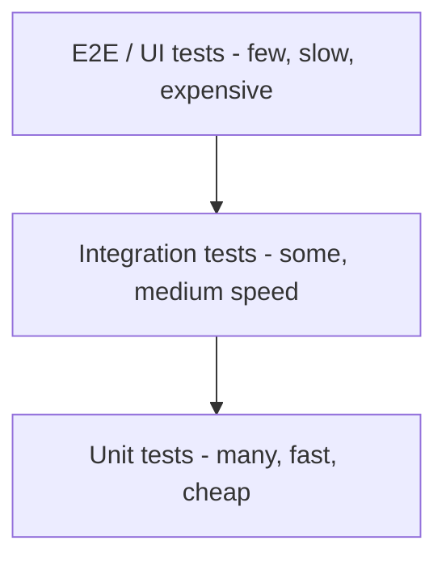

# Test pyramid and unit vs integration vs end-to-end tests

---

## 🟢 Junior Level

A **test** is a small program that runs your code and automatically checks that it behaves as expected. Tests come in different **sizes**:

| Type | What it checks | Speed | Typical tools |
|---|---|---|---|
| **Unit test** | One class or method in isolation (dependencies replaced) | milliseconds | JUnit 5, Mockito, AssertJ |
| **Integration test** | Several real components working together (Spring context, DB, HTTP client) | 100 ms – seconds | Spring Boot Test, Testcontainers |
| **End-to-end (E2E) test** | The whole system through the UI or public API, like a real user | seconds – minutes | Selenium, Playwright, Cypress, RestAssured |

The **test pyramid** (Mike Cohn) says: write **many** fast unit tests, **fewer** integration tests, and **very few** slow E2E tests.



### Real-world analogy
Building a car. You test each bolt and spark plug on a bench (unit). Then you test that the engine works with the gearbox (integration). Finally, you drive the finished car on a track (E2E). If the car fails on the track you want to know *which part* failed - bench tests tell you that in seconds, track tests only tell you "something is wrong".

### Minimal example: a unit test

```java
// src/main/java/demo/PriceCalculator.java
package demo;

import java.math.BigDecimal;

public class PriceCalculator {
    public BigDecimal withVat(BigDecimal net, BigDecimal vatRate) {
        return net.add(net.multiply(vatRate));
    }
}
```

```java
// src/test/java/demo/PriceCalculatorTest.java
package demo;

import org.junit.jupiter.api.Test;
import java.math.BigDecimal;
import static org.junit.jupiter.api.Assertions.assertEquals;

class PriceCalculatorTest {

    @Test
    void addsVatToNetPrice() {
        PriceCalculator calc = new PriceCalculator();

        BigDecimal gross = calc.withVat(new BigDecimal("100.00"), new BigDecimal("0.20"));

        assertEquals(0, new BigDecimal("120.00").compareTo(gross));
    }
}
```

No Spring, no database, no network: it runs in a few milliseconds. That is the hallmark of a unit test.

---

## 🟡 Middle Level

### Why a pyramid and not an ice-cream cone?
Each layer up costs more in **speed**, **maintenance**, **flakiness**, and **diagnosis time**. Teams that rely mostly on E2E tests (the "ice-cream cone" anti-pattern) end up with a 40-minute pipeline that fails randomly.

| Property | Unit | Integration | E2E |
|---|---|---|---|
| Feedback speed | very fast | medium | slow |
| Failure localisation | exact line | a module boundary | "somewhere" |
| Flakiness | ~none | low-medium | high |
| Confidence in wiring/config | none | good | best |
| Cost to write/maintain | low | medium | high |

### What counts as a "unit"?
Two schools exist:
* **Solitary (London/mockist)** – one class, all collaborators mocked.
* **Sociable (Detroit/classicist)** – a cluster of collaborating domain objects, only *slow or external* dependencies (DB, HTTP, clock) are replaced.

Pragmatic teams mix both: pure domain logic is tested sociably with real objects, I/O boundaries are mocked or faked.

### Integration test in Spring Boot

```java
package demo;

import org.junit.jupiter.api.Test;
import org.springframework.beans.factory.annotation.Autowired;
import org.springframework.boot.test.autoconfigure.web.servlet.AutoConfigureMockMvc;
import org.springframework.boot.test.context.SpringBootTest;
import org.springframework.test.web.servlet.MockMvc;

import static org.springframework.test.web.servlet.request.MockMvcRequestBuilders.get;
import static org.springframework.test.web.servlet.result.MockMvcResultMatchers.status;

@SpringBootTest
@AutoConfigureMockMvc
class HealthIntegrationTest {

    @Autowired
    MockMvc mvc;

    @Test
    void actuatorHealthIsUp() throws Exception {
        mvc.perform(get("/actuator/health")).andExpect(status().isOk());
    }
}
```

This checks wiring: component scan, auto-configuration, serialization, security filters - something no unit test can prove.

### Naming conventions that help CI
* Surefire runs `*Test`, `Test*`, `*Tests` (unit) by default.
* Failsafe runs `*IT`, `IT*`, `*ITCase` in the `integration-test`/`verify` phases.
* Separating them lets `mvn test` stay fast, while `mvn verify` runs everything.

### Common mistakes
1. Calling a test "unit" while it boots Spring and a DB.
2. Testing the same business rule at all three layers (redundant, slow).
3. Using E2E tests to verify detailed validation rules - these belong in unit tests.
4. Mocking everything so tests only verify the mocks.

---

## 🔴 Senior Level

### Beyond the pyramid: shapes for modern architectures
* **Testing trophy** (Kent C. Dodds) – emphasises integration tests because for UI/service glue code they give the best confidence per minute. Static analysis/types sit at the base.
* **Testing honeycomb** (Spotify, microservices) – few unit tests for trivial code, mostly *integrated* tests of a service against real/in-memory collaborators, and a few *integration* tests for external contracts.
* Microservices add **contract tests** (see [Contract testing with Pact and Spring Cloud Contract](21.%20Contract%20testing%20with%20Pact%20and%20Spring%20Cloud%20Contract.md)) so you do not need a giant shared E2E environment.

### Economics: the cost model
Let *p* be the probability a test fails for a non-product reason (flake), *t* its runtime, and *n* the number of tests. Pipeline success probability is roughly `(1-p)^n`. With 300 E2E tests and p = 0.5%, the pipeline passes only about 22% of the time. This is why E2E count must be kept small and each must be rock solid. See [Flaky tests](19.%20Flaky%20tests.md).

### Designing for testability
* Hexagonal/ports-and-adapters architecture keeps domain logic free of frameworks, so 80% of the logic is tested by plain JUnit in milliseconds.
* Inject `Clock`, `Random`/`UUID` suppliers, and `ExecutorService` - never call `Instant.now()` deep inside logic.
* Keep adapters thin (controllers, repositories) and cover them with slice tests (see [Spring Boot test slices WebMvcTest and DataJpaTest](11.%20Spring%20Boot%20test%20slices%20WebMvcTest%20and%20DataJpaTest.md)).

```java
import java.time.Clock;
import java.time.Instant;

public class TokenService {
    private final Clock clock;

    public TokenService(Clock clock) { this.clock = clock; }

    public boolean isExpired(Instant expiresAt) {
        return clock.instant().isAfter(expiresAt);
    }
}

// test
// Clock fixed = Clock.fixed(Instant.parse("2025-01-01T00:00:00Z"), ZoneOffset.UTC);
// assertTrue(new TokenService(fixed).isExpired(Instant.parse("2024-12-31T00:00:00Z")));
```

### Separating suites in Maven

```xml
<plugin>
  <artifactId>maven-surefire-plugin</artifactId>
  <configuration>
    <excludedGroups>integration</excludedGroups>
  </configuration>
</plugin>
<plugin>
  <artifactId>maven-failsafe-plugin</artifactId>
  <executions>
    <execution>
      <goals><goal>integration-test</goal><goal>verify</goal></goals>
    </execution>
  </executions>
</plugin>
```

Using JUnit 5 `@Tag("integration")` lets one source tree host both, filtered by profile.

### Production-grade layering
1. **Pre-merge:** unit + slice + a handful of Testcontainers tests (< 10 min).
2. **Post-merge / nightly:** full integration, performance smoke, mutation testing.
3. **Production:** synthetic monitoring, canary releases, feature flags - testing in production complements, never replaces, pre-prod tests.

### Diagnostics
* Track *time per layer* and *failure rate per layer* in CI dashboards. A rising E2E share is an early-warning smell.
* Use the JUnit XML reports to find the slowest 20 tests; they usually are accidental integration tests.

---

## 🎯 Interview Cheat Sheet

**30-second pitch:** The pyramid says most tests should be fast, isolated unit tests, a moderate number integration tests that verify real wiring (DB, HTTP, Spring), and a very small number of E2E tests that cover critical user journeys. The goal is fast feedback, precise failures, and low maintenance cost.

**Must know:**
* Unit = one unit, no I/O; integration = real collaborators; E2E = full deployed system.
* Surefire (unit) vs Failsafe (integration, `*IT`).
* Ice-cream cone is an anti-pattern; trophy/honeycomb are variants for UI/microservices.
* Testability comes from dependency injection, injected `Clock`, ports and adapters.
* Do not test the same rule at every layer.

**Common follow-ups:**
* Is a `@SpringBootTest` a unit test? (No – integration.)
* Where do contract tests fit? (Between integration and E2E for services.)
* How do you keep E2E suites reliable?

**Red flags:** "We only do E2E because unit tests are useless"; "100% of tests are mocked"; no distinction between fast and slow suites.

**Related:**
* [What makes a good test](02.%20What%20makes%20a%20good%20test.md)
* [Flaky tests](19.%20Flaky%20tests.md)
* [CI test strategy](23.%20CI%20test%20strategy.md)
* [Contract testing with Pact and Spring Cloud Contract](21.%20Contract%20testing%20with%20Pact%20and%20Spring%20Cloud%20Contract.md)
