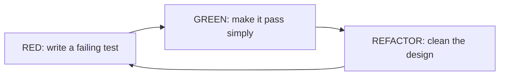

# TDD red green refactor

---

## 🟢 Junior Level

**Test-Driven Development (TDD)** is a way of programming where you write the **test first**, then the code. The cycle is tiny and repeated hundreds of times a day:

1. 🔴 **Red** - write a failing test for the next small behaviour.
2. 🟢 **Green** - write the *simplest* code that makes it pass.
3. 🔵 **Refactor** - clean up the code (and tests) while all tests stay green.



### Analogy
Like a carpenter marking the cut line before sawing: the test is the line, the code is the cut. If the line is wrong you notice *before* wasting wood.

### Mini-kata: FizzBuzz, step by step

**Step 1 - Red:**

```java
import org.junit.jupiter.api.Test;
import static org.junit.jupiter.api.Assertions.assertEquals;

class FizzBuzzTest {
    @Test
    void returnsNumberAsString() {
        assertEquals("1", new FizzBuzz().convert(1));
    }
}
```
(Does not even compile - compilation failure counts as red.)

**Step 2 - Green (simplest thing):**

```java
class FizzBuzz {
    String convert(int n) { return String.valueOf(n); }
}
```

**Step 3 - next Red:** `assertEquals("Fizz", convert(3))`. **Green:** add `if (n % 3 == 0) return "Fizz";`. Then Buzz, then FizzBuzz (15), refactor to remove duplication.

Final code after refactor:

```java
class FizzBuzz {
    String convert(int n) {
        StringBuilder sb = new StringBuilder();
        if (n % 3 == 0) sb.append("Fizz");
        if (n % 5 == 0) sb.append("Buzz");
        return sb.isEmpty() ? String.valueOf(n) : sb.toString();
    }
}
```

The tests protect you while you restructure.

---

## 🟡 Middle Level

### The three laws (Uncle Bob)
1. Do not write production code until you have a failing test.
2. Do not write more of a test than is sufficient to fail (compile failure = failure).
3. Do not write more production code than is sufficient to pass the test.

### Benefits (and honest limits)
| Benefit | Explanation |
|---|---|
| Design feedback | Hard-to-test code reveals coupling immediately |
| Regression safety | Refactoring with confidence |
| Executable specification | Tests document intent |
| Focus & small steps | Less debugging; "Debug less, think more" |
| Coverage by construction | Every line exists because a test demanded it |

Limits: slows exploratory/spike work; poor fit for UI-look-and-feel, data-science experimentation; needs team discipline; bad tests (over-mocked) produce bad designs.

### Techniques for choosing the next test
* **Triangulation** - add a second example to force generalisation instead of returning a constant.
* **Obvious implementation** - if the code is trivial, just write it.
* **Fake it till you make it** - return a constant first, then generalise.
* **Transformation Priority Premise** - prefer simple transformations (`constant -> variable -> conditional -> loop`).
* **Test list** - jot a list of behaviours up front, pick one at a time.

### TDD with Mockito: outside-in (London)
Start from the controller/use case, mock collaborators that do not exist yet, which *discovers* the interfaces:

```java
@ExtendWith(MockitoExtension.class)
class PlaceOrderUseCaseTest {

    @Mock InventoryPort inventory;
    @Mock PaymentPort payment;
    @InjectMocks PlaceOrderUseCase useCase;

    @Test
    void reservesStockThenCharges() {
        when(inventory.reserve("SKU-1", 2)).thenReturn(true);
        when(payment.charge("cust-1", 20_00)).thenReturn(true);

        OrderResult result = useCase.place("cust-1", "SKU-1", 2, 20_00);

        assertThat(result.accepted()).isTrue();
        InOrder o = inOrder(inventory, payment);
        o.verify(inventory).reserve("SKU-1", 2);
        o.verify(payment).charge("cust-1", 20_00);
    }
}

interface InventoryPort { boolean reserve(String sku, int qty); }
interface PaymentPort { boolean charge(String customer, long cents); }
record OrderResult(boolean accepted) {}

class PlaceOrderUseCase {
    private final InventoryPort inventory;
    private final PaymentPort payment;
    PlaceOrderUseCase(InventoryPort i, PaymentPort p) { this.inventory = i; this.payment = p; }

    OrderResult place(String customer, String sku, int qty, long cents) {
        if (!inventory.reserve(sku, qty)) return new OrderResult(false);
        return new OrderResult(payment.charge(customer, cents));
    }
}
```

(Imports omitted: `org.mockito.*`, `org.mockito.junit.jupiter.MockitoExtension`, `org.junit.jupiter.api.*`, AssertJ.)

### Inside-out (Detroit/Chicago)
Begin with the core domain objects with real collaborators; mock only at architectural boundaries. Tests survive refactoring better. ATDD/"double-loop TDD" combines both: a failing *acceptance* test (outer loop, [Cucumber](16.%20BDD%20and%20Cucumber.md) or `@SpringBootTest`) drives many unit-level red-green cycles (inner loop).

### Common mistakes
* Writing all tests first ("big bang") rather than one at a time.
* Skipping the refactor step -> messy code with green tests.
* Testing private/internal structure -> brittle tests.
* Never seeing the test fail (a test that cannot fail is worthless): *always run red first*.
* Using TDD for everything, including glue code and config.

---

## 🔴 Senior Level

### TDD as design tool: what the tests tell you
* **Many mocks to arrange** -> too many collaborators (SRP).
* **Long setup** -> missing abstraction or builder (see [Test data builders](08.%20Test%20data%20builders%20and%20object%20mothers.md)).
* **Needing to reset static state** -> hidden global dependency.
* **Hard-to-name tests** -> unclear responsibility.

### TDD and architecture
Hexagonal architecture complements TDD: the domain core is driven by fast unit tests without Spring; adapters are driven by slice/integration tests; a handful of acceptance tests wire it up. The classical risk is **TDD damage** - the design bends for testability in ways harming clarity (excessive interfaces for each class, "mock-driven" over-abstraction). Counter with "test at the right level" and avoid interface-per-class.

### Evidence and honest metrics
Studies (Microsoft/IBM case studies, Nagappan et al. 2008) reported 40-90% fewer pre-release defects with 15-35% longer initial development time; controlled academic experiments are mixed. Real benefits are lower defect-detection latency and design discipline. Track *change failure rate* and *time to restore* (DORA metrics) rather than "% of code written with TDD".

### Legacy and TDD
You cannot TDD existing untested code; first write **characterization tests** (pin current behaviour), carve seams, then apply TDD for new changes (see [Testing legacy code](22.%20Testing%20legacy%20code.md)).

### Tactics for fast cycles
* Keep the unit-test loop < 2 seconds: no Spring context for domain code; run tests in the IDE on save/"continuous testing" (IntelliJ, Infinitest, `mvn -T 1C`, Gradle `--continuous`).
* Use the **test-first with example mapping** habit: examples from product owners become the first parameterized tests.
* Refactor tests: remove duplicates, introduce builders, rename for intent. Tests are part of the design.

### Property-based flavour
After example-driven cycles, add properties for invariants (jqwik):

```java
import net.jqwik.api.*;

class FizzBuzzProperties {
    @Property
    boolean multiplesOf15AreFizzBuzz(@ForAll @IntRange(min = 1, max = 10_000) int k) {
        return new FizzBuzz().convert(15 * k).equals("FizzBuzz");
    }
}
```

### Anti-patterns at team level
* **Coverage mandates masquerading as TDD** - tests written after code to reach 80%; see [Code coverage](17.%20Code%20coverage%20with%20JaCoCo%20and%20why%20100%20percent%20is%20misleading.md).
* **Mandatory TDD dogma** - pair-programming/mobbing and kata practice make adoption stick better than rules.
* **Test-after-with-refactoring-risk** - if tests are written after, you often only test what the code happens to do.

---

## 🎯 Interview Cheat Sheet

**30-second pitch:** TDD is a micro-cycle of Red (failing test), Green (simplest passing code), Refactor (clean up under green tests). It gives fast feedback, executable specs, and a testable design; its value is design discipline more than raw coverage.

**Must know:**
* The three laws; red-green-refactor.
* Triangulation, fake-it, obvious implementation.
* Outside-in (mockist) vs inside-out (classicist); double-loop with acceptance tests.
* Limits: spikes, UI, legacy code (characterization tests first).
* Never skip seeing a test fail.

**Common follow-ups:**
* TDD vs BDD vs ATDD?
* Does TDD guarantee good design?
* How do you TDD a REST controller or DB repository? (Slice tests, Testcontainers.)

**Red flags:** "TDD means 100% coverage"; tests written after code but labelled TDD; refusing refactor step.

**Related:**
* [BDD and Cucumber](16.%20BDD%20and%20Cucumber.md)
* [What makes a good test](02.%20What%20makes%20a%20good%20test.md)
* [Test doubles mock stub and fake](05.%20Test%20doubles%20mock%20stub%20and%20fake.md)
* [Testing legacy code](22.%20Testing%20legacy%20code.md)
