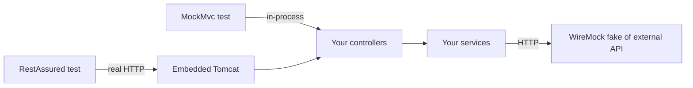

# Testing REST APIs with MockMvc RestAssured and WireMock

---

## 🟢 Junior Level

Three tools cover most HTTP testing in Spring projects:

* **MockMvc** — calls your Spring MVC controllers *without a real server*. Fast, runs inside the test JVM, perfect for checking routing, validation, JSON and status codes.
* **RestAssured** — a fluent client for testing a **running** HTTP server (`@SpringBootTest(webEnvironment = RANDOM_PORT)`), closer to how real clients call you.
* **WireMock** — a fake HTTP server that stands in for **external APIs you call** (payment provider, CRM), so tests don't depend on them.



### First MockMvc test

```java
@WebMvcTest(OrderController.class)
class OrderControllerTest {
    @Autowired MockMvc mvc;
    @MockitoBean OrderService service;          // Spring Boot 3.4+; older: @MockBean

    @Test
    void returnsOrder() throws Exception {
        when(service.find(42L)).thenReturn(new OrderDto(42L, "NEW", new BigDecimal("19.99")));

        mvc.perform(get("/api/orders/42").accept(MediaType.APPLICATION_JSON))
           .andExpect(status().isOk())
           .andExpect(jsonPath("$.id").value(42))
           .andExpect(jsonPath("$.status").value("NEW"));
    }
}
```

---

## 🟡 Middle Level

### Validation and error contracts with MockMvc

```java
@Test
void rejectsInvalidRequest() throws Exception {
    mvc.perform(post("/api/orders")
                .contentType(MediaType.APPLICATION_JSON)
                .content("""
                         {"customerId": null, "lines": []}
                         """))
       .andExpect(status().isBadRequest())
       .andExpect(content().contentType(MediaType.APPLICATION_PROBLEM_JSON))
       .andExpect(jsonPath("$.title").value("Bad Request"))
       .andExpect(jsonPath("$.errors[*].field", containsInAnyOrder("customerId", "lines")));
}
```

Test the **error format** as carefully as the happy path — clients depend on it. Security can be included: `@WebMvcTest` loads your `SecurityFilterChain`, and `.with(jwt().authorities(...))` from `spring-security-test` simulates a token.

### Full-stack test with RestAssured

```java
@SpringBootTest(webEnvironment = SpringBootTest.WebEnvironment.RANDOM_PORT)
@Testcontainers
class OrderApiIT {
    @LocalServerPort int port;
    @Container @ServiceConnection static PostgreSQLContainer<?> db = new PostgreSQLContainer<>("postgres:16-alpine");

    @BeforeEach void setUp() { RestAssured.port = port; }

    @Test
    void createsAndFetchesOrder() {
        String location =
            given().contentType(ContentType.JSON)
                   .body(Map.of("customerId", 7, "lines", List.of(Map.of("sku", "A1", "qty", 2))))
            .when().post("/api/orders")
            .then().statusCode(201).header("Location", containsString("/api/orders/"))
            .extract().header("Location");

        given().when().get(location)
               .then().statusCode(200).body("lines.size()", equalTo(1));
    }
}
```

This catches what MockMvc can't: servlet filters ordering, real Jackson configuration, serialization of dates and `BigDecimal`, database constraints, transaction behavior.

### Stubbing external APIs with WireMock

```java
@SpringBootTest
@EnableWireMock(@ConfigureWireMock(name = "payments", baseUrlProperties = "payments.base-url"))
class PaymentClientIT {
    @InjectWireMock("payments") WireMockServer payments;
    @Autowired PaymentClient client;

    @Test
    void mapsDeclineToDomainError() {
        payments.stubFor(post("/v1/charges")
                .withHeader("Idempotency-Key", matching(".+"))
                .willReturn(aResponse().withStatus(402)
                        .withHeader("Content-Type", "application/json")
                        .withBody("""
                                  {"code": "card_declined"}
                                  """)));

        assertThatThrownBy(() -> client.charge(new Charge("ord-1", Money.eur(10))))
                .isInstanceOf(CardDeclinedException.class);
        payments.verify(1, postRequestedFor(urlEqualTo("/v1/charges")));
    }
}
```

(Uses `wiremock-spring-boot`; plain `WireMockExtension` works the same way.)

---

## 🔴 Senior Level

### Testing resilience, not just correctness
WireMock can simulate the failures that hurt in production:

```java
payments.stubFor(post("/v1/charges")
        .willReturn(aResponse().withFixedDelay(3_000)));            // read timeout
payments.stubFor(post("/v1/charges")
        .willReturn(aResponse().withFault(Fault.CONNECTION_RESET_BY_PEER)));
payments.stubFor(post("/v1/charges").inScenario("retry")
        .whenScenarioStateIs(STARTED).willReturn(aResponse().withStatus(503))
        .willSetStateTo("recovered"));
payments.stubFor(post("/v1/charges").inScenario("retry")
        .whenScenarioStateIs("recovered").willReturn(okJson("{\"id\":\"ch_1\"}")));
```

Assert that timeouts are configured (test completes in < 2.5 s, not 30 s), that retries happen only for retryable status codes, that the idempotency key is identical across retries, and that the circuit breaker opens after N failures.

### Picking the right level
| Concern | Best tool |
| --- | --- |
| Routing, validation, status codes, JSON shape | `@WebMvcTest` + MockMvc (ms per test) |
| Security rules per endpoint | MockMvc with `spring-security-test` |
| Filters, real serialization, DB, transactions | `@SpringBootTest(RANDOM_PORT)` + RestAssured / `RestTestClient` |
| Outbound integrations and their failure modes | WireMock |
| Agreement with consumers/providers | Contract tests (Pact, Spring Cloud Contract) |

Spring Framework 6.2/7 adds `MockMvcTester` (AssertJ-style) and `RestTestClient`, which share one API across mock and live servers — useful to reuse assertions at both levels.

### Pitfalls
* **Over-mocking in `@WebMvcTest`**: if every collaborator is a mock, the test only verifies Mockito. Keep controller logic thin and test mapping/validation there; test business rules in plain unit tests.
* **Context caching**: each distinct combination of `@MockitoBean`s, properties and profiles creates a new Spring context. Dozens of variations make the suite slow; standardize test configurations and watch the context-cache log (`logging.level.org.springframework.test.context.cache=DEBUG`).
* **Shared WireMock state**: reset stubs between tests (`@AfterEach payments.resetAll()`), or tests become order-dependent.
* **Asserting full JSON strings**: brittle against field order and formatting; use JSONPath or `JSONAssert` in lenient mode.

---

## 🎯 Interview Cheat Sheet

**30-second pitch:** MockMvc tests controllers in-process quickly; RestAssured tests the running app over real HTTP, catching filters, serialization and DB issues; WireMock fakes external APIs, including delays, faults and stateful retry scenarios. I use all three at different layers of the pyramid.

**Must know:**
* `@WebMvcTest` loads only the web slice; mock services with `@MockitoBean`.
* `RANDOM_PORT` + RestAssured for end-to-end inside the service.
* WireMock stubs, request verification, `withFixedDelay`, `withFault`, scenarios.
* Test error formats and security, not only happy paths.

**Common follow-ups:**
* How do you test timeouts and retries?
* Why is my test suite creating many Spring contexts?
* MockMvc vs TestRestTemplate vs WebTestClient?

**Red flags:** calling real third-party sandboxes in CI; asserting exact JSON strings; no tests for 4xx/5xx paths.

**Related:**
* [Spring Boot test slices WebMvcTest and DataJpaTest](11.%20Spring%20Boot%20test%20slices%20WebMvcTest%20and%20DataJpaTest.md)
* [SpringBootTest and MockBean vs MockitoBean](12.%20SpringBootTest%20and%20MockBean%20vs%20MockitoBean.md)
* [Testcontainers for integration tests](15.%20Testcontainers%20for%20integration%20tests.md)
* [Contract testing with Pact and Spring Cloud Contract](21.%20Contract%20testing%20with%20Pact%20and%20Spring%20Cloud%20Contract.md)
