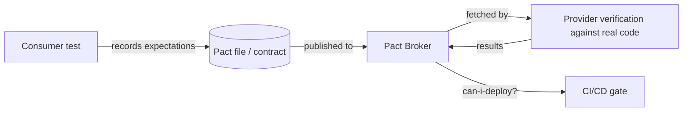

# Contract testing with Pact and Spring Cloud Contract

---

## 🟢 Junior Level

When service A (the **consumer**) calls service B (the **provider**), both teams need to agree on the API: URLs, fields, status codes. **Contract tests** check that agreement automatically — *without* deploying both services together for an end-to-end test.

* **Pact** — *consumer-driven*: the consumer's tests record what it expects in a **pact file**; the provider replays that file against its real implementation.
* **Spring Cloud Contract** — usually *provider-driven* in the JVM world: contracts are written (Groovy/YAML/Java DSL) in the provider repo; the provider gets generated tests and consumers get generated **stubs** (WireMock) to test against.

### Real-world analogy
Instead of building the whole car to see if the engine fits, the engine maker and the car maker agree on a precise mounting specification — and each checks their own part against it.



---

## 🟡 Middle Level

### Consumer side with Pact (JUnit 5)

```java
@ExtendWith(PactConsumerTestExt.class)
@PactTestFor(providerName = "order-service")
class OrderClientPactTest {

    @Pact(consumer = "billing-service")
    V4Pact orderExists(PactDslWithProvider builder) {
        return builder
            .given("order 42 exists")                                   // provider state
            .uponReceiving("get order 42")
                .path("/api/orders/42").method("GET")
            .willRespondWith()
                .status(200)
                .headers(Map.of("Content-Type", "application/json"))
                .body(new PactDslJsonBody()
                        .integerType("id", 42)
                        .stringMatcher("status", "NEW|PAID|SHIPPED", "PAID")
                        .decimalType("total", 19.99))
            .toPact(V4Pact.class);
    }

    @Test
    void readsOrder(MockServer server) {
        OrderClient client = new OrderClient(RestClient.create(server.getUrl()));
        assertThat(client.find(42).status()).isEqualTo("PAID");
    }
}
```

Use **matchers** (`integerType`, `stringMatcher`) instead of exact values: the contract states the *shape* the consumer relies on, not test data. Only include fields the consumer actually reads — that's what gives providers freedom to change everything else.

### Provider verification

```java
@Provider("order-service")
@PactBroker(url = "${PACT_BROKER_URL}")
@SpringBootTest(webEnvironment = SpringBootTest.WebEnvironment.RANDOM_PORT)
class OrderProviderPactTest {
    @LocalServerPort int port;
    @MockitoBean OrderRepository orders;

    @BeforeEach void target(PactVerificationContext ctx) { ctx.setTarget(new HttpTestTarget("localhost", port)); }

    @TestTemplate @ExtendWith(PactVerificationInvocationContextProvider.class)
    void verify(PactVerificationContext ctx) { ctx.verifyInteraction(); }

    @State("order 42 exists")
    void order42() { when(orders.findById(42L)).thenReturn(Optional.of(paidOrder(42L))); }
}
```

### Spring Cloud Contract (provider side)

```yaml
# src/test/resources/contracts/order/get_order.yml
request:
  method: GET
  url: /api/orders/42
response:
  status: 200
  headers: { Content-Type: application/json }
  body: { id: 42, status: "PAID", total: 19.99 }
  matchers:
    body:
      - path: $.status
        type: by_regex
        value: "NEW|PAID|SHIPPED"
```

The Maven/Gradle plugin generates JUnit tests that run against your controllers (via a base class with MockMvc/RestAssured) and publishes a `-stubs.jar`; consumers run `@AutoConfigureStubRunner(ids = "com.shop:order-service:+:stubs")` to get a WireMock server that behaves exactly as the contract says.

---

## 🔴 Senior Level

### Deployment safety: `can-i-deploy`
The Pact Broker stores which consumer versions are compatible with which provider versions and which versions are deployed in each environment (`record-deployment`). Before deploying, CI asks:

```bash
pact-broker can-i-deploy --pacticipant billing-service --version $GIT_SHA --to-environment production
```

This replaces "deploy everything to staging and run E2E" with a precise compatibility matrix. **Webhooks** trigger provider verification when a consumer publishes a changed pact, and **pending pacts / WIP pacts** let new consumer expectations be verified without breaking the provider's build until they are agreed.

### Choosing the approach
| | Pact | Spring Cloud Contract |
| --- | --- | --- |
| Driver | Consumer expectations | Provider-owned contracts (consumer-driven possible via PRs) |
| Polyglot | Yes (JS, Go, Python, .NET...) | JVM-centric (stubs usable by others via Docker) |
| Messaging | Message pacts (Kafka, SQS payloads) | Messaging contracts with Spring Cloud Stream/Kafka/AMQP |
| Infra | Pact Broker / PactFlow | Artifact repository for stub JARs |
| Best fit | Many independent consumer teams | JVM organizations, provider controls the API |

### What contract tests do and don't cover
* ✅ Request/response shape, status codes, headers, error payloads the consumer handles.
* ✅ Message schemas for event-driven integrations.
* ❌ Business correctness of the provider (that's the provider's own tests).
* ❌ Performance, authentication flows end-to-end, infrastructure wiring.
* ❌ Public APIs with unknown consumers — use OpenAPI schema checks and versioning policy instead (consumer-driven contracts need known consumers).

### Pitfalls
* **Over-specified pacts** — asserting exact values or every field couples consumer to provider internals; providers can't evolve.
* **Provider states with real databases** — slow and brittle; mock the repository or service layer in provider verification and keep states small.
* **Skipping verification in the provider pipeline** — then contracts are just documentation.
* **Contracts as a replacement for communication** — the broker is an early-warning system, not an excuse to stop talking to the other team.

---

## 🎯 Interview Cheat Sheet

**30-second pitch:** Contract tests verify that a consumer and provider agree on an API without integrated E2E environments. With Pact, consumer tests generate pacts that the provider verifies against its real code, and the broker answers "can I deploy?". Spring Cloud Contract writes contracts on the provider side and generates both provider tests and WireMock stubs for consumers.

**Must know:**
* Consumer-driven contracts: only what the consumer uses, with type/regex matchers.
* Provider states set up data for each interaction.
* Pact Broker: publish, verify, `can-i-deploy`, `record-deployment`, webhooks.
* SCC: generated tests + stub runner.
* Contracts don't test provider business logic.

**Common follow-ups:**
* How do you handle a breaking change with contracts?
* Contract testing vs OpenAPI validation?
* How do you contract-test Kafka messages?

**Red flags:** exact-value pacts; contracts nobody verifies in CI; using contracts for public APIs with unknown clients.

**Related:**
* [Testing REST APIs with MockMvc RestAssured and WireMock](13.%20Testing%20REST%20APIs%20with%20MockMvc%20RestAssured%20and%20WireMock.md)
* [CI test strategy](23.%20CI%20test%20strategy.md)
* [What are consumer-driven contract tests](../34.%20API%20Design%20and%20Integration/15.%20What%20are%20consumer-driven%20contract%20tests.md)
* [Test pyramid and unit vs integration vs end-to-end tests](01.%20Test%20pyramid%20and%20unit%20vs%20integration%20vs%20end-to-end%20tests.md)
