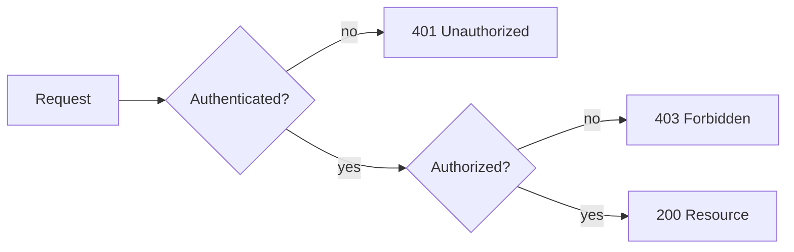

# What is the difference between authentication and authorization

---

## 🟢 Junior Level

### 1. Plain Definitions

- **Authentication (AuthN)** answers **"Who are you?"** The system verifies an identity claim (username + password, a token, a certificate, a fingerprint).
- **Authorization (AuthZ)** answers **"What are you allowed to do?"** Once the identity is known, the system decides whether this identity may perform a given action on a given resource.

Authentication always happens **first**. You cannot decide what someone may do before you know who they are.

### 2. Real-World Analogy

An airport:

1. **Passport control** checks your passport and face -> *authentication*.
2. **Boarding gate** checks your ticket: is *this* person allowed on *this* flight? Business lounge only for gold members -> *authorization*.

A valid passport does not let you into the cockpit. A valid identity is not a permission.

### 3. HTTP Status Codes

| Situation | Status | Meaning |
| :--- | :--- | :--- |
| No credentials / bad credentials | **401 Unauthorized** (historic misnomer, really "unauthenticated") | AuthN failed |
| Valid credentials, but not enough rights | **403 Forbidden** | AuthZ failed |

### 4. Minimal Working Example (Spring Boot 3 / Spring Security 6)

```java
import org.springframework.context.annotation.Bean;
import org.springframework.context.annotation.Configuration;
import org.springframework.security.config.Customizer;
import org.springframework.security.config.annotation.web.builders.HttpSecurity;
import org.springframework.security.core.userdetails.User;
import org.springframework.security.core.userdetails.UserDetailsService;
import org.springframework.security.crypto.factory.PasswordEncoderFactories;
import org.springframework.security.crypto.password.PasswordEncoder;
import org.springframework.security.provisioning.InMemoryUserDetailsManager;
import org.springframework.security.web.SecurityFilterChain;

@Configuration
public class SecurityConfig {

    @Bean
    SecurityFilterChain filterChain(HttpSecurity http) throws Exception {
        http
            .authorizeHttpRequests(auth -> auth
                .requestMatchers("/public/**").permitAll()          // no AuthN needed
                .requestMatchers("/admin/**").hasRole("ADMIN")      // AuthZ rule
                .anyRequest().authenticated())                      // AuthN required
            .httpBasic(Customizer.withDefaults());
        return http.build();
    }

    @Bean
    PasswordEncoder passwordEncoder() {
        return PasswordEncoderFactories.createDelegatingPasswordEncoder();
    }

    @Bean
    UserDetailsService users(PasswordEncoder encoder) {
        return new InMemoryUserDetailsManager(
            User.withUsername("alice").password(encoder.encode("secret")).roles("USER").build(),
            User.withUsername("bob").password(encoder.encode("secret")).roles("ADMIN").build());
    }
}
```

Try it:

- no credentials on `/orders` -> **401**
- `alice` on `/admin/users` -> **403** (authenticated but not authorized)
- `bob` on `/admin/users` -> **200**



---

## 🟡 Middle Level

### 1. How Spring Models Each Concept

| Concept | Spring Security type | Role |
| :--- | :--- | :--- |
| Credentials submitted | `Authentication` (unauthenticated) | Carries username/password or token |
| AuthN engine | `AuthenticationManager` -> `AuthenticationProvider` | Verifies credentials |
| Verified identity | `Authentication` (authenticated=true) | Principal + `GrantedAuthority` list |
| AuthZ engine | `AuthorizationManager` (Spring Security 6) | Decides allow/deny for a request or method |
| Failure -> 401 | `AuthenticationEntryPoint` | Starts the auth challenge |
| Failure -> 403 | `AccessDeniedHandler` | Handles denied access |

Authentication produces **authorities**; authorization **consumes** them. This is the seam between the two.

### 2. Authorization Granularities

1. **URL-level** - `authorizeHttpRequests` (coarse, first line of defence).
2. **Method-level** - `@PreAuthorize("hasAuthority('order:write')")` (business rule close to the code).
3. **Object-level (ownership / ABAC)** - "may *this* user see *this* order?". The most commonly forgotten one; its absence is the **#1 OWASP issue: Broken Access Control / IDOR**.

```java
@PreAuthorize("hasRole('ADMIN') or @orderPolicy.isOwner(#id, authentication.name)")
public Order getOrder(long id) { ... }
```

### 3. Common Mistakes

- **Confusing 401 and 403** in API responses; clients rely on it to decide whether to re-login or show "no access".
- **Authorization only in the UI** (hidden buttons). The API must enforce it independently.
- **Trusting client-supplied identity** (`userId` in body or header) instead of reading it from the `SecurityContext`.
- **Checking roles but not ownership** (IDOR: `GET /orders/42` works for any logged-in user).
- **`permitAll()` on a path and relying on obscurity** (`/internal/**`).
- **Rule ordering errors**: matchers are evaluated top-down, first match wins; `anyRequest()` must be last.

### 4. Authentication vs Authorization vs Accounting

Security is often described as **AAA**: Authentication, Authorization, Accounting (audit). Spring covers audit through `AuthenticationSuccessEvent`/`AuthorizationDeniedEvent` (see [Common security misconfigurations and audit logging](24.%20Common%20security%20misconfigurations%20and%20audit%20logging.md)).

### 5. Authentication Factors

| Factor | Example |
| :--- | :--- |
| Knowledge | password, PIN |
| Possession | TOTP app, hardware key (FIDO2/WebAuthn), client certificate |
| Inherence | fingerprint, face |

MFA combines at least two *different* factors; two passwords are not MFA.

---

## 🔴 Senior Level

### 1. Where the Decision Happens in the Filter Chain

Authentication is performed by filters such as `UsernamePasswordAuthenticationFilter`, `BearerTokenAuthenticationFilter` or `BasicAuthenticationFilter`. Authorization for URLs is performed by `AuthorizationFilter`, which is **late** in the chain and delegates to an `AuthorizationManager<RequestAuthorizationContext>`. Unauthenticated and denied are distinguished by `ExceptionTranslationFilter`: if the current `Authentication` is anonymous -> entry point (401 / redirect to login); otherwise -> access-denied handler (403).

### 2. Custom AuthorizationManager (Spring Security 6)

```java
import java.util.function.Supplier;
import org.springframework.security.authorization.AuthorizationDecision;
import org.springframework.security.authorization.AuthorizationManager;
import org.springframework.security.core.Authentication;
import org.springframework.security.web.access.intercept.RequestAuthorizationContext;
import org.springframework.stereotype.Component;

@Component
public class TenantAuthorizationManager implements AuthorizationManager<RequestAuthorizationContext> {

    @Override
    public AuthorizationDecision check(Supplier<Authentication> auth, RequestAuthorizationContext ctx) {
        Authentication a = auth.get();
        if (a == null || !a.isAuthenticated()) {
            return new AuthorizationDecision(false);
        }
        String tenantInPath = ctx.getVariables().get("tenantId");
        boolean sameTenant = a.getAuthorities().stream()
                .anyMatch(g -> g.getAuthority().equals("TENANT_" + tenantInPath));
        return new AuthorizationDecision(sameTenant);
    }
}

// usage
// .requestMatchers("/tenants/{tenantId}/**").access(tenantAuthorizationManager)
```

Note the `Supplier<Authentication>`: Spring Security 6 defers loading the authentication so that `permitAll` requests do not force a session lookup.

### 3. Production Concerns

- **Fail closed.** Default to `.anyRequest().authenticated()` or even `denyAll()`; add explicit exceptions. A missing rule must mean "denied".
- **Defence in depth.** URL rules + method security + data-level filters (`WHERE tenant_id = ?`). Bugs in one layer should not equal a breach.
- **Authentication freshness.** Sensitive actions (change e-mail, wire money) should require *step-up* authentication - re-entering the password or MFA - checked via an `auth_time` claim or custom `AuthorizationManager`.
- **Revocation vs staleness.** Authorities baked into a JWT stay valid until expiry. For "fire the admin now" requirements, use short-lived tokens or introspection ([Refresh tokens and JWT revocation strategies](08.%20Refresh%20tokens%20and%20JWT%20revocation%20strategies.md)).
- **Return 404 vs 403** for resources whose existence is itself sensitive, to avoid user enumeration.

### 4. Diagnostics

Enable `logging.level.org.springframework.security=DEBUG` (or `TRACE`) and read the line `Securing GET /admin/users` and the subsequent `Authorizing ... Denied`. It prints the full filter chain and the decision. Never leave TRACE on in production (it may log sensitive request data).

---

## 🎯 Interview Cheat Sheet

### 30-Second Elevator Pitch
Authentication proves *who* you are; authorization decides *what* you may do. AuthN comes first and yields a principal plus authorities; AuthZ consumes them at URL, method and object level. Failed AuthN -> 401, failed AuthZ -> 403. In Spring Security 6 these are `AuthenticationManager` and `AuthorizationManager`, wired into a `SecurityFilterChain`.

### Must-Know Bullets
- 401 = not authenticated, 403 = authenticated but forbidden.
- AuthN never implies AuthZ.
- Enforce on the server; UI hiding is cosmetic.
- Object-level checks prevent IDOR / Broken Access Control.
- Deny by default.

### Common Follow-Up Questions
1. Why is 401 called "Unauthorized" when it means unauthenticated?
2. Where in the filter chain does 403 originate?
3. How would you implement ownership checks?
4. What is step-up authentication?
5. Can authorization exist without authentication? (Yes - anonymous principal with limited rights.)

### 🚩 Red Flags
- "`hasRole` is authentication."
- Reading `userId` from a request parameter to decide ownership.
- `permitAll` on `/**` "for now".

### Related Topics
- [How does Spring Security architecture and the filter chain work](02.%20How%20does%20Spring%20Security%20architecture%20and%20the%20filter%20chain%20work.md)
- [Roles vs authorities](13.%20Roles%20vs%20authorities.md)
- [Method security with PreAuthorize](12.%20Method%20security%20with%20PreAuthorize.md)
- [OWASP Top 10 for Java developers](17.%20OWASP%20Top%2010%20for%20Java%20developers.md)
