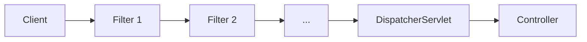
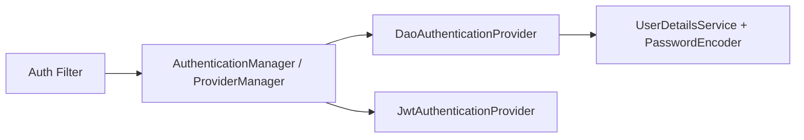

# How does Spring Security architecture and the filter chain work

---

## 🟢 Junior Level

### 1. What Is Spring Security?

Spring Security is the standard framework for authentication, authorization and attack protection in Spring applications. In a web application it works as a **chain of servlet filters** placed in front of your controllers. Every HTTP request passes through the filters; each one does a small job (read a token, check CSRF, add headers, check access). If any filter rejects the request, your controller is never called.

### 2. Real-World Analogy

A building with several security checkpoints in a corridor: reception checks your badge, a scanner checks your bag, a guard checks which floor you may visit. Only after passing all of them do you reach the office (the controller).

### 3. Minimal Example

Adding `spring-boot-starter-security` is enough to protect every endpoint with form login and a generated password (printed in the log). To customize, define a `SecurityFilterChain` bean (the `WebSecurityConfigurerAdapter` was **removed** in Spring Security 6):

```java
import org.springframework.context.annotation.Bean;
import org.springframework.context.annotation.Configuration;
import org.springframework.security.config.Customizer;
import org.springframework.security.config.annotation.web.builders.HttpSecurity;
import org.springframework.security.web.SecurityFilterChain;

@Configuration
public class WebSecurityConfig {

    @Bean
    SecurityFilterChain app(HttpSecurity http) throws Exception {
        return http
            .authorizeHttpRequests(a -> a
                .requestMatchers("/", "/health").permitAll()
                .anyRequest().authenticated())
            .formLogin(Customizer.withDefaults())
            .logout(Customizer.withDefaults())
            .build();
    }
}
```



---

## 🟡 Middle Level

### 1. The Wiring: DelegatingFilterProxy -> FilterChainProxy

1. The servlet container only knows standard `Filter`s. Spring Boot registers `DelegatingFilterProxy` (named `springSecurityFilterChain`), which delegates to a Spring bean.
2. That bean is **`FilterChainProxy`**. It holds a list of `SecurityFilterChain` objects, each with a `RequestMatcher` plus an ordered list of filters.
3. For each request, `FilterChainProxy` picks the **first** chain whose matcher matches, and runs its filters via a `VirtualFilterChain`.

This is why you can have several chains (e.g. one for `/api/**` stateless JWT, one for the web UI with sessions).

```java
@Bean @Order(1)
SecurityFilterChain api(HttpSecurity http) throws Exception {
    return http.securityMatcher("/api/**")
        .csrf(c -> c.disable())
        .sessionManagement(s -> s.sessionCreationPolicy(SessionCreationPolicy.STATELESS))
        .authorizeHttpRequests(a -> a.anyRequest().authenticated())
        .oauth2ResourceServer(o -> o.jwt(Customizer.withDefaults()))
        .build();
}

@Bean @Order(2)
SecurityFilterChain web(HttpSecurity http) throws Exception {
    return http.authorizeHttpRequests(a -> a.anyRequest().authenticated())
        .formLogin(Customizer.withDefaults()).build();
}
```

Chains are ordered with `@Order`; a catch-all chain **must be last** or it shadows the others.

### 2. Important Filters in Order (simplified)

| Order | Filter | Purpose |
| :--- | :--- | :--- |
| 1 | `DisableEncodeUrlFilter` | Prevents session id in URLs |
| 2 | `SecurityContextHolderFilter` | Loads `SecurityContext` (6.x; replaced `SecurityContextPersistenceFilter`) |
| 3 | `HeaderWriterFilter` | Adds security headers |
| 4 | `CorsFilter` | CORS pre-flight handling |
| 5 | `CsrfFilter` | Validates CSRF token |
| 6 | `LogoutFilter` | Handles `/logout` |
| 7 | `UsernamePasswordAuthenticationFilter` / `BearerTokenAuthenticationFilter` / `BasicAuthenticationFilter` | Authentication |
| 8 | `RequestCacheAwareFilter` | Replays saved request after login |
| 9 | `AnonymousAuthenticationFilter` | Populates anonymous principal |
| 10 | `ExceptionTranslationFilter` | Translates security exceptions into 401/403 |
| 11 | `AuthorizationFilter` | Final access decision |

### 3. Authentication Architecture



- `AuthenticationManager.authenticate(Authentication)` - single method.
- `ProviderManager` iterates `AuthenticationProvider`s; the first that `supports()` the token type and doesn't return `null` wins.
- Success -> filter stores the result in the `SecurityContext`. Failure -> `AuthenticationException` -> entry point.

### 4. Custom Filter Placement

```java
public class RequestIdFilter extends OncePerRequestFilter {
    @Override
    protected void doFilterInternal(HttpServletRequest req, HttpServletResponse res, FilterChain chain)
            throws ServletException, IOException {
        String id = Optional.ofNullable(req.getHeader("X-Request-Id")).orElse(UUID.randomUUID().toString());
        MDC.put("requestId", id);
        try {
            chain.doFilter(req, res);
        } finally {
            MDC.remove("requestId");
        }
    }
}
// http.addFilterBefore(new RequestIdFilter(), UsernamePasswordAuthenticationFilter.class);
```

### 5. Common Mistakes

- Declaring the custom filter as a `@Component`: Boot then also registers it as a servlet filter, so it runs **twice** (inside and outside the chain). Create it with `new` inside the config or disable auto-registration via `FilterRegistrationBean`.
- Writing `antMatchers`/`mvcMatchers` (removed in 6.x) instead of `requestMatchers`.
- Two chains without `securityMatcher`: Boot fails with "A filter chain that matches any request has already been configured".
- Ignoring `authorizeHttpRequests` ordering.

---

## 🔴 Senior Level

### 1. Internals Worth Knowing

- `FilterChainProxy` wraps each request with a **`StrictHttpFirewall`** that rejects suspicious URLs (`//`, `;`, encoded `%2e%2e`, `%0a`) with `RequestRejectedException` *before* any chain logic. This blocks path-traversal and HTTP response splitting tricks.
- `HttpSecurity` is a **builder** collecting `SecurityConfigurer`s (`CsrfConfigurer`, `FormLoginConfigurer`, ...); `build()` creates `DefaultSecurityFilterChain` once. The DSL is just a typed way to register those filters in the right order (`FilterOrderRegistration`).
- Spring Security 6 changed `AuthorizationFilter` to run for **every dispatch type** only if configured (`shouldFilterAllDispatcherTypes`, default true in 6) - async and error dispatches are authorized too. This is why `/error` is blocked for anonymous users unless permitted; a classic source of "my 500 became 401".
- Reactive stack (WebFlux) uses `WebFilterChainProxy` and `ServerHttpSecurity`; concepts are identical but the `SecurityContext` lives in the Reactor `Context`.

### 2. Performance

A typical chain adds well under a millisecond per request; the costs are in what you put in it: BCrypt (intentionally ~100 ms), remote JWK or introspection calls, session store lookups (Redis RTT). Mitigations: cache JWKs (default in `NimbusJwtDecoder`), use stateless JWT validation locally, keep authority loading cheap (cache the `UserDetails`).

Use `ignoring()` carefully: `web.ignoring()` skips the **whole** chain (no headers, no CSRF, no context) - prefer `permitAll()` for static content so headers still apply.

### 3. Debugging the Chain

```java
@Bean
ApplicationListener<AbstractAuthenticationEvent> authEvents() {
    return e -> log.info("auth event {} user={}", e.getClass().getSimpleName(), e.getAuthentication().getName());
}
```

Set `logging.level.org.springframework.security=TRACE` to see every filter invoked, plus `spring.security.debug` equivalents via `@EnableWebSecurity(debug = true)` in dev only (it dumps headers - sensitive).

### 4. Multi-Tenant / Multiple Entry Points

Use per-chain `exceptionHandling().authenticationEntryPoint(...)`: REST chains should return JSON 401 with `WWW-Authenticate`, browser chains should redirect to login. Mixing them yields HTML login pages returned to an SPA's `fetch()`.

### 5. Testing the Chain

`MockMvc` with `springSecurity()` configurer runs the real `FilterChainProxy`; see [Testing secured endpoints](23.%20Testing%20secured%20endpoints.md).

---

## 🎯 Interview Cheat Sheet

### 30-Second Elevator Pitch
Spring Security is a `FilterChainProxy` bean, plugged into the servlet container by `DelegatingFilterProxy`, which picks the first matching `SecurityFilterChain` and runs its ordered filters: context loading, CSRF, authentication, exception translation, authorization. You configure it by declaring `SecurityFilterChain` beans with the `HttpSecurity` DSL; authentication is delegated to `AuthenticationManager`/`ProviderManager`.

### Must-Know Bullets
- First matching chain wins; order with `@Order`.
- `WebSecurityConfigurerAdapter` is gone; use bean style.
- `ExceptionTranslationFilter` decides 401 vs 403.
- Never register custom filters as plain `@Component` without care.
- `StrictHttpFirewall` rejects malformed URLs.

### Common Follow-Up Questions
1. Difference between `DelegatingFilterProxy` and `FilterChainProxy`?
2. How do you have separate security for `/api` and the web UI?
3. Why does my custom filter run twice?
4. `permitAll` vs `web.ignoring()`?
5. Where does `AuthorizationFilter` sit and why is it last?

### 🚩 Red Flags
- Extending `WebSecurityConfigurerAdapter` in a Boot 3 project.
- Disabling the whole chain with `ignoring("/**")`.
- Catch-all chain placed first.

### Related Topics
- [What is SecurityContext and how does SecurityContextHolder work](03.%20What%20is%20SecurityContext%20and%20how%20does%20SecurityContextHolder%20work.md)
- [How does UserDetailsService work](04.%20How%20does%20UserDetailsService%20work.md)
- [Security headers](19.%20Security%20headers.md)
- [Testing secured endpoints](23.%20Testing%20secured%20endpoints.md)
