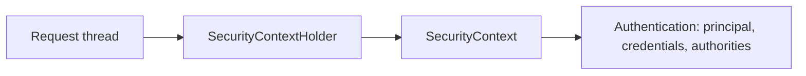

# What is SecurityContext and how does SecurityContextHolder work

---

## 🟢 Junior Level

### 1. Definition

The **`SecurityContext`** is the object that holds the **currently authenticated user** (an `Authentication`) for the running request. **`SecurityContextHolder`** is the static helper that lets you reach it from anywhere in your code without passing the user around as a parameter.

### 2. Analogy

A visitor badge pinned on your jacket for the whole visit. Any guard in the building can glance at it. The badge is yours only - another visitor has another badge.

### 3. Reading the Current User

```java
import org.springframework.security.core.Authentication;
import org.springframework.security.core.context.SecurityContextHolder;

public String currentUsername() {
    Authentication auth = SecurityContextHolder.getContext().getAuthentication();
    return auth == null ? "anonymous" : auth.getName();
}
```

In a controller, prefer injection - it is easier to test:

```java
import org.springframework.security.core.annotation.AuthenticationPrincipal;
import org.springframework.security.core.userdetails.UserDetails;
import org.springframework.web.bind.annotation.GetMapping;
import org.springframework.web.bind.annotation.RestController;

import java.security.Principal;

@RestController
public class MeController {

    @GetMapping("/me")
    public String me(Principal principal) {                    // simplest
        return principal.getName();
    }

    @GetMapping("/me/details")
    public String details(@AuthenticationPrincipal UserDetails user) {
        return user.getUsername() + " " + user.getAuthorities();
    }
}
```



---

## 🟡 Middle Level

### 1. What Is Inside `Authentication`

| Method | Meaning |
| :--- | :--- |
| `getPrincipal()` | Who: `UserDetails`, a `Jwt`, an `OidcUser`, or a String |
| `getCredentials()` | Proof (password / token); erased after successful authentication by default |
| `getAuthorities()` | `Collection<GrantedAuthority>` |
| `getDetails()` | Extra info such as remote IP and session id |
| `isAuthenticated()` | Trust flag |

### 2. Storage Strategies

`SecurityContextHolder` delegates to a `SecurityContextHolderStrategy`:

| Strategy | Mechanism | Use |
| :--- | :--- | :--- |
| `MODE_THREADLOCAL` (default) | `ThreadLocal` | One request = one thread |
| `MODE_INHERITABLETHREADLOCAL` | `InheritableThreadLocal` | Child threads copy context (fragile with pools) |
| `MODE_GLOBAL` | static field | Desktop apps/tests only |

### 3. Persistence Between Requests

- **Session-based:** `HttpSessionSecurityContextRepository` stores the context in the `HttpSession` after login and re-loads it on each request.
- **Stateless:** `RequestAttributeSecurityContextRepository` (or `NullSecurityContextRepository`): context lives for one request only; the token is re-validated on every call.

In Spring Security 6, saving is **explicit**: `SecurityContextHolderFilter` only *loads*; the authentication mechanism must *save*. If you authenticate manually (e.g. in a custom login controller) you must do it yourself:

```java
@PostMapping("/custom-login")
public void login(@RequestBody LoginRequest body, HttpServletRequest req, HttpServletResponse res) {
    Authentication token = UsernamePasswordAuthenticationToken.unauthenticated(body.username(), body.password());
    Authentication result = authenticationManager.authenticate(token);

    SecurityContext context = SecurityContextHolder.createEmptyContext();   // never reuse getContext() here
    context.setAuthentication(result);
    SecurityContextHolder.setContext(context);
    securityContextRepository.saveContext(context, req, res);               // persist to the session
}
```

Forgetting `saveContext` is the #1 migration bug: login "works" but the next request is anonymous.

### 4. Common Mistakes

- **Reading the context in a new thread.** `@Async`, `CompletableFuture.supplyAsync`, parallel streams and executors do **not** see the `ThreadLocal`. Result: `null` authentication or NPE.
- **Leaking the context in pooled threads** by calling `setContext` without clearing; the next request on that thread might inherit someone else's identity. The framework clears it in a `finally`; your own thread code must too.
- Using `getContext().setAuthentication(...)` on the shared empty context object instead of `createEmptyContext()` (race condition across threads in older versions).
- Casting `getPrincipal()` blindly to `UserDetails` when the app uses JWT (principal is a `Jwt`).

---

## 🔴 Senior Level

### 1. Propagating the Context to Async Work

```java
import org.springframework.context.annotation.Bean;
import org.springframework.core.task.TaskExecutor;
import org.springframework.scheduling.concurrent.ThreadPoolTaskExecutor;
import org.springframework.security.task.DelegatingSecurityContextAsyncTaskExecutor;

@Bean
TaskExecutor securityAwareExecutor() {
    ThreadPoolTaskExecutor pool = new ThreadPoolTaskExecutor();
    pool.setCorePoolSize(8);
    pool.setThreadNamePrefix("sec-async-");
    pool.initialize();
    return new DelegatingSecurityContextAsyncTaskExecutor(pool);   // captures + restores context per task
}
```

Alternatives: `DelegatingSecurityContextRunnable/Callable/Executor`, and for `@Async` simply `@EnableAsync` with the executor above. With Java 21 **virtual threads**, ThreadLocals still work per virtual thread, but context is not inherited into newly forked tasks - the same wrapping applies. With `StructuredTaskScope` (preview) pass identity explicitly or bind it to a `ScopedValue` via a custom `SecurityContextHolderStrategy`.

### 2. Custom Holder Strategy

```java
@Bean
MethodInvokingFactoryBean setStrategy() {
    MethodInvokingFactoryBean b = new MethodInvokingFactoryBean();
    b.setTargetClass(SecurityContextHolder.class);
    b.setTargetMethod("setStrategyName");
    b.setArguments(SecurityContextHolder.MODE_INHERITABLETHREADLOCAL);
    return b;
}
```

Spring Security 5.8+/6 prefers a `SecurityContextHolderStrategy` **bean** injected into components rather than static access: it makes testing deterministic and enables alternative stores.

### 3. Reactive Differences

In WebFlux, there is no thread affinity. The context is held in the Reactor `Context` and read through `ReactiveSecurityContextHolder.getContext()` returning `Mono<SecurityContext>`. Blocking code bridged via `Schedulers.boundedElastic()` loses it unless `Hooks.enableAutomaticContextPropagation()` (Micrometer context-propagation) is on.

### 4. Production Scenarios

- **Audit fields.** `AuditorAware<String>` reading `SecurityContextHolder` fills `@CreatedBy`; in batch jobs and Kafka listeners there is no context - return a fixed system principal, not `null`.
- **Message consumers.** Do not trust the in-process context; carry the user id as a message header and set a context explicitly with minimal authorities.
- **Session fixation & concurrency.** `sessionManagement().sessionFixation().changeSessionId()` is default; `maximumSessions(1)` needs a `SessionRegistry` + `HttpSessionEventPublisher`.
- **Memory.** A context with large `Authentication` (huge `Jwt` claims, thousands of authorities) is serialized to Redis sessions on each request; keep it lean.

### 5. Diagnostics

Log `Thread.currentThread().getName()` next to `SecurityContextHolder.getContext().getAuthentication()` when async identity is lost; a `null` principal in a `sec-async` thread without delegating executor is the typical root cause.

---

## 🎯 Interview Cheat Sheet

### 30-Second Elevator Pitch
`SecurityContext` stores the `Authentication` of the current caller; `SecurityContextHolder` exposes it, by default through a `ThreadLocal`, so any layer can ask "who is calling?". The framework loads it at the start of a request, clears it at the end, and persists it between requests via a `SecurityContextRepository` (session) or not at all (stateless).

### Must-Know Bullets
- ThreadLocal by default: new threads lose identity.
- Use `DelegatingSecurityContext*` wrappers for async.
- Spring Security 6 requires explicit `saveContext` for manual login.
- Prefer `@AuthenticationPrincipal` / `Principal` over static access.
- `getPrincipal()` type depends on the mechanism.

### Common Follow-Up Questions
1. Why is my user `null` inside `@Async` methods?
2. How does a session-based app restore the user per request?
3. What changed in Spring Security 6 about context persistence?
4. How do you test code using `SecurityContextHolder`?
5. How does it work in WebFlux?

### 🚩 Red Flags
- Using `MODE_GLOBAL` on a server.
- Storing the `Authentication` in a static field or singleton bean.
- Trusting identity from request body instead of context.

### Related Topics
- [How does Spring Security architecture and the filter chain work](02.%20How%20does%20Spring%20Security%20architecture%20and%20the%20filter%20chain%20work.md)
- [Session-based vs token-based authentication](06.%20Session-based%20vs%20token-based%20authentication.md)
- [Testing secured endpoints](22.%20Testing%20secured%20endpoints.md)
