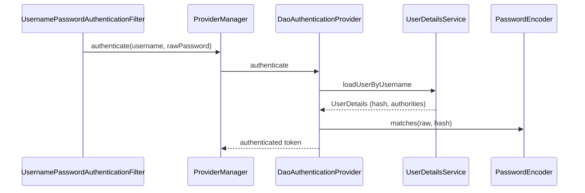

# How does UserDetailsService work

---

## 🟢 Junior Level

### 1. Definition

`UserDetailsService` is a Spring Security interface with **one method**:

```java
UserDetails loadUserByUsername(String username) throws UsernameNotFoundException;
```

Spring calls it during username/password login to **load the user's stored data** (hash, roles, account flags). Spring then compares the submitted password with the stored hash itself. You never compare passwords in this method.

### 2. Analogy

A receptionist who, given your name, pulls your file from the cabinet. The guard (the authentication provider) then checks the ID you present against the file.

### 3. In-Memory Example

```java
import org.springframework.context.annotation.Bean;
import org.springframework.context.annotation.Configuration;
import org.springframework.security.core.userdetails.User;
import org.springframework.security.core.userdetails.UserDetailsService;
import org.springframework.security.crypto.bcrypt.BCryptPasswordEncoder;
import org.springframework.security.crypto.password.PasswordEncoder;
import org.springframework.security.provisioning.InMemoryUserDetailsManager;

@Configuration
public class UsersConfig {

    @Bean
    PasswordEncoder encoder() { return new BCryptPasswordEncoder(); }

    @Bean
    UserDetailsService userDetailsService(PasswordEncoder encoder) {
        return new InMemoryUserDetailsManager(
            User.withUsername("demo")
                .password(encoder.encode("demo123"))
                .roles("USER")
                .build());
    }
}
```

In-memory users are for demos and tests only. Real apps load from a database.

---

## 🟡 Middle Level

### 1. The Flow



`DaoAuthenticationProvider` also checks the four flags via `UserDetailsChecker`: `isAccountNonLocked`, `isEnabled`, `isAccountNonExpired`, `isCredentialsNonExpired`. Failures raise `LockedException`, `DisabledException`, etc.

### 2. JPA-Backed Implementation

```java
import java.util.Set;
import org.springframework.security.core.GrantedAuthority;
import org.springframework.security.core.authority.SimpleGrantedAuthority;
import org.springframework.security.core.userdetails.UserDetails;
import org.springframework.security.core.userdetails.UserDetailsService;
import org.springframework.security.core.userdetails.UsernameNotFoundException;
import org.springframework.stereotype.Service;
import org.springframework.transaction.annotation.Transactional;
import java.util.stream.Collectors;

@Service
public class DbUserDetailsService implements UserDetailsService {

    private final UserRepository repo;

    public DbUserDetailsService(UserRepository repo) { this.repo = repo; }

    @Override
    @Transactional(readOnly = true)
    public UserDetails loadUserByUsername(String username) {
        AppUser u = repo.findWithRolesByEmail(username.toLowerCase())
            .orElseThrow(() -> new UsernameNotFoundException("Bad credentials"));
        Set<GrantedAuthority> auths = u.getRoles().stream()
            .map(r -> new SimpleGrantedAuthority("ROLE_" + r.getName()))
            .collect(Collectors.toSet());
        return org.springframework.security.core.userdetails.User.builder()
            .username(u.getEmail())
            .password(u.getPasswordHash())
            .authorities(auths)
            .accountLocked(u.isLocked())
            .disabled(!u.isActive())
            .build();
    }
}
```

The repository uses `@EntityGraph` or `JOIN FETCH` for roles, otherwise a `LazyInitializationException` or N+1 appears.

Spring Boot auto-detects a single `UserDetailsService` bean and wires it into `DaoAuthenticationProvider`; with several, define the provider explicitly.

### 3. Related Interfaces

| Interface | Purpose |
| :--- | :--- |
| `UserDetailsPasswordService` | Upgrades hashes transparently on login |
| `UserDetailsManager` | CRUD on users (`JdbcUserDetailsManager`) |
| `AuthenticationProvider` | Entirely custom auth logic (OTP, API keys) |
| `ReactiveUserDetailsService` | WebFlux variant returning `Mono` |

### 4. Common Mistakes

- **Returning your JPA entity as `UserDetails`.** Couples persistence and security, makes lazy-loading errors in the session, and serializes the hash to Redis sessions. Use a lightweight DTO/record implementing `UserDetails`.
- **Different error messages** for "user not found" vs "bad password" -> user enumeration. Spring wraps by default into `BadCredentialsException` (`hideUserNotFoundExceptions=true`); don't undo that.
- **Prefixing roles inconsistently** (`ROLE_ADMIN` in DB, `hasRole("ROLE_ADMIN")`) - see [Roles vs authorities](13.%20Roles%20vs%20authorities.md).
- **Case-sensitive usernames** letting `Bob@x.com` and `bob@x.com` be two accounts.
- **Doing the password check inside the method** - bypasses the encoder and upgrade logic.

---

## 🔴 Senior Level

### 1. Timing and Enumeration Attacks

If the user doesn't exist, a naive flow returns instantly, whereas an existing user costs ~100 ms (BCrypt). Attackers measure that. `DaoAuthenticationProvider` mitigates this by running `passwordEncoder.matches` against a pre-computed dummy hash (`USER_NOT_FOUND_PASSWORD`) for unknown users. Custom providers must replicate that behaviour.

### 2. Caching and Performance

`loadUserByUsername` runs **on every authentication** (each Basic-auth request, each login). For stateless Basic or API-key flows this becomes a DB hit per request. Options:

```java
@Bean
UserDetailsService cached(DbUserDetailsService delegate) {
    var cache = Caffeine.newBuilder().maximumSize(10_000)
                        .expireAfterWrite(Duration.ofMinutes(1)).build();
    return username -> cache.get(username, delegate::loadUserByUsername);
}
```

Trade-off: stale lock/disable state for up to the TTL. Evict on user change events, keep TTL short. Never cache plain passwords.

### 3. Hash Upgrade on Login

```java
public class UpgradingUserDetailsService extends DbUserDetailsService implements UserDetailsPasswordService {
    @Override
    public UserDetails updatePassword(UserDetails user, String newHash) {
        repo.updateHash(user.getUsername(), newHash);   // called when encoder.upgradeEncoding(old) is true
        return org.springframework.security.core.userdetails.User.withUserDetails(user).password(newHash).build();
    }
}
```

With `DelegatingPasswordEncoder` this migrates legacy `{bcrypt}` cost-10 hashes to cost-12 or `{argon2@SpringSecurity_v5_8}` gradually without forcing resets ([password storage](05.%20How%20to%20store%20passwords%20securely%20with%20PasswordEncoder.md)).

### 4. Multiple Identity Stores / Multi-Tenant

Create one `AuthenticationProvider` per source (LDAP, DB) in a `ProviderManager`, or make the `UserDetailsService` tenant-aware using a tenant resolved from the request (store it in the `Authentication.getDetails()` through an `AuthenticationDetailsSource`). Avoid thread-local tenant state leaking between requests.

### 5. Account Lockout

Implement brute-force protection with an `ApplicationListener<AuthenticationFailureBadCredentialsEvent>` counting failures per username *and* IP (Redis `INCR` with TTL), and have the service return `accountLocked(true)`. Per-username-only lockout enables DoS against victims; combine with exponential delay and CAPTCHA.

---

## 🎯 Interview Cheat Sheet

### 30-Second Elevator Pitch
`UserDetailsService.loadUserByUsername` fetches a user's hash, authorities and account flags; `DaoAuthenticationProvider` then verifies the password with a `PasswordEncoder`. Provide it as a bean, back it with a DB, return a lightweight `UserDetails`, hide whether the user exists, and cache carefully.

### Must-Know Bullets
- It *loads*; it never compares passwords.
- Throw `UsernameNotFoundException`; Spring converts to `BadCredentials`.
- Account flags: locked, disabled, expired, credentials expired.
- Not used by JWT resource servers (no password flow).
- Runs on every auth - consider cost.

### Common Follow-Up Questions
1. Where is the password actually compared?
2. How to authenticate with e-mail or phone instead of username?
3. How to implement account lockout?
4. How do you migrate hash algorithms without forcing resets?
5. `UserDetailsService` vs `AuthenticationProvider` - when each?

### 🚩 Red Flags
- Entity returned as `UserDetails`.
- Storing/returning plaintext passwords.
- Leaking "user not found" in the response.

### Related Topics
- [How to store passwords securely with PasswordEncoder](05.%20How%20to%20store%20passwords%20securely%20with%20PasswordEncoder.md)
- [Roles vs authorities](13.%20Roles%20vs%20authorities.md)
- [What is SecurityContext and how does SecurityContextHolder work](03.%20What%20is%20SecurityContext%20and%20how%20does%20SecurityContextHolder%20work.md)
