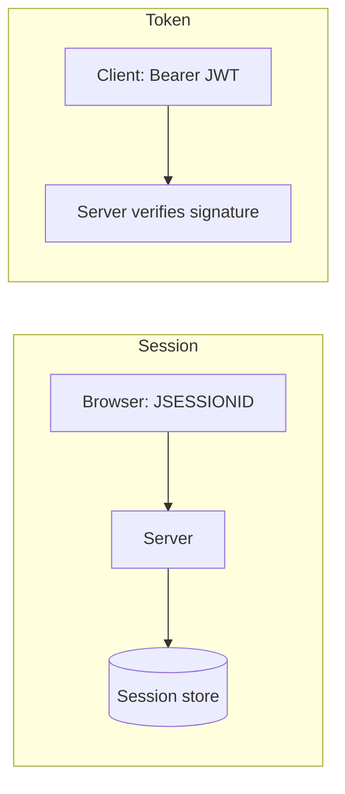

# Session-based vs token-based authentication

---

## 🟢 Junior Level

### 1. Two Ways to Remember a Logged-In User

HTTP is stateless: every request is independent. After login, the server needs a way to recognise you again.

- **Session-based:** the server keeps a record ("session") in memory/DB and gives the browser a random **session id** in a cookie (`JSESSIONID`). Each request sends the cookie; the server looks the record up.
- **Token-based:** the server gives the client a **signed token** (usually a JWT) containing the identity. The client sends it in `Authorization: Bearer <token>`. The server verifies the signature - no lookup needed.

### 2. Analogy

- **Session = cloakroom ticket.** The ticket number means nothing alone; the coat (state) stays at the venue.
- **Token = a signed festival wristband.** It carries the information itself, and staff only check that it's genuine.

### 3. Session Example (default Spring Boot)

```java
@Bean
SecurityFilterChain web(HttpSecurity http) throws Exception {
    return http
        .authorizeHttpRequests(a -> a.anyRequest().authenticated())
        .formLogin(Customizer.withDefaults())
        .sessionManagement(s -> s.sessionCreationPolicy(SessionCreationPolicy.IF_REQUIRED))
        .build();
}
```

### 4. Token Example (stateless API)

```java
@Bean
SecurityFilterChain api(HttpSecurity http) throws Exception {
    return http
        .csrf(csrf -> csrf.disable())                                    // safe only because no cookie auth
        .sessionManagement(s -> s.sessionCreationPolicy(SessionCreationPolicy.STATELESS))
        .authorizeHttpRequests(a -> a.anyRequest().authenticated())
        .oauth2ResourceServer(o -> o.jwt(Customizer.withDefaults()))
        .build();
}
```



---

## 🟡 Middle Level

### 1. Comparison

| Aspect | Session (cookie) | Token (JWT bearer) |
| :--- | :--- | :--- |
| State | Server-side | Client-side (self-contained) |
| Horizontal scaling | Needs sticky sessions or shared store (Redis, Spring Session JDBC) | Trivial, any node verifies |
| Revocation | Immediate (delete session) | Hard until expiry (see [revocation](08.%20Refresh%20tokens%20and%20JWT%20revocation%20strategies.md)) |
| CSRF | **Vulnerable** (browser auto-sends cookie) -> needs CSRF token | Not vulnerable if sent in header |
| XSS | `HttpOnly` cookie can't be read by JS | Token in `localStorage` readable by XSS |
| Mobile / third-party API clients | Awkward | Natural |
| Size per request | ~32 bytes | 0.5-2 KB |
| Cross-service propagation | Not possible | Forward the token |

### 2. Spring Session with Redis

```java
// build.gradle: org.springframework.session:spring-session-data-redis
@Configuration
@EnableRedisHttpSession(maxInactiveIntervalInSeconds = 1800)
public class SessionConfig { }
```

```yaml
server:
  servlet:
    session:
      cookie:
        http-only: true
        secure: true
        same-site: lax
      timeout: 30m
```

This keeps the server-side model but makes nodes stateless (the state lives in Redis).

### 3. Session Fixation and Concurrency

Spring changes the session id on login (`changeSessionId`) to defeat fixation. Limit logins:

```java
.sessionManagement(s -> s
    .sessionFixation(f -> f.changeSessionId())
    .maximumSessions(1).maxSessionsPreventsLogin(false))
```

### 4. Common Mistakes

- Using JWT "because it's modern" for a server-rendered monolith: you lose easy logout and gain pitfalls.
- Disabling CSRF globally while still authenticating by cookie.
- Putting the JWT in `localStorage` for a browser SPA, exposing it to any XSS.
- Long-lived access tokens "to avoid refresh complexity".
- Not setting `Secure`/`HttpOnly`/`SameSite` on session cookies.

### 5. Choosing

| Scenario | Recommended |
| :--- | :--- |
| Server-rendered web app | Session + CSRF |
| SPA + same-site backend (BFF) | Session cookie to BFF; BFF holds tokens |
| Public API, mobile, M2M | Bearer tokens (OAuth 2.0) |
| Microservices behind a gateway | Tokens propagated or exchanged |

---

## 🔴 Senior Level

### 1. The Backend-for-Frontend (BFF) Pattern

Best-practice for SPAs (IETF "OAuth 2.0 for Browser-Based Apps"): the browser never sees tokens. A BFF (Spring Cloud Gateway / Spring Boot with `oauth2Login`) performs the OAuth flow, stores access/refresh tokens in the server-side session, issues an `HttpOnly; Secure; SameSite` cookie to the browser, and attaches `Authorization: Bearer` when proxying to APIs (`TokenRelay` filter). You get cookie-grade XSS safety plus token-grade microservice integration, at the cost of CSRF handling and a stateful tier.

```yaml
spring:
  cloud:
    gateway:
      routes:
        - id: api
          uri: http://orders:8080
          predicates: [Path=/api/**]
          filters: [TokenRelay=]
```

### 2. Performance and Scalability

- **Sessions:** every request hits the store (Redis RTT ~0.3-1 ms + deserialisation). Keep session objects small, use `SaveMode.ON_SET_ATTRIBUTE`, and avoid storing entities. Memory = users x session size.
- **JWT:** signature verify is CPU only (RS256 verify ~20-50 microseconds, HS256 less); JWK set cached. No shared store but every service needs the key. Larger headers can exceed proxy limits (8 KB common) when claims grow.

### 3. Hybrid "Reference Tokens"

Opaque tokens validated via introspection (RFC 7662) give session-like revocation with token-like transport. `NimbusOpaqueTokenIntrospector` with a short cache (e.g. 30 s) balances load and freshness:

```java
@Bean
SecurityFilterChain opaque(HttpSecurity http) throws Exception {
    return http.oauth2ResourceServer(o -> o.opaqueToken(Customizer.withDefaults())).build();
}
```
```yaml
spring.security.oauth2.resourceserver.opaquetoken:
  introspection-uri: https://idp.example.com/oauth2/introspect
  client-id: orders-api
  client-secret: ${INTROSPECT_SECRET}
```

### 4. Security Edge Cases

- **Session fixation** & **session hijacking**: bind to TLS, rotate id on privilege change, short idle timeout, optionally bind to client fingerprint (careful with mobile networks).
- **Logout semantics:** JWT logout = client discards token; true logout needs a deny-list keyed by `jti` with TTL equal to remaining lifetime.
- **Clock skew:** `exp/nbf` checks tolerate 60 s by default in Spring.
- **Cookie scope:** use `__Host-` prefix (Secure, Path=/, no Domain) to prevent subdomain takeover overwriting cookies.
- **Multi-device sessions:** store device metadata in the session registry to allow "sign out everywhere".

---

## 🎯 Interview Cheat Sheet

### 30-Second Elevator Pitch
Sessions keep state on the server and send an opaque id in a cookie: easy revocation, but they need CSRF protection and a shared store when scaled. Tokens carry signed claims and the server stays stateless: great for APIs and microservices, but revocation is hard and storage on the browser is risky. For SPAs, a BFF with a session cookie and server-held tokens combines the best of both.

### Must-Know Bullets
- Cookie auth => CSRF protection required; bearer header => CSRF not applicable.
- JWT can't be revoked before `exp` without extra state.
- Use `HttpOnly`, `Secure`, `SameSite` cookies.
- Spring Session + Redis scales sessions.
- Opaque tokens + introspection = revocable tokens.

### Common Follow-Up Questions
1. Where would you store a JWT in a browser and why?
2. How do you scale sessions across 10 instances?
3. How does logout work with JWT?
4. Why is `STATELESS` not the same as "no CSRF needed"?
5. What is the BFF pattern?

### 🚩 Red Flags
- "JWT is always better than sessions".
- Access token lifetime of 30 days.
- `csrf.disable()` with cookie login.

### Related Topics
- [JWT structure signing and common pitfalls](07.%20JWT%20structure%20signing%20and%20common%20pitfalls.md)
- [Refresh tokens and JWT revocation strategies](08.%20Refresh%20tokens%20and%20JWT%20revocation%20strategies.md)
- [CSRF protection](14.%20CSRF%20protection.md)
- [Securing microservices](21.%20Securing%20microservices.md)
