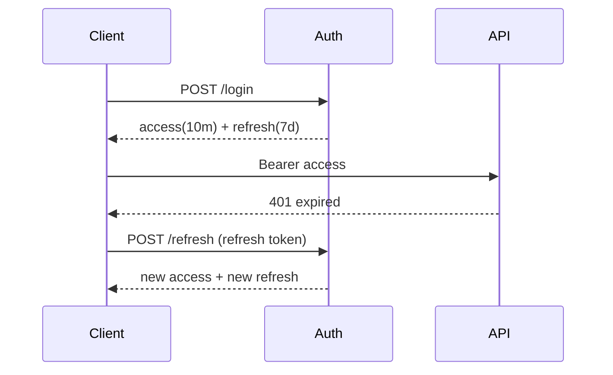

# Refresh tokens and JWT revocation strategies

---

## 🟢 Junior Level

### 1. The Problem

A JWT access token is valid until it expires; the server doesn't remember it. Two conflicting wishes:

- **Short life** (5-15 min) so a stolen token is useless quickly.
- **Convenience:** users shouldn't log in every 10 minutes.

### 2. The Solution: Refresh Tokens

At login the server issues **two** tokens:

| Token | Lifetime | Sent to | Purpose |
| :--- | :--- | :--- | :--- |
| **Access token** (JWT) | minutes | every API call | Authorize requests |
| **Refresh token** (opaque random string) | days/weeks | only the auth server's `/token` endpoint | Get a new access token |

### 3. Analogy

An access token is a **day pass**; the refresh token is your **membership card** kept at reception. When the day pass expires, you show the membership card at reception to get a new pass. If the card is lost, reception can cancel it.

### 4. Minimal Flow in Code

```java
record TokenPair(String accessToken, String refreshToken, long expiresIn) {}

@RestController
@RequestMapping("/auth")
class AuthController {
    private final AuthService auth;
    AuthController(AuthService auth) { this.auth = auth; }

    @PostMapping("/login")
    TokenPair login(@RequestBody LoginRequest r) {
        return auth.login(r.username(), r.password());
    }

    @PostMapping("/refresh")
    TokenPair refresh(@RequestBody RefreshRequest r) {
        return auth.refresh(r.refreshToken());
    }
}
record LoginRequest(String username, String password) {}
record RefreshRequest(String refreshToken) {}
```



---

## 🟡 Middle Level

### 1. Refresh Token Rules

- **Opaque and random** (>= 128 bits from `SecureRandom`), not a JWT, so you can revoke it simply.
- **Stored hashed** (SHA-256) in the DB: a DB leak doesn't expose usable tokens.
- **Rotation:** every refresh returns a *new* refresh token and invalidates the old one.
- **Reuse detection:** if an already-used refresh token appears again, someone stole it. Revoke the whole **token family** (all descendants) and force re-login.
- **Bound** to user, client, device; with absolute max age (e.g. 30 days) plus idle timeout.

### 2. Implementation Sketch

```java
@Service
public class AuthService {

    private final RefreshTokenRepository tokens;
    private final JwtService jwt;
    private final SecureRandom random = new SecureRandom();

    public AuthService(RefreshTokenRepository tokens, JwtService jwt) {
        this.tokens = tokens;
        this.jwt = jwt;
    }

    @Transactional
    public TokenPair refresh(String presented) {
        String hash = sha256(presented);
        RefreshToken stored = tokens.findByHash(hash)
                .orElseThrow(() -> new BadCredentialsException("Invalid refresh token"));

        if (stored.isUsed()) {                        // reuse => theft
            tokens.revokeFamily(stored.getFamilyId());
            throw new BadCredentialsException("Token reuse detected");
        }
        if (stored.getExpiresAt().isBefore(Instant.now()) || stored.isRevoked()) {
            throw new BadCredentialsException("Expired refresh token");
        }
        stored.setUsed(true);

        String raw = newRawToken();
        tokens.save(new RefreshToken(sha256(raw), stored.getUserId(), stored.getFamilyId(),
                Instant.now().plus(Duration.ofDays(7))));
        return new TokenPair(jwt.issue(stored.getUserId()), raw, 600);
    }

    private String newRawToken() {
        byte[] b = new byte[32];
        random.nextBytes(b);
        return Base64.getUrlEncoder().withoutPadding().encodeToString(b);
    }

    private static String sha256(String s) {
        try {
            return HexFormat.of().formatHex(MessageDigest.getInstance("SHA-256").digest(s.getBytes(StandardCharsets.UTF_8)));
        } catch (NoSuchAlgorithmException e) { throw new IllegalStateException(e); }
    }
}
```

Use a unique constraint / `SELECT ... FOR UPDATE` so two concurrent refreshes with the same token cannot both succeed.

### 3. Revocation Strategies for Access Tokens

| Strategy | How | Trade-off |
| :--- | :--- | :--- |
| **Short TTL only** | 5 min and nothing else | Simple; up to 5 min of exposure |
| **Deny-list by `jti`** | Redis `SET jti EX remaining_ttl`; check each request | Stateful lookup but tiny set |
| **Token version / `tokenValidAfter`** | Claim `ver` compared with user's current version in cache | One cache read; revokes all of a user's tokens at once |
| **Introspection** (opaque tokens) | Auth server decides per call (cache 10-60 s) | Real-time; extra network hop |
| **Key rotation** | Drop the signing key | Nuclear: invalidates everybody |
| **Back-channel logout** (OIDC) | IdP notifies apps to kill sessions | Needs session store |

### 4. Deny-list Filter Example

```java
@Component
class RevocationValidator implements OAuth2TokenValidator<Jwt> {
    private final StringRedisTemplate redis;
    RevocationValidator(StringRedisTemplate redis) { this.redis = redis; }

    @Override
    public OAuth2TokenValidatorResult validate(Jwt jwt) {
        boolean revoked = Boolean.TRUE.equals(redis.hasKey("revoked:" + jwt.getId()));
        return revoked
            ? OAuth2TokenValidatorResult.failure(new OAuth2Error("invalid_token", "Token revoked", null))
            : OAuth2TokenValidatorResult.success();
    }
}
```

Set TTL on the key equal to the token's remaining life, so the list never grows unbounded.

### 5. Common Mistakes

- Refresh token as a never-expiring JWT.
- Storing refresh tokens in `localStorage`; prefer `HttpOnly; Secure; SameSite=Strict; Path=/auth/refresh` cookie or a BFF.
- No rotation, so one leaked token = permanent access.
- Not revoking refresh tokens on password change / "log out everywhere".
- Race: SPA tabs refreshing concurrently trigger false reuse detection - serialize refreshes client-side or allow a short grace window (10-30 s).

---

## 🔴 Senior Level

### 1. Reuse Detection and Distributed Races

Rotation + reuse detection requires atomic "compare-and-mark-used". In SQL: `UPDATE refresh_token SET used = true WHERE hash = ? AND used = false` and check affected rows == 1; do not read-then-write. With Redis use `GETDEL`/Lua. Multi-region: replication lag can make a legitimate retry appear as reuse; use a grace window or sticky routing for the refresh endpoint, and return the same successor response idempotently for the grace period.

### 2. OAuth 2.0 Alignment

RFC 9700 (OAuth 2.0 Security BCP) requires refresh tokens for public clients to be **sender-constrained** (DPoP/mTLS) *or* rotated with reuse detection. Spring Authorization Server provides `OAuth2RefreshToken` handling with `reuseRefreshTokens(false)` (rotation). Prefer using it over a hand-rolled implementation:

```java
@Bean
RegisteredClientRepository clients() {
    RegisteredClient c = RegisteredClient.withId(UUID.randomUUID().toString())
        .clientId("spa-bff")
        .clientSecret("{noop}change-me")                   // use a real encoded secret
        .authorizationGrantType(AuthorizationGrantType.AUTHORIZATION_CODE)
        .authorizationGrantType(AuthorizationGrantType.REFRESH_TOKEN)
        .redirectUri("https://app.example.com/login/oauth2/code/spa")
        .tokenSettings(TokenSettings.builder()
            .accessTokenTimeToLive(Duration.ofMinutes(10))
            .refreshTokenTimeToLive(Duration.ofDays(7))
            .reuseRefreshTokens(false)
            .build())
        .build();
    return new InMemoryRegisteredClientRepository(c);
}
```

### 3. Capacity and Cost

Deny-list lookups add ~0.3-1 ms per request in Redis; cache negative results in-process for a few seconds (Caffeine) to cut load at the cost of that much revocation delay. A `ver` claim approach needs one cached integer per active user: typically a few MB for 100k users.

### 4. Failure Modes

- **Revocation store outage:** fail open (availability) or closed (security)? For high-risk APIs fail closed on write operations, open on reads, and alert.
- **Clock skew** between auth server and APIs shifts effective expiry; keep NTP and leeway <= 60 s.
- **Mass logout** after compromise: bump a global `notBefore` timestamp and reject tokens with `iat` earlier.
- **Audit:** log issuance, refresh, reuse-detection and revocation events with `jti`/family id but never the token value.

### 5. Observability

Metrics: refresh rate per client, reuse-detection count (should be near zero; spikes mean attacks or client bugs), revocation-store latency. Alert on reuse spikes.

---

## 🎯 Interview Cheat Sheet

### 30-Second Elevator Pitch
Use short-lived JWT access tokens and long-lived, opaque, hashed, **rotating** refresh tokens with reuse detection. Since JWTs can't be recalled, revoke by killing refresh tokens, keeping a `jti` deny-list or token-version, or using introspection for opaque tokens. Sender-constrain tokens where the risk justifies it.

### Must-Know Bullets
- Access: minutes. Refresh: days, opaque, server-stored hash.
- Rotate on each use; reuse = revoke family.
- Revocation options: TTL, deny-list, version claim, introspection.
- Refresh tokens never go in `localStorage`.
- Atomic compare-and-set prevents races.

### Common Follow-Up Questions
1. Why not just use a long-lived access token?
2. What is refresh token rotation and why?
3. How would you implement "log out all devices"?
4. What happens when two tabs refresh at once?
5. Deny-list vs introspection trade-offs?

### 🚩 Red Flags
- Refresh token that is itself a stateless, unrevocable JWT.
- Returning refresh tokens in URLs.
- No expiry on refresh tokens.

### Related Topics
- [JWT structure signing and common pitfalls](07.%20JWT%20structure%20signing%20and%20common%20pitfalls.md)
- [OAuth 2.0 flows with authorization code PKCE and client credentials](09.%20OAuth%202.0%20flows%20with%20authorization%20code%20PKCE%20and%20client%20credentials.md)
- [Session-based vs token-based authentication](06.%20Session-based%20vs%20token-based%20authentication.md)
