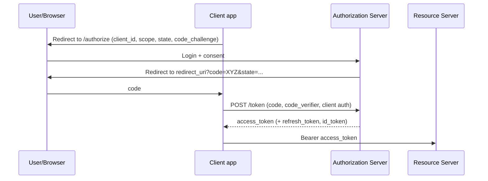

# OAuth 2.0 flows with authorization code PKCE and client credentials

---

## 🟢 Junior Level

### 1. What Is OAuth 2.0?

OAuth 2.0 is a framework that lets an application obtain **limited access to a resource on behalf of a user (or itself)** without ever seeing the user's password. It is about **delegated authorization**, not login (login is OpenID Connect, built on top).

### 2. Roles

| Role | Example |
| :--- | :--- |
| Resource Owner | You, the user |
| Client | The app that wants access (a photo-printing site) |
| Authorization Server | Keycloak, Okta, Auth0, Spring Authorization Server |
| Resource Server | The API holding the data (Google Photos API) |

### 3. Analogy

A **hotel key card**. You don't give the cleaner your house master key (your password). The front desk (authorization server) issues a card that opens only room 412 and only until checkout (scope + expiry).

### 4. The Two Flows You Must Know

- **Authorization Code (+ PKCE):** a *user* is involved (web apps, SPAs, mobile).
- **Client Credentials:** no user; *machine-to-machine* (a batch job calling an API).

(The older *Implicit* and *Password* grants are removed in OAuth 2.1 - never use them.)

### 5. Client Credentials in Spring Boot (calls another service)

```yaml
spring:
  security:
    oauth2:
      client:
        registration:
          billing:
            provider: keycloak
            client-id: orders-service
            client-secret: ${ORDERS_CLIENT_SECRET}
            authorization-grant-type: client_credentials
            scope: invoices.read
        provider:
          keycloak:
            token-uri: https://idp.example.com/realms/demo/protocol/openid-connect/token
```

```java
@Configuration
class ClientConfig {
    @Bean
    RestClient billingClient(OAuth2AuthorizedClientManager manager) {
        return RestClient.builder()
            .baseUrl("https://billing.example.com")
            .requestInterceptor((req, body, exec) -> {
                OAuth2AuthorizedClient c = manager.authorize(
                    OAuth2AuthorizeRequest.withClientRegistrationId("billing")
                        .principal("orders-service").build());
                req.getHeaders().setBearerAuth(c.getAccessToken().getTokenValue());
                return exec.execute(req, body);
            }).build();
    }
}
```

---

## 🟡 Middle Level

### 1. Authorization Code Flow



The **authorization code** is short-lived, single-use and travels through the browser; the **token** is obtained over a direct back-channel, so tokens never appear in URLs.

### 2. PKCE (Proof Key for Code Exchange, RFC 7636)

Problem: on mobile/SPA the code can be intercepted (malicious app registered on the same custom scheme) and exchanged. PKCE binds the code to the client instance:

1. Client generates random `code_verifier` (43-128 chars).
2. Sends `code_challenge = BASE64URL(SHA256(code_verifier))` and `code_challenge_method=S256` in `/authorize`.
3. At `/token`, sends the original `code_verifier`; the server recomputes and compares.

An attacker with only the code can't redeem it. **OAuth 2.1 requires PKCE for all authorization-code clients**, including confidential ones.

```java
import java.nio.charset.StandardCharsets;
import java.security.MessageDigest;
import java.security.SecureRandom;
import java.util.Base64;

public class Pkce {
    public static void main(String[] args) throws Exception {
        byte[] r = new byte[32];
        new SecureRandom().nextBytes(r);
        String verifier = Base64.getUrlEncoder().withoutPadding().encodeToString(r);
        byte[] digest = MessageDigest.getInstance("SHA-256").digest(verifier.getBytes(StandardCharsets.US_ASCII));
        String challenge = Base64.getUrlEncoder().withoutPadding().encodeToString(digest);
        System.out.println("verifier=" + verifier + "\nchallenge=" + challenge);
    }
}
```

### 3. Spring Boot Login Client (`oauth2Login`)

```java
@Bean
SecurityFilterChain web(HttpSecurity http) throws Exception {
    return http
        .authorizeHttpRequests(a -> a.requestMatchers("/", "/error").permitAll().anyRequest().authenticated())
        .oauth2Login(Customizer.withDefaults())
        .build();
}
```
```yaml
spring.security.oauth2.client.registration.google:
  client-id: ${GOOGLE_ID}
  client-secret: ${GOOGLE_SECRET}
  scope: openid,profile,email
```

Spring Security automatically sends `state`, and uses PKCE for public clients (for confidential clients since 6.x it is also enabled when `client-authentication-method=none` or customized with `OAuth2AuthorizationRequestCustomizers.withPkce()`).

### 4. Other Grants

| Grant | Use |
| :--- | :--- |
| Refresh token | Renew access token |
| Device code | TVs/CLIs without a browser |
| Token exchange (RFC 8693) | Swap token for a downstream audience/on-behalf-of |
| JWT bearer | Assertion-based client auth |
| Implicit / Password (ROPC) | **Deprecated - don't** |

### 5. Scopes vs Roles

Scopes describe what the **client** may do on the user's behalf (`orders.read`); roles describe what the **user** is. Spring maps scopes to authorities `SCOPE_orders.read`.

### 6. Common Mistakes

- Skipping `state` -> CSRF on the redirect (login CSRF).
- Loose `redirect_uri` matching (wildcards) -> code/token theft. Require exact match.
- Using Implicit flow for SPAs, tokens in URL fragment.
- Treating an access token as proof of *login* (that's what the ID token is for).
- Embedding the client secret in SPA/mobile code (public clients have no secrets).

---

## 🔴 Senior Level

### 1. Client Types and Authentication Methods

Confidential clients (server-side) authenticate with `client_secret_basic/post`, `private_key_jwt` (preferred: no shared secret; JWT assertion signed by the client) or mutual TLS. Public clients (SPA, mobile) have no secret -> PKCE is the only protection. For high security (FAPI), use PAR (Pushed Authorization Requests, RFC 9126), JAR, `private_key_jwt`, and DPoP/mTLS-bound tokens.

### 2. Attacks and Mitigations

| Attack | Mitigation |
| :--- | :--- |
| Authorization code interception | PKCE, exact redirect URIs, single-use short-lived code (<= 60 s) |
| Login CSRF / mix-up | `state`, `nonce`, `iss` parameter (RFC 9207) |
| Open redirector in client | Strict allow-list for post-login redirects |
| Token leakage via Referer/logs | Code flow only, no tokens in URLs, `Referrer-Policy` |
| Refresh-token theft | Rotation + reuse detection, sender constraint |
| Phishing consent | Verified clients, limited scopes |

### 3. Spring Authorization Server Skeleton

```java
@Configuration
@EnableWebSecurity
public class AuthServerConfig {

    @Bean @Order(1)
    SecurityFilterChain authServer(HttpSecurity http) throws Exception {
        OAuth2AuthorizationServerConfiguration.applyDefaultSecurity(http);
        http.getConfigurer(OAuth2AuthorizationServerConfigurer.class).oidc(Customizer.withDefaults());
        http.exceptionHandling(e -> e.defaultAuthenticationEntryPointFor(
                new LoginUrlAuthenticationEntryPoint("/login"), new MediaTypeRequestMatcher(MediaType.TEXT_HTML)));
        return http.build();
    }

    @Bean
    RegisteredClientRepository clients() {
        RegisteredClient spa = RegisteredClient.withId(UUID.randomUUID().toString())
            .clientId("web")
            .clientAuthenticationMethod(ClientAuthenticationMethod.NONE)   // public client
            .authorizationGrantType(AuthorizationGrantType.AUTHORIZATION_CODE)
            .redirectUri("https://app.example.com/callback")
            .scope(OidcScopes.OPENID).scope("orders.read")
            .clientSettings(ClientSettings.builder().requireProofKey(true).requireAuthorizationConsent(true).build())
            .build();
        return new InMemoryRegisteredClientRepository(spa);
    }
}
```

### 4. Client Credentials in Production

- Cache the token until ~30 s before `expires_in`; `OAuth2AuthorizedClientManager` does this. Without caching, every call hits the IdP (rate limits, latency).
- Use `AuthorizedClientServiceOAuth2AuthorizedClientManager` for non-request contexts (schedulers); the servlet variant needs a request.
- Rotate secrets (see [Secrets management](20.%20Secrets%20management.md)) or use `private_key_jwt` / workload identity (K8s projected service account tokens, SPIFFE).
- Request minimal scopes per target API; use audience restriction.

### 5. Diagnostics

Enable `logging.level.org.springframework.security.oauth2=TRACE`. Typical failures: `invalid_grant` (code reused/expired or wrong `redirect_uri`/`code_verifier`), `invalid_client` (wrong auth method), `invalid_scope`. Verify clocks and the **issuer-uri** behind proxies (`X-Forwarded-*` handling and `server.forward-headers-strategy=framework`).

---

## 🎯 Interview Cheat Sheet

### 30-Second Elevator Pitch
OAuth 2.0 delegates access using tokens. For users, use the authorization code flow with PKCE: redirect to the authorization server, get a one-time code, exchange it (with the code verifier) for tokens over a back channel. For services, use client credentials. Implicit and password grants are obsolete. OAuth is authorization; OIDC adds authentication.

### Must-Know Bullets
- Code flow + PKCE for all user-facing clients.
- Client credentials for M2M, no user.
- `state` prevents CSRF; exact `redirect_uri` match.
- Public clients can't keep secrets.
- Scopes limit the client; not the same as roles.

### Common Follow-Up Questions
1. Why was Implicit flow deprecated?
2. How does PKCE stop code interception?
3. Difference between access token and ID token?
4. How does a service-to-service call get a token?
5. What does `state` protect against?

### 🚩 Red Flags
- "OAuth is for authentication."
- Client secret in a mobile app.
- Wildcard redirect URIs.

### Related Topics
- [OpenID Connect and Single Sign-On](10.%20OpenID%20Connect%20and%20Single%20Sign-On.md)
- [How to build an OAuth 2.0 Resource Server](11.%20How%20to%20build%20an%20OAuth%202.0%20Resource%20Server.md)
- [Refresh tokens and JWT revocation strategies](08.%20Refresh%20tokens%20and%20JWT%20revocation%20strategies.md)
- [Securing microservices](22.%20Securing%20microservices.md)
