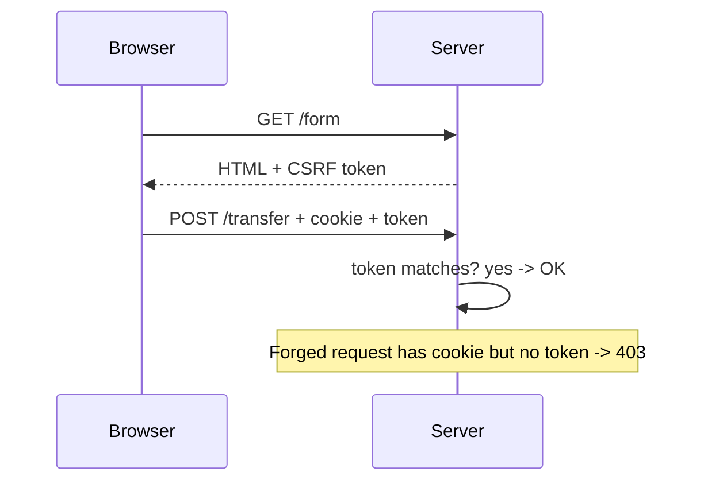

# CSRF protection

---

## 🟢 Junior Level

### 1. What Is CSRF?

**Cross-Site Request Forgery** tricks a logged-in user's browser into sending an unwanted request to a site where they are authenticated. Browsers **automatically attach cookies** (including the session cookie) to every request to that site, even when the request was triggered by another site.

### 2. Analogy

You hold a signed blank cheque book (your session cookie). A stranger slips a pre-filled "pay me $1000" form in front of you; you sign it without reading (your browser auto-attaches the cookie). The bank sees your genuine signature.

### 3. Attack Example

You're logged into `bank.example.com`. You visit `evil.example` which contains:

```html
<form action="https://bank.example.com/transfer" method="POST" id="f">
  <input name="to" value="attacker"><input name="amount" value="1000">
</form>
<script>document.getElementById('f').submit()</script>
```

The browser sends your bank cookie along; the transfer happens.

### 4. Defence: CSRF Token

The server issues a random token that the legitimate page includes in each state-changing request. `evil.example` can't read it (same-origin policy), so it can't forge a valid request. Spring Security enables CSRF protection **by default** for `POST/PUT/PATCH/DELETE`.

```html
<!-- Thymeleaf adds the hidden field automatically -->
<form th:action="@{/transfer}" method="post">
  <input name="to"><input name="amount">
  <button>Send</button>
</form>
```



---

## 🟡 Middle Level

### 1. When You Need It and When You Don't

| Scenario | CSRF needed? |
| :--- | :--- |
| Server-rendered app with session cookie | **Yes** |
| SPA authenticating with cookie/session | **Yes** |
| Pure API authenticating via `Authorization: Bearer` header | No (browser doesn't auto-send it) |
| Public, stateless API with no cookies | No |

`csrf.disable()` is acceptable **only** when no credential is sent automatically by the browser (cookies, Basic-auth cached credentials, client certificates).

### 2. Spring Security 6 Behaviour

- `CsrfFilter` checks unsafe methods (not GET/HEAD/OPTIONS/TRACE).
- Token supplied via header `X-CSRF-TOKEN` or the `_csrf` form parameter.
- Spring Security 6 **defers loading** the token (`XorCsrfTokenRequestAttributeHandler` is default, BREACH-protection by XOR-masking each response).

### 3. SPA Configuration (Angular/React) with Cookie Repository

```java
import org.springframework.security.web.csrf.CookieCsrfTokenRepository;
import org.springframework.security.web.csrf.CsrfTokenRequestAttributeHandler;

@Bean
SecurityFilterChain spa(HttpSecurity http) throws Exception {
    CsrfTokenRequestAttributeHandler handler = new CsrfTokenRequestAttributeHandler();
    handler.setCsrfRequestAttributeName(null);       // load token eagerly so the cookie is always set
    http.csrf(csrf -> csrf
            .csrfTokenRepository(CookieCsrfTokenRepository.withHttpOnlyFalse())   // JS must read XSRF-TOKEN
            .csrfTokenRequestHandler(handler))
        .authorizeHttpRequests(a -> a.anyRequest().authenticated())
        .formLogin(Customizer.withDefaults());
    return http.build();
}
```

The frontend reads cookie `XSRF-TOKEN` and sends it back in `X-XSRF-TOKEN` (Angular does it automatically; with `fetch` you do it by hand):

```javascript
const token = document.cookie.split('; ').find(c => c.startsWith('XSRF-TOKEN='))?.split('=')[1];
fetch('/api/transfer', {
  method: 'POST',
  credentials: 'include',
  headers: { 'Content-Type': 'application/json', 'X-XSRF-TOKEN': token },
  body: JSON.stringify({ to: 'bob', amount: 10 })
});
```

### 4. Selective Exclusions

```java
http.csrf(csrf -> csrf.ignoringRequestMatchers("/webhooks/stripe/**"));   // authenticate those by HMAC signature instead
```

### 5. Complementary Defences

- **`SameSite` cookies:** `Lax` (browser default now) blocks cross-site POST cookies; `Strict` is stronger but breaks inbound links. Configure `server.servlet.session.cookie.same-site=lax`.
- **Origin/Referer verification** for unsafe requests.
- **Custom header requirement** (e.g. `X-Requested-With`): cross-site forms can't set it without a CORS pre-flight.
- Re-authenticate for critical actions.

### 6. Common Mistakes

- `csrf.disable()` "because POST returns 403" while using sessions. The 403 was the protection working.
- Forgetting to send the token in AJAX calls / logout (logout is POST in Spring Security 4+).
- Using GET for state-changing operations (CSRF filter ignores GET).
- Putting the token in a URL (leaks via Referer and logs).
- With the cookie-repository + SPA: token not returned on first load because it is deferred (see the eager handler above).

---

## 🔴 Senior Level

### 1. Patterns and Their Trade-offs

| Pattern | State | Notes |
| :--- | :--- | :--- |
| **Synchronizer token** (session stored) | Server session | Default `HttpSessionCsrfTokenRepository`; strongest |
| **Double-submit cookie** | Stateless | Cookie value must equal header value; vulnerable if attacker can set cookies on a sibling subdomain -> use **signed** (HMAC) double-submit tokens bound to session id |
| **SameSite + custom header** | Stateless | Defence in depth, not primary |

Spring's `CookieCsrfTokenRepository` is double-submit; combine with `__Host-` prefix or signed values for subdomain-takeover scenarios.

### 2. BREACH Protection

When responses are compressed over TLS and contain a static secret plus attacker-controlled reflected text, the secret can be inferred through response size. Spring Security 5.8+/6 masks the token per response using a random XOR pad, so the token string differs on each response while still validating. Don't disable it by switching to `CsrfTokenRequestAttributeHandler` unless the token is not embedded in compressed HTML.

### 3. Login CSRF and Session Fixation

Attackers can CSRF the **login** form to log the victim into the *attacker's* account (the victim then enters data into it). Spring protects `/login` with CSRF too; keep it that way, and rotate the session id after authentication.

### 4. Testing

```java
@Test
void postWithoutCsrfIsForbidden() throws Exception {
    mvc.perform(post("/transfer").with(user("alice")).param("to", "bob"))
       .andExpect(status().isForbidden());
}

@Test
void postWithCsrfSucceeds() throws Exception {
    mvc.perform(post("/transfer").with(user("alice")).with(csrf()).param("to", "bob"))
       .andExpect(status().isOk());
}
```

### 5. Edge Cases in Production

- **Load balancers + sessions:** token stored in session -> shared session store or sticky sessions required; cookie-based repository avoids it.
- **Multipart uploads:** token in query string or `MultipartFilter` before security, otherwise body is not parsed yet.
- **Token expiry:** session timeout makes stored tokens vanish; UI should handle 403 by reloading the token.
- **CORS + CSRF:** a permissive CORS config (`allowCredentials` with `*` origins) can reintroduce CSRF-like exposure by allowing evil origins to read responses ([CORS configuration](15.%20CORS%20configuration.md)).
- **Monitoring:** `AccessDeniedHandler` for `CsrfException`/`MissingCsrfTokenException` -> count them; a spike suggests an attack or a client bug after a deploy.

---

## 🎯 Interview Cheat Sheet

### 30-Second Elevator Pitch
CSRF abuses the browser's automatic cookie sending to make authenticated requests the user didn't intend. Spring Security blocks it by default with per-session (or double-submit) tokens required on unsafe HTTP methods, plus `SameSite` cookies as defence in depth. You can disable it only for stateless APIs authenticated by headers, never for cookie-based sessions.

### Must-Know Bullets
- Only matters when credentials are sent automatically (cookies).
- Tokens on POST/PUT/PATCH/DELETE; GET must be safe.
- `SameSite=Lax` helps but is not a replacement.
- SPA: `CookieCsrfTokenRepository.withHttpOnlyFalse()` + header.
- Bearer-token APIs are not CSRF-prone.

### Common Follow-Up Questions
1. Why is CSRF not an issue with JWT in the `Authorization` header?
2. Synchronizer token vs double-submit cookie?
3. How does SameSite help?
4. Why is the token XOR-masked in Spring Security 6?
5. How do webhooks coexist with CSRF protection?

### 🚩 Red Flags
- "Disable CSRF to make the 403 go away."
- State changes via GET.
- Token in a URL parameter.

### Related Topics
- [CORS configuration](15.%20CORS%20configuration.md)
- [Session-based vs token-based authentication](06.%20Session-based%20vs%20token-based%20authentication.md)
- [Security headers](19.%20Security%20headers.md)
- [XSS and SQL injection prevention](16.%20XSS%20and%20SQL%20injection%20prevention.md)
