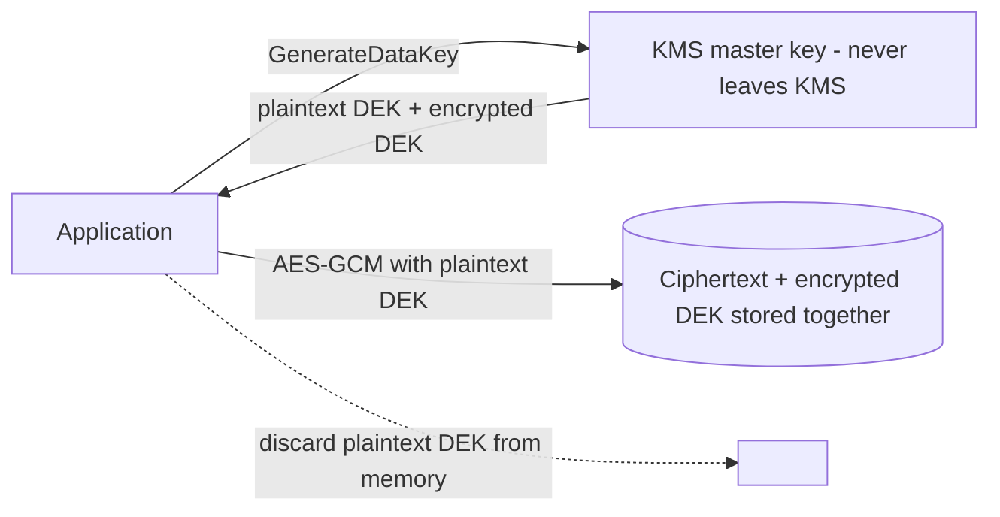

# Secrets management

---

## 🟢 Junior Level

**Secrets** are credentials that grant access: database passwords, API keys, OAuth client secrets, private keys, encryption keys. **Secrets management** is how you store, deliver, rotate and audit them.

### Rules that prevent most incidents
1. **Never commit secrets to Git** — not in `application.yml`, not in tests, not "temporarily". Git history keeps them forever.
2. **Keep secrets out of images and logs.**
3. **Different secrets per environment** (dev, staging, prod).
4. **Least privilege** — each service gets only the secrets it needs.
5. **Rotate** regularly and immediately after a leak.

### Externalized configuration in Spring Boot

```yaml
# application.yml — no secret values, only references
spring:
  datasource:
    url: jdbc:postgresql://db:5432/orders
    username: orders_app
    password: ${DB_PASSWORD}          # resolved from env var, file, or a secret store at runtime
```

Locally, use a `.env` file or IDE run configuration that is `.gitignore`d; in production, inject from a secret manager.

---

## 🟡 Middle Level

### Where secrets come from

| Option | How it reaches the app | Notes |
| --- | --- | --- |
| Environment variables | `${DB_PASSWORD}` | Simple; visible in `/proc/<pid>/environ`, crash dumps and `docker inspect` |
| Kubernetes Secret as files | Mounted volume, Spring `configtree:` | Updated in place on rotation; base64 ≠ encryption — enable etcd encryption at rest |
| HashiCorp Vault | Spring Cloud Vault, Vault Agent sidecar | Dynamic secrets, leases, audit log |
| AWS Secrets Manager / SSM Parameter Store | Spring Cloud AWS `spring.config.import=aws-secretsmanager:` | IAM-scoped access, rotation Lambdas |
| Azure Key Vault / GCP Secret Manager | Spring Cloud Azure / GCP | Same idea, managed identities |

### Kubernetes files + Spring config tree

```yaml
# deployment.yaml
volumes:
  - name: db-creds
    secret: { secretName: orders-db }
containers:
  - name: app
    volumeMounts: [{ name: db-creds, mountPath: /etc/secrets/db, readOnly: true }]
```

```yaml
# application.yml
spring:
  config:
    import: optional:configtree:/etc/secrets/
# file /etc/secrets/db/password becomes property "db.password"
  datasource:
    password: ${db.password}
```

### Preventing leaks
* **Pre-commit and CI scanning**: gitleaks, trufflehog, GitHub secret scanning with push protection.
* **Mask in logs**: never log full configuration; Actuator `/env` and `/configprops` sanitize keys like `password`, `secret`, `key`, `token` by default (`management.endpoint.env.show-values=never`, the default in Boot 3).
* **Don't put secrets in URLs** (`jdbc:...?password=`, `?api_key=`): they end up in access logs and proxies.

---

## 🔴 Senior Level

### Dynamic, short-lived credentials
The strongest pattern is to have **no long-lived secret at all**:
* **Vault database secrets engine** — the app requests credentials at startup; Vault creates a database user with a TTL (e.g. 1 h) and revokes it when the lease expires. A leaked password is useless soon after.
* **Cloud workload identity** — EKS IRSA / EKS Pod Identity, GKE Workload Identity, Azure Workload Identity: the pod gets short-lived cloud credentials via OIDC federation; no access keys in config.
* **IAM database authentication** (RDS/Aurora IAM auth, Cloud SQL IAM) — a 15-minute token instead of a password.

With rotating credentials, connection pools need to pick up new passwords: Spring Cloud Vault can refresh `HikariDataSource` credentials; Hikari's `HikariConfigMXBean` allows changing the password for *new* connections, and `maxLifetime` shorter than the credential TTL ensures old connections are replaced.

### Encryption keys and envelope encryption
For application-level encryption of data (PII columns, files), don't keep the data key in config:



To decrypt, the app sends the encrypted DEK to KMS (access-controlled and audited) and gets the plaintext DEK back. Rotating the master key doesn't require re-encrypting data; deleting a per-tenant key provides crypto-shredding.

### Threat model for secrets
* **Who can read it?** Restrict by service identity, not by "anyone in the cluster" (Kubernetes RBAC on `secrets` is often too broad — `get/list secrets` on a namespace reveals all of them).
* **Where does it live in memory?** Heap dumps contain plaintext secrets; protect `/actuator/heapdump` and heap-dump-on-OOM files.
* **How fast can you rotate?** Practice rotation (game day): if rotating the DB password requires a coordinated redeploy of 12 services, you won't do it during an incident.
* **Is access audited?** Vault and cloud secret managers log every read; alert on reads from unexpected identities.

### Tooling for GitOps
Secrets must not sit in plain YAML in the GitOps repo. Use **External Secrets Operator** (syncs from AWS/GCP/Vault into Kubernetes Secrets), **Sealed Secrets** (encrypted with a cluster public key), or **SOPS** (encrypted values with KMS/age keys). The repo then stores references or ciphertext only.

---

## 🎯 Interview Cheat Sheet

**30-second pitch:** Secrets never go into Git or images; apps reference them and receive them at runtime from a secret store — Vault, cloud secret managers, or Kubernetes Secrets mounted as files. The best setup uses short-lived dynamic credentials and workload identity so there's no long-lived secret to leak, plus scanning, least privilege, audit logs and practiced rotation.

**Must know:**
* `${ENV}` placeholders, `configtree:` for mounted secrets, `spring.config.import` for Vault/AWS.
* Kubernetes Secrets are base64, not encrypted — encrypt etcd and limit RBAC.
* Dynamic DB credentials and workload identity.
* Envelope encryption with KMS.
* gitleaks / secret scanning with push protection.

**Common follow-ups:**
* A developer committed an AWS key — what do you do? (Revoke/rotate first, then clean history, then investigate usage in CloudTrail.)
* Env vars vs mounted files?
* How do connection pools handle rotated passwords?

**Red flags:** "it's fine, the repo is private"; one shared prod password for all services; exposing `/actuator/env`.

**Related:**
* [API keys and rate limiting](20.%20API%20keys%20and%20rate%20limiting.md)
* [Common security misconfigurations and audit logging](23.%20Common%20security%20misconfigurations%20and%20audit%20logging.md)
* [Environment configuration and secrets management](../32.%20Build%20CI%20CD%20and%20DevOps/14.%20Environment%20configuration%20and%20secrets%20management.md)
* [Secrets Manager Parameter Store and KMS](../33.%20Cloud%20and%20AWS/17.%20Secrets%20Manager%20Parameter%20Store%20and%20KMS.md)
