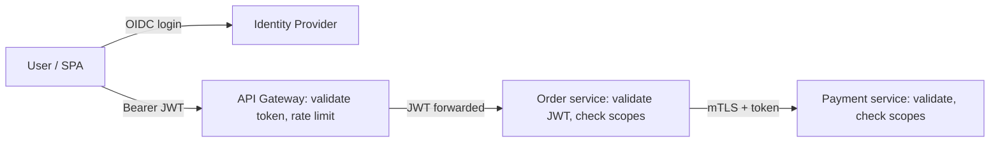

# Securing microservices

---

## 🟢 Junior Level

In a monolith, one application checks the user once. In microservices, a request travels through a **gateway** and several **services**, so you must answer at every hop:

1. **Who is the end user?** (user authentication)
2. **Which service is calling me?** (service authentication)
3. **Is this caller allowed to do this?** (authorization)
4. **Is traffic encrypted and untampered?** (transport security)

### The common baseline



* Users log in at an **Identity Provider** (Keycloak, Auth0, Okta, Entra ID, Cognito) via OpenID Connect.
* Clients send an **access token (JWT)**; every service validates it as an **OAuth 2.0 resource server**.
* Service-to-service traffic uses **TLS** (ideally mutual TLS) and its own credentials.

```yaml
# Each service: validate JWTs locally using the IdP's public keys
spring:
  security:
    oauth2:
      resourceserver:
        jwt:
          issuer-uri: https://login.shop.com/realms/shop
          audiences: order-service
```

---

## 🟡 Middle Level

### Zero trust: don't rely on the network
"Internal traffic is trusted" fails as soon as one pod is compromised. Each service should:
* **validate tokens itself** (signature, `iss`, `aud`, `exp`) instead of trusting the gateway blindly,
* **check authorization** for its own resources (scopes for coarse access, domain rules for object-level access),
* **accept traffic only from expected callers** (network policies, mTLS identities).

### Propagating identity: three patterns

| Pattern | How | When |
| --- | --- | --- |
| **Token relay** | Forward the user's access token downstream | Simple; downstream sees user identity; tokens must have broad audience |
| **Token exchange** (RFC 8693) | Gateway/service exchanges user token for a new one with narrower audience/scopes | Least privilege per hop; supported by Keycloak, Okta, Entra |
| **Client credentials** | Service calls with its *own* token (no user) | Background jobs, system-to-system calls |

```java
// Spring: relay the incoming user's token to downstream calls
@Bean
RestClient paymentClient(RestClient.Builder builder) {
    return builder.baseUrl("https://payment-service")
            .requestInterceptor((req, body, exec) -> {
                if (SecurityContextHolder.getContext().getAuthentication() instanceof JwtAuthenticationToken jwt) {
                    req.getHeaders().setBearerAuth(jwt.getToken().getTokenValue());
                }
                return exec.execute(req, body);
            })
            .build();
}

// Client credentials for service identity
@Bean
RestClient ledgerClient(RestClient.Builder builder, OAuth2AuthorizedClientManager manager) {
    var interceptor = new OAuth2ClientHttpRequestInterceptor(manager);   // Spring Security 6.4+
    interceptor.setClientRegistrationIdResolver(req -> "ledger");
    return builder.baseUrl("https://ledger-service").requestInterceptor(interceptor).build();
}
```

### Don't put identity in plain headers
A gateway that strips the JWT and forwards `X-User-Id: 42` makes every internal service trust a header any compromised pod can forge. If you do this, the downstream must only accept it over mTLS from the gateway's identity — better to forward a signed token.

---

## 🔴 Senior Level

### Workload identity and mTLS
* **Service mesh** (Istio, Linkerd) issues each workload a short-lived X.509 certificate (SPIFFE ID like `spiffe://cluster.local/ns/shop/sa/order-service`), rotates it automatically, and enforces mTLS between sidecars. Authorization policies then express "only `order-service` may call `POST /payments`".
* Without a mesh: SPIRE for identities, or cloud-native options (AWS VPC Lattice auth policies, GCP mTLS with Certificate Authority Service).
* mTLS proves *which service* is calling; it doesn't replace user-level authorization — you need both.

### Token design trade-offs
* **JWT size** grows with roles/claims; large tokens hit header limits (8–16 KB in proxies). Keep tokens lean; fetch fine-grained permissions from an authorization service when needed.
* **Revocation**: JWTs are valid until `exp`. Use short lifetimes (5–15 min) + refresh tokens; for immediate revocation of high-risk sessions, introspection (RFC 7662) at the gateway or a denylist of `jti`/session IDs.
* **Audience restriction**: a token for `order-service` must not be accepted by `admin-service`; validate `aud` everywhere (Spring Security 6.3+ `audiences` property, or a custom `OAuth2TokenValidator`).
* **Key rotation**: services cache the IdP JWKS; `NimbusJwtDecoder` refreshes keys on unknown `kid`. Test rotation before you need it.

### Centralized policy
For complex authorization (ABAC/ReBAC: "user can edit documents in projects they're a member of"), decentralized `@PreAuthorize` rules drift. Options: **OPA** (Open Policy Agent, Rego policies, sidecar or library), **OpenFGA/SpiceDB** (Zanzibar-style relationship-based authorization), or a dedicated permissions service. Keep the *decision* centralized and the *enforcement* in each service.

### Securing the edges you forget
* **Asynchronous messaging** — Kafka/RabbitMQ consumers have no HTTP token. Authenticate producers/consumers to the broker (SASL/SCRAM, mTLS, IAM), authorize topics with ACLs, and carry the originating user/tenant in message metadata — signed if consumers make security decisions on it.
* **Actuator and management ports** — separate port, not exposed through the gateway, protected by network policy.
* **Secrets per service**, no shared database users across services, and egress restrictions (services can only reach the hosts they need).
* **Audit trail across hops** — propagate a correlation ID and the authenticated principal; log authorization decisions centrally.

---

## 🎯 Interview Cheat Sheet

**30-second pitch:** I authenticate users at an OIDC provider and have every service validate JWT access tokens as a resource server — checking issuer, audience and expiry — instead of trusting the network. User identity flows downstream via token relay or token exchange; service identity via client credentials and mTLS, ideally from a service mesh. Authorization is enforced in each service, with complex policies centralized in a tool like OPA.

**Must know:**
* Zero trust: validate at every service, not just the gateway.
* Token relay vs token exchange vs client credentials.
* mTLS / SPIFFE workload identity; mesh authorization policies.
* Short-lived JWTs, `aud` validation, JWKS rotation.
* Secure messaging and management endpoints too.

**Common follow-ups:**
* How do you revoke access immediately with JWTs?
* Should the gateway do all authorization?
* How do you secure Kafka consumers?

**Red flags:** `X-User-Id` headers trusted from anywhere; one god-token with all scopes; disabling TLS internally "for performance".

**Related:**
* [How to build an OAuth 2.0 Resource Server](11.%20How%20to%20build%20an%20OAuth%202.0%20Resource%20Server.md)
* [OAuth 2.0 flows with authorization code PKCE and client credentials](09.%20OAuth%202.0%20flows%20with%20authorization%20code%20PKCE%20and%20client%20credentials.md)
* [Refresh tokens and JWT revocation strategies](08.%20Refresh%20tokens%20and%20JWT%20revocation%20strategies.md)
* [Service mesh vs Spring Cloud](../25.%20Spring%20Cloud%20and%20Resilience/16.%20Service%20mesh%20vs%20Spring%20Cloud.md)
