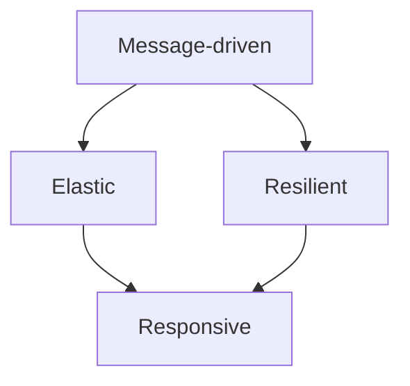

# What is reactive programming and the Reactive Manifesto

---

## 🟢 Junior Level

### 1. Plain definition

**Reactive programming** is a programming style built around **asynchronous streams of data** and **propagation of change**. Instead of *asking* for data and waiting (`getUser()` blocks until the answer arrives), you *describe what should happen when data arrives* and the framework calls your code at the right time.

Key ideas:
- **Everything is a stream** – a single value, a list, a click, a Kafka message, a price tick.
- **Push, not pull** – the producer pushes items to the consumer when they are ready.
- **Non-blocking** – no thread sits idle waiting for I/O.
- **Declarative pipelines** – you compose `map`, `filter`, `flatMap` just like the Stream API, but over time.

### 2. Real-world analogy

A **restaurant**:
- *Blocking (imperative)*: one waiter takes your order, stands at the kitchen door until the dish is ready, then serves you. 100 customers need 100 waiters.
- *Reactive*: the waiter takes the order, hands it to the kitchen and serves other tables. When the kitchen rings the bell (an **event**), the waiter reacts and delivers the dish. Five waiters can serve 100 tables.

### 3. Minimal working example (Project Reactor)

Add `reactor-core` (Spring Boot 3 manages the version through `spring-boot-starter-webflux`, or use the BOM `io.projectreactor:reactor-bom`):

```java
import reactor.core.publisher.Flux;

public class HelloReactive {
    public static void main(String[] args) {
        Flux<String> names = Flux.just("anna", "bob", "carol")
                .map(String::toUpperCase)
                .filter(n -> n.length() > 3);

        // Nothing has happened yet - the pipeline is only a description!
        names.subscribe(
                n -> System.out.println("Got: " + n),          // onNext
                err -> System.err.println("Error: " + err),    // onError
                () -> System.out.println("Done"));             // onComplete
    }
}
```

Output:

```text
Got: ANNA
Got: CAROL
Done
```

> [!IMPORTANT]
> Nothing happens until somebody calls `subscribe()`. This is the number one beginner surprise.

### 4. Imperative vs reactive at a glance


| Aspect | Imperative / blocking | Reactive |
| :--- | :--- | :--- |
| Data access | Pull (`list.get`) | Push (`onNext`) |
| Threads | One thread per request waits | Few threads, never wait |
| Composition | Loops, try/catch | Operators, `onError` signals |
| Overload protection | Thread pool exhaustion | Backpressure (`request(n)`) |

---

## 🟡 Middle Level

### 1. The Reactive Manifesto (2014, v2.0)

The Manifesto (reactivemanifesto.org) is **not a library** – it is an architectural vision for **reactive systems**. A system is reactive when it is:

| Trait | Meaning |
| :--- | :--- |
| **Responsive** | Replies in a timely manner, consistently – the goal. |
| **Resilient** | Stays responsive on failure (replication, isolation, containment, delegation). |
| **Elastic** | Stays responsive under varying load (scale up/down, no contention points). |
| **Message-driven** | Components communicate through asynchronous messages, giving loose coupling and location transparency – the *means*. |



### 2. Reactive *programming* is not Reactive *systems*

A very common interview trap:

- **Reactive programming** = a *local* technique (inside one service): async, non-blocking, event-driven code with libraries such as Reactor, RxJava, Akka Streams.
- **Reactive systems** = an *architecture* across services: message queues, circuit breakers, bulkheads, back-pressure between components.

You can write a reactive system using plain Kafka consumers and blocking threads, and you can write reactive code that lives inside a fragile monolith.

### 3. The four building blocks every reactive library shares

1. **Publisher** – source of 0..N items followed by *complete* or *error*.
2. **Subscriber** – consumer of those signals.
3. **Operators** – transformation stages.
4. **Backpressure** – the consumer controls the rate via demand.

### 4. Why it matters: threads are expensive

A platform thread reserves about **1 MB of stack** by default and costs context switches. A thread-per-request server (Tomcat default 200 threads) saturates when downstream calls are slow: threads simply *wait*. Reactive servers (Netty) use roughly `2 × CPU cores` event-loop threads and multiplex thousands of connections.

### 5. Typical Spring Boot 3 example

```java
@RestController
@RequestMapping("/users")
class UserController {

    private final WebClient client = WebClient.create("https://api.example.com");

    @GetMapping("/{id}")
    Mono<UserDto> byId(@PathVariable String id) {
        return client.get().uri("/users/{id}", id)
                .retrieve()
                .bodyToMono(UserDto.class)
                .timeout(Duration.ofSeconds(2));
    }

    @GetMapping(value = "/stream", produces = MediaType.TEXT_EVENT_STREAM_VALUE)
    Flux<UserDto> stream() {
        return client.get().uri("/users").retrieve().bodyToFlux(UserDto.class);
    }
}

record UserDto(String id, String name) {}
```

### 6. Common mistakes

- Calling `.block()` in the middle of a pipeline – defeats the purpose.
- Treating reactive as "faster". It improves **scalability under I/O wait**, not latency of a single request.
- Mixing blocking JDBC calls into a Netty pipeline.
- Assuming reactive == multithreaded. A pipeline often runs on a *single* thread.

---

## 🔴 Senior Level

### 1. What is really gained

Little's Law: `concurrency = throughput × latency`. If an endpoint calls a 200 ms backend and you want 5,000 req/s you need **1,000 concurrent in-flight requests**. With blocking I/O that is 1,000 platform threads (≈1 GB of stacks plus scheduler pressure). With non-blocking I/O the in-flight state is a few hundred bytes of heap per request (operator state, subscriber chain) and the event loop count stays ~ cores.

Reactive wins when: high concurrency, I/O-bound, streaming (SSE, WebSocket), fan-out/fan-in composition, need for built-in backpressure. It loses when: CPU-bound work, blocking-only drivers, small teams without reactive skills.

### 2. Cost model of a pipeline

Each operator wraps the upstream in a new object (assembly time), and on `subscribe` the chain is walked back to the source building `Subscriber` wrappers (subscription time). Per-item overhead is a virtual call per operator plus occasional queue hand-offs (`flatMap`, `publishOn`). Operator fusion (`Fuseable`, `QueueSubscription`) removes some of these queues – e.g. `map` → `filter` on a `Flux.range` is fused.

```java
// Measure assembly vs execution when profiling
Flux<Integer> f = Flux.range(1, 1_000_000)
        .map(i -> i * 2)
        .filter(i -> i % 3 == 0);        // fused: no intermediate queues

long t = System.nanoTime();
long count = f.count().block();          // block() fine in a benchmark/main
System.out.printf("%d items, %d ms%n", count, (System.nanoTime() - t) / 1_000_000);
```

For serious numbers use JMH; never measure with a cold JVM.

### 3. Resilience patterns that map to the Manifesto

```java
Mono<Quote> quote = webClient.get().uri("/quote")
        .retrieve().bodyToMono(Quote.class)
        .timeout(Duration.ofMillis(800))                                  // responsiveness
        .retryWhen(Retry.backoff(3, Duration.ofMillis(100)).jitter(0.5))  // resilience
        .onErrorResume(ex -> Mono.just(Quote.CACHED))                     // graceful degradation
        .transformDeferred(CircuitBreakerOperator.of(circuitBreaker));    // isolation (Resilience4j)
```

Elasticity is delivered by the platform: Kubernetes HPA scaling pods based on event-loop utilisation or in-flight requests, not just CPU.

### 4. Production gotchas

- **Observability**: stack traces are assembled from async hops; enable `Hooks.onOperatorDebug()` only in dev, use `checkpoint()` and the `reactor-tools` agent (`ReactorDebugAgent.init()`) in prod.
- **Thread-locals** (MDC, SecurityContext, transactions) do not follow items: use Reactor `Context` + context propagation (Micrometer `context-propagation`).
- **Blocking detection**: add BlockHound in integration tests.
- **Backpressure across a boundary**: HTTP/1.1 has none – a reactive controller reading a slow client relies on TCP flow control; Kafka/RabbitMQ need explicit `prefetch`/`limitRate`.
- **Memory**: unbounded `buffer()`, `collectList()`, `cache()` and `Sinks.many().multicast().directAllOrNothing()` hide O(n) memory.

### 5. When the manifesto is the right lens

Use the Manifesto when designing *service boundaries*: asynchronous messaging between bounded contexts, bulkheads per dependency, timeouts everywhere, load shedding. Use reactive *programming* only where the I/O profile justifies the complexity – and since Java 21 virtual threads give an alternative (see [Virtual threads vs reactive programming and when to choose which](18.%20Virtual%20threads%20vs%20reactive%20programming%20and%20when%20to%20choose%20which.md)).

---

## 🎯 Interview Cheat Sheet

**30-second pitch:** Reactive programming is asynchronous, non-blocking, push-based stream processing with built-in backpressure. The Reactive Manifesto defines reactive *systems*: responsive, resilient, elastic and message-driven. The library (Reactor) is a tool; the Manifesto is the architecture.

**Must-know bullets**
- Nothing happens until `subscribe()`.
- Publisher/Subscriber/Subscription/Processor are the Reactive Streams contracts.
- Reactive programming ≠ reactive systems ≠ multithreading.
- Benefit is scalability for I/O-bound concurrency, not raw speed.
- Backpressure = consumer-driven demand.
- Reactor (Spring), RxJava, Akka Streams, Mutiny are implementations.

**Common follow-ups**
- Difference between reactive and asynchronous? (Async is "not waiting"; reactive adds streams, composition and backpressure.)
- Is WebFlux faster than MVC? (Not per request; it handles more concurrent I/O with fewer threads.)
- Can you use reactive with JPA? (Only by offloading to `boundedElastic`; prefer R2DBC.)
- What is the Manifesto's "message-driven" about? (Async boundaries and loose coupling.)

**Red flags**
- "Reactive makes everything faster."
- Calling `.block()` inside controllers and claiming to be reactive.
- Confusing Reactive Manifesto with Reactive Streams.

**Related topics**
- [What is the difference between blocking and non-blocking IO](02.%20What%20is%20the%20difference%20between%20blocking%20and%20non-blocking%20IO.md)
- [What is the Reactive Streams specification and java.util.concurrent.Flow](03.%20What%20is%20the%20Reactive%20Streams%20specification%20and%20java.util.concurrent.Flow.md)
- [When not to use reactive programming](21.%20When%20not%20to%20use%20reactive%20programming.md)
- [CompletableFuture and Asynchrony section](../19.%20CompletableFuture%20and%20Asynchrony/00.%20Section%20Navigator.md)
