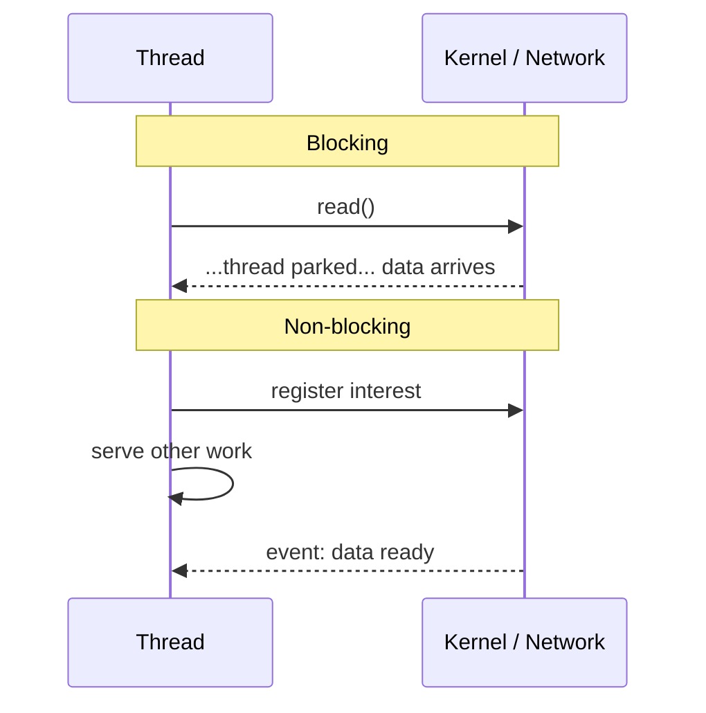

# What is the difference between blocking and non-blocking IO

---

## 🟢 Junior Level

### 1. Plain definition

- **Blocking I/O**: the calling thread *stops* and waits until the operation (read from socket, file, DB) finishes. The thread can do nothing else meanwhile.
- **Non-blocking I/O**: the call returns *immediately*, either with data or with "nothing yet". The thread keeps working and is *notified* (or polls) when data is ready.

### 2. Real-world analogy

- **Blocking**: you call a pizzeria and hold the phone until the pizza is baked.
- **Non-blocking**: you order, hang up, watch TV, and the doorbell tells you the pizza has arrived.

### 3. Minimal examples

Blocking (classic `java.io` / `java.net`):

```java
import java.io.*;
import java.net.*;

public class BlockingEcho {
    public static void main(String[] args) throws IOException {
        try (ServerSocket server = new ServerSocket(8080)) {
            while (true) {
                Socket client = server.accept();               // blocks until a client connects
                new Thread(() -> handle(client)).start();      // one thread per connection
            }
        }
    }

    static void handle(Socket s) {
        try (s; BufferedReader in = new BufferedReader(new InputStreamReader(s.getInputStream()));
             PrintWriter out = new PrintWriter(s.getOutputStream(), true)) {
            String line;
            while ((line = in.readLine()) != null) {          // blocks on every read
                out.println("echo: " + line);
            }
        } catch (IOException ignored) { }
    }
}
```

Non-blocking (`java.nio` Selector - one thread, many connections):

```java
import java.net.InetSocketAddress;
import java.nio.ByteBuffer;
import java.nio.channels.*;
import java.util.Iterator;

public class NonBlockingEcho {
    public static void main(String[] args) throws Exception {
        Selector selector = Selector.open();
        ServerSocketChannel server = ServerSocketChannel.open();
        server.bind(new InetSocketAddress(8080));
        server.configureBlocking(false);
        server.register(selector, SelectionKey.OP_ACCEPT);

        ByteBuffer buf = ByteBuffer.allocate(1024);
        while (true) {
            selector.select();                                  // waits for *any* ready channel
            Iterator<SelectionKey> it = selector.selectedKeys().iterator();
            while (it.hasNext()) {
                SelectionKey key = it.next();
                it.remove();
                if (key.isAcceptable()) {
                    SocketChannel ch = server.accept();
                    ch.configureBlocking(false);
                    ch.register(selector, SelectionKey.OP_READ);
                } else if (key.isReadable()) {
                    SocketChannel ch = (SocketChannel) key.channel();
                    buf.clear();
                    if (ch.read(buf) < 0) { ch.close(); continue; }
                    buf.flip();
                    ch.write(buf);
                }
            }
        }
    }
}
```

### 4. Picture



---

## 🟡 Middle Level

### 1. Blocking vs non-blocking vs synchronous vs asynchronous

These are two different axes, often mixed up in interviews:

| Term | Question it answers |
| :--- | :--- |
| Blocking / non-blocking | Does the *calling thread* wait? |
| Synchronous / asynchronous | Is the *result delivered* at the return of the call or later via callback/future? |

Combinations:
- Blocking + sync: `InputStream.read()`.
- Non-blocking + sync: `channel.read(buf)` returning 0 and you poll.
- Non-blocking + async (event notification): NIO `Selector`, Netty, epoll.
- Async completion: NIO.2 `AsynchronousSocketChannel` (IOCP on Windows).

### 2. How the OS helps

Multiplexing syscalls let one thread watch thousands of file descriptors: `select`/`poll`, **epoll** (Linux), **kqueue** (BSD/macOS), **IOCP** (Windows). Java's `Selector` wraps them; Netty uses native transports (`netty-transport-native-epoll`) for fewer allocations.

### 3. Cost of the thread-per-connection model

| Resource | Cost |
| :--- | :--- |
| Stack | ~1 MB reserved (`-Xss`), committed lazily |
| Context switch | microseconds, plus cache pollution |
| Pool saturation | Tomcat 200 threads → request 201 queues even if CPU is idle |

With 10,000 slow clients you either need 10,000 threads or you reject requests. Non-blocking servers hold connection state as small objects.

### 4. Blocking in a reactive app: the real danger

```java
@GetMapping("/bad")
Mono<String> bad() {
    return Mono.fromSupplier(() -> {
        try { Thread.sleep(2000); } catch (InterruptedException e) { }   // blocks a Netty event loop!
        return "late";
    });
}

@GetMapping("/good")
Mono<String> good() {
    return Mono.delay(Duration.ofSeconds(2)).map(l -> "late");           // timer, no thread held
}

@GetMapping("/legacy")
Mono<String> legacy(LegacyJdbcDao dao) {
    return Mono.fromCallable(dao::slowQuery)                              // unavoidable blocking call
            .subscribeOn(Schedulers.boundedElastic());                    // isolated pool
}
```

With 8 cores Netty has ~8 event loops: 8 concurrent `bad()` calls freeze the whole server.

### 5. Common mistakes

- Thinking `CompletableFuture.supplyAsync(blockingCall)` is non-blocking – it just moves the blocked thread to `ForkJoinPool.commonPool`.
- Using non-blocking HTTP client but a blocking JDBC driver.
- Believing non-blocking makes a single call faster.

---

## 🔴 Senior Level

### 1. Readiness vs completion models

- **Readiness (reactor pattern)**: epoll tells you "socket is readable", *you* call `read`. Used by Netty/NIO on Linux.
- **Completion (proactor pattern)**: you submit a buffer, the OS says "done". IOCP, `io_uring` (Netty incubator `io_uring` transport), NIO.2.

Reading ≠ non-blocking for *files*: regular files are always "ready" for epoll, so file I/O in Netty/Java NIO is effectively blocking (or goes through a thread pool, as libuv does). In WebFlux serving static files uses `ResourceRegion` with `DataBufferUtils.read` backed by `AsynchronousFileChannel` on a pool – still a thread hand-off.

### 2. What virtual threads change

On JDK 21+ `Socket.read()` called on a virtual thread parks the *virtual* thread and the carrier is released; the JDK internally uses a poller (epoll) – you get non-blocking behaviour under the hood with blocking code. The programming model stays blocking, the resource model becomes non-blocking. Caveat: `synchronized` pinning (fixed in JDK 24 via JEP 491) and native frames. See [Virtual threads vs reactive programming and when to choose which](18.%20Virtual%20threads%20vs%20reactive%20programming%20and%20when%20to%20choose%20which.md).

### 3. Diagnosing blocking calls in production

```bash
# Thread dump: event-loop threads (reactor-http-nio-N) should be RUNNABLE in epollWait, never in socketRead/park/sleep
jcmd <pid> Thread.print | grep -A 15 "reactor-http"

# Async-profiler wall-clock mode finds blocked event loops
./asprof -e wall -t -d 30 -f profile.html <pid>
```

Automated detection with BlockHound:

```java
// build.gradle: testImplementation "io.projectreactor.tools:blockhound:1.0.9.RELEASE"
@BeforeAll
static void installBlockHound() {
    BlockHound.install();     // throws BlockingOperationError when Thread.sleep/socket read is called on a non-blocking thread
}
```

JDK 13+ requires `-XX:+AllowRedefinitionToAddDeleteMethods` for BlockHound.

### 6. Benchmarks you should be able to quote

A classic experiment (200 ms downstream, 4 vCPU, wrk with 2,000 connections): Tomcat with 200 threads plateaus around 1,000 req/s (`200 / 0.2`) with growing latency; Netty/WebFlux reaches CPU-bound throughput limited only by serialization. Note the cause: *thread pool size ÷ latency*, not the framework. Raising Tomcat `max-threads` to 2,000 narrows the gap at the cost of memory.

### 7. Edge cases

- **Spurious readiness**: `select()` can return with zero keys – always loop.
- **Partial writes**: `channel.write()` may write fewer bytes; you must register `OP_WRITE`. Netty's `ChannelOutboundBuffer` and write watermarks implement this and expose `isWritable()` – the transport-level backpressure.
- **DNS**: `InetAddress.getByName` is blocking; Reactor Netty uses an async resolver (`netty-resolver-dns`), and on macOS you need `netty-resolver-dns-native-macos`.
- **TLS handshakes** are CPU heavy and run on event loops: a flood of new connections can starve them.

---

## 🎯 Interview Cheat Sheet

**30-second pitch:** Blocking I/O parks the calling thread until data is ready; non-blocking I/O returns immediately and lets one thread multiplex many connections through epoll/kqueue/IOCP. Sync/async is a different axis. Non-blocking improves scalability and resource use under high concurrency, not single-call latency.

**Must-know bullets**
- Blocking = thread waits; non-blocking = thread continues.
- `Selector`, epoll, kqueue and IOCP enable multiplexing.
- Thread-per-request limits concurrency to pool size.
- One blocking call on an event loop stalls thousands of connections.
- Isolate unavoidable blocking calls with `subscribeOn(Schedulers.boundedElastic())`.
- Virtual threads give blocking-style code with non-blocking resource usage.

**Common follow-ups**
- Is `CompletableFuture.supplyAsync` non-blocking? (No, it relocates the block.)
- How many event-loop threads does Reactor Netty create? (`max(4, cores)` by default.)
- Why is file I/O not truly non-blocking on Linux? (Regular files are always "ready" in epoll.)

**Red flags**
- Mixing up "asynchronous" and "non-blocking" as synonyms.
- Using `Thread.sleep` inside a `Mono.map`.
- Believing NIO is faster for a single request.

**Related topics**
- [What is reactive programming and the Reactive Manifesto](01.%20What%20is%20reactive%20programming%20and%20the%20Reactive%20Manifesto.md)
- [How does Netty work and why must you never block the event loop](14.%20How%20does%20Netty%20work%20and%20why%20must%20you%20never%20block%20the%20event%20loop.md)
- [What is the difference between publishOn and subscribeOn](09.%20What%20is%20the%20difference%20between%20publishOn%20and%20subscribeOn.md)
- [Multithreading section](../9.%20Multithreading/00.%20Section%20Navigator.md)
