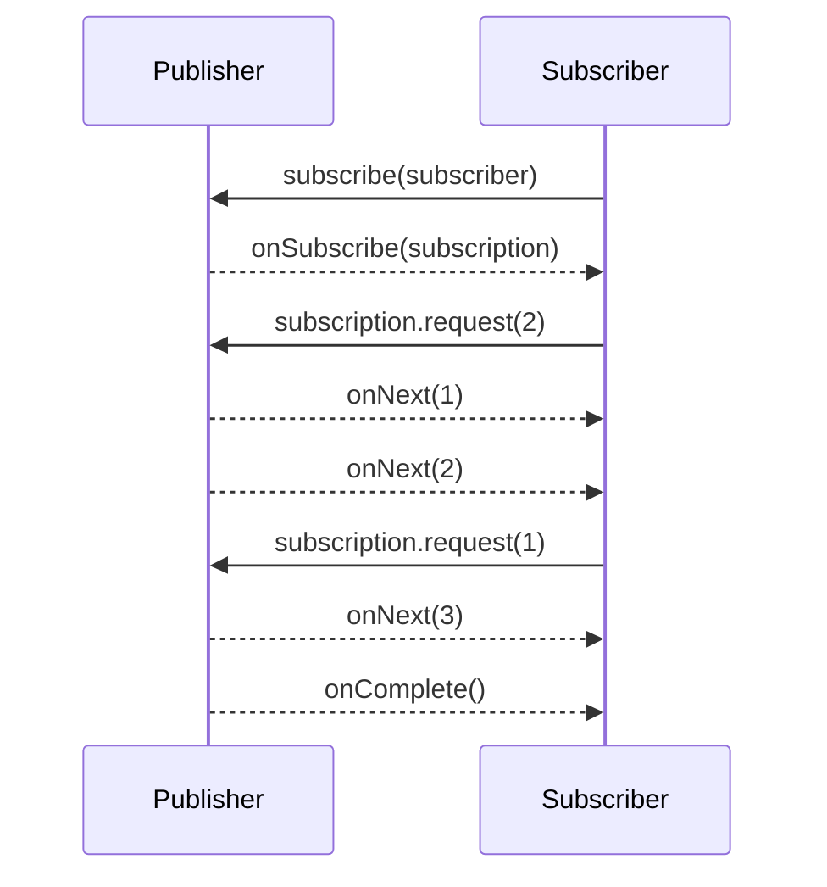

# What is the Reactive Streams specification and java.util.concurrent.Flow

---

## 🟢 Junior Level

### 1. Plain definition

**Reactive Streams** is a tiny standard (2015) that defines how asynchronous stream producers and consumers talk to each other **with non-blocking backpressure**. It consists of four interfaces. Since Java 9 the same four interfaces live in the JDK as nested types of `java.util.concurrent.Flow`.

| Interface | Role |
| :--- | :--- |
| `Publisher<T>` | Source of data. One method: `subscribe(Subscriber)`. |
| `Subscriber<T>` | Consumer: `onSubscribe`, `onNext`, `onError`, `onComplete`. |
| `Subscription` | The *link* between them: `request(long n)` and `cancel()`. |
| `Processor<T,R>` | Both a `Subscriber<T>` and a `Publisher<R>` – a transformation stage. |

### 2. Analogy

A **newspaper subscription** where you decide the pace: you tell the publisher "send me 3 issues" (`request(3)`). It sends at most 3 and waits. If you are on holiday you cancel (`cancel()`). A publisher never floods your mailbox.

### 3. Minimal working example using only the JDK

```java
import java.util.List;
import java.util.concurrent.Flow;
import java.util.concurrent.SubmissionPublisher;

public class FlowHello {
    public static void main(String[] args) throws Exception {
        try (SubmissionPublisher<String> publisher = new SubmissionPublisher<>()) {
            publisher.subscribe(new Flow.Subscriber<>() {
                private Flow.Subscription subscription;

                @Override public void onSubscribe(Flow.Subscription s) {
                    this.subscription = s;
                    s.request(1);                       // ask for the first item
                }
                @Override public void onNext(String item) {
                    System.out.println("received " + item);
                    subscription.request(1);            // ask for the next one
                }
                @Override public void onError(Throwable t) { t.printStackTrace(); }
                @Override public void onComplete() { System.out.println("done"); }
            });

            List.of("a", "b", "c").forEach(publisher::submit);
        }                                               // close() -> onComplete
        Thread.sleep(300);                              // SubmissionPublisher delivers asynchronously
    }
}
```

### 4. Signal flow



---

## 🟡 Middle Level

### 1. Two packages, same shape

- `org.reactivestreams.*` (artifact `org.reactivestreams:reactive-streams`) – the original, used by Reactor, RxJava 2/3, Akka Streams, R2DBC drivers, Vert.x.
- `java.util.concurrent.Flow.*` – JDK 9+ mirror. Identical method signatures.

Adapters: Reactor `JdkFlowAdapter.flowPublisherToFlux(...)` / `JdkFlowAdapter.publisherToFlowPublisher(...)`, or `FlowAdapters` in `reactive-streams` (`FlowAdapters.toPublisher(flowPublisher)`). Spring `Mono`/`Flux` implement `org.reactivestreams.Publisher`, not `Flow.Publisher`.

### 2. The rules you must know (spec §1–§3 highlights)

1. A `Subscriber` must call `Subscription.request` to signal demand; a `Publisher` must **never send more `onNext` than requested** (rule 1.1).
2. Signals must be **serial**: `onSubscribe`, `onNext*`, then at most one of `onError`/`onComplete` – no concurrent `onNext` calls (rule 1.3).
3. `onError` and `onComplete` are **terminal**; nothing may follow (1.7).
4. `request(n)` with `n <= 0` must signal `onError(IllegalArgumentException)` (3.9).
5. `Subscription.request` and `cancel` must be **non-blocking, fast, and thread-safe** (3.4, 3.5).
6. `null` elements are forbidden (2.13) – that is why Reactor has no `Mono<null>`; use `Mono.empty()` or `Optional`.
7. Demand is cumulative and may be `Long.MAX_VALUE` meaning *unbounded*.
8. `Processor` is hard to implement correctly – rarely write one by hand.

### 3. Hand-written Subscriber with batch demand (Reactor)

```java
import org.reactivestreams.Subscription;
import reactor.core.publisher.BaseSubscriber;
import reactor.core.publisher.Flux;

public class BatchSubscriber {
    public static void main(String[] args) {
        Flux.range(1, 10).subscribe(new BaseSubscriber<Integer>() {
            private int received;

            @Override protected void hookOnSubscribe(Subscription s) { request(3); }

            @Override protected void hookOnNext(Integer value) {
                System.out.println("item " + value);
                if (++received % 3 == 0) request(3);     // replenish the window
            }

            @Override protected void hookOnComplete() { System.out.println("complete"); }
        });
    }
}
```

`BaseSubscriber` handles rules like double subscription and cancellation for you – prefer it over implementing `Subscriber` directly.

### 4. Common mistakes

- Implementing `Publisher` by hand: `subscribe` that just loops and calls `onNext` ignores demand and breaks the spec. Use `Flux.create`, `Flux.generate`, `Sinks`.
- Forgetting to call `request` in `onSubscribe` → the stream silently stalls (nothing is requested).
- Calling `onNext` after `cancel` without checking.
- Mixing up `Subscription` (one per subscriber) with `Publisher` (can serve many).

### 5. Where the spec shows up in practice

- **R2DBC SPI** returns `Publisher<? extends Result>`.
- **Spring WebFlux** codecs read from `Publisher<DataBuffer>`.
- **Reactor Kafka**, **Reactor RabbitMQ**, **MongoDB reactive driver** all expose `Publisher`.
- Interop: you can chain RxJava and Reactor via `Flux.from(flowable)` / `Flowable.fromPublisher(flux)`.

---

## 🔴 Senior Level

### 1. Why four interfaces and no operators?

The spec deliberately defines **only the boundary protocol** (the TCK checks ~ 150 rules). Operators are library territory. This makes libraries interoperable with *zero* shared implementation classes: any `Publisher` can be wrapped by any other library's operator.

### 2. Verifying your implementation: the TCK

```xml
<dependency>
  <groupId>org.reactivestreams</groupId>
  <artifactId>reactive-streams-tck</artifactId>
  <version>1.0.4</version>
  <scope>test</scope>
</dependency>
```

```java
public class MyPublisherTest extends PublisherVerification<Integer> {
    public MyPublisherTest() { super(new TestEnvironment(300)); }

    @Override public Publisher<Integer> createPublisher(long elements) {
        return new MyPublisher(elements);                  // your implementation under test
    }
    @Override public Publisher<Integer> createFailedPublisher() {
        return subscriber -> { subscriber.onSubscribe(CancelledSubscription.INSTANCE); subscriber.onError(new RuntimeException()); };
    }
}
```

### 3. Implementing demand correctly: the hard parts

A compliant `Publisher` must handle:
- **Concurrent `request` calls** → keep an `AtomicLong requested` and add with overflow capping to `Long.MAX_VALUE` (Reactor: `Operators.addCap`).
- **Drain loop** (the "wip" pattern): multiple threads may call `request` and `onNext` race; a work-in-progress counter ensures only one thread emits at a time (reentrancy-safe, no recursion → no stack overflow with synchronous sources).
- **Cancellation visibility**: a volatile flag checked between emissions.
- **Synchronous sources**: a naive `request(1)` → `onNext` → `request(1)` recursion overflows the stack at ~10k items; that is why drain loops exist.

Skeleton:

```java
final class RangeSubscription implements Flow.Subscription {
    private final Flow.Subscriber<? super Integer> actual;
    private final int end;
    private int index;
    private volatile boolean cancelled;
    private final java.util.concurrent.atomic.AtomicLong requested = new java.util.concurrent.atomic.AtomicLong();
    private final java.util.concurrent.atomic.AtomicInteger wip = new java.util.concurrent.atomic.AtomicInteger();

    RangeSubscription(Flow.Subscriber<? super Integer> actual, int start, int end) {
        this.actual = actual; this.index = start; this.end = end;
    }

    @Override public void request(long n) {
        if (n <= 0) { cancelled = true; actual.onError(new IllegalArgumentException("§3.9: n must be > 0")); return; }
        requested.accumulateAndGet(n, (a, b) -> { long r = a + b; return r < 0 ? Long.MAX_VALUE : r; });
        drain();
    }

    @Override public void cancel() { cancelled = true; }

    private void drain() {
        if (wip.getAndIncrement() != 0) return;            // someone else is draining
        int missed = 1;
        for (;;) {
            long r = requested.get(), e = 0;
            while (e != r && index < end) {
                if (cancelled) return;
                actual.onNext(index++);
                e++;
            }
            if (!cancelled && index == end) { cancelled = true; actual.onComplete(); return; }
            if (e != 0 && r != Long.MAX_VALUE) requested.addAndGet(-e);
            missed = wip.addAndGet(-missed);
            if (missed == 0) break;
        }
    }
}
```

This is the essence of how `FluxRange`, `FluxFlatMap` and `FluxPublishOn` work internally.

### 4. Reactor optimisations beyond the spec

- **Operator fusion**: `Fuseable.QueueSubscription` lets adjacent operators share a queue (macro-fusion) or compute inline (micro-fusion).
- **Prefetch**: `publishOn`, `flatMap`, `concatMap` request in batches (default 256 for `Queues.SMALL_BUFFER_SIZE`, `flatMap` 32 inner concurrency; `limitRate` uses a 75 % replenishment strategy).
- **Assembly-time optimisations**: `Mono.just(x).map(f)` collapses to `MonoJust` + `MonoMap` and with `Callable` sources can be evaluated eagerly (`Fuseable.ScalarCallable`).

### 5. Production implications

- A `Subscriber` that never requests more is a **silent leak**: an HTTP response that nobody reads holds Netty buffers until timeout. Always bound with `timeout()` and release `DataBuffer`s (`DataBufferUtils.release`).
- Reactor Netty translates demand into reading from the channel (`autoRead` toggling), giving true end-to-end backpressure from WebClient to the TCP window.
- Throwing from `onNext` of a hand-written subscriber violates §2.13; Reactor protects you via `Operators.onOperatorError` but a raw `Subscriber` might not be.

---

## 🎯 Interview Cheat Sheet

**30-second pitch:** Reactive Streams is a four-interface contract – Publisher, Subscriber, Subscription, Processor – that standardises async stream passing with non-blocking backpressure via `request(n)`. `java.util.concurrent.Flow` (JDK 9) is the same API in the JDK. Libraries like Reactor and RxJava implement it, giving interoperability.

**Must-know bullets**
- `Subscription.request(n)` is the backpressure mechanism; `cancel()` is the stop.
- Signal order: `onSubscribe`, `onNext*`, then one terminal signal.
- Publisher must not exceed requested demand; `null` is not allowed.
- `Flow` and `org.reactivestreams` are identical; adapters exist.
- Don't implement Publisher/Processor yourself – use `Flux.create/generate`, `Sinks`.
- Spec has a TCK for verifying compliance.

**Common follow-ups**
- Why doesn't `Flow` include operators? (Interoperability; library concern.)
- What does `request(Long.MAX_VALUE)` mean? (Unbounded demand – no backpressure.)
- What is `SubmissionPublisher`? (A JDK reference Publisher with an internal buffer and executor, default `ForkJoinPool.commonPool`.)

**Red flags**
- Saying Reactive Streams = Reactor.
- Calling `onNext` without regard to `request`.
- Not knowing a Subscriber must request to receive anything.

**Related topics**
- [What is the difference between Mono and Flux](04.%20What%20is%20the%20difference%20between%20Mono%20and%20Flux.md)
- [What is backpressure and which strategies exist](08.%20What%20is%20backpressure%20and%20which%20strategies%20exist.md)
- [How does Project Reactor compare with RxJava](20.%20How%20does%20Project%20Reactor%20compare%20with%20RxJava.md)
- [Multithreading section](../9.%20Multithreading/00.%20Section%20Navigator.md)
