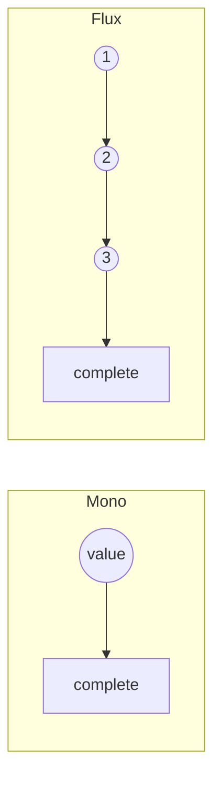

# What is the difference between Mono and Flux

---

## 🟢 Junior Level

### 1. Plain definition

Project Reactor offers two `Publisher` implementations:

- **`Mono<T>`** – emits **0 or 1** item, then completes (or fails).
- **`Flux<T>`** – emits **0 to N** items (possibly infinite), then completes (or fails).

Both are lazy: nothing runs until you `subscribe`.

### 2. Analogy

- `Mono` is a **single parcel delivery** (or "nobody home" = empty).
- `Flux` is a **conveyor belt** delivering parcels one after another.

### 3. Minimal example

```java
import reactor.core.publisher.Flux;
import reactor.core.publisher.Mono;

public class MonoFluxBasics {
    public static void main(String[] args) {
        Mono<String> one = Mono.just("hello");
        Mono<String> none = Mono.empty();
        Flux<Integer> many = Flux.range(1, 5);

        one.subscribe(System.out::println);                     // hello
        none.subscribe(System.out::println,
                       e -> {}, () -> System.out.println("empty completed"));
        many.map(i -> i * i).subscribe(System.out::println);    // 1 4 9 16 25
    }
}
```

### 4. Quick guide

| You have | Use |
| :--- | :--- |
| `findById`, HTTP GET of one resource, `save` | `Mono<T>` |
| `findAll`, list, stream of events, SSE | `Flux<T>` |
| Action with no return value (`delete`) | `Mono<Void>` |
| Optional value | `Mono<T>` (empty = absent) |

---

## 🟡 Middle Level

### 1. Signals

Both emit the same signals: `onSubscribe`, `onNext`, `onError`, `onComplete`. A `Mono` emits **at most one** `onNext` and *then* `onComplete` (the spec lets it complete directly after `onNext`; Reactor's `Mono` optimises by treating `onNext` as implicitly terminal for many operators).



### 2. Creating them

```java
Mono<String> a = Mono.just("x");                        // eager value, non-null
Mono<String> b = Mono.justOrEmpty(maybeNull);           // null -> empty
Mono<String> c = Mono.fromSupplier(() -> compute());    // lazy, evaluated per subscription
Mono<String> d = Mono.defer(() -> Mono.just(Instant.now().toString()));  // re-evaluated each subscribe
Mono<String> e = Mono.error(new IllegalStateException("boom"));
Mono<Void> f = Mono.fromRunnable(() -> log.info("side effect"));

Flux<Integer> g = Flux.fromIterable(List.of(1, 2, 3));
Flux<Long> h = Flux.interval(Duration.ofSeconds(1));    // infinite, runs on Schedulers.parallel()
Flux<String> i = Flux.generate(() -> 0, (state, sink) -> {   // synchronous, one item per call
    sink.next("n" + state);
    if (state == 9) sink.complete();
    return state + 1;
});
Flux<String> j = Flux.create(sink -> {                  // multi-threaded bridge from callback APIs
    listener.onMessage(sink::next);
    listener.onClose(sink::complete);
}, FluxSink.OverflowStrategy.BUFFER);
```

### 3. Converting between them

```java
Mono<List<User>> list = userFlux.collectList();         // Flux -> Mono (waits for completion)
Mono<Long> count = userFlux.count();
Mono<User> first = userFlux.next();                     // first element, cancels rest
Mono<User> single = userFlux.single();                  // exactly one or error
Mono<User> last = userFlux.last();
Mono<Map<String, User>> map = userFlux.collectMap(User::id);
Mono<User> reduced = userFlux.reduce(User::merge);

Flux<User> asFlux = userMono.flux();                    // Mono -> Flux
Flux<Integer> flat = Mono.just(List.of(1, 2)).flatMapMany(Flux::fromIterable);
```

### 4. Why have both?

- **Type-level cardinality**: callers know a `Mono<User>` cannot be 1,000 users. It documents intent and allows cheaper implementations (no queues, no request accounting).
- **Operators only meaningful for one**: `Mono.then()`, `Mono.zipWith`, `Mono.block()`, `Mono.timeout` simplifications.
- **`CompletableFuture` analogy**: `Mono` ≈ lazy, re-subscribable `CompletableFuture`, but with cancellation and no thread started until subscribe.

### 5. Common mistakes

- Returning `Mono<List<T>>` from a controller when the client could stream `Flux<T>` – loses streaming and holds everything in memory.
- Using `Mono<Void>` and then chaining `.map` – it never emits an item, so `map` never runs. Use `.then(Mono.just(x))` or `thenReturn(x)`.
- `Mono.just(expensiveCall())` – the call executes at **assembly time**, immediately, whether or not anyone subscribes. Use `fromSupplier`/`defer`.
- Null in `Mono.just(null)` → NPE.

```java
// Wrong: delete() result is Mono<Void>, map never triggers
repo.deleteById(id).map(v -> ResponseEntity.noContent().build());

// Right
repo.deleteById(id).then(Mono.just(ResponseEntity.noContent().build()));
```

---

## 🔴 Senior Level

### 1. Implementation differences

- `Flux` operators handle **request accounting** (`Operators.addCap`, drain loops, queues sized by `Queues.SMALL_BUFFER_SIZE` = 256 and `XS_BUFFER_SIZE` = 32, tunable via `reactor.bufferSize.small`).
- `Mono` operators are mostly **fire-once** (`MonoSubscriber`, `Operators.MonoSubscriber#complete`) – typically one state machine with CAS transitions (NO_REQUEST_HAS_VALUE, HAS_REQUEST_NO_VALUE, ...), considerably cheaper.
- `Mono.fromCallable`, `Mono.just`, `Mono.empty` are `Fuseable.ScalarCallable`/`Callable` → `flatMap` on them is inlined without subscribing (assembly-time optimization).

### 2. `Mono<Void>` and `Mono<Object>` semantic traps

`Mono.when(a, b)` / `Mono.then()` complete when *all* complete and discard values. `Mono.zip` completes **empty** if any source is empty:

```java
Mono<String> name = Mono.just("Ada");
Mono<Integer> age = Mono.empty();
Mono.zip(name, age).subscribe(System.out::println,
        e -> {}, () -> System.out.println("completed with NO value"));   // zip short-circuits on empty
```

Use `defaultIfEmpty`/`switchIfEmpty` before zipping when "missing" is legal.

### 3. Streaming vs collecting in WebFlux

```java
@GetMapping(produces = MediaType.APPLICATION_NDJSON_VALUE)
Flux<Order> stream() { return repo.findAll(); }                 // items flushed as they arrive; constant memory

@GetMapping
Mono<List<Order>> all() { return repo.findAll().collectList(); } // whole list in heap, JSON array at once
```

For `application/json` with `Flux<T>`, WebFlux's `Jackson2JsonEncoder` still emits a JSON array but streams elements without buffering the entire list; the response is chunked. For `text/event-stream` / `application/x-ndjson` each element is flushed separately.

### 4. Memory and performance considerations

- `Flux.collectList()` on a 10M-row table = OOM. Prefer `window`, `buffer(1000)` or end-to-end streaming (`bodyToFlux`, `DataBufferUtils.write`).
- `Flux.cache()` and `replay()` retain history; bound with `replay(n)` or `cache(Duration)`.
- `Mono.cache()` is a common memoization tool, but it caches *errors* too unless you use `cache(valueTtl, errorTtl, emptyTtl)` with `Duration.ZERO` for the error TTL:

```java
Mono<Config> config = loadRemoteConfig()
        .cache(v -> Duration.ofMinutes(5), e -> Duration.ZERO, () -> Duration.ofSeconds(10));
```

### 5. Interop with `CompletableFuture`, `Optional`, and Stream

```java
Mono<String> m = Mono.fromFuture(() -> client.sendAsync(req, BodyHandlers.ofString()).thenApply(HttpResponse::body)); // supplier overload: lazy
CompletableFuture<String> f = m.toFuture();               // subscribes immediately
Flux<Integer> fromStream = Flux.fromStream(() -> list.stream());   // supply Stream lazily; streams are single-use
Optional<String> o = Mono.just("x").blockOptional();       // test code only
```

### 6. Diagnostics

`mono.log("tag")` prints `onSubscribe`, `request(unbounded)`, `onNext`, `onComplete` – a Mono almost always shows `request(unbounded)`, a Flux with `limitRate` shows bounded requests. Use `Hooks.onOperatorDebug()` in development to see assembly traces (see [How to debug reactive stacks with checkpoint and Hooks.onOperatorDebug](18.%20How%20to%20debug%20reactive%20stacks%20with%20checkpoint%20and%20Hooks.onOperatorDebug.md)).

---

## 🎯 Interview Cheat Sheet

**30-second pitch:** `Mono<T>` is a publisher of 0..1 elements and `Flux<T>` of 0..N. Both are lazy Reactive Streams `Publisher`s from Reactor. Choose by cardinality; convert with `collectList`, `next`, `flux`, `flatMapMany`. Mono is cheaper and mirrors a lazy `CompletableFuture`/`Optional`.

**Must-know bullets**
- Empty `Mono` is a valid result (`Optional.empty()` analogue).
- `Mono<Void>` never emits `onNext` – chain with `then`, not `map`.
- `Mono.just(x)` evaluates `x` immediately; `fromSupplier`/`defer` are lazy.
- `collectList` loads everything in memory.
- `Flux.interval` and `Flux.generate/create` differ: `generate` is synchronous & stateful, `create` is async/multi-producer.
- `zip` with an empty source completes empty.

**Common follow-ups**
- How is `Mono` different from `CompletableFuture`? (Lazy, cold, cancellable, composable, backpressure-aware, can be empty.)
- `Mono.fromSupplier` vs `Mono.defer`? (Supplier returns a value; defer returns a publisher.)
- How do you turn Flux into Mono? (`collectList`, `reduce`, `next`, `single`, `then`.)

**Red flags**
- Returning `Mono<List<T>>` for unbounded data.
- Calling `.block()` in controllers.
- `Mono.just(repository.blockingCall())`.

**Related topics**
- [What is the difference between cold and hot publishers](05.%20What%20is%20the%20difference%20between%20cold%20and%20hot%20publishers.md)
- [How do the core operators work map flatMap concatMap zip merge and switchIfEmpty](06.%20How%20do%20the%20core%20operators%20work%20map%20flatMap%20concatMap%20zip%20merge%20and%20switchIfEmpty.md)
- [What are the most common reactive programming pitfalls](21.%20What%20are%20the%20most%20common%20reactive%20programming%20pitfalls.md)
- [CompletableFuture and Asynchrony section](../19.%20CompletableFuture%20and%20Asynchrony/00.%20Section%20Navigator.md)
