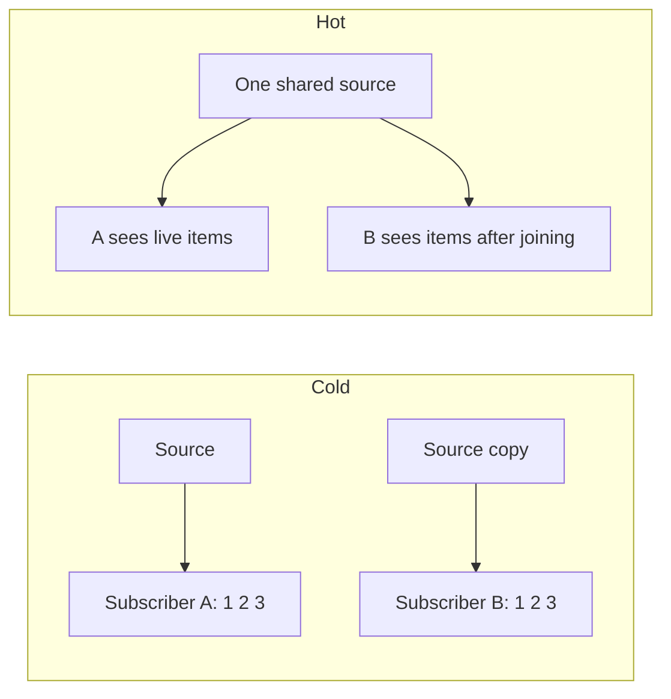

# What is the difference between cold and hot publishers

---

## 🟢 Junior Level

### 1. Plain definition

- **Cold publisher**: starts producing data **from scratch for every subscriber**. No subscriber → no data. Each subscriber gets the *whole* sequence. Most Reactor publishers are cold (`Flux.range`, `Mono.fromCallable`, `WebClient` calls, R2DBC queries).
- **Hot publisher**: produces data **independently of subscribers**. A late subscriber only sees items emitted *after* it joined (and misses earlier ones). Examples: mouse clicks, stock tickers, `Sinks.many().multicast()`.

### 2. Analogy

- **Cold** = a **Netflix movie**: everyone presses play and watches from the beginning.
- **Hot** = **live TV**: the broadcast goes on whether or not you tuned in; if you join late you miss the start.

### 3. Minimal example

```java
import reactor.core.publisher.Flux;
import java.time.Duration;

public class ColdDemo {
    public static void main(String[] args) throws InterruptedException {
        Flux<Integer> cold = Flux.range(1, 3)
                .doOnSubscribe(s -> System.out.println("source started"));

        cold.subscribe(i -> System.out.println("A " + i));
        cold.subscribe(i -> System.out.println("B " + i));
        // "source started" printed TWICE; each subscriber sees 1,2,3
    }
}
```

Hot version:

```java
import reactor.core.publisher.Flux;
import reactor.core.publisher.Sinks;

public class HotDemo {
    public static void main(String[] args) {
        Sinks.Many<String> sink = Sinks.many().multicast().onBackpressureBuffer();
        Flux<String> hot = sink.asFlux();

        sink.tryEmitNext("m1");              // buffered: nobody subscribed yet (warm-up buffer)
        hot.subscribe(s -> System.out.println("A " + s));
        sink.tryEmitNext("m2");
        hot.subscribe(s -> System.out.println("B " + s));
        sink.tryEmitNext("m3");              // A and B both get m3; B never sees m2
        sink.tryEmitComplete();
    }
}
```

### 4. Diagram



---

## 🟡 Middle Level

### 1. Cold behaviour has side effects you must understand

Every subscription re-executes the pipeline. For a `WebClient` call, **two subscribers = two HTTP requests**:

```java
Mono<User> user = webClient.get().uri("/users/1").retrieve().bodyToMono(User.class);

Mono<String> name = user.map(User::name);
Mono<String> mail = user.map(User::email);
Mono.zip(name, mail).subscribe(...);     // 2 HTTP calls!
```

Fix by sharing: `user.cache()` (replay last value) or `user.share()`/`publish().refCount()`.

### 2. Turning cold into hot

| Operator | Behaviour |
| :--- | :--- |
| `share()` | `publish().refCount()`: connects on first subscriber, disconnects when last cancels; late subscribers miss earlier items. |
| `publish().autoConnect(n)` | Connects after *n* subscribers arrive and **never disconnects** automatically. |
| `replay(n)` / `replay(Duration)` | Hot source that replays last *n* items or items within a time window to late subscribers. |
| `cache()` / `cache(n)` / `cache(Duration)` | `replay().autoConnect(1)` – connects on first subscription, retains history. |
| `Mono.cache()` | Memoizes the single result (and error unless TTL specified). |

```java
Flux<Long> ticks = Flux.interval(Duration.ofSeconds(1)).share();
ticks.subscribe(t -> System.out.println("A " + t));
Thread.sleep(3500);
ticks.subscribe(t -> System.out.println("B " + t));   // starts around 3, A has seen 0..2
```

### 3. Sinks: the modern way to build hot sources

`Processors` (`DirectProcessor`, `EmitterProcessor`, `UnicastProcessor`) were deprecated in favour of `Sinks` (since Reactor 3.4); use `Sinks`:

```java
Sinks.One<String> one = Sinks.one();                                // Mono source
Sinks.Empty<Void> empty = Sinks.empty();
Sinks.Many<Event> unicast = Sinks.many().unicast().onBackpressureBuffer();           // exactly one subscriber
Sinks.Many<Event> multicast = Sinks.many().multicast().onBackpressureBuffer();         // many subs, late ones miss data
Sinks.Many<Event> replay = Sinks.many().replay().limit(100);                           // late subs get last 100
```

Emit with `tryEmitNext`, which returns `EmitResult` (`FAIL_NON_SERIALIZED` when two threads emit concurrently). Use `emitNext(value, Sinks.EmitFailureHandler.busyLooping(Duration.ofMillis(100)))` for a retry-on-contention policy.

### 4. Real usage: broadcasting events to SSE clients

```java
@Component
class NotificationHub {
    private final Sinks.Many<Notification> sink = Sinks.many().multicast().directBestEffort();

    void publish(Notification n) { sink.tryEmitNext(n); }
    Flux<Notification> stream() { return sink.asFlux(); }
}

@RestController
class NotificationController {
    private final NotificationHub hub;
    NotificationController(NotificationHub hub) { this.hub = hub; }

    @GetMapping(path = "/notifications", produces = MediaType.TEXT_EVENT_STREAM_VALUE)
    Flux<Notification> notifications() { return hub.stream(); }
}
```

`directBestEffort` drops items for slow subscribers instead of stalling others; `directAllOrNothing` drops for everybody when one is slow; `onBackpressureBuffer` queues until the first subscriber arrives.

### 5. Common mistakes

- Assuming `Flux.interval` is hot – it is **cold**: each subscriber gets its own timer starting at 0.
- Expecting a late subscriber to see old data from `share()`.
- Sharing a stateful cold source without realising two side-effecting calls fire (double payment, double insert).
- Using `cache()` for data that changes and never expiring it.

---

## 🔴 Senior Level

### 1. Internals of `share()` / `refCount`

`Flux.publish()` returns a `ConnectableFlux` (`FluxPublish`) which holds one upstream subscription and a set of `PublishInner` subscribers, with a bounded queue (prefetch default 256). **The slowest subscriber governs the rate** because the upstream demand is the *minimum* of all subscribers' demand. A single stuck subscriber stalls the whole group unless you isolate them with `onBackpressureDrop`, `onBackpressureBuffer` or `publishOn` per subscriber.

`refCount(minSubscribers, gracePeriod)` lets you keep the upstream alive briefly after the last subscriber leaves – important for WebSocket/SSE reconnects:

```java
Flux<Price> prices = marketDataClient.stream()           // expensive upstream WebSocket
        .publish()
        .refCount(1, Duration.ofSeconds(30));            // keep connection 30 s after last client leaves
```

### 2. Hot-source backpressure policy matrix

| Sink flavour | Slow subscriber | No subscriber |
| :--- | :--- | :--- |
| `multicast().onBackpressureBuffer()` | Per-sink buffer grows until bound, then `FAIL_OVERFLOW` | Buffers up to `Queues.SMALL_BUFFER_SIZE` (256) until first subscriber |
| `multicast().directBestEffort()` | Drops for slow one only | Drops (emit returns `FAIL_ZERO_SUBSCRIBER`) |
| `multicast().directAllOrNothing()` | Drops for everyone if any is slow | Drops |
| `replay().limit(n)` | Same as multicast + history | Retains last n |

### 3. Thread safety and `FAIL_NON_SERIALIZED`

Sinks require **serialised** emission (spec §1.3). In a multi-threaded producer:

```java
sink.emitNext(event, (signalType, result) -> result == Sinks.EmitResult.FAIL_NON_SERIALIZED);  // retry on contention
```

The returned lambda is `EmitFailureHandler`: returning `true` retries. Without it, `emitNext` throws `EmissionException` on failure; `tryEmitNext` leaves handling to you. Alternatives: serialise through a single-threaded `Schedulers.single()` via `publishOn`, or use `Sinks.many().multicast()` per producer and `Flux.merge`.

### 4. Memory-leak scenarios

- `replay()` / `cache()` without bounds on an infinite `Flux.interval` retains everything forever.
- `autoConnect()` never cancels the upstream when subscribers leave → upstream (e.g. Kafka consumer) keeps running with no consumers. Use `refCount`.
- A hot `Sinks.many().multicast()` held in a singleton with subscribers that disconnect uncleanly: ensure `doFinally`/`doOnCancel` cleans per-client state. Check `sink.currentSubscriberCount()` in metrics.

### 5. Testing hot publishers

```java
@Test
void multicastDeliversToBoth() {
    Sinks.Many<Integer> sink = Sinks.many().multicast().directBestEffort();
    StepVerifier first = StepVerifier.create(sink.asFlux().take(2)).expectNext(1, 2).expectComplete().verifyLater();
    StepVerifier second = StepVerifier.create(sink.asFlux().take(2)).expectNext(1, 2).expectComplete().verifyLater();

    sink.tryEmitNext(1);
    sink.tryEmitNext(2);

    first.verify(Duration.ofSeconds(1));
    second.verify(Duration.ofSeconds(1));
}
```

For time-based cold sources use `StepVerifier.withVirtualTime(() -> Flux.interval(...))` so tests don't actually wait (see [How to test reactive code with StepVerifier](16.%20How%20to%20test%20reactive%20code%20with%20StepVerifier.md)).

### 6. Design guidance

- Services that call downstream HTTP/DB: keep **cold**, subscribe once per request.
- Event buses, tickers, presence, notification fan-out: **hot** with explicit backpressure policy and replay window.
- Expensive shared upstream (one WebSocket for N clients): `publish().refCount(1, grace)`.
- Always document whether a method returns a hot or cold publisher in the Javadoc – callers can't see it from the type.

---

## 🎯 Interview Cheat Sheet

**30-second pitch:** A cold publisher replays its logic for every subscriber and does nothing until subscribed; a hot publisher emits regardless of subscribers and late joiners miss earlier items. Convert cold to hot using `share`, `publish().refCount()`, `cache`, `replay`; build hot sources with `Sinks`.

**Must-know bullets**
- Reactor is cold by default – 2 subscribers = 2 executions (2 HTTP calls).
- `share()` = `publish().refCount()`; `cache()` = replay + autoConnect(1).
- `Sinks` replaced `EmitterProcessor`/`DirectProcessor`.
- Hot sources need a backpressure policy (buffer / drop / fail).
- `Flux.interval` is cold; `Flux.never`/Sinks are the hot-style ones.
- Slowest subscriber throttles `publish()`ed streams.

**Common follow-ups**
- How would you broadcast events to all SSE clients? (`Sinks.many().multicast()`.)
- How to avoid calling a remote service twice when zipping? (`cache()` or restructure with `flatMap`.)
- What does `FAIL_NON_SERIALIZED` mean? (Concurrent emission violated the serial rule.)

**Red flags**
- "Flux is hot because it's a stream."
- Using deprecated `EmitterProcessor`.
- Unbounded `replay()`/`cache()`.

**Related topics**
- [What is the difference between Mono and Flux](04.%20What%20is%20the%20difference%20between%20Mono%20and%20Flux.md)
- [What is backpressure and which strategies exist](08.%20What%20is%20backpressure%20and%20which%20strategies%20exist.md)
- [What are the most common reactive programming pitfalls](20.%20What%20are%20the%20most%20common%20reactive%20programming%20pitfalls.md)
- [Multithreading section](../9.%20Multithreading/00.%20Section%20Navigator.md)
