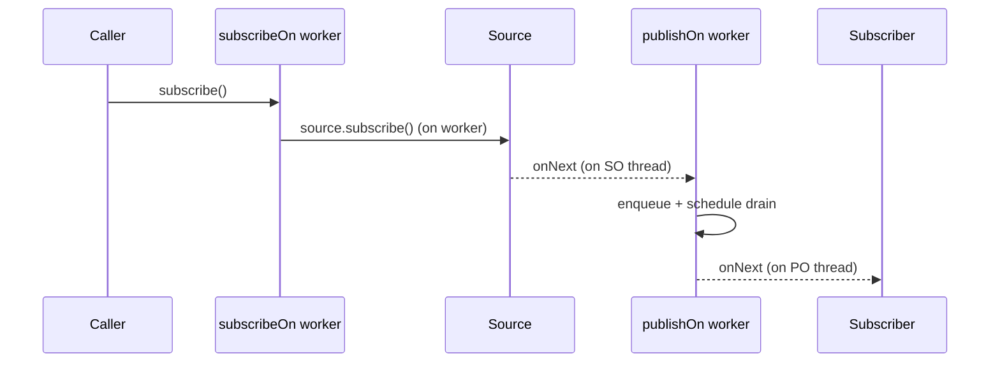

# What is the difference between publishOn and subscribeOn

---

## 🟢 Junior Level

### 1. Plain definition

Reactor is **concurrency-agnostic**: by default a pipeline runs on the thread that called `subscribe()` (or on whichever thread produces the signals, e.g. a Netty event loop). Two operators move work to a different **Scheduler** (thread pool):

- **`subscribeOn(scheduler)`** – decides which thread runs the **subscription and the source** (where the whole chain *starts*), affecting upstream.
- **`publishOn(scheduler)`** – switches the thread for **everything downstream** of that point.

### 2. Analogy

A kitchen line:
- `subscribeOn` = *who starts the whole order*: "the grill cook handles this order from the beginning".
- `publishOn` = *a hand-off in the middle*: "after cooking, pass the plate to the plating station; everything after that is done there".

### 3. Minimal example

```java
import reactor.core.publisher.Flux;
import reactor.core.scheduler.Schedulers;

public class SchedulersDemo {
    static void log(String step) { System.out.println(Thread.currentThread().getName() + " -> " + step); }

    public static void main(String[] args) throws InterruptedException {
        Flux.range(1, 2)
            .doOnNext(i -> log("source " + i))
            .publishOn(Schedulers.parallel())                    // everything below runs on parallel-N
            .doOnNext(i -> log("after publishOn " + i))
            .subscribeOn(Schedulers.boundedElastic())            // subscription + source run on boundedElastic-N
            .subscribe(i -> log("subscriber " + i));

        Thread.sleep(500);
    }
}
```

Typical output:

```text
boundedElastic-1 -> source 1
boundedElastic-1 -> source 2
parallel-1 -> after publishOn 1
parallel-1 -> subscriber 1
parallel-1 -> after publishOn 2
parallel-1 -> subscriber 2
```

Note: `subscribeOn` placement doesn't matter (it influences the subscribe chain from the bottom to the source), but `publishOn` placement matters a lot.

---

## 🟡 Middle Level

### 1. Rules of thumb

| | `subscribeOn` | `publishOn` |
| :--- | :--- | :--- |
| Affects | Subscription, `request`, and the *source* (upstream) | All downstream operators and the subscriber |
| Position in chain | Irrelevant (only the first/closest-to-source one wins) | Critical; multiple allowed, each switches again |
| Typical use | Wrap **blocking source** (`Mono.fromCallable(jdbc)`) | Offload **CPU-heavy** or blocking *downstream* steps |
| Cost | One thread hand-off at start | A queue hand-off per item (prefetch 256) |

### 2. Built-in Schedulers

| Factory | Threads | Use for |
| :--- | :--- | :--- |
| `Schedulers.immediate()` | caller thread | no switching (tests) |
| `Schedulers.single()` | 1 reusable thread | serialised work |
| `Schedulers.parallel()` | `cores` fixed workers | **CPU-bound**, non-blocking work, timers (`delay`, `interval`) |
| `Schedulers.boundedElastic()` | up to `10 × cores` threads, 100,000 queued tasks, 60 s TTL | **blocking** calls (JDBC, files, legacy SDKs) |
| `Schedulers.fromExecutorService(exec)` | yours | custom pools, bulkheads |
| `Schedulers.newBoundedElastic(n, queue, name)` | dedicated | per-dependency bulkhead |

`Schedulers.elastic()` was removed (unbounded threads); use `boundedElastic`.

### 3. Wrapping blocking code properly

```java
@Service
class LegacyAccountService {
    private final AccountJdbcDao dao;          // blocking JDBC DAO
    private final Scheduler jdbcScheduler = Schedulers.newBoundedElastic(
            20, 1_000, "jdbc");                // cap threads = connection pool size

    Mono<Account> find(long id) {
        return Mono.fromCallable(() -> dao.find(id))     // blocking call inside Callable
                   .subscribeOn(jdbcScheduler);           // keeps the event loop free
    }

    Flux<Account> findAll() {
        return Flux.defer(() -> Flux.fromIterable(dao.findAll()))
                   .subscribeOn(jdbcScheduler);
    }
}
```

### 4. Offloading CPU-heavy downstream work

```java
webClient.get().uri("/image").retrieve().bodyToMono(byte[].class)
    .publishOn(Schedulers.parallel())          // leave the Netty thread
    .map(ImageResizer::resize)                 // CPU-bound work
    .publishOn(Schedulers.boundedElastic())
    .flatMap(img -> Mono.fromRunnable(() -> blockingStore.save(img)));
```

### 5. Operators that change threads implicitly

- `delayElements`, `interval`, `timeout`, `delay` → `Schedulers.parallel()`.
- `WebClient` responses → Netty event loop (`reactor-http-nio-N`).
- R2DBC callbacks → driver's event loop.
- `Mono.fromFuture` → thread of the completing future.
- `Flux.create` → whichever thread calls `sink.next`.

### 6. Common mistakes

- Expecting `subscribeOn` to affect what happens after a `publishOn` – it doesn't.
- Using `parallel()` for blocking calls: with only `cores` threads you stall everything.
- Using `publishOn` per operator "for performance" – each hop adds queueing and cache misses.
- Thinking that `flatMap` runs inner publishers in parallel *by itself*; it only subscribes concurrently – real parallelism requires an inner `subscribeOn` or an async source:

```java
Flux.range(1, 8)
    .flatMap(i -> Mono.fromCallable(() -> cpuHeavy(i)).subscribeOn(Schedulers.parallel()))   // truly parallel
    .subscribe();
// alternatively: .parallel().runOn(Schedulers.parallel()).map(...).sequential()
```

---

## 🔴 Senior Level

### 1. Implementation details

- `subscribeOn` → `FluxSubscribeOn`: in `subscribe()` it creates a `Worker` and **schedules the call to `source.subscribe(...)`** on it. Subsequent `request(n)` calls from other threads are re-dispatched to that worker (`requestOn = true`) so that data emission remains on the worker thread – a thread hand-off *per request*.
- `publishOn` → `FluxPublishOn`: `onNext` enqueues into a bounded SPSC queue (prefetch, default `Queues.SMALL_BUFFER_SIZE`=256, overridable `publishOn(sch, prefetch)`) and schedules a drain task on the Worker; items are delivered serially from that worker thread. Replenishes upstream at 75 % of prefetch (`limit`).
- `Flux.parallel(n).runOn(sch)` → `ParallelFlux` rails, each with its own `publishOn`-like worker for CPU parallelism, with `sequential()` to merge.



### 2. Thread-affinity assumptions that break

- `ThreadLocal` / MDC / `SecurityContextHolder` / `@Transactional` are **not** carried across scheduler hops → use Reactor `Context` and Micrometer's context-propagation, `Hooks.enableAutomaticContextPropagation()` (Reactor 3.5.3+), or `ReactorContextAccessor` (see [How to propagate context with Reactor Context and MDC](15.%20How%20to%20propagate%20context%20with%20Reactor%20Context%20and%20MDC.md)).
- Non-thread-safe objects captured by lambdas can be touched from different threads *over time* (never concurrently, but visibility is guaranteed by queue hand-offs – safe, but beware of `parallel`/`flatMap` inner concurrency).

### 3. Sizing and bulkheads for `boundedElastic`

Default cap = `10 × availableProcessors()`. On 4 cores that is 40 threads and 100k queued tasks; blocking JDBC calls with a Hikari pool of 10 will queue on Hikari anyway. Use a **dedicated scheduler per dependency** to prevent one slow system from saturating the shared pool:

```java
Scheduler pdfScheduler  = Schedulers.newBoundedElastic(4, 100, "pdf",  30, true); // daemon, ttl 30s
Scheduler mailScheduler = Schedulers.newBoundedElastic(8, 500, "mail", 30, true);
```

When capacity is exceeded you get `RejectedExecutionException: Task ... rejected from boundedElastic-...` – this is *deliberate backpressure* visible in logs; alert on it.

Metrics: `Schedulers.enableMetrics()` (Reactor 3.4.? / 3.5) publishes `executor.*` Micrometer meters per scheduler; use `Schedulers.onScheduleHook("tag", Runnable decorator)` for tracing or MDC copying.

### 4. Virtual threads as Scheduler backend

Reactor 3.6 / Spring Framework 6.1 allow `Schedulers.boundedElastic()` backed by virtual threads with `-Dreactor.schedulers.defaultBoundedElasticOnVirtualThreads=true` (Reactor ≥ 3.6.0, JDK 21). Blocking calls inside then park a virtual thread instead of a platform thread; the cap is still applied on tasks.

### 5. Measuring cost

```java
// JMH sketch: items/s for cheap map with and without hand-off
@Benchmark public long noHop()   { return Flux.range(0, 100_000).map(i -> i + 1).reduce(0L, Long::sum).block(); }
@Benchmark public long oneHop()  { return Flux.range(0, 100_000).publishOn(Schedulers.parallel()).map(i -> i + 1).reduce(0L, Long::sum).block(); }
```

Expect `noHop` several times faster due to operator fusion; each `publishOn` breaks fusion with a queue and a `Worker.schedule` call.

### 6. Diagnostics

- Thread dumps: reactor threads are named `reactor-http-nio-N`, `parallel-N`, `boundedElastic-N`. Blocked `parallel` or `reactor-http-nio` threads = bug.
- BlockHound installed with `.allowBlockingCallsInside(...)` for known false positives, see [How does Netty work and why must you never block the event loop](14.%20How%20does%20Netty%20work%20and%20why%20must%20you%20never%20block%20the%20event%20loop.md).
- `log()` operator prints thread names in `onNext` lines; `Hooks.onEachOperator` can add thread tracing.

---

## 🎯 Interview Cheat Sheet

**30-second pitch:** `subscribeOn` chooses the thread on which the subscription and the source run (affects upstream, position-independent). `publishOn` switches the thread for all downstream operators from its position. Use `boundedElastic` for blocking calls, `parallel` for CPU work, and avoid needless hops because each costs a queue hand-off.

**Must-know bullets**
- Default: no thread switching – runs on the subscribing/producing thread.
- `publishOn` position matters; `subscribeOn` position doesn't.
- `parallel()` = cores threads, non-blocking only; `boundedElastic()` = blocking-tolerant, bounded.
- `flatMap` ≠ parallelism by itself.
- ThreadLocals don't follow – use Reactor Context.
- `Schedulers.elastic()` is removed.

**Common follow-ups**
- Which thread runs `.map` after `WebClient`? (Netty event loop.)
- How to wrap JDBC? (`Mono.fromCallable(...).subscribeOn(boundedElastic())`.)
- How to run CPU tasks in parallel? (`parallel().runOn(...)` or inner `subscribeOn`.)

**Red flags**
- Blocking calls on `parallel()`.
- Sprinkling `publishOn` everywhere.
- Believing `subscribeOn` placed at the end affects downstream.

**Related topics**
- [How does Netty work and why must you never block the event loop](14.%20How%20does%20Netty%20work%20and%20why%20must%20you%20never%20block%20the%20event%20loop.md)
- [What is backpressure and which strategies exist](08.%20What%20is%20backpressure%20and%20which%20strategies%20exist.md)
- [Virtual threads vs reactive programming and when to choose which](18.%20Virtual%20threads%20vs%20reactive%20programming%20and%20when%20to%20choose%20which.md)
- [Multithreading section](../9.%20Multithreading/00.%20Section%20Navigator.md)
