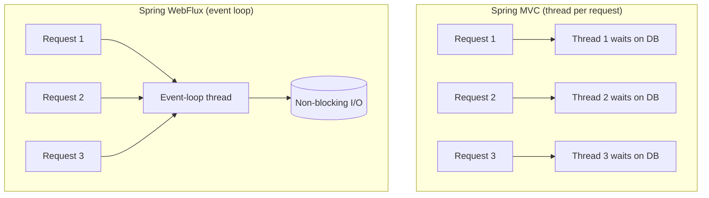
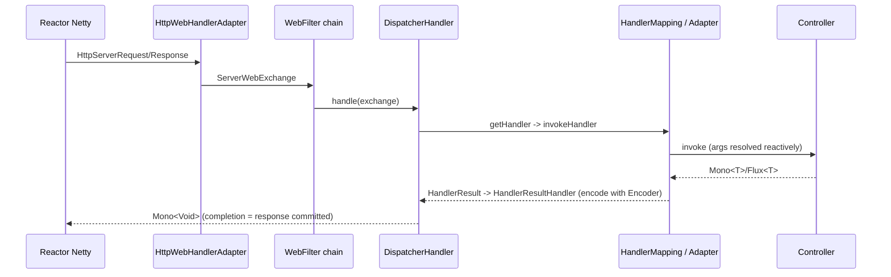

# What is the difference between Spring WebFlux and Spring MVC

---

## 🟢 Junior Level

### 1. Plain definition

Both are web frameworks inside Spring and both can use the same annotations (`@RestController`, `@GetMapping`):

- **Spring MVC** (`spring-boot-starter-web`) – **servlet-based, blocking**: one thread handles a request from start to finish (default server: Tomcat). Returns plain objects (`User`, `List<User>`).
- **Spring WebFlux** (`spring-boot-starter-webflux`) – **reactive, non-blocking**: a small number of event-loop threads serve many requests (default server: Reactor Netty). Returns `Mono<User>` / `Flux<User>`.

### 2. Analogy

- MVC = a bank where each customer gets a **dedicated teller** who waits for each document to be fetched.
- WebFlux = **few tellers with tickets**; while a document is being fetched the teller serves the next customer.

### 3. Same endpoint, both styles

MVC:

```java
@RestController
@RequestMapping("/users")
class UserMvcController {
    private final UserRepository repo;                      // Spring Data JPA

    UserMvcController(UserRepository repo) { this.repo = repo; }

    @GetMapping("/{id}")
    ResponseEntity<User> get(@PathVariable Long id) {
        return repo.findById(id).map(ResponseEntity::ok)
                   .orElse(ResponseEntity.notFound().build());   // blocks the request thread on the DB
    }
}
```

WebFlux:

```java
@RestController
@RequestMapping("/users")
class UserFluxController {
    private final UserReactiveRepository repo;               // ReactiveCrudRepository (R2DBC / Mongo)

    UserFluxController(UserReactiveRepository repo) { this.repo = repo; }

    @GetMapping("/{id}")
    Mono<ResponseEntity<User>> get(@PathVariable Long id) {
        return repo.findById(id)
                   .map(ResponseEntity::ok)
                   .defaultIfEmpty(ResponseEntity.notFound().build());   // no thread blocked
    }

    @GetMapping(produces = MediaType.APPLICATION_NDJSON_VALUE)
    Flux<User> all() { return repo.findAll(); }
}
```

### 4. Picture



---

## 🟡 Middle Level

### 1. Comparison table

| Aspect | Spring MVC | Spring WebFlux |
| :--- | :--- | :--- |
| Foundation | Servlet API (blocking, 3.x/6.x) | Reactive Streams + `HttpHandler` |
| Servers | Tomcat, Jetty, Undertow | Netty (default), Tomcat/Jetty (Servlet 3.1+ non-blocking), Undertow |
| Threading | Thread per request (`server.tomcat.threads.max`=200) | Event loop (`max(4, cores)` threads) |
| Return types | `T`, `List<T>`, `ResponseEntity<T>` (also `Callable`, `DeferredResult`) | `Mono<T>`, `Flux<T>`, `Mono<ResponseEntity<T>>` |
| Data access | JDBC, JPA/Hibernate (blocking) | R2DBC, reactive Mongo/Redis/Cassandra/Elasticsearch |
| HTTP client | `RestTemplate`, `RestClient`, `WebClient` | `WebClient` |
| Security | `SecurityFilterChain` (servlet filters) | `SecurityWebFilterChain` (`WebFilter`) |
| Filters | `Filter`, `HandlerInterceptor` | `WebFilter`, `HandlerFilterFunction` |
| Streaming | SSE via `SseEmitter`, `ResponseBodyEmitter` | `Flux` natively (SSE, NDJSON) |
| Programming models | Annotated controllers | Annotated controllers **and** functional endpoints |
| Debuggability | Simple stack traces, ThreadLocals work | Async stack traces, Context needed |
| Transactions | `@Transactional` (ThreadLocal-bound) | `TransactionalOperator`, `@Transactional` with reactive manager |

### 2. What is **shared**

`@Controller`, `@RequestMapping`, `@RequestBody`, `@Valid`, `@ExceptionHandler`, `@ControllerAdvice`, `ResponseEntity`, `ProblemDetail`, content negotiation, Jackson, Spring Boot configuration. This is why migration is feasible endpoint by endpoint (but not in one module: the starter `web` wins if both are on the classpath and the app runs as MVC unless `spring.main.web-application-type=reactive`).

### 3. Both can be used together

If both starters are present, Boot runs **Servlet/MVC**; `WebClient` still works for reactive client calls and MVC controllers may return `Mono`/`Flux`, which Spring MVC adapts (async request processing, `Flux` as `List` or SSE). A very common pragmatic architecture: **MVC + WebClient** for fan-out calls.

```java
// MVC controller using WebClient for parallel downstream calls
@GetMapping("/dashboard/{id}")
Dashboard dashboard(@PathVariable String id) {
    return Mono.zip(profile(id), orders(id).collectList())
               .map(t -> new Dashboard(t.getT1(), t.getT2()))
               .block(Duration.ofSeconds(2));            // acceptable on a servlet thread
}
```

### 4. Configuration

```yaml
# application.yml (Boot 3.x)
spring:
  main:
    web-application-type: reactive    # default when only webflux starter present
server:
  port: 8080
  netty:
    connection-timeout: 5s
  shutdown: graceful
```

```xml
<dependency>
  <groupId>org.springframework.boot</groupId>
  <artifactId>spring-boot-starter-webflux</artifactId>
</dependency>
```

### 5. Common mistakes

- Choosing WebFlux for a CRUD app using JPA/JDBC – the blocking DAO nullifies benefits.
- Returning `Mono<Void>` and forgetting the subscription – WebFlux subscribes for you, but your own `Mono` stored in a field is never executed.
- Using `Thread.sleep`, `RestTemplate`, or `block()` in WebFlux handlers.
- Expecting ThreadLocals (e.g. `SecurityContextHolder`, MDC) to work.
- Forgetting `produces = TEXT_EVENT_STREAM_VALUE` for SSE – the client otherwise receives a collected JSON array.

---

## 🔴 Senior Level

### 1. Request lifecycle in WebFlux



`DispatcherHandler` returns `Mono<Void>`; Netty subscribes to it. Encoding uses `Encoder<T>`/`HttpMessageWriter` producing `Flux<DataBuffer>` written with demand from the channel (backpressure).

### 2. Performance: facts, not folklore

- For **CPU-bound** or **fast-DB** workloads WebFlux is often *not faster* and can be 10–20 % slower in latency due to extra allocations and hand-offs.
- It scales better when **many requests wait on slow I/O**: at high concurrency (thousands of in-flight requests) MVC saturates its pool (default 200 threads) and memory (≈ 1 MB per stack), while WebFlux holds steady with ~`cores` threads.
- Benchmarks (e.g. Spring team, TechEmpower-style): with simulated 100–500 ms downstream latency WebFlux sustains several times the throughput of default Tomcat; adding `max-threads=2000` or **virtual threads** (`spring.threads.virtual.enabled=true` in Boot 3.2+) closes most of the gap with far simpler code.
- The real win is **streaming and composition**: SSE, WebSocket, long polling, gateways (Spring Cloud Gateway is built on WebFlux).

### 3. Blocking-tolerant WebFlux

When you must call blocking code from a handler:

```java
@GetMapping("/report/{id}")
Mono<Report> report(@PathVariable Long id) {
    return Mono.fromCallable(() -> jdbcReportService.load(id))
               .subscribeOn(Schedulers.boundedElastic());
}
```

Install BlockHound in CI to guarantee nobody blocks on `reactor-http-nio` threads.

### 4. Security and transactions

```java
@Configuration
@EnableWebFluxSecurity
class SecurityConfig {
    @Bean
    SecurityWebFilterChain chain(ServerHttpSecurity http) {
        return http.csrf(ServerHttpSecurity.CsrfSpec::disable)
                   .authorizeExchange(e -> e.pathMatchers("/actuator/health").permitAll()
                                            .anyExchange().authenticated())
                   .oauth2ResourceServer(o -> o.jwt(Customizer.withDefaults()))
                   .build();
    }
}
```

`ReactiveSecurityContextHolder.getContext()` reads the `SecurityContext` from Reactor `Context` (not a ThreadLocal). Transactions: `@Transactional` works with `ReactiveTransactionManager` (`R2dbcTransactionManager`); the transaction is stored in the Reactor Context, and **only reactive chains that are part of the returned publisher** participate.

### 5. Operational concerns

- **Request body size / memory**: `spring.codec.max-in-memory-size` (default 256 KB) limits buffered `bodyToMono(String)`; raise deliberately or stream.
- **Timeouts**: Netty has none by default for handlers: add `.timeout(...)` or use `WebFilter` with global deadline; configure `server.netty.idle-timeout`.
- **Metrics**: `reactor.netty.http.server.*` via `Metrics.addRegistry`; enable with `-Dreactor.netty.http.server.metrics=true` or Boot's autoconfig.
- **Graceful shutdown**: `server.shutdown=graceful` + `spring.lifecycle.timeout-per-shutdown-phase`.
- **Observability**: Micrometer Observation with `Hooks.enableAutomaticContextPropagation()`.

### 6. Decision guide

Choose **WebFlux** for: API gateways, streaming/SSE/WebSocket, high-fan-out aggregation, fully reactive stack (R2DBC/Mongo/Redis/Kafka-reactor), teams comfortable with reactive.
Choose **MVC** (optionally with virtual threads) for: JPA/JDBC apps, CRUD/business apps, teams valuing debuggability, mostly CPU or fast I/O. See [Virtual threads vs reactive programming and when to choose which](18.%20Virtual%20threads%20vs%20reactive%20programming%20and%20when%20to%20choose%20which.md).

---

## 🎯 Interview Cheat Sheet

**30-second pitch:** Spring MVC is servlet-based and thread-per-request with blocking I/O; Spring WebFlux is reactive, runs on an event loop (Netty by default) and returns `Mono`/`Flux`. They share annotations; WebFlux additionally offers functional endpoints. WebFlux shines with high concurrency, streaming and fully non-blocking stacks – it's not automatically faster.

**Must-know bullets**
- MVC: Servlet API, thread per request; WebFlux: Reactive Streams, event loop.
- Same annotations; different return types.
- Don't use JPA/JDBC/`RestTemplate` in WebFlux handlers without `boundedElastic`.
- If both starters present, MVC wins.
- Security: `SecurityWebFilterChain`, Reactor Context instead of ThreadLocal.
- Virtual threads make MVC competitive for I/O concurrency.

**Common follow-ups**
- Can WebFlux run on Tomcat? (Yes, via Servlet 3.1 non-blocking I/O.)
- Can MVC return `Mono`? (Yes, via async support.)
- When would you migrate MVC → WebFlux? (Gateways/streaming/fan-out; not plain CRUD on JPA.)

**Red flags**
- "WebFlux is always faster."
- Blocking calls inside reactive handlers.
- Mixing JPA repositories in a WebFlux service without isolation.

**Related topics**
- [What is the difference between WebClient and RestTemplate](11.%20What%20is%20the%20difference%20between%20WebClient%20and%20RestTemplate.md)
- [What are WebFlux functional endpoints](12.%20What%20are%20WebFlux%20functional%20endpoints.md)
- [What is the difference between R2DBC and JDBC or JPA](13.%20What%20is%20the%20difference%20between%20R2DBC%20and%20JDBC%20or%20JPA.md)
- [When not to use reactive programming](21.%20When%20not%20to%20use%20reactive%20programming.md)
