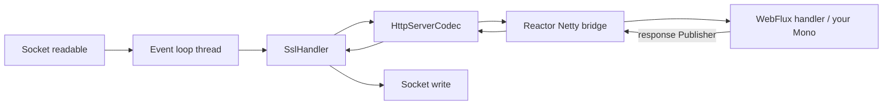

# How does Netty work and why must you never block the event loop

---

## 🟢 Junior Level

**Netty** is the asynchronous networking framework underneath Spring WebFlux (via Reactor Netty), gRPC-Java, Elasticsearch, Cassandra drivers and many others. Instead of one thread per connection, Netty uses a **small number of event-loop threads** — usually one per CPU core — and each thread handles **thousands of connections**.

### How an event loop works
Each event loop runs an endless loop:
1. Ask the OS which sockets are ready (`epoll` on Linux, `kqueue` on macOS, NIO `Selector` elsewhere).
2. For each ready socket, read bytes and run the handlers (decode HTTP, call your code, encode the response).
3. Run queued tasks and timers.
4. Repeat.

### Why blocking is fatal
If your code on that thread waits — a JDBC query, `Thread.sleep`, a blocking HTTP call, `Mono.block()` — **every other connection assigned to that event loop waits too**. With 8 event loops, 8 slow database calls can freeze the whole server.

```java
// BAD: blocks an event-loop thread
@GetMapping("/report")
Mono<Report> report() {
    return Mono.just(jdbcTemplate.queryForObject("select ...", Report.class));   // runs immediately, blocking
}

// OK: isolate unavoidable blocking work on a separate scheduler
@GetMapping("/report")
Mono<Report> report() {
    return Mono.fromCallable(() -> jdbcTemplate.queryForObject("select ...", Report.class))
               .subscribeOn(Schedulers.boundedElastic());
}
```

---

## 🟡 Middle Level

### Netty's building blocks
* **`EventLoopGroup`** — a set of event loops. Servers typically have a *boss* group (accepts connections) and a *worker* group (handles I/O).
* **`Channel`** — a connection; each channel is registered with exactly **one** event loop for its whole life, so all its events run on one thread (no locking needed inside handlers).
* **`ChannelPipeline`** — a chain of `ChannelHandler`s (TLS, HTTP codec, compression, your logic). Inbound events flow head → tail, outbound tail → head.
* **`ByteBuf`** — reference-counted buffers, usually pooled and off-heap (direct memory) to avoid copies to the socket.



### Thread names tell you where you are
In WebFlux logs: `reactor-http-nio-3` (or `reactor-http-epoll-3`) is an event-loop thread. `boundedElastic-5` is Reactor's elastic pool for blocking work. `parallel-2` is for CPU-bound work. If you see JDBC or `InputStream.read` in a stack trace on `reactor-http-*`, you've found a bug.

### Detecting blocking calls: BlockHound

```java
@BeforeAll
static void installBlockHound() {
    BlockHound.install();               // instruments JDK blocking methods
}

@Test
void handlerDoesNotBlock() {
    StepVerifier.create(handler.report()).expectNextCount(1).verifyComplete();
    // if anything calls a blocking method on a non-blocking thread:
    // reactor.blockhound.BlockingOperationError: Blocking call! java.io.FileInputStream#readBytes
}
```

Run BlockHound in integration tests (it requires `-XX:+AllowRedefinitionToAddDeleteMethods` on Java 13+).

---

## 🔴 Senior Level

### Scheduling details that bite in production
* **`subscribeOn(boundedElastic())`** moves the *subscription and upstream emission* to an elastic thread; the rest of the chain continues there unless you `publishOn` back. Response writing returns to the event loop automatically when Netty writes the bytes.
* **`boundedElastic`** caps threads at `10 × cores` and queues up to 100,000 tasks per thread — it's a safety valve, not a license to run everything blocking. If most of your app blocks, WebFlux gives you the complexity without the benefit.
* **CPU-heavy work** (JSON of 20 MB, image resizing, crypto) also stalls the event loop. Offload to `Schedulers.parallel()` or a dedicated executor, and stream large payloads.

### Event-loop latency as a metric
A healthy event loop processes tasks in microseconds. Monitor:
* Reactor Netty metrics (`reactor.netty.*` via Micrometer, enable with `.metrics(true, uriMapper)`), especially pending tasks per event loop.
* Pending acquire time of connection pools.
* Profiling with async-profiler in *wall-clock* mode on event-loop threads: any frame that isn't Netty/your non-blocking code is suspect.

### Memory: direct buffers and leaks
Netty's `PooledByteBufAllocator` allocates arenas of direct memory (per event-loop thread caches). Symptoms of trouble:
* `OutOfDirectMemoryError` / `io.netty.util.internal.OutOfDirectMemoryError: failed to allocate 16777216 byte(s) of direct memory`.
* `LEAK: ByteBuf.release() was not called before it's garbage-collected` — a handler didn't release a buffer.

Tools: `-Dio.netty.leakDetection.level=paranoid` in tests (expensive), `io.netty.maxDirectMemory`, `-XX:MaxDirectMemorySize`, and NMT (`-XX:NativeMemoryTracking=summary`). In containers, budget direct memory separately from heap when setting memory limits.

### Native transports
Reactor Netty uses `epoll` (Linux) or `kqueue` (macOS) native transports when the `netty-transport-native-*` dependency is present, otherwise NIO. Native epoll offers edge-triggered I/O, fewer GC-producing objects and features like `SO_REUSEPORT`; Netty 4.2 adds `io_uring`. The thread name changes from `nio` to `epoll` — a quick way to check what you're running.

---

## 🎯 Interview Cheat Sheet

**30-second pitch:** Netty multiplexes thousands of connections onto a few event-loop threads using epoll/kqueue; each channel is pinned to one loop and processed through a handler pipeline with pooled off-heap buffers. Blocking or CPU-heavy work on an event loop stalls every connection on it, so blocking calls go to `boundedElastic` (sparingly), CPU work to `parallel`, and BlockHound catches violations in tests.

**Must know:**
* EventLoopGroup, Channel, ChannelPipeline, ByteBuf.
* One channel ↔ one event loop thread.
* `reactor-http-nio-*` threads must never block.
* `subscribeOn(Schedulers.boundedElastic())` for unavoidable blocking.
* Direct memory and `ByteBuf` leaks.

**Common follow-ups:**
* What happens if one handler calls JDBC?
* How do you find blocking calls?
* Why does WebFlux use so few threads?

**Red flags:** `.block()` in handlers; wrapping everything in `boundedElastic` "to be safe"; ignoring direct memory in container limits.

**Related:**
* [What is the difference between blocking and non-blocking IO](02.%20What%20is%20the%20difference%20between%20blocking%20and%20non-blocking%20IO.md)
* [What is the difference between publishOn and subscribeOn](09.%20What%20is%20the%20difference%20between%20publishOn%20and%20subscribeOn.md)
* [What are the most common reactive programming pitfalls](20.%20What%20are%20the%20most%20common%20reactive%20programming%20pitfalls.md)
* [What is the difference between WebClient and RestTemplate](11.%20What%20is%20the%20difference%20between%20WebClient%20and%20RestTemplate.md)
