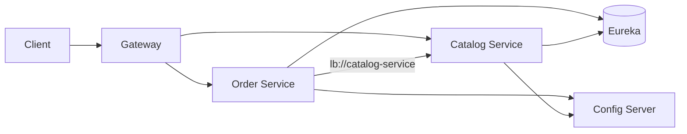

# What does Spring Cloud provide

---

## 🟢 Junior Level

### What is it?

**Spring Cloud** is an umbrella of projects that sit on top of Spring Boot and give you ready-made building blocks for the recurring problems of distributed systems: finding other services, calling them reliably, distributing configuration, routing external traffic, and tracing a request across processes.

> It does **not** replace Spring Boot. Spring Boot builds one service; Spring Cloud helps many services cooperate.

### Real-world analogy

Think of a city. Each microservice is a shop. Spring Boot gives you the shop building. Spring Cloud gives you the city infrastructure: a phone book (service discovery), a central notice board with shop rules (config server), a main entrance with security guards (API gateway), traffic rules when a road is closed (circuit breaker), and a delivery tracking number (distributed tracing).

### The main building blocks

| Problem | Spring Cloud answer |
| :--- | :--- |
| "Where is service X right now?" | Service discovery (Eureka, Consul, Kubernetes) |
| "Which instance should I call?" | Spring Cloud LoadBalancer |
| "One entry point for all clients" | Spring Cloud Gateway |
| "Change config without redeploy" | Spring Cloud Config, Kubernetes ConfigMaps |
| "Call another service declaratively" | OpenFeign, HTTP interfaces |
| "Remote service is failing" | Spring Cloud CircuitBreaker (Resilience4j) |
| "Follow one request across services" | Micrometer Tracing (not strictly Spring Cloud anymore) |

### Minimal example

Add the BOM once; individual starters then need no version:

```xml
<dependencyManagement>
  <dependencies>
    <dependency>
      <groupId>org.springframework.cloud</groupId>
      <artifactId>spring-cloud-dependencies</artifactId>
      <version>2023.0.3</version>
      <type>pom</type>
      <scope>import</scope>
    </dependency>
  </dependencies>
</dependencyManagement>
```

A service that reads its configuration from a Config Server and registers itself in Eureka:

```java
@SpringBootApplication
public class CatalogApplication {
    public static void main(String[] args) {
        SpringApplication.run(CatalogApplication.class, args);
    }
}
```

```yaml
spring:
  application:
    name: catalog-service
  config:
    import: "optional:configserver:http://localhost:8888"
eureka:
  client:
    service-url:
      defaultZone: http://localhost:8761/eureka
```



---

## 🟡 Middle Level

### Release trains and compatibility

Spring Cloud uses calendar-versioned **release trains** (`2022.0.x`, `2023.0.x`, `2024.0.x`, `2025.0.x`). Each train targets a specific Spring Boot line. Spring Cloud 2022.0 and later require Spring Boot 3 / Jakarta EE; mixing a wrong train and Boot version leads to `NoSuchMethodError` or auto-configuration failures at startup. Always consult the official compatibility matrix and import the BOM instead of pinning individual artifact versions.

### What is still "Netflix" and what is not

Since Spring Cloud 2020, most Netflix OSS components entered maintenance or were removed:

| Old (Netflix) | Modern replacement |
| :--- | :--- |
| Ribbon | Spring Cloud LoadBalancer |
| Hystrix | Resilience4j via Spring Cloud CircuitBreaker |
| Zuul 1 | Spring Cloud Gateway |
| Archaius | Spring Environment / Config |
| Sleuth | Micrometer Tracing (Spring Boot 3) |
| Eureka | Still maintained and widely used |

Interviewers love this question because many tutorials are stale.

### Programming model: abstractions over implementations

Spring Cloud defines abstractions so you can swap implementations:

- `DiscoveryClient` / `ReactiveDiscoveryClient` — Eureka, Consul, Zookeeper, Kubernetes.
- `LoadBalancerClient` — one API, pluggable algorithms.
- `CircuitBreakerFactory` — Resilience4j, Spring Retry, Sentinel.
- `Spring Cloud Stream` — Kafka/RabbitMQ binders.

```java
@Service
public class RecommendationClient {

    private final CircuitBreakerFactory<?, ?> cbFactory;
    private final RestClient restClient;

    public RecommendationClient(CircuitBreakerFactory<?, ?> cbFactory,
                                @LoadBalanced RestClient.Builder builder) {
        this.cbFactory = cbFactory;
        this.restClient = builder.baseUrl("http://recommendation-service").build();
    }

    public List<String> forUser(long userId) {
        return cbFactory.create("recommendations").run(
            () -> restClient.get().uri("/users/{id}", userId)
                    .retrieve().body(new ParameterizedTypeReference<List<String>>() {}),
            throwable -> List.of()); // fallback
    }
}
```

### Common mistakes

1. **Putting `bootstrap.yml` everywhere.** Since Boot 2.4 use `spring.config.import`; `bootstrap` needs `spring-cloud-starter-bootstrap`.
2. **Adopting everything.** On Kubernetes, you often do not need Eureka or Config Server; the platform provides discovery and ConfigMaps.
3. **Treating Spring Cloud as mandatory for microservices.** It is a toolbox.
4. **Ignoring the actuator.** Many features (refresh, health, gateway routes) are exposed as actuator endpoints that must be secured.

### Trade-offs

Library-based cloud patterns (Spring Cloud) run **in-process**: language-specific, but easy to debug and customize in Java. Platform-based patterns (Kubernetes Services, service mesh) are language-neutral but add operational complexity. Many production systems mix them.

---

## 🔴 Senior Level

### Startup and bootstrapping mechanics

Spring Cloud features plug into Spring Boot through `AutoConfiguration.imports` and `ConfigDataLocationResolver`. With `spring.config.import=configserver:`, the `ConfigServerConfigDataLocationResolver` fetches remote properties **before** the application context is built, so `@ConfigurationProperties` and conditions see remote values. A failure here with a non-`optional:` import stops startup; combine with `spring.cloud.config.fail-fast` and retry (`spring-retry` + `spring.cloud.config.retry.*`) when the config server may come up late.

### Cost model of each capability

| Capability | Hidden runtime cost |
| :--- | :--- |
| Eureka client | Heartbeat every 30 s, registry fetch every 30 s, up to ~90 s staleness by default |
| LoadBalancer | Instance list cached 35 s by default (`spring.cloud.loadbalancer.cache.ttl`) |
| Gateway | Netty event loop; blocking code in filters starves it |
| Config refresh | `@RefreshScope` beans are re-created lazily with a lock; hot paths see contention |
| Tracing | Span creation per call; sample probability matters at high RPS |

### Production architecture reasoning

A realistic layout on Kubernetes in 2024+:

- **Discovery**: Kubernetes DNS / `spring-cloud-kubernetes-discoveryclient` — drop Eureka.
- **Config**: ConfigMaps/Secrets, optionally Config Server for Git-backed history and encryption.
- **Edge**: Spring Cloud Gateway for domain-specific logic (auth token relay, rate limiting), ingress for TLS.
- **Resilience**: Resilience4j in the application, because only the application knows business fallbacks.
- **Observability**: Micrometer Tracing + OpenTelemetry collector.

### Diagnostics

```bash
# What did Spring Cloud actually auto-configure?
curl -s localhost:8080/actuator/conditions | jq '.contexts[].positiveMatches | keys[] | select(test("cloud"))'
# Effective property sources, including remote ones
curl -s localhost:8080/actuator/env | jq '.propertySources[].name'
```

A frequent production surprise: `/actuator/env` shows `configserver:` property sources missing because the app silently used `optional:`. Always alert on config-server fallback by logging the active label/version (`/actuator/env` → `configserver:...`).

### Edge cases

- Upgrading release train changes property namespaces (e.g., Gateway properties moved under `spring.cloud.gateway.server.webflux.*` in 2025.0). Pin and read migration notes.
- Mixing Spring MVC and Gateway (WebFlux) in one app is unsupported; use Gateway Server MVC variant if you need servlet stack.
- Native image: Spring Cloud features with reflection-heavy proxies (Feign) need AOT hints; verify each starter's GraalVM support.

---

## 🎯 Interview Cheat Sheet

**30-second pitch:** Spring Cloud is a set of Spring Boot–based libraries for distributed-system concerns: discovery, load balancing, gateway, configuration, resilience, and messaging, built on abstractions so implementations are swappable. It evolved from Netflix OSS to Spring-owned replacements (LoadBalancer, Gateway, Resilience4j, Micrometer Tracing).

**Must-know bullets**
- Release trains versioned by year, tied to Spring Boot lines; import the BOM.
- Ribbon, Hystrix, Zuul 1, Sleuth are replaced.
- Use `spring.config.import`, not bootstrap.
- On Kubernetes, many features overlap with the platform; choose deliberately.
- Abstractions: `DiscoveryClient`, `LoadBalancerClient`, `CircuitBreakerFactory`.

**Follow-up questions**
- Why was Hystrix replaced and by what?
- Do you need Eureka on Kubernetes?
- How does a Config Server property reach a bean before the context starts?

**Red flags**
- Claiming Spring Cloud is required to build microservices.
- Recommending Ribbon/Hystrix/Sleuth for a new Boot 3 project.
- Pinning individual Spring Cloud artifact versions manually.

**Related topics**
- [How does service discovery work in Spring Cloud](02.%20How%20does%20service%20discovery%20work%20in%20Spring%20Cloud.md)
- [What is Spring Cloud Gateway](04.%20What%20is%20Spring%20Cloud%20Gateway.md)
- [Centralized configuration with Spring Cloud Config](05.%20Centralized%20configuration%20with%20Spring%20Cloud%20Config.md)
- [Circuit breaker pattern with Resilience4j](07.%20Circuit%20breaker%20pattern%20with%20Resilience4j.md)
- [Service mesh vs Spring Cloud](16.%20Service%20mesh%20vs%20Spring%20Cloud.md)
- Microservices section: [Section 17](../17.%20Microservices/00.%20Section%20Navigator.md)
