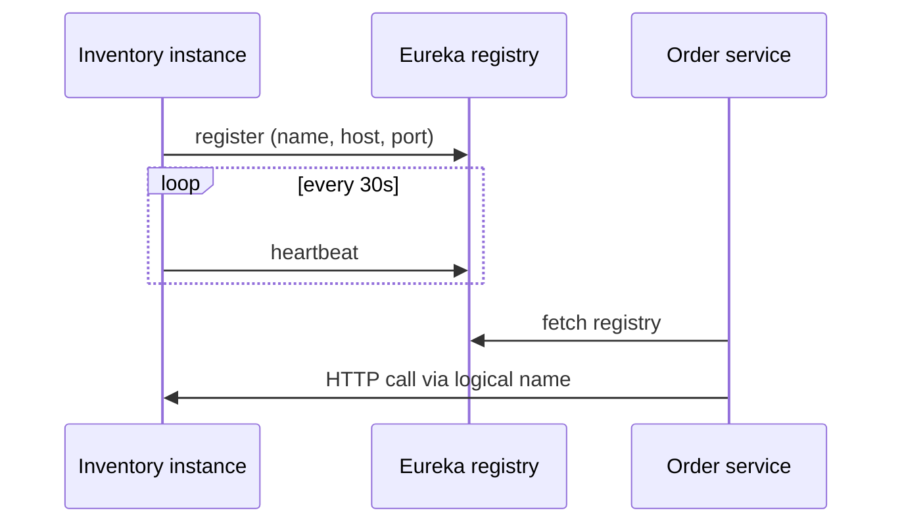

# How does service discovery work in Spring Cloud

---

## 🟢 Junior Level

### What is service discovery?

In a microservice system, instances start, stop, and move constantly (autoscaling, deployments, crashes). Hard-coding `http://10.0.3.17:8080` breaks immediately. **Service discovery** lets a service register itself under a *logical name* (`inventory-service`) and lets callers look up the current healthy instances by that name.

### Analogy

A phone book that updates itself: when a shop opens it adds its number; if it stops answering, its entry is removed. You look up "Pizza Place", not a phone number you memorized.

### Two halves

1. **Registration** — each instance tells the registry "I am `inventory-service` at host:port".
2. **Lookup** — a client asks the registry "give me instances of `inventory-service`".

### Minimal Eureka example

Registry server:

```java
@SpringBootApplication
@EnableEurekaServer
public class RegistryApplication {
    public static void main(String[] args) {
        SpringApplication.run(RegistryApplication.class, args);
    }
}
```

```yaml
server:
  port: 8761
eureka:
  client:
    register-with-eureka: false
    fetch-registry: false
```

Client (dependency `spring-cloud-starter-netflix-eureka-client`; registration happens automatically when the starter is on the classpath):

```yaml
spring:
  application:
    name: inventory-service
eureka:
  client:
    service-url:
      defaultZone: http://localhost:8761/eureka
```



---

## 🟡 Middle Level

### Options compared

| Option | Model | Notes |
| :--- | :--- | :--- |
| **Eureka** | AP system, client-side cache | Eventually consistent; tolerates network partitions with "self-preservation" |
| **Consul** | CP (Raft) + health checks, KV store | Agent per node; `spring-cloud-starter-consul-discovery` |
| **Kubernetes native** | DNS (`svc.namespace.svc.cluster.local`) + Endpoints | No library needed; `spring-cloud-kubernetes-discoveryclient` exposes `DiscoveryClient` |
| **Zookeeper** | CP | Rarely chosen now |

### The abstraction

`DiscoveryClient` is the API; you rarely use it directly:

```java
@RestController
public class InstancesController {

    private final DiscoveryClient discoveryClient;

    public InstancesController(DiscoveryClient discoveryClient) {
        this.discoveryClient = discoveryClient;
    }

    @GetMapping("/instances/{name}")
    public List<String> instances(@PathVariable String name) {
        return discoveryClient.getInstances(name).stream()
                .map(si -> si.getHost() + ":" + si.getPort())
                .toList();
    }
}
```

Normally you let [Spring Cloud LoadBalancer](03.%20Client-side%20vs%20server-side%20load%20balancing.md) consume it via `lb://inventory-service`.

### Consul registration with health check

```yaml
spring:
  cloud:
    consul:
      host: localhost
      port: 8500
      discovery:
        health-check-path: /actuator/health
        health-check-interval: 10s
        instance-id: ${spring.application.name}:${random.value}
```

### Kubernetes: do you need a registry?

Kubernetes already gives you discovery: a `Service` has a stable DNS name and `kube-proxy`/CNI load-balances across ready pods. Calling `http://inventory-service` just works. Use `spring-cloud-kubernetes-discoveryclient` only when you need client-side balancing per pod, cross-namespace listing, or metadata-driven routing. Remember it needs RBAC permissions to read Endpoints/EndpointSlices:

```yaml
apiVersion: rbac.authorization.k8s.io/v1
kind: Role
metadata: { name: discovery-reader }
rules:
  - apiGroups: [""]
    resources: ["services", "endpoints", "pods"]
    verbs: ["get", "list", "watch"]
```

### Common mistakes

- Default `instance-id` = `host:app:port`; on Docker/K8s with multiple containers this collides. Use random or pod name.
- Registering with `localhost` or wrong IP inside containers. Set `eureka.instance.prefer-ip-address=true` and verify `eureka.instance.ip-address`/hostname.
- Running a single Eureka server in production; use a peer-aware cluster.
- Treating Eureka as strongly consistent: you will call dead instances briefly, so pair it with retries and circuit breakers.

---

## 🔴 Senior Level

### Eureka internals and timing

Defaults produce slow convergence:

| Setting | Default | Effect |
| :--- | :--- | :--- |
| `eureka.instance.lease-renewal-interval-in-seconds` | 30 | heartbeat |
| `eureka.instance.lease-expiration-duration-in-seconds` | 90 | server evicts after missing heartbeats |
| `eureka.client.registry-fetch-interval-seconds` | 30 | client cache refresh |
| Server response cache (`response-cache-update-interval-ms`) | 30000 | read-only cache layer |
| LoadBalancer cache TTL | 35 s | another layer |

Worst-case, a killed instance can still be in some client's list for **several minutes** when these layers stack. Mitigations: lower intervals in non-huge fleets, **graceful deregistration** (`shutdown` hook calls `/eureka/apps/{app}/{id}` DELETE), and mandatory retries on connect failures.

**Self-preservation:** when the server sees fewer than 85% of expected heartbeats (renewal threshold), it stops evicting, assuming a network partition. That's correct for AP behavior but surprises people in small dev clusters ("why are dead instances still listed?"). Disable only in dev: `eureka.server.enable-self-preservation=false`.

### Zones and affinity

Eureka carries `zone` metadata; LoadBalancer's `zone-preference` hints prefer same-zone instances to cut cross-AZ latency and cost:

```yaml
spring:
  cloud:
    loadbalancer:
      zone: eu-west-1a
      configurations: zone-preference
```

### Health semantics

Eureka by default reports "UP" if the app is running, **not** deep health. Enable `eureka.client.healthcheck.enabled=true` to propagate Actuator health status; but be careful: a failing downstream dependency would mark *you* DOWN and remove you from the registry, amplifying an outage. Use readiness groups limited to local concerns (see [Health checks and graceful degradation](18.%20Health%20checks%20and%20graceful%20degradation.md)).

### Failure modes in production

- **Registry down:** clients keep their last cached list; new instances are invisible. Test this with chaos experiments.
- **Thundering herd on restart:** thousands of clients re-registering. Stagger startups, tune `initial-instance-info-replication-interval-seconds`.
- **Split-brain between peers:** replicas diverge; clients use `defaultZone` ordering and fail over.
- **DNS caching:** JVM `networkaddress.cache.ttl` can pin stale IPs for Kubernetes DNS; set to 30 s or lower.

### Diagnostics

```bash
curl -H "Accept: application/json" http://eureka:8761/eureka/apps/INVENTORY-SERVICE
curl localhost:8080/actuator/health/discoveryComposite
```

Compare what the registry thinks, what the client cache holds (`DiscoveryClient.getInstances`) and what actually responds. Mismatch location tells you which TTL layer is hiding the truth.

---

## 🎯 Interview Cheat Sheet

**30-second pitch:** Service discovery lets services register under a logical name and lets callers resolve healthy instances dynamically. In Spring Cloud it's the `DiscoveryClient` abstraction with Eureka, Consul, or Kubernetes backends, consumed by the LoadBalancer. On Kubernetes you often rely on native Services/DNS instead.

**Must-know bullets**
- Register + heartbeat + lookup; lease expiry evicts dead instances.
- Eureka = AP, eventually consistent; Consul = CP with active health checks.
- Multi-layer caches mean stale instances; always pair with retry/circuit breaker.
- Kubernetes Service DNS removes the need for a registry in many cases.
- Self-preservation protects from partitions, confuses small dev setups.

**Follow-up questions**
- Why is Eureka AP and what does that imply?
- How long until a crashed instance is removed?
- When would you use `spring-cloud-kubernetes-discoveryclient`?

**Red flags**
- Single-node Eureka in production.
- Wiring deep dependency health into registry health.
- Hard-coding host/port "because discovery is flaky".

**Related topics**
- [What does Spring Cloud provide](01.%20What%20does%20Spring%20Cloud%20provide.md)
- [Client-side vs server-side load balancing](03.%20Client-side%20vs%20server-side%20load%20balancing.md)
- [Health checks and graceful degradation](18.%20Health%20checks%20and%20graceful%20degradation.md)
- [Service mesh vs Spring Cloud](16.%20Service%20mesh%20vs%20Spring%20Cloud.md)
- Kubernetes: [Section 14](../14.%20Docker%20Kubernetes/00.%20Section%20Navigator.md)
