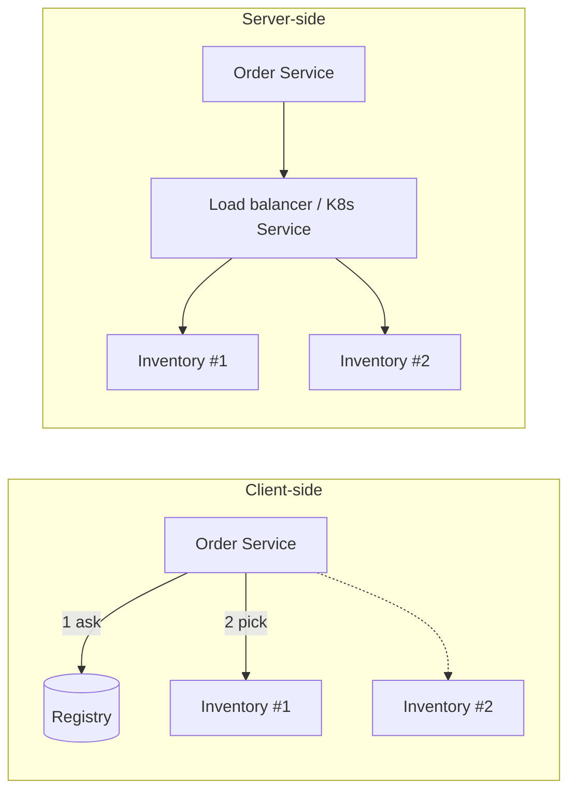

# Client-side vs server-side load balancing

---

## 🟢 Junior Level

### What is load balancing?

When several instances of a service run, something has to decide **which instance handles each request**. That decision is load balancing.

- **Server-side:** the client calls one address (a load balancer such as NGINX, AWS ALB, or a Kubernetes Service). The balancer picks the instance. The client knows nothing about instances.
- **Client-side:** the client itself holds the list of instances (from service discovery) and picks one before sending the request.

### Analogy

*Server-side*: a restaurant host at the door seats you at a free table. *Client-side*: you get a list of all free tables and walk to one yourself.

### Minimal example: Spring Cloud LoadBalancer

Dependency `spring-cloud-starter-loadbalancer` (included with Eureka client and OpenFeign starters):

```java
@Configuration
public class HttpConfig {

    @Bean
    @LoadBalanced
    RestClient.Builder loadBalancedRestClientBuilder() {
        return RestClient.builder();
    }

    @Bean
    RestClient inventoryClient(RestClient.Builder builder) {
        return builder.baseUrl("http://inventory-service").build();
    }
}
```

`inventory-service` is not a DNS name here; the `@LoadBalanced` interceptor resolves it to a real `host:port` per request, round-robin by default.



---

## 🟡 Middle Level

### Comparison

| Aspect | Client-side | Server-side |
| :--- | :--- | :--- |
| Extra network hop | No | Yes |
| Single point of failure | No central one | The balancer (mitigated by HA) |
| Language coupling | Library per language | None |
| Smart algorithms (zone, weight, hint) | Easy in code | Depends on product |
| Operational ownership | App teams | Platform team |
| Visibility | Needs metrics from every client | Central metrics |

### How Spring Cloud LoadBalancer works

Core types:

- `ServiceInstanceListSupplier` — supplies candidate instances (from `DiscoveryClient`, cached, health-filtered, zone-filtered).
- `ReactorServiceInstanceLoadBalancer` — selects one (`RoundRobinLoadBalancer` default, `RandomLoadBalancer`).
- `LoadBalancerClient` / `ReactiveLoadBalancer.Factory` — per-service child context.
- `@LoadBalancerClient(name=..., configuration=...)` customizes for one service.

Custom per-service configuration:

```java
public class RandomConfig {
    @Bean
    ReactorLoadBalancer<ServiceInstance> randomLoadBalancer(
            Environment env, LoadBalancerClientFactory factory) {
        String name = env.getProperty(LoadBalancerClientFactory.PROPERTY_NAME);
        return new RandomLoadBalancer(
                factory.getLazyProvider(name, ServiceInstanceListSupplier.class), name);
    }
}

@Configuration
@LoadBalancerClient(name = "inventory-service", configuration = RandomConfig.class)
class LbConfig {}
```

Note: do **not** annotate `RandomConfig` with `@Configuration` (or place it outside component scan), otherwise it applies to every client.

### Useful properties

```yaml
spring:
  cloud:
    loadbalancer:
      cache:
        ttl: 10s
      health-check:
        interval: 10s
      configurations: health-check   # filter instances by /actuator/health
      retry:
        enabled: true
```

### Common mistakes

- Using `@LoadBalanced` on a builder and then injecting an **already-built** plain `RestClient`; the interceptor is applied only when built from the annotated builder.
- Calling `lb://` URLs with a non-load-balanced client: `UnknownHostException`.
- Assuming retry is on: LoadBalancer retries only on connect-level issues and for idempotent methods by default (GET); be explicit.
- Combining a client-side LB with a Kubernetes `ClusterIP` Service: you balance twice and may pin to a single virtual IP (no gain).

### Kubernetes nuance: long-lived connections

`kube-proxy` balances **connections**, not requests. With HTTP/2 or gRPC a client keeps one connection and hammers one pod. Solutions: headless Service + client-side balancing, a service mesh (Envoy balances requests), or periodic connection recycling (`maxLifeTime` on the HTTP client pool).

---

## 🔴 Senior Level

### Algorithms and their failure behavior

| Algorithm | Strength | Weakness |
| :--- | :--- | :--- |
| Round robin | Simple, even for homogeneous work | Ignores slow nodes and request cost |
| Random | Stateless, no coordination | Variance at low volumes |
| Power of two choices (P2C) | Great tail latency with in-flight counts | Not built in; implement custom supplier |
| Least connections | Adapts to slow instances | Needs per-client state |
| Zone-aware | Lower latency and cross-AZ cost | Imbalance if zones are uneven |

Round-robin with many client instances has a hidden issue: each client keeps its own counter starting at a random position, so aggregate distribution is fine, but a slow instance still receives 1/N of traffic until health filtering or circuit breaking removes it. This is why **LB and circuit breaker per instance** matter: Resilience4j's breaker is per name; if you name it per service, one bad instance poisons the entire service's breaker. Consider per-instance naming only when cardinality is bounded.

### Custom supplier with in-flight tracking (sketch)

```java
public class LeastInFlightLoadBalancer implements ReactorServiceInstanceLoadBalancer {

    private final ObjectProvider<ServiceInstanceListSupplier> supplier;
    private final ConcurrentMap<String, LongAdder> inFlight = new ConcurrentHashMap<>();

    public LeastInFlightLoadBalancer(ObjectProvider<ServiceInstanceListSupplier> supplier) {
        this.supplier = supplier;
    }

    @Override
    public Mono<Response<ServiceInstance>> choose(Request request) {
        return supplier.getIfAvailable().get(request).next().map(list -> {
            if (list.isEmpty()) return new EmptyResponse();
            ServiceInstance best = list.stream()
                .min(Comparator.comparingLong(si ->
                    inFlight.computeIfAbsent(si.getInstanceId(), k -> new LongAdder()).sum()))
                .get();
            return new DefaultResponse(best);
        });
    }
}
```

To decrement correctly you also need a `LoadBalancerLifecycle` hook (`onComplete`) — otherwise counts leak.

### Caching and staleness

Instance list cache (Caffeine) default TTL 35 s. Combined with registry propagation delay, a deploy can send traffic to terminated pods for a minute. Strategies: preStop sleep (5-10 s) on pods, graceful shutdown (`server.shutdown=graceful`), and retry on a different instance (`spring.cloud.loadbalancer.retry`, `retry-on-all-operations` only for idempotent calls).

### Observability

Spring Cloud LoadBalancer emits Micrometer metrics (`loadbalancer.requests.active`, `loadbalancer.requests.success`, `loadbalancer.requests.failed`) per service instance when Micrometer is on classpath. Dashboard the *spread* (stddev of requests per instance) to catch imbalance, and alert on `failed` ratios per instance.

### Decision guidance

Choose **server-side** (K8s Service/ingress/mesh) when polyglot or platform-driven; choose **client-side** when you need application-aware routing (hints, canary by header, zone) and are mostly Java. In mesh-heavy environments disable client-side balancing (`spring.cloud.loadbalancer.enabled=false` or call the Service DNS directly) to avoid double hop-logic.

---

## 🎯 Interview Cheat Sheet

**30-second pitch:** In server-side balancing a dedicated component picks the instance; in client-side balancing the caller fetches instance lists from discovery and picks itself. Spring Cloud LoadBalancer replaced Ribbon, supplies round-robin and random strategies, caches instance lists, and integrates with `RestClient`, `WebClient`, and Feign.

**Must-know bullets**
- `@LoadBalanced` + logical host name (`http://service-name`).
- Round-robin default; zone preference and health-check suppliers available.
- Cache TTL causes stale instances; use retries and graceful shutdown.
- kube-proxy balances connections, not requests; HTTP/2 needs care.
- Do not double-balance with a mesh.

**Follow-up questions**
- What replaced Ribbon and what changed?
- How do you route to the same zone?
- Why does gRPC on Kubernetes need special load-balancing handling?

**Red flags**
- Believing a `ClusterIP` Service is round-robin per request.
- Global `@Configuration` leaking per-client LB settings.
- Ignoring that one bad instance still gets traffic.

**Related topics**
- [How does service discovery work in Spring Cloud](02.%20How%20does%20service%20discovery%20work%20in%20Spring%20Cloud.md)
- [What is Spring Cloud Gateway](04.%20What%20is%20Spring%20Cloud%20Gateway.md)
- [Service mesh vs Spring Cloud](16.%20Service%20mesh%20vs%20Spring%20Cloud.md)
- [Circuit breaker pattern with Resilience4j](07.%20Circuit%20breaker%20pattern%20with%20Resilience4j.md)
- Kubernetes: [Section 14](../14.%20Docker%20Kubernetes/00.%20Section%20Navigator.md)
