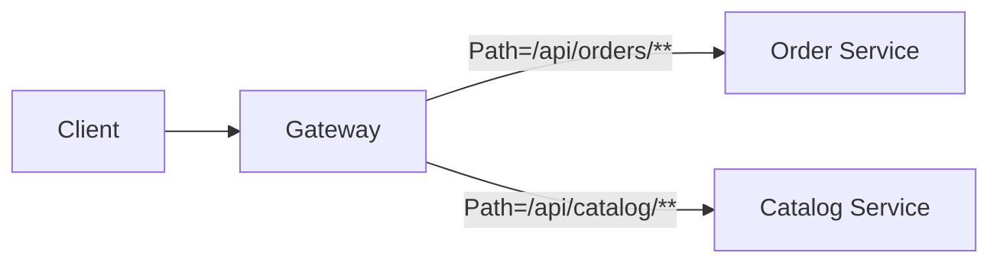

# What is Spring Cloud Gateway

---

## 🟢 Junior Level

### Definition

**Spring Cloud Gateway** is the API gateway of the Spring ecosystem. It is a single entry point in front of your microservices that receives every external request and **routes** it to the right backend, optionally modifying it on the way (adding headers, rewriting paths, authenticating, rate limiting).

### Analogy

The reception desk of a large office building: visitors don't wander the floors; reception checks who you are, then directs you to the right department.

### Three core concepts

| Concept | Meaning |
| :--- | :--- |
| **Route** | An id + destination URI + predicates + filters |
| **Predicate** | A condition to match the request (path, method, header, host, time) |
| **Filter** | Logic that modifies the request or response (pre/post) |

### Minimal example (Java DSL)

Dependency: `spring-cloud-starter-gateway` (reactive, Netty-based).

```java
@Configuration
public class GatewayRoutes {

    @Bean
    RouteLocator routes(RouteLocatorBuilder builder) {
        return builder.routes()
            .route("orders", r -> r.path("/api/orders/**")
                .filters(f -> f.stripPrefix(1).addRequestHeader("X-Source", "gateway"))
                .uri("lb://order-service"))
            .route("catalog", r -> r.path("/api/catalog/**")
                .and().method(HttpMethod.GET)
                .filters(f -> f.stripPrefix(1))
                .uri("http://catalog:8080"))
            .build();
    }
}
```

The same route in YAML (property prefix `spring.cloud.gateway.routes` in 2023/2024 trains; in 2025.0 it became `spring.cloud.gateway.server.webflux.routes`):

```yaml
spring:
  cloud:
    gateway:
      routes:
        - id: orders
          uri: lb://order-service
          predicates:
            - Path=/api/orders/**
          filters:
            - StripPrefix=1
```



---

## 🟡 Middle Level

### Request lifecycle

1. `DispatcherHandler` → `RoutePredicateHandlerMapping` evaluates routes in order and picks the first match.
2. `FilteringWebHandler` builds a chain: global filters + route filters sorted by `Ordered`.
3. "pre" logic runs, then `NettyRoutingFilter` sends the request to the target, then "post" logic runs.

### Built-in predicates and filters

| Predicates | Filters |
| :--- | :--- |
| `Path`, `Method`, `Host`, `Header`, `Query`, `Cookie` | `StripPrefix`, `RewritePath`, `AddRequestHeader` |
| `After`/`Before`/`Between` | `CircuitBreaker`, `Retry`, `RequestRateLimiter` |
| `Weight` (canary/A-B), `RemoteAddr`, `XForwarded` | `TokenRelay`, `DedupeResponseHeader`, `SetStatus` |

Retry plus circuit breaker with fallback at the edge:

```yaml
filters:
  - name: CircuitBreaker
    args:
      name: ordersCb
      fallbackUri: forward:/fallback/orders
  - name: Retry
    args:
      retries: 2
      methods: GET
      statuses: BAD_GATEWAY, SERVICE_UNAVAILABLE
      backoff:
        firstBackoff: 50ms
        maxBackoff: 500ms
        factor: 2
```

### Custom global filter

```java
@Component
public class CorrelationIdFilter implements GlobalFilter, Ordered {

    private static final String HEADER = "X-Correlation-Id";

    @Override
    public Mono<Void> filter(ServerWebExchange exchange, GatewayFilterChain chain) {
        String id = exchange.getRequest().getHeaders().getFirst(HEADER);
        if (id == null) id = UUID.randomUUID().toString();
        ServerHttpRequest mutated = exchange.getRequest().mutate()
                .header(HEADER, id).build();
        exchange.getResponse().getHeaders().set(HEADER, id);
        return chain.filter(exchange.mutate().request(mutated).build());
    }

    @Override
    public int getOrder() { return Ordered.HIGHEST_PRECEDENCE; }
}
```

### Rate limiting

`RequestRateLimiter` uses Redis (token bucket) and a `KeyResolver`:

```java
@Bean
KeyResolver userKeyResolver() {
    return exchange -> Mono.justOrEmpty(
        exchange.getRequest().getHeaders().getFirst("X-User-Id")).defaultIfEmpty("anonymous");
}
```

### Common mistakes

- **Blocking in a filter** (JDBC, `RestTemplate`): Netty event loop threads stall, throughput collapses.
- Putting business logic in the gateway. It should do cross-cutting edge concerns only.
- Forgetting that `Path=/api/**` matching order matters; first match wins.
- Exposing `/actuator/gateway/*` without security.
- Applying `Retry` to POST without idempotency.

### Gateway vs alternatives

Spring Cloud Gateway vs NGINX/Envoy/Kong: Gateway wins when you want Java-based custom filters and Spring Security integration; dedicated proxies win on raw throughput and ecosystem. Spring Cloud Gateway also has a **Server MVC** variant (servlet stack, supports virtual threads) for teams not on WebFlux.

---

## 🔴 Senior Level

### Threading model and performance

Gateway runs on Reactor Netty: a small fixed number of event-loop threads (default = CPU cores) multiplex thousands of connections. Rules:

- Never block. Detect with BlockHound in tests.
- Large bodies: avoid caching request bodies (`ModifyRequestBody` or reading the body in a predicate buffers it fully in memory).
- Connection pool: tune `spring.cloud.gateway.httpclient.pool.max-connections`, `max-idle-time`, `max-life-time`; stale pooled connections to a restarted backend yield sporadic `Connection reset` / `PrematureCloseException` — set `max-idle-time` below the backend/LB idle timeout.

```yaml
spring:
  cloud:
    gateway:
      httpclient:
        connect-timeout: 1000
        response-timeout: 5s
        pool:
          type: elastic
          max-idle-time: 20s
          max-life-time: 5m
```

Per-route override: `metadata: { response-timeout: 2000, connect-timeout: 500 }`.

### Security at the edge

Typical pattern: Gateway is an OAuth2 client/resource server; validates JWT, then forwards using `TokenRelay` or exchanges for an internal token. Strip inbound `X-User-*` headers from untrusted clients to prevent identity spoofing, and always re-add trusted ones post-authentication (`RemoveRequestHeader`).

### Dynamic routes at scale

Routes can come from `DiscoveryClient` (`spring.cloud.gateway.discovery.locator.enabled`), from a `RouteDefinitionRepository` (database/Redis), or via `/actuator/gateway/routes` POST plus refresh. Discovery locator auto-exposes **every** service — usually unwanted in production.

### Failure modes

| Symptom | Cause |
| :--- | :--- |
| 504 under load, low CPU | Backend slow + no timeouts; connection pool exhausted (pending acquire queue) |
| Memory growth | Body buffering, `Retry` with large bodies, direct-buffer leaks |
| Intermittent 502 after deploys | Pooled connection to dead pod; use retry on `BAD_GATEWAY` for GET and lower idle time |
| Latency tail | Event loop blocked by custom filter |

### Diagnostics

```bash
curl localhost:8080/actuator/gateway/routes
curl localhost:8080/actuator/metrics/spring.cloud.gateway.requests
curl localhost:8080/actuator/metrics/reactor.netty.connection.provider.active.connections
```

Enable `reactor.netty.http.client` wiretap logging temporarily (`logging.level.reactor.netty.http.client=DEBUG`, `spring.cloud.gateway.httpclient.wiretap=true`) to see raw bytes — never leave it on in production.

### Capacity thinking

A well-tuned gateway instance handles on the order of tens of thousands of simple proxied requests per second per node; the real limit is usually filters (JWT validation, Redis call for rate limiting) and downstream pools. Scale horizontally; it is stateless apart from rate-limit counters in Redis.

---

## 🎯 Interview Cheat Sheet

**30-second pitch:** Spring Cloud Gateway is a non-blocking, Netty-based API gateway built on Spring WebFlux. Routes combine predicates (match) and filters (transform) to forward traffic to services via URIs or `lb://` names, giving a single place for auth, rate limiting, retries, and circuit breaking.

**Must-know bullets**
- Route = id + uri + predicates + filters; first match wins.
- Global vs route filters, ordered chain, pre/post phases.
- Reactive: never block in filters.
- `lb://` integrates with discovery and LoadBalancer.
- Server MVC variant exists for servlet/virtual threads.

**Follow-up questions**
- How does Gateway differ from Zuul 1?
- How do you implement canary routing? (`Weight` predicate)
- How do you protect the actuator gateway endpoint?

**Red flags**
- Blocking calls in filters.
- Business logic/aggregation baked into the gateway (use BFF/composition).
- Enabling discovery locator in production by default.

**Related topics**
- [Client-side vs server-side load balancing](03.%20Client-side%20vs%20server-side%20load%20balancing.md)
- [Rate limiter](11.%20Rate%20limiter.md)
- [API composition and BFF](17.%20API%20composition%20and%20BFF.md)
- [Service mesh vs Spring Cloud](16.%20Service%20mesh%20vs%20Spring%20Cloud.md)
- Microservices: [Section 17](../17.%20Microservices/00.%20Section%20Navigator.md)
