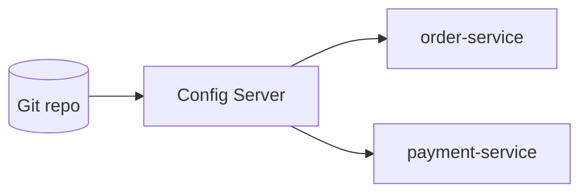

# Centralized configuration with Spring Cloud Config

---

## 🟢 Junior Level

### The problem

With 40 microservices, each with its own `application.yml`, changing a database URL or a feature flag means editing and redeploying many repositories. **Centralized configuration** keeps configuration outside the application artifact in one managed place, so the same build runs in dev, test, and prod with different settings.

### Analogy

A company handbook stored in one shared drive. Employees read the current version instead of keeping personal photocopies that go out of date.

### Spring Cloud Config in two pieces

1. **Config Server** — a Spring Boot app that serves properties from a Git repository (or Vault, JDBC, filesystem).
2. **Config Client** — your services, which fetch properties at startup.

### Minimal example

Server (`spring-cloud-config-server`):

```java
@SpringBootApplication
@EnableConfigServer
public class ConfigServerApplication {
    public static void main(String[] args) {
        SpringApplication.run(ConfigServerApplication.class, args);
    }
}
```

```yaml
server:
  port: 8888
spring:
  cloud:
    config:
      server:
        git:
          uri: https://github.com/acme/config-repo
          default-label: main
          search-paths: '{application}'
```

Client (`spring-cloud-starter-config`):

```yaml
spring:
  application:
    name: order-service
  profiles:
    active: prod
  config:
    import: "configserver:http://config-server:8888"
```

Git repo files `order-service.yml`, `order-service-prod.yml`, `application.yml` are merged by precedence. Test it: `GET http://localhost:8888/order-service/prod`.



---

## 🟡 Middle Level

### Resolution order

The server answers `/{application}/{profile}/{label}`. Property sources, highest precedence first: `{app}-{profile}.yml`, `{app}.yml`, `application-{profile}.yml`, `application.yml`. Client-local sources (environment variables, command line) can override depending on `spring.cloud.config.allow-override` / `override-none` settings.

### Refreshing configuration at runtime

`@RefreshScope` beans are destroyed and lazily re-created when `/actuator/refresh` is POSTed:

```java
@RefreshScope
@RestController
public class FeatureController {

    @Value("${feature.new-checkout:false}")
    private boolean newCheckout;

    @GetMapping("/feature")
    public boolean enabled() { return newCheckout; }
}
```

```yaml
management:
  endpoints:
    web:
      exposure:
        include: health,refresh,busrefresh
```

Calling refresh on each instance is impractical; **Spring Cloud Bus** (RabbitMQ/Kafka) broadcasts `POST /actuator/busrefresh` to all instances, and the Config Server's `/monitor` endpoint accepts Git webhooks. Alternative: Kubernetes rollout restart on ConfigMap change.

Properties bound with `@ConfigurationProperties` are rebound on refresh without `@RefreshScope` (they listen to `EnvironmentChangeEvent`). Connection pools, `DataSource`, thread pools do **not** magically rebuild.

### Encryption

```yaml
# server
encrypt:
  key: ${CONFIG_ENCRYPT_KEY}
```

Store `password: '{cipher}AQB...'` in Git; the server decrypts before serving (`/encrypt` and `/decrypt` endpoints exist; protect them). Production preference: HashiCorp Vault backend or Kubernetes Secrets, with asymmetric keys if you do use `{cipher}`.

### Kubernetes: ConfigMaps instead of Config Server

```yaml
apiVersion: v1
kind: ConfigMap
metadata:
  name: order-service
data:
  application.yaml: |
    feature:
      new-checkout: true
```

With `spring-cloud-starter-kubernetes-client-config` (or fabric8 variant), the app reads ConfigMaps/Secrets named after `spring.application.name` through the API server and can reload on change:

```yaml
spring:
  cloud:
    kubernetes:
      config:
        enabled: true
      reload:
        enabled: true
        mode: event   # or polling
        strategy: refresh
```

Simpler option: mount the ConfigMap as a file and use `spring.config.import=optional:file:/config/`. Mounted-volume updates reach the pod after kubelet sync delay (up to ~1 min).

### Config Server vs ConfigMaps

| | Config Server | K8s ConfigMap/Secret |
| :--- | :--- | :--- |
| History/audit | Git commits | Needs GitOps (Argo CD, Flux) |
| Extra component | Yes (HA needed) | No |
| Non-Kubernetes | Works anywhere | No |
| Environment promotion | Labels/branches | Overlays (Kustomize/Helm) |

### Common mistakes

- Secrets in plain text in Git.
- Config Server as a single instance with no fail-fast/retry strategy: every service fails to start if it is down.
- Using `@Value` in a non-refresh-scoped bean and expecting refresh.
- Exposing `/actuator/env` or `/encrypt` without authentication.

---

## 🔴 Senior Level

### Startup semantics and resilience

`spring.config.import=configserver:` is resolved in the `ConfigData` phase. Failure semantics:

- Without `optional:` → startup fails (good in prod, to avoid running with defaults silently).
- With `spring.cloud.config.fail-fast=true` + `spring-retry` on classpath, retries per `spring.cloud.config.retry.max-attempts` (default 6) with exponential backoff.

```yaml
spring:
  cloud:
    config:
      fail-fast: true
      retry:
        initial-interval: 1000
        multiplier: 1.5
        max-attempts: 10
        max-interval: 10000
```

Mitigation for Config Server outages: run ≥2 replicas, and have the server cache its Git clone (`spring.cloud.config.server.git.clone-on-start=true`, `force-pull`, `refresh-rate`). The server keeps serving from its local clone even if GitHub is down. Clients cannot cache locally by default, so a restart during an outage needs an image-baked fallback or an `optional:` import with sane defaults — a deliberate trade-off.

### Performance

Git backend: each request may touch the filesystem; a monorepo of configs with thousands of files and `search-paths` wildcards slows resolution. Use `spring.cloud.config.server.git.refresh-rate=30` instead of pulling on every request, and consider `composite` or JDBC/Redis backends for large fleets. During a mass restart (hundreds of pods) the server becomes a thundering-herd target; stagger rollouts (`maxSurge/maxUnavailable`) and give the server a horizontal autoscaler.

### Refresh pitfalls under load

- `@RefreshScope` creates a proxy; a refresh destroys the target bean under a write lock. Calls in flight block briefly, and `@PreDestroy` of the old bean runs while old references may still be used.
- Refresh is not atomic across a cluster: for some seconds instances hold different config. Design flags so mixed versions are safe (backward compatible), as in deploys.
- Beans with expensive state (`HikariDataSource`) should not be refresh scoped; instead restart pods for those changes.

### Security architecture

- Authenticate clients (`spring.cloud.config.username/password`, or OAuth2 with Spring Security).
- Restrict which repo paths a client sees; the server shows everything for `{app}` that matches. A leaked service name can pull another service's config unless you use per-app credentials/proxy policy.
- Prefer Vault with dynamic secrets (rotating DB credentials) over static secrets in Git.

### Diagnostics

```bash
curl -u user:pass http://config-server:8888/order-service/prod | jq '.propertySources[].name'
curl localhost:8080/actuator/env/feature.new-checkout
curl localhost:8080/actuator/configprops | jq '.contexts[].beans | keys'
```

Look at the `version` field (Git commit id) in the server response and log it at client startup so incident reviews know which config was active.

---

## 🎯 Interview Cheat Sheet

**30-second pitch:** Spring Cloud Config provides a server that serves externalized properties from Git/Vault to clients by application, profile, and label, with runtime refresh via `@RefreshScope` and Bus. On Kubernetes, ConfigMaps/Secrets with `spring-cloud-kubernetes-config` or mounted files often replace it.

**Must-know bullets**
- `spring.config.import=configserver:` (bootstrap is legacy).
- Precedence: app-profile > app > application-profile > application.
- `@RefreshScope`, `/actuator/refresh`, Spring Cloud Bus for fan-out.
- Secrets: Vault/K8s Secrets, `{cipher}` only with care.
- Fail-fast + retry; replicas for HA.

**Follow-up questions**
- How do you change a flag in 200 instances without restart?
- What happens when the Config Server is down at startup?
- Why shouldn't a `DataSource` be `@RefreshScope`?

**Red flags**
- Plaintext secrets in config Git.
- Thinking refresh is atomic across the cluster.
- Single un-replicated config server in the critical startup path.

**Related topics**
- [What does Spring Cloud provide](01.%20What%20does%20Spring%20Cloud%20provide.md)
- [Health checks and graceful degradation](18.%20Health%20checks%20and%20graceful%20degradation.md)
- [Tuning resilience in production](21.%20Tuning%20resilience%20in%20production.md)
- Kubernetes ConfigMaps: [Section 14](../14.%20Docker%20Kubernetes/00.%20Section%20Navigator.md)
