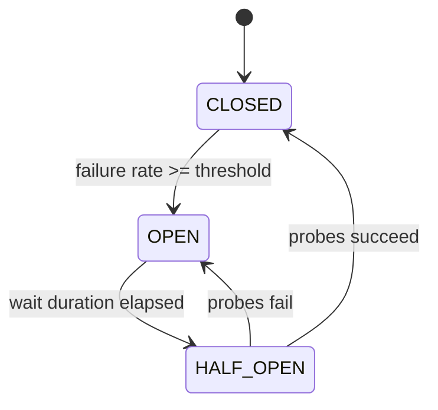

# Circuit breaker pattern with Resilience4j

---

## 🟢 Junior Level

### Definition

A **circuit breaker** wraps a remote call and watches its failures. When failures cross a threshold it **opens** and immediately rejects further calls for a while ("fail fast") instead of waiting on a broken dependency. After a cool-down, it lets a few trial calls through to see whether the dependency has recovered.

### Analogy

The electrical breaker in your home: when a surge happens it trips to protect the wiring. You reset it after the problem is fixed instead of letting the house burn.

### Three states

| State | Behavior |
| :--- | :--- |
| **CLOSED** | Calls pass; failures are counted |
| **OPEN** | Calls are rejected immediately with `CallNotPermittedException` |
| **HALF_OPEN** | A limited number of probe calls are allowed; success → CLOSED, failure → OPEN |



### Minimal example

Dependencies: `io.github.resilience4j:resilience4j-spring-boot3`, `spring-boot-starter-aop`, `spring-boot-starter-actuator`.

```java
@Service
public class PaymentClient {

    private final RestClient restClient;

    public PaymentClient(RestClient.Builder builder) {
        this.restClient = builder.baseUrl("http://payment-service").build();
    }

    @CircuitBreaker(name = "payment", fallbackMethod = "paymentFallback")
    public PaymentResult charge(String orderId) {
        return restClient.post().uri("/charge/{id}", orderId)
                .retrieve().body(PaymentResult.class);
    }

    PaymentResult paymentFallback(String orderId, Throwable t) {
        return new PaymentResult(orderId, "PENDING");
    }

    public record PaymentResult(String orderId, String status) {}
}
```

```yaml
resilience4j:
  circuitbreaker:
    instances:
      payment:
        slidingWindowSize: 20
        failureRateThreshold: 50
        waitDurationInOpenState: 10s
        permittedNumberOfCallsInHalfOpenState: 3
```

---

## 🟡 Middle Level

### Key configuration

| Property | Meaning | Default |
| :--- | :--- | :--- |
| `slidingWindowType` | `COUNT_BASED` or `TIME_BASED` | COUNT_BASED |
| `slidingWindowSize` | Calls (or seconds) in window | 100 |
| `minimumNumberOfCalls` | Calls needed before evaluating | 100 |
| `failureRateThreshold` | % failures to open | 50 |
| `slowCallDurationThreshold` | Call counted "slow" above this | 60 s |
| `slowCallRateThreshold` | % slow calls to open | 100 |
| `waitDurationInOpenState` | Time OPEN before HALF_OPEN | 60 s |
| `permittedNumberOfCallsInHalfOpenState` | Probes | 10 |
| `automaticTransitionFromOpenToHalfOpenEnabled` | Transition on timer, not on next call | false |
| `recordExceptions` / `ignoreExceptions` | Which exceptions count | all exceptions |

Note: `minimumNumberOfCalls` default (100) is larger than many tuned `slidingWindowSize` values; set it ≤ window size, otherwise the breaker can never open.

### Business exceptions must not trip the breaker

```yaml
resilience4j:
  circuitbreaker:
    instances:
      payment:
        recordExceptions:
          - java.io.IOException
          - java.util.concurrent.TimeoutException
          - org.springframework.web.client.HttpServerErrorException
        ignoreExceptions:
          - com.acme.payment.InsufficientFundsException
          - org.springframework.web.client.HttpClientErrorException
```

A 404 or 400 means the downstream is healthy; counting it as failure opens breakers because of user errors.

### Programmatic API

```java
CircuitBreakerConfig config = CircuitBreakerConfig.custom()
        .slidingWindowType(CircuitBreakerConfig.SlidingWindowType.TIME_BASED)
        .slidingWindowSize(30)
        .minimumNumberOfCalls(10)
        .failureRateThreshold(40f)
        .slowCallDurationThreshold(Duration.ofSeconds(2))
        .slowCallRateThreshold(60f)
        .waitDurationInOpenState(Duration.ofSeconds(15))
        .build();

CircuitBreakerRegistry registry = CircuitBreakerRegistry.of(config);
CircuitBreaker cb = registry.circuitBreaker("payment");

Supplier<String> decorated = CircuitBreaker.decorateSupplier(cb, () -> remote.call());
String result = Try.ofSupplier(decorated).recover(t -> "fallback").get();
```

### Spring Cloud CircuitBreaker abstraction

`CircuitBreakerFactory` (`spring-cloud-starter-circuitbreaker-resilience4j`) offers a vendor-neutral API (used by Gateway and Feign), while the annotation/`resilience4j-spring-boot3` route exposes all Resilience4j modules. Use one approach per client to avoid two breakers wrapping the same call.

### Events and metrics

```java
cb.getEventPublisher()
  .onStateTransition(e -> log.warn("CB {} {}", e.getCircuitBreakerName(), e.getStateTransition()))
  .onCallNotPermitted(e -> log.debug("rejected"));
```

Actuator: `/actuator/circuitbreakers`, `/actuator/circuitbreakerevents`, Micrometer `resilience4j.circuitbreaker.state`, `.calls`, `.failure.rate`.

### Common mistakes

- Annotation on a method invoked via `this.` (self-invocation bypasses the proxy).
- Missing `spring-boot-starter-aop` → annotations silently ignored.
- Fallback signature mismatch (must have same params + optional exception param, same return type).
- Breaker without a timeout: slow calls hold threads for 60 s before they ever count as failures (see [Timeouts](09.%20Timeouts%20in%20distributed%20calls.md)).

---

## 🔴 Senior Level

### Internals

Resilience4j is functional, dependency-light, and stores outcomes in a lock-free ring buffer. `COUNT_BASED` windows use a circular array of `size` slots with a `TotalAggregation`; `TIME_BASED` windows use one bucket per second (partial aggregations), so memory is O(window seconds) and recording is O(1). State changes use an atomic `AtomicReference<CircuitBreakerState>`; transitions are CAS-based, so under concurrency a few extra calls can pass during the closed→open flip — it's a heuristic, not a hard gate.

In HALF_OPEN, `permittedNumberOfCallsInHalfOpenState` calls are admitted; the rest are rejected with `CallNotPermittedException`. If `maxWaitDurationInHalfOpenState` is 0 (default), a half-open breaker can stay half-open indefinitely if probes never complete; set it for safety.

### Granularity decisions

| Granularity | Pro | Con |
| :--- | :--- | :--- |
| One breaker per downstream service | Simple | One bad endpoint trips all |
| Per endpoint/operation | Isolates slow reports from fast lookups | More config and metrics |
| Per tenant/instance | Precise | High cardinality, cold-start per breaker (min calls) |

Rule of thumb: group by *failure domain and SLA*, not by URL.

### Tuning with traffic reality

`minimumNumberOfCalls` interacts with RPS. At 2 RPS, a 100-call window means 50 s of data; a time-based 10 s window with `minimumNumberOfCalls=5` reacts faster. For high RPS (1000/s) a 100-call count window flaps on noise; use TIME_BASED with 10-30 s window or a larger count window. The breaker per application instance means each pod learns independently; for 50 pods a dependency failure opens breakers at slightly different times, producing a probe wave of 50×permitted calls in HALF_OPEN. Add jitter to `waitDurationInOpenState` via `IntervalFunction`-style custom logic or staggered wait using `waitIntervalFunctionInOpenState` (e.g., `IntervalFunction.ofExponentialRandomBackoff(...)`).

### Failure scenarios

- **Flapping:** window too small, wait too short. Observe `state` metric oscillating; raise min calls and wait duration.
- **Never opens:** slow calls not recorded because `slowCallRateThreshold=100` default and slow threshold 60 s; set realistic values.
- **Opens due to downstream cold start:** fallback should be cheap and cached.
- **Fallback also remote:** a fallback calling another failing service creates a chain; fallbacks must be local/degraded.
- **Reactive code:** use `CircuitBreakerOperator` (`resilience4j-reactor`), not the annotation on methods returning `Mono` with blocking proxy semantic confusion (the annotation supports Reactor types with aspect-level handling, but timeouts need `TimeLimiter`).

### Verification test

```java
@Test
void opensAfterFailures() {
    CircuitBreaker cb = CircuitBreaker.of("t", CircuitBreakerConfig.custom()
        .slidingWindowSize(4).minimumNumberOfCalls(4).failureRateThreshold(50f)
        .waitDurationInOpenState(Duration.ofSeconds(1)).build());
    for (int i = 0; i < 4; i++) {
        try { cb.executeRunnable(() -> { throw new IllegalStateException(); }); }
        catch (IllegalStateException ignored) {}
    }
    assertEquals(CircuitBreaker.State.OPEN, cb.getState());
    assertThrows(CallNotPermittedException.class, () -> cb.executeRunnable(() -> {}));
}
```

---

## 🎯 Interview Cheat Sheet

**30-second pitch:** A circuit breaker measures failure and slow-call rates over a sliding window and flips CLOSED → OPEN to fail fast, then HALF_OPEN to probe recovery. Resilience4j implements it functionally with count/time windows, configurable exceptions, and Micrometer metrics, and integrates with Spring Boot 3 and Spring Cloud CircuitBreaker.

**Must-know bullets**
- States, thresholds, min calls, wait duration, half-open probes.
- Count slow calls, not only errors; pair with timeouts.
- Ignore business/4xx exceptions.
- Fallbacks must be local and cheap.
- Per-pod state, not global.

**Follow-up questions**
- Why is my breaker never opening?
- Count-based vs time-based window?
- How do circuit breaker and retry order interact? (Retry wraps CircuitBreaker by default.)

**Red flags**
- No timeout beneath the breaker.
- One global breaker for all downstreams.
- Treating the breaker as a substitute for capacity planning.

**Related topics**
- [Retry with exponential backoff and jitter](08.%20Retry%20with%20exponential%20backoff%20and%20jitter.md)
- [Timeouts in distributed calls](09.%20Timeouts%20in%20distributed%20calls.md)
- [Fallback strategies](12.%20Fallback%20strategies.md)
- [Cascading failures and retry storms](13.%20Cascading%20failures%20and%20retry%20storms.md)
- [Common resilience misconfigurations](22.%20Common%20resilience%20misconfigurations.md)
