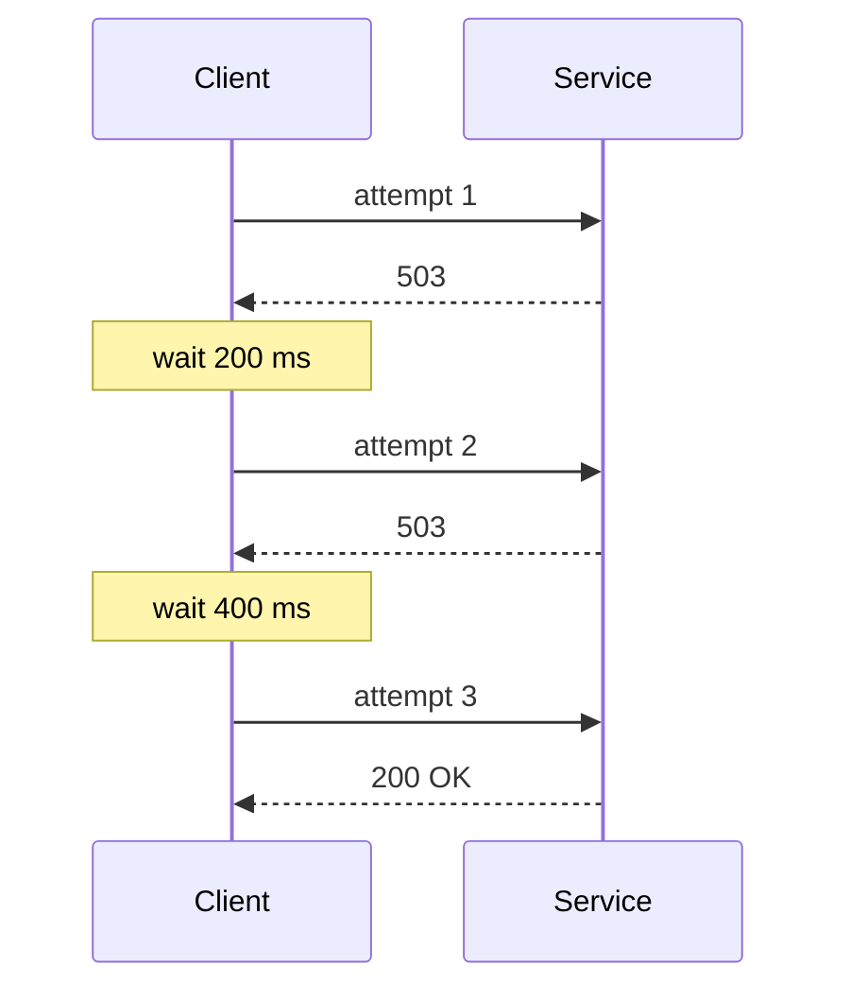

# Retry with exponential backoff and jitter

---

## 🟢 Junior Level

### Definition

A **retry** repeats an operation that failed, on the assumption that the failure was **transient** (a network blip, a brief overload, a deploy in progress). **Backoff** means waiting between attempts, and **jitter** adds randomness to that wait.

### Analogy

Calling a busy phone line. You don't redial 100 times per second; you wait a bit, then a bit longer, and you don't call at the exact same second as everyone else who got the busy tone.

### When to retry (and when not)

| Retry | Do not retry |
| :--- | :--- |
| Connection refused/reset, timeouts | 400 Bad Request, 401/403, 404, 422 |
| 502, 503, 504, 429 (honor `Retry-After`) | Business rule failures |
| Idempotent operations (GET, PUT, DELETE) | Non-idempotent POST without an idempotency key |

### Minimal example with Resilience4j

```java
@Service
public class CatalogClient {

    private final RestClient client;

    public CatalogClient(RestClient.Builder builder) {
        this.client = builder.baseUrl("http://catalog-service").build();
    }

    @Retry(name = "catalog", fallbackMethod = "fallback")
    public String product(String id) {
        return client.get().uri("/products/{id}", id).retrieve().body(String.class);
    }

    private String fallback(String id, Exception e) {
        return "{\"id\":\"" + id + "\",\"name\":\"unavailable\"}";
    }
}
```

```yaml
resilience4j:
  retry:
    instances:
      catalog:
        maxAttempts: 3
        waitDuration: 200ms
        enableExponentialBackoff: true
        exponentialBackoffMultiplier: 2
```

Attempts wait roughly 200 ms, then 400 ms. `maxAttempts` includes the first call.



---

## 🟡 Middle Level

### Why jitter?

If 1,000 clients fail at the same moment and all retry after exactly 200 ms, then 400 ms, they hit the recovering server in **synchronized waves**. Jitter spreads the retries randomly:

| Strategy | Wait for attempt n |
| :--- | :--- |
| Fixed | `base` |
| Exponential | `base * 2^(n-1)` |
| Exponential + full jitter | `random(0, min(cap, base * 2^(n-1)))` |
| Equal jitter | `half + random(0, half)` |
| Decorrelated jitter | `min(cap, random(base, prev * 3))` |

The AWS Architecture Blog analysis shows full or decorrelated jitter minimize total server work and completion time compared with plain exponential backoff.

### Resilience4j configuration

```yaml
resilience4j:
  retry:
    configs:
      default:
        maxAttempts: 3
        waitDuration: 100ms
        enableExponentialBackoff: true
        exponentialBackoffMultiplier: 2
        exponentialMaxWaitDuration: 2s
        enableRandomizedWait: false
    instances:
      catalog:
        baseConfig: default
        enableExponentialBackoff: false
        enableRandomizedWait: true
        randomizedWaitFactor: 0.5
        retryExceptions:
          - java.io.IOException
          - java.util.concurrent.TimeoutException
          - org.springframework.web.client.HttpServerErrorException$ServiceUnavailable
        ignoreExceptions:
          - org.springframework.web.client.HttpClientErrorException
```

Caveat: in Resilience4j, enabling both exponential backoff **and** randomized wait at once is rejected (`IllegalStateException`) in older versions; use `IntervalFunction.ofExponentialRandomBackoff` programmatically to get both:

```java
RetryConfig config = RetryConfig.custom()
        .maxAttempts(4)
        .intervalFunction(IntervalFunction.ofExponentialRandomBackoff(
                Duration.ofMillis(100), 2.0, 0.5, Duration.ofSeconds(2)))
        .retryOnException(t -> t instanceof IOException || t instanceof TimeoutException)
        .build();
Retry retry = Retry.of("catalog", config);
String result = retry.executeSupplier(() -> remote.fetch());
```

### Retry on result

```java
RetryConfig byResult = RetryConfig.<ResponseEntity<String>>custom()
        .maxAttempts(3)
        .retryOnResult(r -> r.getStatusCode().value() == 503)
        .waitDuration(Duration.ofMillis(100))
        .build();
```

### Spring Retry vs Resilience4j

`spring-retry` (`@Retryable`) is older and simpler; Spring Framework 7 / Boot 4 brings core retry support (`@Retryable`, `RetryTemplate` in spring-core). Resilience4j integrates with metrics, other decorators, and reactive types. Pick one per call path.

### Common mistakes

- Retrying everything including 4xx.
- Unbounded or too many attempts (`maxAttempts=10`).
- Retrying non-idempotent POST (duplicate charges).
- `Thread.sleep` backoff blocks request threads; each retried request holds a thread and a connection for its entire total time.
- No overall deadline: 3 attempts × 5 s timeout + waits = 16 s for the user.

---

## 🔴 Senior Level

### Retry amplification math

If each layer in a chain retries `r` times, total load on the deepest service multiplies: with 3 layers each `maxAttempts=3` the bottom sees up to **27×** the traffic during an outage — precisely when it's weakest (see [Cascading failures and retry storms](13.%20Cascading%20failures%20and%20retry%20storms.md)). Principles:

1. Retry at **one** layer (usually closest to the user-facing edge or closest to the failing call, but not both).
2. Use a **retry budget**: allow retries up to ~10% of requests (Envoy/Finagle style) rather than a fixed count per call. Resilience4j has no built-in budget; implement via a token bucket or `RateLimiter` around retries.
3. Propagate a **deadline**: pass remaining time budget downstream (`grpc-timeout` style header) so inner layers don't retry past the caller's expiry.

### Decorator ordering

Resilience4j Spring aspect order (outermost first): `Retry → CircuitBreaker → RateLimiter → TimeLimiter → Bulkhead → function`. Retry is outside the breaker, so each attempt is recorded by the breaker, and an OPEN breaker throws `CallNotPermittedException`, which you should **not** retry:

```yaml
resilience4j:
  retry:
    instances:
      catalog:
        ignoreExceptions:
          - io.github.resilience4j.circuitbreaker.CallNotPermittedException
```

### Honoring server hints

`429`/`503` with `Retry-After` should override the computed delay. Custom `IntervalBiFunction<Object>` receives attempt and result/exception to derive the wait:

```java
IntervalBiFunction<Object> fn = (attempt, either) -> {
    if (either.isLeft() && either.getLeft() instanceof HttpServerErrorException ex) {
        String ra = ex.getResponseHeaders() == null ? null
                : ex.getResponseHeaders().getFirst("Retry-After");
        if (ra != null) return Duration.ofSeconds(Long.parseLong(ra)).toMillis();
    }
    return 200L * (1L << Math.min(attempt, 6));
};
RetryConfig cfg = RetryConfig.custom().maxAttempts(4).intervalBiFunction(fn).build();
```

### Async and threads

Retry waits in `@Retry` blocking mode sleep the caller. For high-concurrency services use async (`CompletableFuture` with `ScheduledExecutorService` via `Retry.decorateCompletionStage`) or Reactor (`Retry.backoff` in `reactor-core`) so waits don't consume threads. With virtual threads sleeping is cheap but still holds the connection/semaphore resources upstream.

### Observability

Metrics `resilience4j.retry.calls{kind=successful_without_retry|successful_with_retry|failed_with_retry|failed_without_retry}`. Dashboards: ratio of `successful_with_retry` — a rising value means the dependency is degrading before breakers trip; alert on retry ratio > 5-10%.

### Test

```java
@Test
void retriesTransientFailures() {
    AtomicInteger calls = new AtomicInteger();
    Retry retry = Retry.of("t", RetryConfig.custom()
            .maxAttempts(3).waitDuration(Duration.ofMillis(10)).build());
    String r = retry.executeSupplier(() -> {
        if (calls.incrementAndGet() < 3) throw new IllegalStateException("transient");
        return "ok";
    });
    assertEquals("ok", r);
    assertEquals(3, calls.get());
}
```

---

## 🎯 Interview Cheat Sheet

**30-second pitch:** Retry masks transient failures; exponential backoff spaces attempts so the failing service can recover; jitter desynchronizes clients to avoid retry waves. Retry only safe/idempotent operations on transient errors, cap attempts and total time, and retry at a single layer.

**Must-know bullets**
- Full/decorrelated jitter beats plain exponential backoff.
- Retry only transient errors; never blindly retry POSTs.
- Retries multiply across layers: 3×3×3 = 27.
- Retry wraps CircuitBreaker by default in Resilience4j.
- Overall deadline and retry budget.

**Follow-up questions**
- Why add jitter?
- Where in the call chain should retries live?
- How do you make POST retry-safe? ([Idempotency](14.%20Idempotency%20for%20safe%20retries.md))

**Red flags**
- Fixed interval retries from many clients.
- Retry without timeout.
- Retrying `CallNotPermittedException`.

**Related topics**
- [Circuit breaker pattern with Resilience4j](07.%20Circuit%20breaker%20pattern%20with%20Resilience4j.md)
- [Timeouts in distributed calls](09.%20Timeouts%20in%20distributed%20calls.md)
- [Cascading failures and retry storms](13.%20Cascading%20failures%20and%20retry%20storms.md)
- [Idempotency for safe retries](14.%20Idempotency%20for%20safe%20retries.md)
