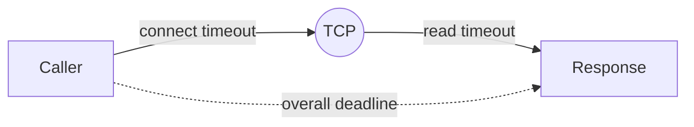

# Timeouts in distributed calls

---

## 🟢 Junior Level

### Definition

A **timeout** is the maximum time you are willing to wait for something. Without one, a caller waits as long as the remote side lets it — potentially forever. In a distributed system "slow" is worse than "down": a down service fails fast, a slow service silently holds your threads.

### Analogy

Waiting for a friend at a restaurant: you decide upfront "I'll wait 15 minutes, then I order without them". No limit means you starve.

### Types of timeouts

| Timeout | What it limits |
| :--- | :--- |
| **Connect** | Establishing the TCP (and TLS) connection |
| **Read / socket / response** | Waiting for data after the request was sent |
| **Connection-pool lease** | Waiting for a free pooled connection |
| **Overall / deadline** | Whole operation including retries |

### Minimal example: RestClient with timeouts (Spring Boot 3.4+)

```java
@Configuration
public class HttpConfig {

    @Bean
    RestClient paymentClient(RestClient.Builder builder) {
        ClientHttpRequestFactory factory = ClientHttpRequestFactoryBuilder.detect()
                .build(ClientHttpRequestFactorySettings.defaults()
                        .withConnectTimeout(Duration.ofSeconds(1))
                        .withReadTimeout(Duration.ofSeconds(2)));
        return builder.baseUrl("http://payment-service").requestFactory(factory).build();
    }
}
```

Or purely via properties in Boot 3.4+:

```yaml
spring:
  http:
    client:
      connect-timeout: 1s
      read-timeout: 2s
```



---

## 🟡 Middle Level

### Defaults are dangerous

| Client | Default |
| :--- | :--- |
| `HttpURLConnection` (RestTemplate default, SimpleClientHttpRequestFactory) | infinite (no timeout) |
| JDK `HttpClient` | no request timeout unless set |
| Feign (plain) | connect 10 s / read 60 s |
| Apache HttpClient 5 | connect 3 min; response infinite in older setups |
| `WebClient` (Reactor Netty) | connect 30 s, no response timeout |
| JDBC | infinite unless `socketTimeout` / `queryTimeout` |

### Resilience4j TimeLimiter

`TimeLimiter` bounds a `CompletionStage`/`Future` (async); it cannot interrupt arbitrary blocking code unless the future is cancelled:

```java
@Service
public class ReportClient {

    @TimeLimiter(name = "report")
    @CircuitBreaker(name = "report", fallbackMethod = "fallback")
    public CompletableFuture<String> generate(String id) {
        return CompletableFuture.supplyAsync(() -> slowRemote(id));
    }

    CompletableFuture<String> fallback(String id, Throwable t) {
        return CompletableFuture.completedFuture("queued");
    }

    private String slowRemote(String id) { /* remote call */ return "done"; }
}
```

```yaml
resilience4j:
  timelimiter:
    instances:
      report:
        timeoutDuration: 3s
        cancelRunningFuture: true
```

Prefer client-level timeouts (they actually close the socket) and use `TimeLimiter` as an additional guard.

### Gateway and WebClient

```java
WebClient client = WebClient.builder()
    .clientConnector(new ReactorClientHttpConnector(
        HttpClient.create()
            .option(ChannelOption.CONNECT_TIMEOUT_MILLIS, 1000)
            .responseTimeout(Duration.ofSeconds(2))))
    .build();

Mono<String> m = client.get().uri("/x").retrieve().bodyToMono(String.class)
        .timeout(Duration.ofSeconds(3));
```

Spring Cloud Gateway: `spring.cloud.gateway.httpclient.response-timeout`, per route `metadata.response-timeout`.

### Server side

Tomcat `server.tomcat.connection-timeout`; Spring MVC async `spring.mvc.async.request-timeout`; database `spring.jpa.properties.jakarta.persistence.query.timeout`, `@Transactional(timeout = 5)`; Hikari `connectionTimeout` (default 30 s — usually too high).

### Timeout budget

If the user-facing SLA is 2 s and the call chain is gateway → A → B → C, then timeouts must **shrink** inward: gateway 2 s, A→B 1.5 s, B→C 1 s. When inner timeouts exceed outer, work continues after the caller has given up (zombie work).

### Common mistakes

- Setting only connect timeout (read stays infinite).
- Same timeout everywhere regardless of percentile latency.
- Timeout shorter than p99 so healthy requests fail; ideal ≈ p99.9 plus margin, informed by metrics.
- Retrying on timeout for non-idempotent operations — the first request may have succeeded.

---

## 🔴 Senior Level

### What happens to the work after a timeout?

A client-side timeout abandons the wait, but the server may still be processing: DB locks, CPU, downstream calls continue. To reduce waste:

- Propagate a deadline header (`X-Request-Deadline` epoch ms) and let servers check `if (Instant.now().isAfter(deadline)) abort` at expensive steps.
- Cancel on disconnect: Reactor cancels upstream subscriptions on timeout; servlet apps often don't notice (Tomcat detects broken pipe only on write).
- For DB, use statement timeouts shorter than the HTTP timeout so queries die before the client gives up.

```java
public final class Deadline {
    private final long expiresAtNanos;
    private Deadline(long ns) { this.expiresAtNanos = ns; }
    public static Deadline after(Duration d) { return new Deadline(System.nanoTime() + d.toNanos()); }
    public Duration remaining() {
        return Duration.ofNanos(Math.max(0, expiresAtNanos - System.nanoTime()));
    }
    public boolean expired() { return remaining().isZero(); }
}
```

### Threads, pools and Little's Law

Concurrency in flight = throughput × latency (L = λW). At 500 req/s and healthy 50 ms latency, ~25 threads are busy. If a dependency stalls to 30 s (no timeout), 500×30 = 15,000 concurrent requests would be needed; the 200-thread Tomcat pool saturates in 0.4 s and the whole service becomes unavailable though only one dependency is broken. A 1 s timeout caps that to 500 in flight; add a bulkhead to cap it further. This is the quantitative argument for timeouts.

### Diagnostics

```bash
# Where are threads stuck?
jcmd <pid> Thread.print | grep -A5 "http-nio" | grep -E "SocketInputStream|read0|poll"
# Pool pressure
curl localhost:8080/actuator/metrics/hikaricp.connections.pending
curl localhost:8080/actuator/metrics/http.client.requests?tag=outcome:SERVER_ERROR
```

A thread dump showing hundreds of threads parked in `SocketInputStream.read` = missing read timeout. Metric `http.client.requests` histogram p99 vs configured timeout reveals mis-sized limits.

### TLS and DNS edge cases

Connect timeout does not always include DNS resolution (JDK resolver is blocking, `InetAddress.getByName` can hang for the resolver timeout, ~5 s × retries). Set `-Dsun.net.client.defaultConnectTimeout`-style only for legacy; better use a client with explicit resolver timeouts and `networkaddress.cache.ttl`. TLS handshake time counts toward connect timeout in some clients but not others — verify with a blackhole test (`iptables DROP` or Toxiproxy `timeout` toxic).

### Verification

Use Toxiproxy's `latency` toxic to add 10 s to a dependency in an integration test and assert the caller returns within the configured budget:

```java
@Test
void callerFailsFastWhenDependencyStalls() {
    long start = System.nanoTime();
    assertThrows(ResourceAccessException.class, () -> client.get().uri("/slow").retrieve().body(String.class));
    assertTrue(Duration.ofNanos(System.nanoTime() - start).toMillis() < 2_500);
}
```

---

## 🎯 Interview Cheat Sheet

**30-second pitch:** Every remote call needs explicit connect, read, and pool-lease timeouts plus an overall deadline. Timeouts convert unbounded waiting into bounded failure, protecting threads and enabling circuit breakers and retries to function. They must shrink along the call chain and be based on observed latency percentiles.

**Must-know bullets**
- Many clients default to infinite or huge timeouts.
- Connect vs read vs pool vs overall.
- `TimeLimiter` complements, not replaces, client timeouts.
- Little's Law explains thread exhaustion.
- Timeouts need idempotency to be retried safely.

**Follow-up questions**
- What happens server-side when the client times out?
- How do you choose a timeout value?
- Why should inner timeouts be shorter than outer ones?

**Red flags**
- "We don't set timeouts, the default is fine."
- Timeouts longer than the user's patience.
- One global timeout for all dependencies.

**Related topics**
- [Circuit breaker pattern with Resilience4j](07.%20Circuit%20breaker%20pattern%20with%20Resilience4j.md)
- [Retry with exponential backoff and jitter](08.%20Retry%20with%20exponential%20backoff%20and%20jitter.md)
- [Bulkhead pattern](10.%20Bulkhead%20pattern.md)
- [Cascading failures and retry storms](13.%20Cascading%20failures%20and%20retry%20storms.md)
- [Tuning resilience in production](21.%20Tuning%20resilience%20in%20production.md)
