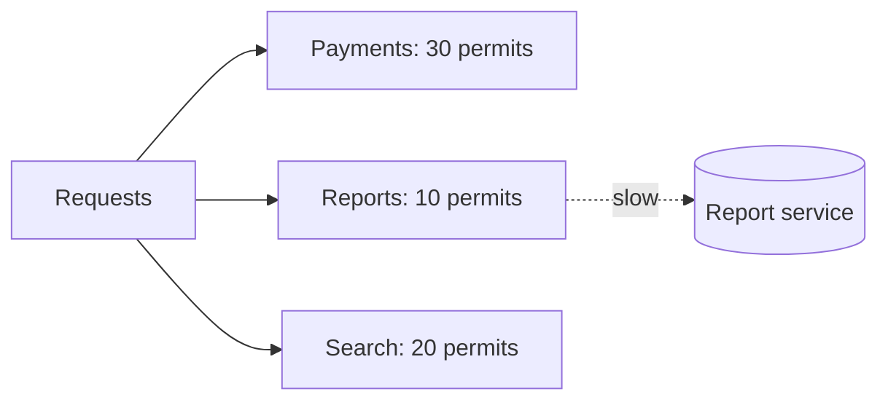

# Bulkhead pattern

---

## 🟢 Junior Level

### Definition

The **bulkhead** pattern isolates parts of a system so that a failure or overload in one part cannot sink the rest. The name comes from ship hulls divided into watertight compartments: a hole floods one compartment, not the whole ship.

In code: give each downstream dependency its **own limited pool** of threads or permits. If the "reports" dependency hangs, it can use up only its own permits; calls to "payments" still work.

### Analogy

A restaurant with separate staff for dine-in and delivery. If delivery orders pile up, dine-in guests are still served.

### Minimal example

```java
@Service
public class ReportService {

    private final RestClient client;

    public ReportService(RestClient.Builder builder) {
        this.client = builder.baseUrl("http://report-service").build();
    }

    @Bulkhead(name = "reports", fallbackMethod = "busy")
    public String build(String id) {
        return client.get().uri("/reports/{id}", id).retrieve().body(String.class);
    }

    String busy(String id, BulkheadFullException e) {
        return "Reports are busy, try later";
    }
}
```

```yaml
resilience4j:
  bulkhead:
    instances:
      reports:
        maxConcurrentCalls: 10
        maxWaitDuration: 0
```

Only 10 calls to `report-service` can run at once; the 11th fails immediately with `BulkheadFullException`.



---

## 🟡 Middle Level

### Two implementations in Resilience4j

| Type | Mechanism | Isolation | Overhead |
| :--- | :--- | :--- | :--- |
| **SemaphoreBulkhead** (default) | Counting semaphore, runs on caller thread | Limits concurrency only | Very low |
| **ThreadPoolBulkhead** | Dedicated `ThreadPoolExecutor` with bounded queue | Concurrency **and** thread-level isolation; caller can time out while the pool thread blocks | Context switches, async result |

```java
@Bulkhead(name = "reportsPool", type = Bulkhead.Type.THREADPOOL)
public CompletableFuture<String> buildAsync(String id) {
    return CompletableFuture.supplyAsync(() -> remote(id));
}
```

```yaml
resilience4j:
  thread-pool-bulkhead:
    instances:
      reportsPool:
        maxThreadPoolSize: 8
        coreThreadPoolSize: 4
        queueCapacity: 20
        keepAliveDuration: 20ms
```

Thread-pool bulkhead methods must return `CompletableFuture`.

### Sizing

Use Little's Law: `permits ≈ target RPS × p99 latency (s) × safety (1.2-1.5)`. For 100 RPS to a dependency with p99 = 200 ms: 100 × 0.2 = 20, so ~25 permits. Too small → rejections under normal load; too big → no protection. Start from measured concurrency (`resilience4j.bulkhead.available.concurrent.calls`).

`maxWaitDuration` lets callers queue briefly for a permit: `0` = fail fast (recommended for user-facing), a few ms smooths micro-bursts, but waiting holds a thread itself.

### Other bulkheads in a Spring system

- **Connection pools per dependency** (separate Hikari pools for OLTP vs reporting DB).
- **Separate Tomcat connectors / executors** for management port (`management.server.port`) so health checks aren't starved.
- **Separate Kafka consumer groups/thread pools** by topic priority.
- **Kubernetes**: resource requests/limits and separate Deployments per workload class; Istio `connectionPool` limits.
- **Virtual threads** make thread-per-request cheap but don't isolate; you still need semaphores.

### Common mistakes

- Single global bulkhead for all downstreams (defeats isolation).
- Bulkhead without timeout: permits are held by hung calls, which is exactly the case it protects from — permits leak until the call returns.
- Handling `BulkheadFullException` as a failure that opens the circuit breaker; rejection from your own limit says nothing about the dependency's health. Add it to `ignoreExceptions` of the breaker.
- Using `@Bulkhead` thread-pool type with blocking `ThreadLocal`-based context (security, tracing, MDC) without propagation.

---

## 🔴 Senior Level

### Internals

`SemaphoreBulkhead` wraps `java.util.concurrent.Semaphore` with `tryAcquire(maxWaitDuration)`; permits release in a `finally`. It publishes events (`CALL_PERMITTED`, `CALL_REJECTED`, `CALL_FINISHED`) and metrics:

- `resilience4j.bulkhead.available.concurrent.calls`
- `resilience4j.bulkhead.max.allowed.concurrent.calls`

`ThreadPoolBulkhead` uses `ThreadPoolExecutor` with `ArrayBlockingQueue`; when the queue is full, `RejectedExecutionException` is mapped to `BulkheadFullException`. Core threads' `keepAliveDuration` governs the shrink behaviour of the extra threads. Default `ContextPropagator` hooks propagate `ThreadLocal` values.

### Adaptive bulkhead

Resilience4j offers an experimental **adaptive** concurrency limiter (`resilience4j-bulkhead` `AdaptiveBulkhead`) in the spirit of Netflix's `concurrency-limits` (AIMD/Vegas/Gradient): the permit count adjusts from observed latency and error rates rather than a static number. It avoids hand-tuning, but verify behaviour under load tests; fixed limits are easier to reason about for most teams.

### Failure analysis scenario

Service X calls Payments (fast, critical) and Recommendations (slow, optional). Recommendations degrades to 30 s latency. Without bulkhead: Tomcat's 200 threads fill with recommendation calls within seconds, checkout fails. With a bulkhead of 15 for recommendations plus a 500 ms timeout and fallback to an empty list: max 15 threads are blocked, checkout is unaffected. Verify by a test with Toxiproxy latency toxic on recommendations while load-testing checkout and asserting its p99.

### Observability and diagnostics

```bash
curl localhost:8080/actuator/bulkheads
curl localhost:8080/actuator/metrics/resilience4j.bulkhead.available.concurrent.calls?tag=name:reports
curl localhost:8080/actuator/bulkheadevents/reports
```

Alert when `available == 0` for over N seconds, or rejection ratio exceeds a threshold. A thread dump (`jcmd Thread.print`) should show at most `maxConcurrentCalls` threads in the guarded client call.

### Virtual threads implications

With `spring.threads.virtual.enabled=true`, Tomcat dispatches each request to a virtual thread, so the "200 thread" natural limit disappears. A slow dependency can now accumulate tens of thousands of blocked virtual threads, exhausting downstream sockets, DB connections, or memory. Semaphore bulkheads become **more** important, not less. Note also that a `synchronized` block around blocking IO pins the carrier thread (fixed in JDK 24 for most cases); prefer `ReentrantLock` on JDK 21.

### Capacity design

Total permits across bulkheads ≤ container concurrency capacity; otherwise bulkheads can't all be filled simultaneously and the isolation is notional. Also size pods so that when one bulkhead is saturated, the remaining capacity still covers the other workloads.

```java
BulkheadConfig cfg = BulkheadConfig.custom()
        .maxConcurrentCalls(15)
        .maxWaitDuration(Duration.ofMillis(20))
        .fairCallHandlingStrategyEnabled(true)
        .build();
Bulkhead bulkhead = Bulkhead.of("recommendations", cfg);
Supplier<List<String>> guarded = Bulkhead.decorateSupplier(bulkhead, recoClient::fetch);
```

---

## 🎯 Interview Cheat Sheet

**30-second pitch:** A bulkhead partitions resources (threads, permits, connections) per dependency or workload so one slow or failing component can't consume everything. Resilience4j offers semaphore bulkheads (cheap concurrency caps) and thread-pool bulkheads (stronger isolation, async). Size them with Little's Law and pair them with timeouts and fallbacks.

**Must-know bullets**
- Isolation per dependency, not global.
- Semaphore vs thread-pool; trade-offs.
- Sizing: RPS × latency × margin.
- `BulkheadFullException` ≠ downstream failure.
- Virtual threads still need bulkheads.

**Follow-up questions**
- Which is better, semaphore or thread-pool bulkhead?
- How does a bulkhead relate to a rate limiter?
- What other bulkheads exist outside Resilience4j?

**Red flags**
- One shared pool for everything.
- No timeout, so permits are held indefinitely.
- Believing virtual threads make limits unnecessary.

**Related topics**
- [Timeouts in distributed calls](09.%20Timeouts%20in%20distributed%20calls.md)
- [Rate limiter](11.%20Rate%20limiter.md)
- [Cascading failures and retry storms](13.%20Cascading%20failures%20and%20retry%20storms.md)
- [Designing for failure](20.%20Designing%20for%20failure.md)
- Microservices: [Section 17](../17.%20Microservices/00.%20Section%20Navigator.md)
