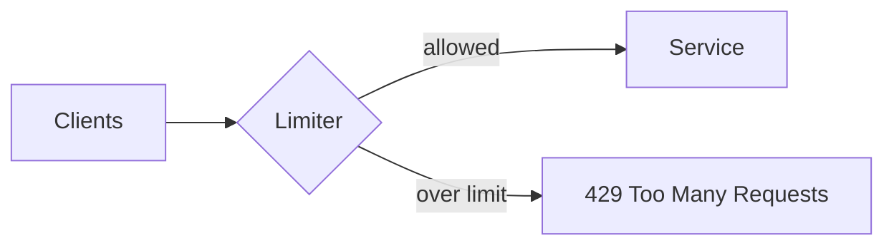

# Rate limiter

---

## 🟢 Junior Level

### Definition

A **rate limiter** restricts how many requests are allowed in a time window. It protects a service from being overwhelmed by too many requests, whether from a misbehaving client, a traffic spike, or abuse, and keeps usage fair across clients.

### Analogy

A nightclub door: only N people enter per minute. Extra guests are told to wait or come back later (HTTP **429 Too Many Requests**).

### Where limits live

| Place | Protects | Typical tool |
| :--- | :--- | :--- |
| **Inbound** (server side) | Your API from callers | Gateway `RequestRateLimiter`, Bucket4j, Envoy |
| **Outbound** (client side) | A third-party API quota or a fragile downstream | Resilience4j `RateLimiter` |

### Minimal example: Resilience4j RateLimiter

```java
@Service
public class SmsClient {

    @RateLimiter(name = "sms", fallbackMethod = "throttled")
    public String send(String phone, String text) {
        // call provider API
        return "SENT";
    }

    String throttled(String phone, String text, RequestNotPermitted e) {
        return "QUEUED";
    }
}
```

```yaml
resilience4j:
  ratelimiter:
    instances:
      sms:
        limitForPeriod: 10
        limitRefreshPeriod: 1s
        timeoutDuration: 0
```

At most 10 calls per second; with `timeoutDuration: 0` extra calls fail immediately with `RequestNotPermitted`.



---

## 🟡 Middle Level

### Algorithms

| Algorithm | Idea | Pros / Cons |
| :--- | :--- | :--- |
| **Fixed window** | Counter reset each period | Simple; allows 2× burst at window edges |
| **Sliding window log/counter** | Counts across moving window | Accurate; more memory |
| **Token bucket** | Tokens refill at rate r, bucket capacity b | Allows bursts up to b, steady rate r |
| **Leaky bucket** | Queue drains at constant rate | Smooth output; adds latency |
| **Concurrency limit** | Max in-flight | See [Bulkhead](10.%20Bulkhead%20pattern.md) |

Resilience4j's `AtomicRateLimiter` is a cycle-based (fixed-cycle) design with permit accumulation and reservation; callers may wait up to `timeoutDuration` for the next cycle's permits.

### Spring Cloud Gateway `RequestRateLimiter`

Redis token bucket (requires `spring-boot-starter-data-redis-reactive`):

```yaml
spring:
  cloud:
    gateway:
      routes:
        - id: orders
          uri: lb://order-service
          predicates:
            - Path=/api/orders/**
          filters:
            - name: RequestRateLimiter
              args:
                redis-rate-limiter.replenishRate: 20
                redis-rate-limiter.burstCapacity: 40
                redis-rate-limiter.requestedTokens: 1
                key-resolver: "#{@apiKeyResolver}"
```

```java
@Bean
KeyResolver apiKeyResolver() {
    return exchange -> Mono.just(
        Optional.ofNullable(exchange.getRequest().getHeaders().getFirst("X-Api-Key"))
                .orElse(exchange.getRequest().getRemoteAddress() == null ? "anon"
                        : exchange.getRequest().getRemoteAddress().getAddress().getHostAddress()));
}
```

`replenishRate` = steady tokens/s, `burstCapacity` = bucket size. Denied requests get 429 plus `X-RateLimit-Remaining` headers. If Redis is down, the default is to **allow** (`deny-empty-key`/fail-open behavior) — decide consciously.

### Bucket4j in a Spring MVC filter

```java
@Component
public class RateLimitFilter extends OncePerRequestFilter {

    private final ConcurrentMap<String, Bucket> buckets = new ConcurrentHashMap<>();

    private Bucket newBucket() {
        return Bucket.builder()
            .addLimit(limit -> limit.capacity(20).refillGreedy(10, Duration.ofSeconds(1)))
            .build();
    }

    @Override
    protected void doFilterInternal(HttpServletRequest req, HttpServletResponse res, FilterChain chain)
            throws ServletException, IOException {
        Bucket bucket = buckets.computeIfAbsent(req.getRemoteAddr(), k -> newBucket());
        ConsumptionProbe probe = bucket.tryConsumeAndReturnRemaining(1);
        if (probe.isConsumed()) {
            res.setHeader("X-RateLimit-Remaining", String.valueOf(probe.getRemainingTokens()));
            chain.doFilter(req, res);
        } else {
            res.setStatus(429);
            res.setHeader("Retry-After",
                String.valueOf(Math.max(1, probe.getNanosToWaitForRefill() / 1_000_000_000)));
        }
    }
}
```

(Bucket4j 8.x fluent API; in-memory only — use its Redis/Hazelcast/JCache modules for cluster-wide limits.)

### Common mistakes

- Limiting by IP behind a proxy: every user shares the proxy IP; use `X-Forwarded-For` carefully (spoofable) or an authenticated key.
- Per-instance limits when you need global ones: 10 pods × 100 rps = 1000 rps.
- Returning 500/503 instead of 429 with `Retry-After`.
- Unbounded key maps (memory leak with unique keys) — use Caffeine with expiry.
- Using the rate limiter as the only DoS protection; do L3/L4 protection at the edge.

---

## 🔴 Senior Level

### Distributed rate limiting trade-offs

| Approach | Accuracy | Latency | Failure mode |
| :--- | :--- | :--- | :--- |
| Local per-pod limit = global/N | Approximate (uneven LB) | None | Wrong when pods scale |
| Central Redis (Lua script, atomic) | Exact | +0.3-1 ms RTT | Redis outage → fail-open/closed decision |
| Sync-batched local tokens (lease N tokens from Redis) | Good | Amortized | Slight overshoot |
| Edge limiting (CDN/WAF/Envoy global rate-limit service) | Exact | At edge | Operational complexity |

Spring Cloud Gateway's Redis limiter runs a Lua script (`request_rate_limiter.lua`) to make token refill/consume atomic across the cluster. At a very high QPS Redis becomes a hot key bottleneck per limit key; shard keys or lease tokens locally.

### Fairness and multi-tenancy

Tiered quotas: key = `tenantId`, limits by plan (free 10 rps, enterprise 500). Use a `RateLimiter` implementation that reads per-key config (custom `RateLimiter` bean for Gateway). Add **priority shedding**: when overall load is high, drop low-priority traffic first, keep health checks and critical paths unlimited.

### Rate limit vs load shedding vs backpressure

- *Rate limiting* is policy-based (per client, fixed quota).
- *Load shedding* is state-based (server drops requests when it is overloaded: CPU, queue depth). Implemented via adaptive concurrency limit or a servlet filter returning 503 when in-flight > threshold.
- *Backpressure* propagates slowness upstream (Reactive Streams demand, bounded queues).

A robust system uses all three; rate limits alone don't help when a single legitimate heavy request pattern overloads you.

### Outbound limiters and quotas

Third-party APIs (payments, SMS) often have quotas. Use Resilience4j `RateLimiter` with `timeoutDuration` > 0 to **smooth** instead of reject (the caller waits up to e.g. 2 s for a permit, holding a thread, so combine with a bulkhead). For long-running quotas (per day), persist counters; in-memory limiters reset at restart.

### Clock and burst edge cases

Fixed-window limiters allow 2×limit across a boundary; token bucket bursts equal bucket capacity. When the limiter refills by wall-clock, NTP jumps affect it; Resilience4j and Bucket4j use `System.nanoTime` (monotonic) for local limits, but Redis-based ones use server time (`TIME` command) in Lua for consistency.

### Observability

Metrics: `resilience4j.ratelimiter.available.permissions`, `resilience4j.ratelimiter.waiting_threads`, plus gateway `spring.cloud.gateway.requests` with status 429 counts. Dashboard: 429 ratio per client key; alert on sudden growth (abuse or a bad deployment of a client retry loop).

```java
RateLimiterConfig cfg = RateLimiterConfig.custom()
        .limitForPeriod(50)
        .limitRefreshPeriod(Duration.ofSeconds(1))
        .timeoutDuration(Duration.ofMillis(200))
        .build();
RateLimiter limiter = RateLimiter.of("partnerApi", cfg);
String r = RateLimiter.decorateSupplier(limiter, partner::call).get();
```

---

## 🎯 Interview Cheat Sheet

**30-second pitch:** A rate limiter caps request volume per time unit to protect a service or respect a quota. Token bucket is the most common algorithm because it allows bursts at a steady average rate. In Spring, use Gateway's Redis `RequestRateLimiter` for inbound, Bucket4j for in-app limiting, and Resilience4j `RateLimiter` for outbound calls; return 429 with `Retry-After`.

**Must-know bullets**
- Token bucket vs fixed window vs sliding window.
- Distributed limiting needs shared atomic state (Redis + Lua).
- 429 + `Retry-After`; fail-open vs fail-closed on limiter outage.
- Key choice: user/API key rather than IP.
- Rate limiting ≠ load shedding ≠ bulkhead.

**Follow-up questions**
- How would you rate limit across 20 pods?
- How do you handle bursts at window edges?
- What happens if Redis is down?

**Red flags**
- Per-pod limits assumed to be global.
- Limiting only by IP behind a NAT/proxy.
- No `Retry-After`, causing clients to hammer.

**Related topics**
- [What is Spring Cloud Gateway](04.%20What%20is%20Spring%20Cloud%20Gateway.md)
- [Bulkhead pattern](10.%20Bulkhead%20pattern.md)
- [Cascading failures and retry storms](13.%20Cascading%20failures%20and%20retry%20storms.md)
- [Tuning resilience in production](21.%20Tuning%20resilience%20in%20production.md)
